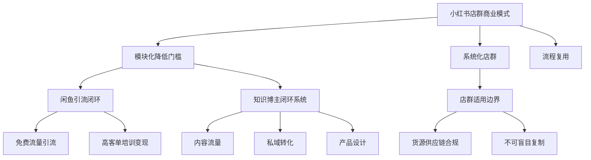
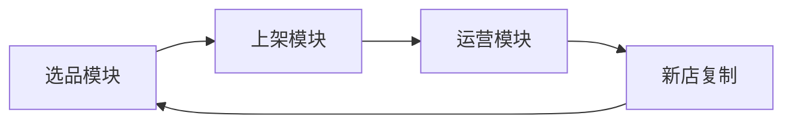
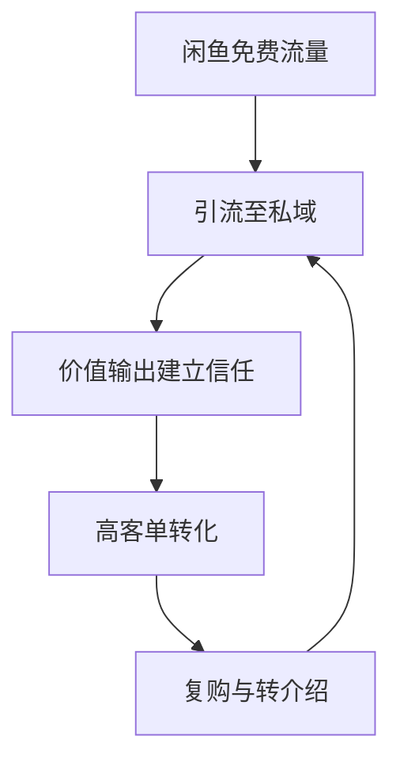
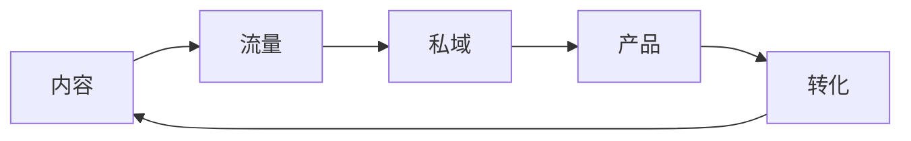

# 第 8 章 平台化变现模式——从单点尝试到系统闭环

## 学习目标

- 理解小红书店群模块化
- 认识店群适用边界
- 掌握闲鱼引流闭环
- 理解知识博主闭环

## 8.1 生活类比

店群模式就像连锁快餐的扩张逻辑：一家门店的出品流程被拆解成标准化的操作手册（选品、上架、客服话术），然后复制到第二家、第三家门店。每家新店不需要从零摸索，只需要照着手册执行，就能快速达到及格线。你不需要成为顶级大厨，只需要把系统搭好、流程跑通，剩下的就是复制粘贴。普通人也能开出一百家店。

## 8.2 概念地图



## 8.3 小红书店群商业模式

> [P001, p.1] "整治无货后高层次玩法"

我们在第 5、6 章讨论的是单店如何起量、如何做内容。但单店的利润是有天花板的——你一天只有 24 小时，一个人只能管好一两家店。**店群**的核心思路是：把"开一家店"这件事从手艺活变成流水线，让同一套方法在多个店铺上同时滚动。

先来看直觉：假设你开一家店，月利润 5000 元。你把选品逻辑、上架模板、客服话术整理成标准作业程序（SOP），雇一个人按 SOP 操作，同时管理 5 家店。即使单店利润因为人工成本摊薄到 4000 元，5 家店的总额也远高于单店。你卖的不是商品，是**可复制的系统**。

这套系统的关键拆解是三个模块：

1. **选品模块**：用同一套数据筛选逻辑（搜索量、竞争度、利润率）批量圈定可上架的商品池；
2. **上架模块**：标题、主图、详情页做成模板，新店直接套用，10 分钟完成上架；
3. **运营模块**：统一的客服话术库、售后处理流程、补单节奏，新人培训 3 天即可上手。

**模块化**的价值体现在"降低门槛"上。素材中反复强调"模块化降低门槛"——这里的门槛是指**人员门槛**，而不是资金门槛。你不需要雇资深运营，只需要能按手册执行的执行者。这就是从手艺（craft）到系统（system）的转变。



这张图展示了店群的**闭环飞轮**：随着店数增加，你积累的选品数据和运营经验越多，新店启动越快；新店又产生新的数据反哺选品模块。

## 8.4 店群适用边界

> [P001, p.2] "平台会整治无货"

店群模式听起来很美好，但它有一个必须正视的**适用边界**。素材里用四个字点破了风险："**平台会整治无货**"。

无货源模式（一件代发）是店群早期的主流玩法——你不需要囤货，用户下单后从上游供应商发货。但平台会通过**货不对板率、发货时效、退货率**等指标识别出这类店铺，然后集中整治。这不是猜测，而是平台规则的底线逻辑：无货源店铺的履约体验通常劣于有货源店铺，平台为了生态健康必然打压。

这里有一个关键的**成本-收益权衡**，我们用表格来看清楚：

| 模式 | 启动成本 | 合规风险 | 可复制性 | 长期稳定性 |
|------|----------|----------|----------|------------|
| 无货源店群 | 低 | 高 | 极高 | 低 |
| 有货源店群 | 中高 | 低 | 中 | 高 |

编辑帮你把这表格读透：**低门槛和低风险，不可兼得**。无货源店群的优势是启动成本低、复制速度快，但它的劣势同样明显——货权不在你手里，供应链不稳定，平台规则一变、整个矩阵就可能一起死掉。

更重要的一个判断是：**店群模式对货源、供应链、合规性的要求极高，不能盲目复制**。素材里强调"整治无货后"的"高层次玩法"——这里的"高层次"指的是，用真实货权、稳定供应链来支撑店群扩张，而不是依赖平台漏洞。也就是说，**比例性比速度更重要**。

让你权衡一下：你的核心竞争力在"选品"和"运营"，还是在"货"？如果在前者，你随时可能被平台规则抹平；如果你控制了货源，你才真正建立了壁垒。

## 8.5 闲鱼引流闭环

> [P002, p.1] "四个月 1.5W 粉变现 25W"

第三个案例讲的是闲鱼平台上的引流闭环，数据非常直观：**四个月做到 1.5 万粉丝，变现 25 万**。你没看错，是 25 万。这个案例的价值不在绝对数字，而在它揭示了一条**免费流量 + 高客单转化**的路径。

先拆解它的商业闭环：

```
1. 在闲鱼发布免费/低价的虚拟资料或咨询服务，吸引目标用户
2. 将用户引导至私域（微信/公众号）
3. 私域内建立信任，通过朋友圈、社群、直播持续输出价值
4. 推出高客单的培训/陪跑服务，完成转化
```

这段闭环的关键在于**每一步都放大前一步的收益**。闲鱼的流量是免费的，但闲鱼本身的客单价很低（几块钱的资料包），真正的价值在私域里被放大——同样的用户，在私域里可以转化为几千块的培训服务。这就是**前端免费引流、后端高客单变现**的双层漏斗。



这个模型在结构上和小红书店群完全不同。小红书店群靠**店铺矩阵的规模效应**赚钱，闲鱼闭环靠的是**用户生命周期价值的深度挖掘**。但两者有一个共性：**都需要一个可复制的引流钩子**。小红书靠上架模板，闲鱼靠内容资料包，知识博主则靠——你现在不必急着知道答案，下一节我们会展开。

## 8.6 知识博主闭环系统

> [P003, p.1] "内容流量私域产品"

第四个素材聚焦知识博主（也就是你自己）的完整闭环：**内容 → 流量 → 私域 → 产品 → 转化**。这个模型看起来和闲鱼案例很像，但有一个关键区别：知识博主的"内容"不是售前的钩子，而是整个商业模式的**核心资产**。

我们把它拆解为标准五步：

```
1. 内容生产：持续输出专业知识/观点，在公域平台获得曝光
2. 流量沉淀：引导粉丝关注公众号/微信，进入私域池
3. 私域运营：通过朋友圈、社群、1v1 建立信任关系
4. 产品设计：设计高价值产品（课程、咨询、训练营）承接需求
5. 转化与迭代：完成第一次付费，再用内容触达新用户

```

这套框架的关键洞察是：**内容不只是引流工具，它是信任的载体**。你在公域写文章，读者不信任你；你告诉他们"我有一套方法论"，他们不会立刻掏钱。但当他们在私域里观察你三个月，持续看到你的输出和案例，信任感自然建立，转化率才会上去。

素材把这一步称为"**可复制的 0-1 框架**"——意思是，这套路径不只适用于你，它可以提炼成一套流程，教给其他人。这恰恰是知识博主最强大的杠杆：**你卖的产品本身就是你创业过程的产物**。你从 0 到 1 的经验，就是你的高客单课程；你做课的过程，又为你的内容池蓄水。



这个循环图展示了知识博主闭环的**自增强特性**：每完成一次转化，你产出的内容就多一份真实案例，案例又成为新的引流内容。

## 8.7 多源对照

三个素材都指向"平台化变现"这个主题，但它们的路径完全不同。下面我们对三个案例做一次横向对照。

### 共识

三者的共识非常一致：**商业模型必须是闭环**。小红书店群是"选品-上架-运营-复制"，闲鱼是"引流-信任-转化"，知识博主是"内容-私域-产品"。任何一个环节的断裂，整个系统都会停摆。另一个共识是：**闭环会产生复利**——你积累的资产（店铺数、信任、内容）不会一次性耗尽，而是持续产生现金流。

### 分歧

分歧的核心在于**壁垒的建立方式**：

- **小红书店群**（[P001, p.1]）依赖**系统化与流程化**作为壁垒——我有一百个标准化的店，你没有，这就是优势；
- **闲鱼闭环**（[P002, p.1]）依赖**私域信任**作为壁垒——流量可以买，但信任关系买不到；
- **知识博主闭环**（[P003, p.1]）则更进一步——壁垒是**内容资产的积累和品牌人格**，这是最难以复制的，但也是**最慢的**。

分歧提示你：**没有通用的最优解，只有与你的资源和禀赋匹配解**。你擅长运营所以适合开三千家店，你擅长内容所以选择做知识博主——关键是找到一个把你的比较优势放大的闭环。

## 8.8 设计中的取舍

你可能会问：店群模式这么赚钱，为什么 8.4 里说不能盲目复制？原因在于**规模与合规的**冲突。店群扩张的每一步都在放大合规风险：店铺越多，被平台识别出批量操作的迹象越明显。所以"更高层玩法"必须后端支持——强大的货源谈判能力、能够快速响应平台规则变化的运营能力，这些都会吃掉利润率。

另一个取舍是：闲鱼闭环和知识博主闭环都依赖**私域**，但私域本身有一个隐藏成本——**精力**。你要运营社群、回复消息、维护朋友圈，这些环节天生无法规模化。如果你想把闭环做大，就必须考虑用工具（SCRM、社群机器人）和团队来分摊这部分成本。真正的商业设计，本质上就是**在可持续和可扩张之间找到平衡点**。

## 8.9 动手练习

- 平台化变现分析

## 8.10 本章小结

这一章我们集中讨论了平台化变现的三条路径——**小红书店群、闲鱼闭环、知识博主闭环**——以及它们背后的共同逻辑：先建立闭环，再通过系统化复制，放大利润。首先，小红书店群的核心是把开店流程模块化，用标准化操作大幅降低人员门槛，形成飞轮；其次，店群模式有清晰的适用边界，无货源玩法必然被平台整治，长期主义者必须回归供应链与合规性；接着，闲鱼闭环展示了免费流量与高客单服务之间的巨大价差，关键在于信任关系的递进；最后，知识博主闭环把内容本身作为资产，形成了全程透明度、复利积累，可复制又可迁移的系统。

本章我们一起学习了以下概念：

| 概念 | 解释 |
|------|------|
| 小红书店群 | 系统化模块化降低门槛 |
| 店群边界 | 对货源供应链合规要求高 |
| 闲鱼引流闭环 | 前端免费流量后端高客单培训 |
| 知识博主闭环 | 内容流量私域产品设计 |

下一章中，我们将离开"平台化变现"的视角，走向 **"个人品牌与影响力"**——聚焦如何通过持续内容输出，完成从流量到信仰的转化。这也是一次升级：从短周期的GMV逻辑，进入周期更长的品牌价值逻辑，进而用真正具有沉淀性的资产来衡量你的创业成果。

