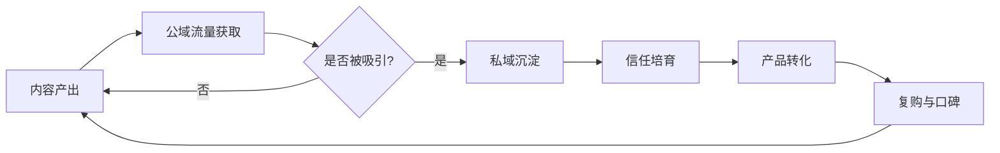

# 第 9 章 个人IP的系统化构建——把内容做成生意

在信息爆炸的时代，单纯的内容创作已难以形成持续的商业价值。本章将带你从"内容创作者"的视角，切换到"产品经理"和"生意人"的视角，探讨如何将个人影响力系统化地构建为一个可运转的商业闭环。我们将拆解知识博主的变现路径，分析新世代商业生态的特点，并最终为你提供一个选择适配变现路径的决策框架。这是一个从"单点内容"到"持续生意"的系统工程。

## 9.1 学习目标

- 理解知识博主变现闭环
- 掌握闭环设计要点
- 认识新世代商业生态

## 9.2 生活类比：把个人IP当作一家"品牌店"

想象一下，开一家属于自己的品牌店。店的**橱窗**（内容是橱窗）陈列着你最吸引人的商品（知识或观点），它的唯一目的是让路过的行人（公域流量）产生兴趣，愿意推门进来。当顾客进店后，你通过真诚的交流、周到的服务（私域运营）来建立信任，促使他们留下联系方式（私域是复购）。当信任足够时，你向他们推荐精心设计的"会员套餐"或"限量产品"（产品转化），从而完成最终的成交。个人IP的构建，正是这样一套从展示、引流、培育到成交的全链路设计，而非孤立的发帖或卖课。

## 9.3 概念地图

```
个人IP系统化构建
├── 知识博主闭环系统
│   ├── 内容（公域引流）
│   ├── 流量（数据增长）
│   ├── 私域（信任沉淀）
│   └── 产品（商业转化）
├── 从单点内容到闭环
│   ├── 钩子内容引流
│   ├── 私域信任培育
│   └── 产品设计收割
├── 新世代商业生态
│   ├── 10后Z世代观察
│   ├── 圈层与语境
│   └── IP变现面对新用户
└── 案例总览
    ├── 横向对比各玩法
    ├── 四象限定位
    └── 选择适配变现路径
```

## 9.4 知识博主变现闭环

> [P001, p.1] "内容流量私域产品"

这句简练的概括，正是知识博主实现商业变现的核心路径。它揭示了个人IP商业化的本质：**内容扮演入口，流量成为过程，私域转为资产，产品达成目的**。这并不是四个孤立的环节，而是一个环环相扣、彼此强化的闭环系统。

我们来拆解这个闭环系统的四个核心模块，它们共同构成一个完整的商业引擎。

> {知识博主闭环系统}**定义**（来源：《个人IP构建》）

```
1. 内容：产出高质量、有观点的内容（文章、视频、音频），触达潜在受众。
2. 流量：通过内容在公域平台（如抖音、小红书、知乎）获取展示和点击，形成流量入口。
3. 私域：将公域流量引导至可随时触达、深度运营的私有领域（如微信群、公众号、企业微信）。
4. 产品：在私域信任基础上，设计并销售课程、咨询服务、社群会员等产品，完成商业转化。
```

这段伪代码展示了知识博主变现闭环的标准流程。其关键在于，**流量并非终点，而是进入私域的起点**。私域中的信任关系决定了产品转化的效率和客单价。这个闭环的威力在于，它让每一份内容输出都在为最终的产品销售积累资产，而非一次性消耗品。

为了更直观地理解这个数据流，我们可以用一张图来表示各要素之间的关系：



这张数据流图清晰地展示了闭环的本质：优秀的**内容**通过公域**流量**筛选出精准用户，**私域**负责将用户关系做厚，最终促成的**产品**转化不仅是终点，其带来的口碑和复购又会反哺新一轮的**内容**创作。这正是"把内容做成生意"的精髓所在。

## 9.5 从单点内容到闭环

仅仅理解闭环的组成还不够，更重要的是掌握如何设计并驱动这个闭环的运转。这一小节的核心，是教你如何将零散的内容发布，升级为一个有战略意图的商业系统。

> {从单点内容到闭环}**方法**（来源：《个人IP构建》）

```
1. 钩子内容引流：设计有话题性、悬念感或强烈价值的"钩子内容"作为公域入口。
2. 私域信任培育：用持续的价值输出、真诚的互动答疑在私域中建立专业与可信赖的形象。
3. 产品设计收割：基于私域中用户的核心痛点，设计精准解决需求的产品服务，并实现转化。
```

这个设计方法的逻辑在于**分步转化**，每一步都在为下一步奠定基础。钩子内容筛选出"潜在客户"，私域培育将其转化为"忠实粉丝"，最终产品收割则是将"忠实粉丝"变为"付费用户"。整个过程由浅入深，层层递进，避免了直接硬广销售带来的高跳出率。

我们用一个表格来对比"单点内容"和"闭环系统"的思维差异，这能帮你更好地理解其设计价值。

| 维度 | 单点内容思维 | 闭环系统思维 |
| :--- | :--- | :--- |
| **目标** | 追求单篇内容的曝光与点赞 | 追求可持续的商业变现 |
| **用户关系** | 观众，一次性消费后离开 | 私域好友，可长期触达和培育 |
| **价值衡量** | 阅读量、播放量、粉丝数 | 私域用户数、信任度、产品转化率 |
| **内容策略** | 追逐热点，随机产出 | 围绕人设和产品规划，有节奏输出 |
| **终局** | 流量过眼云烟，无法沉淀 | 积累私域资产，实现复利增长 |

这个对比让我们意识到，**流量数据只是虚荣指标，而私域资产才是核心引擎**。从单点内容思维到闭环系统思维，意味着你不再为了"火"而创作，而是为了"生意"而构建。

## 9.6 新世代商业生态

当整个商业闭环面向未来时，一个不可忽视的变量是受众的更迭。正如《新世代生态》素材所指出的，我们将面对一群完全不同的消费者。

> [P002, p.2] "小众圈层语言"

观察新一代（如10后、Z世代）消费群体，我们会发现，他们用**小众圈层语言**重新定义了内容消费和品牌认同。他们不再迷恋于泛化的"大V"，而是更愿意信任他们自己圈子里公认的"意见领袖"。这种从"仰视"到"平视"的信任变迁，为个人IP的变现创造了全新的场景。

这要求我们在设计IP时需要做出关键调整，才能在这个新生态中生存和发展。

> {新世代IP变现}**调整方案**（来源：《新世代观察》）

```
1. 融入圈层语境：放弃生硬的"官方腔"，学习和使用目标圈层的"黑话"、梗和表达方式，才能获得入场券。
2. 承认圈层边界：IP不需要讨好所有人，只服务好特定圈层，成为该圈层的"自己人"，反而能获得更高的忠诚度。
3. 共创内容价值：鼓励圈层用户参与内容创作与产品设计，让他们从"消费者"变为"共建者"，增强归属感和付费意愿。
```

这一方法论的转变极具深意。它打破了传统的"意见领袖-粉丝"的单向灌输模式，建立了**"圈层成员-共建者"的平等共创关系**。在算法和货架电商过度饱和的今天，基于圈层信任的IP变现，成为一种难以被算法替代的"信任电商"。

## 9.7 多源对照：案例总览与路径选择

当我们手上既有基础的变现闭环，又有新世代生态的加持时，如何选择适合自己的玩法？这时我们需要借鉴多篇素材中的案例智慧。

> [P003, p.3] "案例总览，横向对比各玩法"
> [P004, p.2] "四象限定位，选择适配变现路径"

**共识**：所有资料来源都同意，不存在普适的最优路径。个人IP的变现路径需要根据自身的**内容禀赋**（擅长做什么）和**资源禀赋**（有哪类粉丝、有何背书）进行匹配。

**分歧**：

- [P003, p.5] 侧重于**产品重模式**。它认为，IP的终极形态是打造高客单价的标准化产品（如训练营、咨询），这要求IP具备极强的专业壁垒和交付能力；
- [P004, p.7] 则侧重于**流量轻模式**。它主张，在IP早期应通过低价或免费的轻产品（如资料包、体验课）快速筛滤用户，以跑通最小化变现闭环，积累案例为后续重产品做准备；
- [P001, p.2] 的核心观点则介于两者之间。它强调**私域信任的模式**。它认为，无论产品轻重，私域内的信任深度决定了转化率，是任何路径的绝对底层基础设施。

由此可见，你在案例图谱中的位置，取决于你是"产品专家"、"流量玩家"还是"关系经营高手"。这三者没有高下之分，只有是否"适配"。

## 9.8 设计中的取舍

- **为什么我们不能直接"卖货"而是要先做"内容"？**
  在信任稀缺的时代，陌生人直接推销是极其低效的行为。内容是建立权威和信任的唯一低成本介质。虽然内容创作的周期长、见效慢（牺牲了短期的变现效率），但它是构建私域信任资产的必经之路，长期来看，其带来的交易成本和获客成本远低于直接投流卖货。

- **私域运营的边界在哪里？**
  很多IP容易把"私域"做成"骚扰"，每天疯狂刷屏。真正的私域运营应克制，以提供价值、解决问题为核心。这个取舍在于：过度打扰能带来短期转化，但会快速透支信任（无形资产）；而通过高质量内容培育出的深度信任，虽然转化周期长，却能带来极高的复购率和转介绍，这是更健康的长期主义策略。

## 9.9 动手练习

- **IP构建分析**（练习编号：1）：请从本章内容中，选择一个你熟悉的头部知识博主（如罗振宇、半佛仙人等），详细拆解其"内容-流量-私域-产品"的变现闭环。分析他的内容钩子是什么，如何引导至私域，私域内提供什么价值，最终以何种产品形态完成收割。最后，尝试用"四象限定位"分析其属于重产品、轻流量或是重关系模式。

## 9.10 本章小结

这一章中，我们系统性学习了个人IP商业化的底层逻辑。首先我们明确了"内容-流量-私域-产品"四位一体的**知识博主变现闭环**，了解了其作为商业引擎的整体运作原理；其次，我们深入探讨了如何从零散的单点内容升级为**从单点内容到闭环**的工程设计，掌握了"钩子引流、私域培育、产品收割"这一套具体的落地方法；接着，我们将视角投向未来，分析了在**新世代商业生态**下，圈层化、语境化带来的新变现机遇与调整方案；最后，我们站在案例总览的宏观层面，通过**横向对比各玩法**，认识到没有唯一的成功路径，关键在于通过定位选择适配自己的变现模式。

本章我们一起学习了以下概念：

| 概念 | 解释 |
|------|------|
| 知识博主闭环 | 内容、流量、私域、产品四环节环环相扣的商业系统 |
| 闭环设计要点 | 通过钩子内容引流、私域信任培育、产品设计收割的三步法 |
| 新世代生态 | 基于小众圈层语言和平等共创关系，IP变现的新商业场景 |

下一章中，我们将基于已建立的个人IP系统，深入探讨如何将这些方法论落实到更具体的日常运维和团队协作管理中。我们将分析当IP度过冷启动阶段后，如何优化内容生产流程、搭建运营团队，以及建立数据化反馈机制，从而实现更为系统和高效的IP资产化管理。

