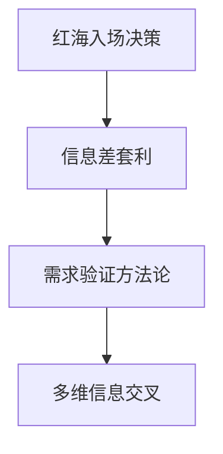

# 第 10 章 利润猎手的入场卷——从信息差到细分需求

## 学习目标

- 理解红海市场入场决策
- 掌握信息差套利
- 掌握需求验证方法

## 10.1 生活类比

信息差就像套利：同样一件商品，在不同市场卖不同的价格，你只要知道哪里便宜、哪里贵，就能低买高卖赚取差价。在商业世界里，这个"商品"可以是信息、认知、资源或服务能力——别人不知道的你知道，别人做不到的你做得到，这中间的落差就是你的利润空间。当你决定进入一个看起来很拥挤的"红海"市场时，真正的机会往往不在正面战场上，而在那些大多数人看不到的缝隙里。

## 10.2 概念地图



## 10.3 红海市场的入场决策

> [P006, p.1] "选址定生死"

"选址定生死"这句话，原本是传统零售业的铁律——店铺开在哪儿，基本决定了生意能不能做起来。我们把它搬到互联网创业里，重新理解一下：**你选择进入哪个细分市场、服务哪类人群、提供什么价值，这个"位置"的选择，决定了你的项目在起步之前就已经赢了一半或输了一半。**
为什么选址能定生死？因为一个市场的竞争格局、用户密度、付费意愿、获客成本，全都藏在"位置"里。

红海市场的入场决策可以拆成三个层次来理解：

**第一层：选址定生死。** 你选的赛道，决定了你面对的是鲨鱼还是小鱼。如果冲进一个巨头林立的红海正面战场，你很可能被碾碎；但如果选在一个巨头看不上、但真实需求存在的细分角落，你就有机会活下来。

**第二层：规避正面竞争。** 不要跟大玩家在同一维度硬碰硬。他们拼资金、拼规模、拼品牌，你拼不起。但你可以拼速度、拼垂直深度、拼服务温度——这些是巨头相对薄弱的维度。

**第三层：差异化生存空间。** 找到一个别人不愿意做、或者做得不好的需求，把它做透。差异化不是"跟别人不一样"，而是"在一个足够小的切口上，做到别人无法替代"。

> 红海市场入场决策**方法**（来源：《利润猎手的入场卷》）

```
1. 画出目标市场的竞争地图，标出主要玩家的位置和优势
2. 找出竞争密度最高的区域，标记为"雷区"
3. 找出竞争稀疏但需求真实的区域，标记为"机会窗"
4. 在"机会窗"内选择一个足够小的切口作为入场点
5. 验证该切口是否有真实的付费意愿后再投入资源
```

这段伪代码展示了如何在红海市场中系统性地找到自己的生存位置。核心逻辑不是"哪里有机会就去哪里"，而是"哪里竞争少且需求真，才去哪里"。

## 10.4 信息差套利模式

> [P005, p.3] "站外推广赚信息差"

这句话来自跨境电商的实战场景：很多卖家只会站内推广，但懂行的人会把站外的流量引进来，赚的就是"别人不知道还有这个渠道"的信息差。我们把它抽象成一种通用的商业模式——**信息差套利**。

信息差套利的本质，是**供需、认知、资源三方面的不对等**：

| 类型 | 表现 | 获利方式 |
|------|------|----------|
| 供需差 | 你知道哪里有需求，别人不知道 | 对接供需，赚取撮合费 |
| 认知差 | 你知道某个渠道/方法有效，别人不知道 | 利用认知领先，先行布局 |
| 资源差 | 你手上有别人拿不到的資源 | 出租或转卖资源，赚取溢价 |

> 信息差套利**定义**（来源：《利润猎手的入场卷》）

$$利润 = 信息差 \times 套利次数 \times 杠杆系数$$

这个公式展示了信息差套利的三个放大杠杆：(1) 信息差的大小决定了单次套利的利润空间；(2) 套利次数决定了你能把这个模式复制多少次；(3) 杠杆系数决定了你是否能用别人的资源放大自己的收益。

中间商的角色在这里特别关键：中间商不是一个贬义词，而是一个"信息枢纽"。他站在供需两端之间，把信息不对称变成自己的利润。服务商逻辑也一样——你卖的不是产品本身，而是"我知道怎么帮你把事做成"的知识和服务能力。

## 10.5 需求验证方法论

> [P004, p.2] "1000个MRR案例"

MRR（Monthly Recurring Revenue，月度经常性收入）是订阅制业务的北极星指标。作者提到"1000个MRR案例"，不是在讲一个数字，而是在讲一种验证方法：**与其猜一个市场需求是否存在，不如去找大量真实存在的小案例来验证。**

这种"收集大量小案例"的方法，本质上是把大样本统计思维用在创业决策上：

```
1. 大量收集细分市场中已存在的、正在赚钱的小项目案例
2. 观察这些案例的共同特征：用户是谁、解决什么问题、怎么收费
3. 如果一个需求已经被多个独立的小项目验证过，说明它是真实的
4. 进一步观察这些案例之间的差异，寻找未被满足的需求缝隙
5. 如果多个案例都在同一个方向上做得不够好，那就是你的机会
```

这段流程说明了需求验证的本质：**不靠感觉，靠证据**。每一个还在赚钱的小案例，都是一个真实的付费信号；当这些信号密集出现时，市场需求的真实性就被验证了。

这种方法论背后有三个支撑点：

- **小案例比大报告更可靠。** 大报告往往是统计平均的结果，小案例是具体到每一个真实用户的行为，后者更能反映真实需求。
- **需求集采的价值。** 当你收集了足够多的小案例，你就能看到它们之间的共性规律，这种"集采"让你的判断从单点案例升级到结构洞级别的洞察。
- **避免自嗨。** 很多创业者死于"我猜用户需要"，而案例验证让你站在已有需求的基础上做增量改进，而不是凭空创造需求。

## 10.6 从案例到决策：多维信息交叉

> [P006, p.5] "多维信息交叉验证"

单一片源的信息都可能有偏，但当多个独立来源指向同一个结论时，可信度就大大提升了。这里的多维信息交叉包含两个层次：

**横向对比行业案例。** 不要只看一个成功项目，而要看同一细分赛道中多个案例的表现模式。它们在什么环节赚钱？它们的获客渠道是什么？它们的客单价落在哪个区间？横向对比能帮你画出这个赛道的"利润地形图"，看清哪些地方利润厚、哪些地方利润薄。

**提炼共性规律。** 当你横向对比了足够多的案例，共性规律就会浮现出来。比如，你发现十个在细分工具赛道成功的项目，有七个靠的是"先免费后付费"的模式——这不是巧合，这是该赛道的结构性特征。

> 多源对照

当我们把 [P006] 的"选址定生死"和 [P005] 的"信息差套利"放在一起时，出现了共识与分歧。

**共识**：两篇素材都认为，成功的入场不是靠运气，而是靠系统性的信息收集和判断。无论"选址"还是"找信息差"，核心都是找到别人没看到的缝隙。

**分歧**：

- [P006] 的视角更倾向**结构性机会**：先选好位置，再在位置上深耕，强调的是赛道选择的决定性；
- [P005] 的视角则更倾向**过程性机会**：机会不是静态的位置，而是动态的信息不对称——你今天赚到了差价，明天别人知道这个渠道后差价就消失了，因此需要不断寻找新的信息差。

这两种视角并非矛盾，而是互补的：结构性机会决定你做不做这个市场，过程性机会决定你能在这个市场里持续赚多久。

## 10.7 设计中的取舍

**为什么不在正面战场硬拼，而是找信息差？**
正面战场的竞争格局往往已经固化，头部玩家的规模效应和品牌壁垒让你很难撼动。信息差套利则让你绕开正面火力，在侧翼找到利润空间。代价是：信息差的时效性很短——一旦你的模式被复制，差价就会消失，因此你必须持续寻找新的信息差，这需要不断的市场扫描和信息收集能力。

**为什么收集1000个小案例而不直接做问卷调研？**
问卷调研问的是"用户说他们需要什么"，而小案例展示的是"用户已经付钱买了什么"。后者是行为的证据，前者只是意图的声明，行为比意图可靠得多。代价是：收集1000个小案例比发一份问卷耗时得多，但这种慢功夫换来的是更高的决策置信度——真正踩过坑的人都知道，选错方向的代价远比调研的耗时要大。

## 10.8 动手练习

- 1. 项目决策分析

## 10.9 本章小结

这一章中我们了解了从"信息差"到"细分需求"的完整入场方法论。首先，我们理解了红海市场的入场决策——选址定生死，规避正面竞争，寻找差异化生存空间；其次，我们掌握了信息差套利模式——利用供需、认知、资源的不对等赚取差价，中间商和服务商都是这种逻辑的典型形态；接着，我们学习了需求验证方法论——通过收集1000个小案例来验证细分市场的真实需求，避免自嗨；然后，我们讨论了从案例到决策的多维信息交叉——横向对比行业案例，提炼共性规律，把单点案例升级为结构性洞察；最后，我们通过设计取舍的分析，理解了为什么信息差套利优于正面竞争，以及为什么小案例验证优于问卷调研。

本章我们一起学习了以下概念：

| 概念 | 解释 |
|------|------|
| 红海入场决策 | 选址定生死规避正面竞争 |
| 信息差套利 | 利用供需认知资源不对等获利 |
| 需求验证 | 收集大量小案例验证市场 |

下一章中，我们将深入探讨如何在验证需求之后，构建可持续的盈利模型，把一次性的信息差套利升级为系统性的商业模式设计。
