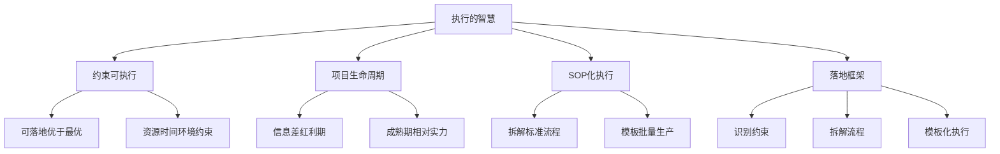

# 第 11 章 执行的智慧——把最优让位于可行

## 学习目标

- 理解约束下可执行
- 掌握项目生命周期阶段
- 学会SOP化执行

## 11.1 生活类比

约束下执行像拼图：在有限碎块中拼出完整的图。想象你面前散落着一堆拼图碎片，它们形状各异、数量有限——你无法选择碎片的样子，也无法决定总共有多少块。你的任务不是设计一幅"理想中的完美图画"，而是在现有碎片的形状、颜色和缺口约束下，把它们拼成一个完整的、可辨识的画面。有时候，一块碎片虽然不完美，但它恰好能嵌入空缺，这就是"可执行"的价值。同理，在项目执行中，我们面对的永远是有限的资源、紧迫的时间和特定的环境——最优方案往往遥不可及，而那个在约束条件下最能落地的方案，才是真正值得投入的。学会在约束中做选择，就是执行智慧的开始。

## 11.2 概念地图



## 11.3 约束下的可执行原则

> [P001, p.5] "约束条件下最可落地方案"

我们先谈直觉：为什么最优方案常常不可行？因为在真实世界中，约束无处不在——预算有上限、时间有期限、团队技能有边界。你设计的"完美方案"可能在理论上最优，但如果它超出了团队的能力范围、超过了资源预算，或者无法在期限内完成，那它就只能停留在纸面上。执行的智慧恰恰在于，**在约束的边界内找到最可行的选项**。

**约束可执行**定义（来源：《执行的智慧》）

$$
\text{可行解} = \{s \in S \mid s \text{ 满足全部约束 } C\}
$$

$$
\text{最优可行解} = \arg\max_{s \in \text{可行解}} U(s)
$$

第一个公式定义了"可行解"的集合——所有满足资源约束、时间约束和环境约束的方案所构成的集合。这个公式展示了约束如何像一个筛子，把理论上可能但实践上不可行的方案过滤掉。

第二个公式说明了执行的核心逻辑：我们不是在全部方案空间 $S$ 中寻找最大值，而是在可行解集合中寻找最优。这个公式展示了"最优"和"可执行"之间的从属关系——**可执行是前提，最优是目标**。

让我们用一个具体例子来感受这一点。假设你的任务是策划一场线上发布会：

| 约束类型 | 具体限制 | 对方案的影响 |
|---------|---------|------------|
| 资源约束 | 预算 5 万元 | 排除高价嘉宾邀请方案 |
| 时间约束 | 两周内上线 | 排除多节点线下活动方案 |
| 环境约束 | 目标用户习惯短视频 | 选择短视频平台优先分发 |

在这个约束集下，最优方案可能是邀请头部 KOL 线下造势，但它的成本远超预算；最可行的方案反而是分阶段推广：先用中小博主铺量，再利用已有用户社群放大传播。它虽然不是理论最优，但它是唯一能在约束内落地的方案——这正是"可落地优于最优"的实践含义。

## 11.4 项目生命周期适配策略

> [P001, p.6] "信息差红利期成熟期"

如果说上一节讨论的是"在约束下做什么选择"，那么本节要讨论的是"在不同阶段用什么策略"。项目从诞生到成熟，会经历不同的生命周期阶段，每个阶段的竞争格局、信息透明度和成功要素都不同。

**项目生命周期**定义（来源：《执行的智慧》）

$$
\text{阶段策略} = f(\text{阶段特征}, \text{团队实力})
$$

$$
\text{阶段特征} = \langle \text{信息差程度}, \text{竞争密度}, \text{用户成熟度} \rangle
$$

第一个公式展示了策略的本质：它不是一个固定的方案，而是阶段特征和团队实力的函数。这个公式告诉我们，策略不是静态的，它必须随阶段的变化而调整。

第二个公式给出了阶段特征的三个维度——信息差程度（有多少人还不了解这个机会）、竞争密度（有多少同类产品在争抢）、用户成熟度（用户是否已经建立了选择和比较的标准）。这个公式展示了判断项目所处阶段需要观察哪些关键信号。

我们把项目生命周期分为两个典型阶段来理解策略的差异：

| 阶段 | 核心优势来源 | 策略重点 | 案例说明 |
|------|------------|---------|---------|
| 红利期 | 信息差（我知道而你不知道） | 快速占领市场、跑马圈地 | 早期短视频平台，先入场者凭内容稀缺性迅速积累用户 |
| 成熟期 | 相对实力（我能做得比你更好） | 精细化运营、差异化竞争 | 赛道拥挤后，靠内容质量、算法推荐、服务体验拉开差距 |

在**红利期**，你赢在"你比别人更早知道"和"你比别人更快行动"。这时候的策略重点是速度和覆盖——单价很低的新产品、尚未被人注意到的细分人群，都是信息差带来的红利窗口。在**成熟期**，信息差已经消失，所有人都在做同样的事，这时唯一的差异化来源是你的相对实力：你的团队更强、你的流程更优化、你的执行更极致。

需要特别强调的是，这两个阶段的划分不是一劳永逸的。项目在不同子市场、不同用户群中可能处于不同阶段——在城市市场可能已经成熟，在县域市场可能仍在红利期。因此，适配策略需要基于**场景细分**来动态判断，而非对整体项目做一个静态归类。

## 11.5 SOP化执行

> [P001, p.7] "视频剪辑SOP"

前面两节讨论了"选择什么"和"什么时候选择"，本节进入执行的核心问题："怎么把一件事稳定地做好"。答案其实很朴素——把非标准的工作拆成标准的流程，用模板批量生产质量稳定的产出。

**SOP化执行**定义（来源：《执行的智慧》）

SOP（Standard Operating Procedure，标准操作程序）化的本质，是把一个依赖个人经验的工作，拆解为一系列步骤固定、质量可预期、任何人按流程执行都能达到及格线的操作单元。

```
1. 将工作拆解为可重复执行的步骤
2. 为每个步骤定义明确的输出标准
3. 将步骤组合为模板（含参数位，可替换变量）
4. 用模板批量执行相似任务
5. 通过反馈持续迭代模板
```

这段伪代码展示了 SOP 化的核心循环：从拆解到标准化，再到模板化批量生产，最后通过反馈不断优化模板。这个过程的关键在于，它把"每一次都从零开始"的思维，转变为"每一次都在既有基础上微调"的思维。

用一个视频剪辑的例子来说明。非 SOP 的做法是：拿到素材后，剪辑师凭感觉决定节奏、转场和配乐，每次都是全新的创作，质量高度依赖个人状态和经验。SOP 的做法是：

| 步骤 | 操作 | 输出标准 | 模板参数 |
|------|------|---------|---------|
| 1 | 素材粗剪 | 时长控制在目标值的 ±5% | 目标时长 |
| 2 | 节奏调整 | 每段落保持 2-4 秒镜头切换 | 风格（快节奏/慢节奏） |
| 3 | 配乐适配 | 背景乐与画面情绪匹配 | 音乐库标签 |
| 4 | 字幕校对 | 字幕准确率 100% | 字体模板 |

这样做的直接收益是**下限被大幅抬高**——即使是一个新手，按流程走也能产出及格的作品；同时，因为模板已经解决了 80% 的重复性决策，执行者可以把精力集中在剩下的 20% 创造性工作上。SOP 化的深层意义在于：它是将个人能力转化为组织能力的桥梁，让"优秀的执行"不再依赖某一位天才，而成为可复制、可传承的系统能力。

## 11.6 多源对照

当"从约束到流程的落地框架"同时出现在两篇素材中时，我们需要对照它们的异同，以更全面地理解框架。

### 从约束到流程的落地框架

> [P001, p.5] "约束条件下最可落地方案"
> 
> [P002, p.7] "视频剪辑SOP"

将这两段素材结合，可以提炼出一个完整的落地框架——第一步识别约束，第二步拆解流程，第三步模板化执行。这个框架的本质，是将"约束可执行"的判断标准和"SOP化执行"的方法论衔接起来：先明确边界（约束是什么），再规划路径（如何走通），最后固化能力（如何重复走通）。

### 共识

**两者都承认约束是执行的起点**。第一篇素材强调"最可落地"必须在约束内寻找；第二篇素材中的 SOP 化执行同样默认了资源和时间的有限性——模板化的目的就是在有限条件下保证稳定产出。两者的共识是：**执行不是从理想出发，而是从约束出发**。

### 分歧

| 素材 | 视角 | 关注焦点 | 方法论侧重 |
|------|------|---------|-----------|
| [P001, p.5] | 决策视角 | 在约束中选择方案 | 判断"什么可选" |
| [P002, p.7] | 执行视角 | 在流程中稳定产出 | 规范"怎么做好" |

**分歧点在于方法论的重心**。第一篇素材更关注"选"——在约束边界内做取舍，它提供的工具是判断标准；第二篇素材更关注"做"——如何把工作拆解成标准流程，它提供的工具是操作模板。单看任何一篇都只是框架的一半：只有"选"没有"做"，方案停留在纸面上；只有"做"没有"选"，执行可能朝着错误的方向高歌猛进。将两者结合，才构成从约束识别到流程落地的一个完整闭环。[需要补充文献：两篇素材缺乏对"如何评估约束是否可变"这一问题的直接讨论]

## 11.7 设计中的取舍

### 为什么不用"最优方案"而是"可落地方案"？

追求最优方案看起来很合理——既然决策，为什么不尽善尽美？问题在于，最优方案需要充足的信息和充足的资源来支撑，而这恰恰是大多数项目所不具备的。当你为寻找最优方案而花掉更多时间和预算时，你可能已经错过了执行的最佳窗口。可落地方案虽然"次优"，但它能立刻启动、马上行动，让你在行动中积累真实反馈，为下一轮迭代提供数据。这个取舍的本质是：**用方案的部分完美，换取执行的全部速度**。

### 生命周期策略的边界在哪里？

信息差红利期的策略是"快"，成熟期的策略是"精"，但这个二分法有一个隐含假设——你的对手也遵循同样的逻辑。如果竞争对手在红利期就用精细化打法，或者在成熟期靠信息差切入细分市场，那么简单的阶段分类就会失效。这就意味着，阶段适配不是一次性判断，而需要持续观察市场反信号，动态调整策略。取舍的本质是：**用框架加速决策，但保留对异常信号的敏感度**。

### SOP化会不会扼杀创造力？

一个常见的担忧是：把工作变成标准流程，会不会让执行变得机械、失去创造力？答案是：取决于你把模板当作"上限"还是"地板"。如果模板是上限，那么创意确实被压缩；但如果把模板当作保证质量的地板，你的执行力就得到了解放——那些重复性决策不再消耗你的注意力，你反而有更多精力投入真正需要创造力的部分。取舍的本质是：**用非关键环节的标准化，换取关键环节的专注度**。

## 11.8 动手练习

1. **执行框架设计**：选取你正在负责或熟悉的一个项目，按"识别约束→拆解流程→模板化执行"三步框架，设计完整的执行方案。具体包括：(a) 列出至少 5 项实际约束（资源、时间、环境）及其边界值；(b) 将项目主流程拆解为 5-8 个可重复的步骤，并为每一步定义输出标准；(c) 为其中至少 3 个步骤设计可填参数的模板，说明模板如何随反馈迭代。

## 11.9 本章小结

这一章中我们学习了执行的智慧——把最优让位于可行。我们首先理解了约束下可执行原则：在真实项目中，可落地方案永远优于理论最优，资源、时间和环境构成的约束边界决定了我们的选择空间；其次讨论了项目生命周期的适配策略，在红利期靠信息差快速占领市场，在成熟期靠相对实力进行差异化竞争，且需基于场景细分动态判断所处阶段；接着学习了 SOP 化执行的方法论，将非标准工作拆解为标准流程，用模板批量生产稳定输出；最后，我们将"约束识别"与"流程拆解"结合起来，形成了从约束到流程的完整落地框架——识别约束、拆解流程、模板化执行。

本章我们一起学习了以下概念：

| 概念 | 解释 |
|------|------|
| 约束可执行 | 可落地方案优于最优方案 |
| 生命周期 | 信息差到成熟期不同策略 |
| SOP化执行 | 非标准工作拆为标准流程 |

核心行动建议：下一个项目启动时，先花 30 分钟列出你的约束清单，再问自己——"在边界内，哪个方案最快启动、最稳落地？"然后，把第一步拆成三个标准动作，开始执行。做完之后，把流程写下来，你就拥有了第一版可复用的 SOP。

下一章中，我们将进入"复盘与迭代"的智慧——如何从已执行的方案中提取经验、识别改进空间，并在下一轮循环中把执行力提升到一个新高度。执行的终点，正是复盘的起点。
