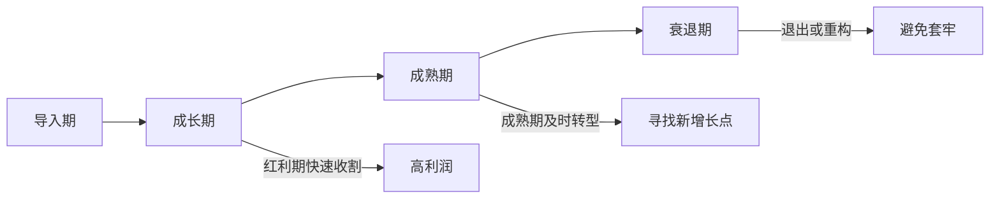
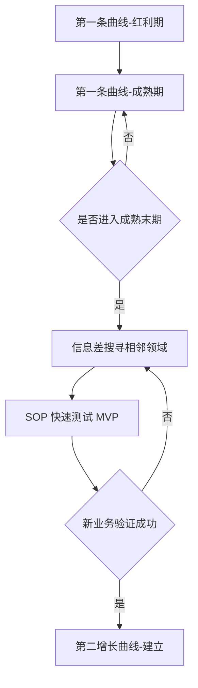

# 第 12 章 财富阶梯进阶——从掘金新手到生态玩家

## 学习目标

- 理解利润随生命周期迁移
- 对比执行者与架构师
- 掌握第二曲线策略

## 12.1 生活类比

财富阶梯就像爬楼，但大多数人只是在自己所在的楼层里原地踏步。想象一下，一栋楼里，执行者是搬砖工，每天靠出卖体力和时间换取工钱；架构师是盖楼者，他们设计图纸、搭建框架、组建团队，让整栋楼拔地而起。搬砖工的收入天花板取决于一天能搬多少砖，而盖楼者拥有整栋楼的价值。更关键的是，楼会随着时间老化，某一层的租金会下降——这就是生命周期。聪明的玩家不会死守一层，而是不断向上攀爬，甚至跳去盖第二栋楼。本章我们将走完这条财富阶梯：从理解利润的生命周期迁移，到完成从执行者到架构师的维度升级，最后用"组合拳"打出第二增长曲线。

## 12.2 概念地图

- 生命周期与利润迁移
- 执行者到架构师
- 组合拳第二曲线

## 12.3 生命周期与利润迁移

> [P006, p.1] "利润生命周期迁移"

**素材引用**：以下内容来源于《20230905_06.md》。

在商业世界里，利润并不是均匀分布在一个产品或行业的整个生命周期中的。我们可以把生命周期划分为导入期、成长期、成熟期和衰退期四个阶段。不同阶段，利润的来源、厚度和可持续性各不相同。理解这一点，就像理解四季更替一样——春天的播种是为了秋天的丰收，而冬天来临前必须完成转型。

> **生命周期利润迁移**定义（来源：《20230905_06.md》）

$$
\begin{aligned}
\text{红利期} & \rightarrow \text{快速收割阶段} \quad (\text{利润率高，竞争少}) \\
\text{成熟期} & \rightarrow \text{及时转型阶段} \quad (\text{利润率下降，竞争加剧}) \\
\text{衰退期} & \rightarrow \text{退出或重构} \quad (\text{利润趋零，必须撤退})
\end{aligned}
$$

这个公式展示了利润随生命周期阶段的迁移规律。它的核心含义是：同一项业务，在不同时期给你带来的利润回报是截然不同的。红利期是"快鱼吃慢鱼"的窗口期——市场稀缺、竞争少、用户急需，此时你的利润率最高，应该集中资源快速收割，而不是犹豫观望。成熟期则是"红海"阶段——大量玩家涌入，同质化竞争导致价格战，利润率被持续摊薄，此时你需要的是"及时转型"的决断力。

我们来看一个具体的例子。假设你在早期发现了一个细分市场需求（比如零糖饮料），在导入期和成长期，你是市场上的稀缺供给者，毛利率可能高达 60% 以上。但一旦大品牌入场，供应链成熟，竞品井喷，毛利率会迅速跌至 10% 甚至更低。如果你在第一个阶段没有完成资本积累和品牌建设，第二个阶段就会非常被动。

> **生命周期利润迁移**方法（来源：《20230905_06.md》）

```
1. 判断当前业务所处的生命周期阶段
2. 红利期：集中全部资源，快速扩大市场份额，最大化收割利润
3. 成熟期：淡出价格战，寻找新的利润增长点，及时转型
4. 衰退期：果断撤出或重构业务模式，避免被套牢
```

这段伪代码展示了如何在生命周期不同阶段采取差异化策略。它的核心逻辑是"顺势而为"——不对抗周期，而是在每个阶段做该阶段最正确的事。



## 12.4 从执行者到架构师

> [P015, p.1] "执行者架构师"

**素材引用**：以下内容来源于《20230905_15.md》与《20230905_55.md》。

当你能稳定地通过某个业务赚到钱时，你会面临一个关键的维度选择：继续当执行者，还是升级为架构师？执行者与架构师的根本区别，不在于做的事情多少，而在于商业维度的高低。

> **执行者与架构师**定义（来源：《20230905_15.md》《20230905_55.md》）

$$
\text{执行者} = \text{卖时间} + \text{卖精力} \quad (\text{线性收入，有天花板}) \\
\text{架构师} = \text{建系统} + \text{卖体系} \quad (\text{指数收入，可复制})
$$

这个公式展示了两种角色的本质差异。执行者的收入模型是线性的：一份时间换一份钱，停止工作就停止收入，天花板就是每天可支配的 24 小时。架构师则不同——他构建的是一个系统，这个系统包含流程、团队、工具和品牌，即使他不在现场，系统依然在运转、在创造价值。这就是从"卖时间"到"建系统"的维度跃迁。

我们用一个对比表来看清楚两者的差异：

| 维度 | 执行者 | 架构师 |
|------|--------|--------|
| 收入模式 | 线性（时间换钱） | 指数（系统创造价值） |
| 时间依赖 | 高（停止即收入停止） | 低（系统自运转） |
| 可复制性 | 低（个人技能） | 高（流程可复制） |
| 商业维度 | 单一（做一件事） | 复合（设计一套玩法） |
| 天花板 | 受限于个人时间 | 几乎无限 |

> **执行者到架构师跃迁**方法（来源：《20230905_55.md》）

```
1. 识别自己当前的角色定位（执行者 or 架构师）
2. 将日常重复工作流程化（SOP），减少对个人的依赖
3. 将核心能力抽象为可复制的系统或产品
4. 逐步放权，从"做"转向"管"和"设计"
5. 最终实现"人不在场，系统照转"
```

这段伪代码展示了从执行者到架构师的跃迁路径。第一步是自我认知——诚实评估自己当前的角色；第二步到第四步是逐步将个人的能力"系统化"，让自己从具体事务中抽离出来；最后一步是验证标准——当你在度假时业务依然正常运转，你才算真正完成了这个跃迁。

## 12.5 组合拳策略与第二曲线

> [P006, p.2] "组合拳策略"

**素材引用**：以下内容来源于《20230905_06.md》《20230905_55.md》与《20230905_11.md》。

完成了从执行者到架构师的跃迁后，你还需要面对一个残酷的事实：任何单一业务的利润最终都会随生命周期走向萎缩。即便你是架构师，如果只握有一条曲线，终将遭遇增长瓶颈。破局之道在于"组合拳"——将多种策略叠加使用，在第一条曲线衰落之前，提前布局第二条曲线。

> **组合拳策略**定义（来源：《20230905_06.md》《20230905_55.md》《20230905_11.md》）

$$
\text{组合拳} = \text{信息差} + \text{SOP 系统化} + \text{生命周期管理} \\
\text{第二曲线} = f(\text{组合拳}, \text{相邻领域扩展})
$$

这个公式展示了第二曲线的生成机制。信息差让你在早期发现别人没看到的机会；SOP 系统化让你能够快速复制成功模式，降低边际成本；生命周期管理则告诉你什么时候该从第一条曲线切换到第二条曲线。三者叠加，就像拳击手打出的组合拳——单拳固然有力，但连击才是制胜关键。

我们来拆解一下这三个要素的具体作用：

- **信息差**：当你掌握别人不知道的信息（政策红利、市场空白、新兴平台），你就拥有了先发优势。信息差是第二曲线的起点，它给了你一个"红利期"的时间窗口。
- **SOP 系统化**：信息差带来的红利是短暂的，别人会迅速跟进。SOP 把你的成功经验固化成标准操作流程，让你能够在竞争对手模仿之前，快速复制出多个利润单元。
- **生命周期管理**：核心是"时机"——在第一条曲线还在成熟期时，就要开始布局第二条曲线。如果等到第一条曲线进入衰退期再行动，就晚了。

> **第二曲线布局**方法（来源：《20230905_11.md》）

```
1. 复盘当前业务，确认处于生命周期哪个阶段
2. 若接近成熟期，启动信息差搜寻，锁定相邻领域的空白机会
3. 用已验证的 SOP 快速测试新业务（MVP）
4. 新业务验证成功后，加大投入，形成第二增长曲线
5. 在第一条曲线仍有余力时，完成资源切换
```

这段伪代码展示了第二曲线从发现到落地的执行流程。关键洞察是"提前"和"相邻"——第二曲线不是从零开始的天马行空，而是基于第一曲线积累的能力与资源，向相邻领域自然延伸。这样，你既能降低探索风险，又能最大化复用已有系统的杠杆。



## 12.6 多源对照

### 共识

三篇素材共同指向同一个核心观点：**利润不是静止的，而是随生命周期流动的**。无论是《20230905_06.md》中"利润随生命周期迁移"的原始提法，还是《20230905_55.md》中"从卖时间到建系统"的维度升级，都在强调一个事实——单一模式无法支撑长期增长，主动转型是不可避免的。

### 分歧

- 《20230905_06.md》强调的是"何时转型"——利润生命周期迁移，核心是**时机判断**，主张在成熟期就要启动转型；
- 《20230905_55.md》强调的是"怎么转型"——执行者到架构师，核心是**系统建设**，主张通过 SOP 和系统化脱离卖时间的泥潭；
- 《20230905_11.md》则补充了"往哪转"——第二曲线必须来自**相邻领域的扩展**，不能随意跳到完全陌生的行业。

三者视角不同但互补：时机、能力和方向，缺一不可。

## 12.7 设计中的取舍

- **为什么不能永远固守一个业务？**  
  因为任何业务的利润都会随生命周期衰退。当你看到利润开始下滑时，竞争者往往已经涌入，你的差异化优势正在丧失。固守一个业务，等于把自己的命运绑定在一个不可逆转的下行曲线上。

- **从执行者到架构师的最大代价是什么？**  
  架构师需要"放权"，这意味着对具体事务的控制力下降。许多从执行者起步的人，最大的心理障碍是不信任他人能像自己一样把事情做好。但如果你不放手，你就永远只是高级执行者，系统永远无法脱离你独立运转。

- **第二曲线应该提前多久布局？**  
  过早布局，会分散你对第一条曲线的资源投入，影响当前利润；过晚布局，第一条曲线的下滑会拖垮你的现金流，新业务没有足够的资金支持。合理的节奏是在第一条曲线进入成熟期的中后段启动探索，保持"两条腿走路"。

## 12.8 动手练习

- 财富路径规划：请列举你当前最主要的收入来源，判断它处于生命周期的哪个阶段，并规划一条可能适合你的第二曲线方向。要求写出具体的时间节点和资源分配方案。

## 12.9 本章小结

这一章中我们学习了财富阶梯进阶的三层核心内容。首先，我们讨论了**利润生命周期迁移**——利润并非均匀分布在业务全周期，红利期要快速收割，成熟期要及时转型；其次，我们对比了**执行者与架构师**——前者卖时间、收入线性增长，后者建系统、收入指数增长，跃迁的关键在于将个人能力流程化、系统化；接着，我们掌握了**组合拳策略与第二曲线**——通过信息差发现机会、SOP 快速复制、生命周期管理把握时机，在第一条曲线衰落前布局相邻领域的新增长点。

本章我们一起学习了以下概念：

| 概念 | 解释 |
|------|------|
| 生命周期利润迁移 | 利润随生命周期阶段改变 |
| 执行者到架构师 | 从卖时间到建系统的维度升级 |
| 组合拳第二曲线 | 信息差加SOP加生命周期管理开拓第二增长曲线 |

下一章中，我们将把这些商业策略落实到具体的行动框架中，探讨如何在真实环境中一步步构建你自己的商业系统。财富阶梯不只是一套理论，更是你可以日复一日执行的行动指南。
