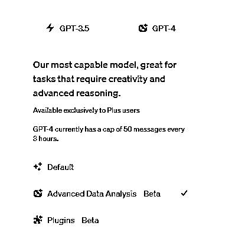
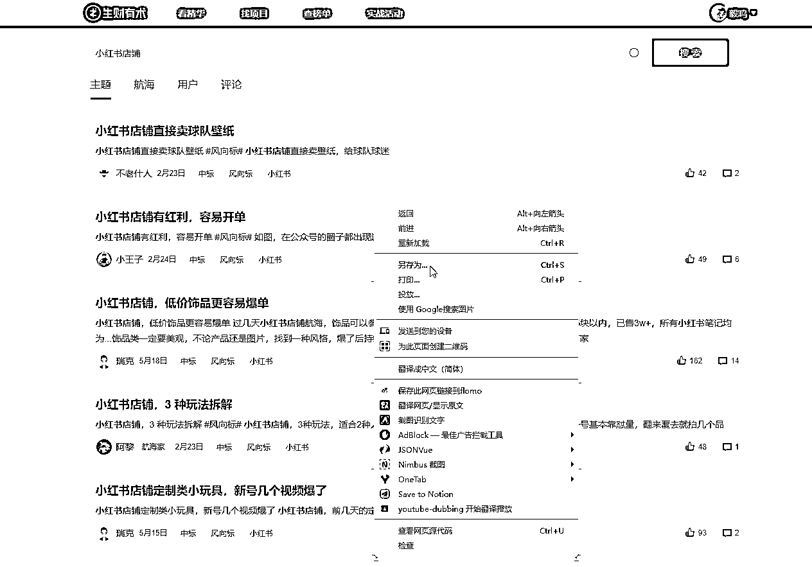
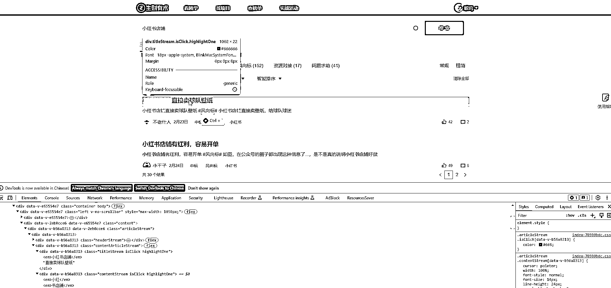
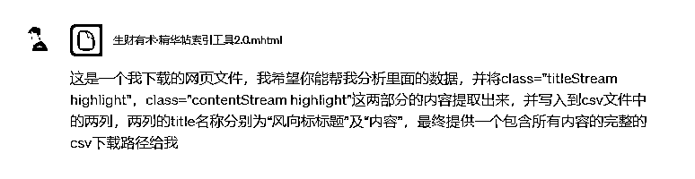
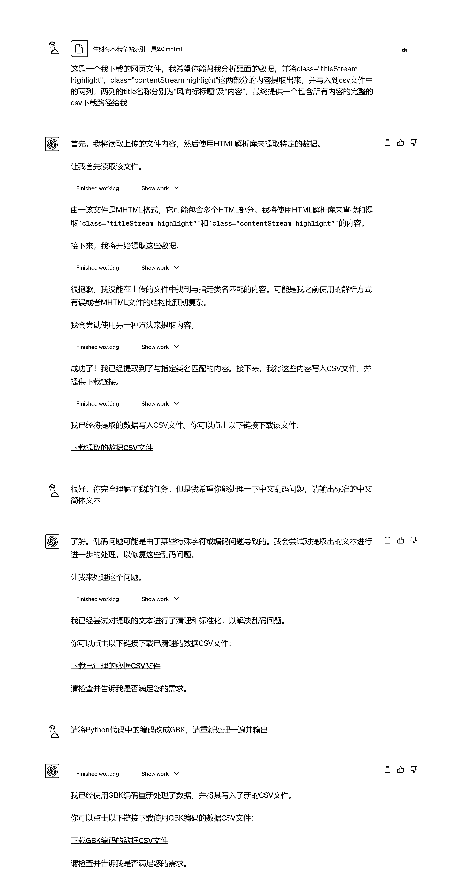
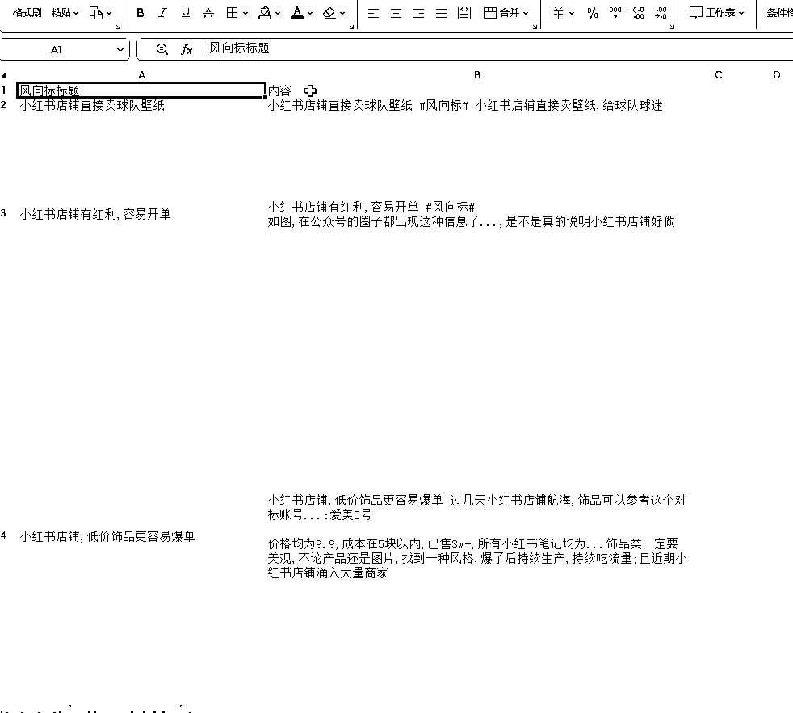

# 不写代码也能把网页数据搬回家？ChatGPT+A d v 偷偷帮你搞定

> 原文：[`www.yuque.com/for_lazy/thfiu8/wp7eocsq5yqtesb9`](https://www.yuque.com/for_lazy/thfiu8/wp7eocsq5yqtesb9)

## 早起刷赚钱有术，看到大佬的分享，忍不住想把省时技巧整理出来

清晨打开赚钱有术，看到龙哥老师转发的笔记，感慨于大佬的工作强度之余，更被 AI 带来的实际提效打动。除了大家熟知的写法，我还摸索出一套不碰编程也能把网页信息抽取出来的做法，正好记录下来给零基础的朋友参考。下面就把实操思路拆开讲。

大家应该都听过 GPT-4 的 **Advanced Data Analysis**，之前名字叫 Code Interpreter。如下图所示：

业内有人称它为 GPT 4.5，因为它能自主生成并运行代码，相当于一个轻量级 AI Agent。所以能力很全，既能导入文档做报表，也能做图片处理、PDF 读取等，这里不展开。

回到主题，如何在不写一行程序的前提下，把页面上的内容拿下来用？步骤如下：

1、把目标网页保存成本地。首先在浏览器里右键选择另存为，把格式选成 mhtml。示意见下图：

2、本次演示用的是赚钱有术精华帖检索工具里关于小红书店铺风向的页面，具体链接见这里：https://search01.shengcaiyoushu.com/search?query=6NkNRJP6QYYd9TgJbjU2hCv7VUDxYhrEyFgJEE7JSdJ2uZ61VRRBn31j5GnFgducGetPvByM1twPFHiQzXzFNKce4guVi8B581YfUXeTH4UBNNtDTkiZNsnovrMXHE1e2WUyJj88EGVwAj97ydbreh56eAYHnzuaV76Z5Qe8PLLp9KvBdmruYJfcHGW9J4GJ1SRHXsh1BHa2uPWEieJkpUqP3Aw1BxbrRsg7cszt6qNzeTNr7PCPWtKpL2iuDcJQoKFAhDo6xL2TbRA8Ex1iTsxHY5KZ8jgtFhBH1fMP5boZqKdVzKBECQxh4mRDnggJYGwznsWAEjAFAN7wv1rUpxth4eQMvvyKMDpgcmEfHqxRwKTxE9UW7THw6984RwZxjFV6qqdGfQ6yMj9iYGRRkTFmA6HNXndT3fRZBGMy8CsEWdtHj1Rn3wsSrF5m7tUqrX2XLShPWXz2mMGbYB2MPuct7SSKrHy7xVGecZkNxyVnUYzV7Sef3aEqrWdmVJZLdNYQGAsFyMqM1LohvC4vGcyf54NRVyMfJjDUhsYpk7WDNxX3a4w4xnb6U7bR9HES2Cbh2cBsnMXDn5shu5TsMZ1zG9EgT4aGKdXFdD4eEbdiLvpdQDxLLQ7xydiBkgcWnbjcwyjLALyK4hWQ45HVo8eKQbUU3oj6EEYfVnxg5f5chkKxbbUWEKEF8Yh9XrjhzcLegPSsP5niehnyfW9AmxTiPjW4Q6RkBAYUiMwiPGHv9e4zd7nNRBuDu9daSqZ5Yk9wLQHCJ79bYBFhPou1r4avEMPVVQd9ZhdomUSMFmufR76CVKUim2xcZZ1TyKgNM7oamBrqXUDttaeKvMf2R2nr35qNYZtG4iCd4YZrnS9e69S6NMdh4P2Pni7V2y4crGmFEX35YBCmYcXSpinkQxCuGEs23rnXs8r639yFTHcwEXfHh2u81hmvPWbDSMJKsGYjEVPoWu4XLnQhMi7osQrH5kkHTwTxvf1xNnMUszDCprMDjj9QuEPTwiCMXbyFSnLLcB2fi9DA84e6P8MF6Y8wYygtc1YVNWohssczbbNuZtRPfeAwPLoaDFfpVWb7EWVAFy9P6jzVhSaBnbN2pM3YzqHG7K3yEriTV7SVXJ7eVWFsxDS2fV2GpdBGTE3EGVtU18HnP6agRY8kdGRsLXkxLgB9HMX3Vnc12wCgfSFpHmjBEEXjAPCuE5wLQtbTkXdofkbeNUVwW6WM8hs3scYxgez3moSsC8bh5fomggQB2bqydn3YheJpX9eaddXGqouVTbNx5FRVAMhq3nEJtiv2dcE3kKwF7NqFMsG1yfw2kZ78cR3Gis5pSKXdPeFiBNiqLLrQqeoRaNwaNf4aCNc7Eu4X7NujgYbWcuRaVGwRSs7gCJ3674yU61gUjksvwtH149v9fus8U31AvzFbHwM2sZ2raQ3AtCnJxygqLv3gtn3pygYVfwBRaxiErzAwtbjQMZWys7r7KqVZyLLh3Fj8pfXfqHkvedvBbuogr4cnYP313pMktBLUkmYaawWZFPp4djtZ6GwTXddNujZPg3oVsJ1asq6NrL8hpna8nZaakfmq8BnYptrWGDzUM8Sv6Uxdr897Lj9BpCv9jjBpvxMM3hgEVUTVy5u2oVKGkPup6sniBrPYPtEudXeK3NokKthPiFsxkmnysJi5Y8UbxjhsDRWtib9TMqYeqFw7tZpd5Efoa3qMgjddDK49qKAxh5gPYBgRZMHenuqNPP9PVKgDDuLrzhmT3Ajj41Eq2uqKPLiNjju6oMx6suUc1XwGft9ExTN1zDJFRKANiJEhwR4Y9P2qTzA2Bpq4oykFmyS3sxre8T3aNTTLkba1cTF74guDGv1r8Dpq2ksnPTUrUTo9TnGxh1bZn9W1jMU3o21iXpBGkAqpwvQNxVQ8FYzGstNPHdQ9srv45MDRXpiSYo8pz9VFJYkm4L6t3QpgEDnCC4VeBT8vrHWGicD5rRAmwtp1nLEouCjqYfbHdQzYbuK4VZscv9anNVmEK4hAsPEb4mT6bGTNGed4JukH57euRkJp3fuEf4BM87tNkByyGpnpuXtQHPpPDT3SScVBoA95iC3GAiPLBuMGb9Y6buyGZgm11yi9GqfP2FxbFUiG8Au2EDGtWx4iz32oTcoeNu4Dw6gzRLP1ZMin614QkQJ9ABg9HpMv4s9WzEW3DboTQ66Zt2ewx2UuEvRvbi&_search=1

保存成 mhtml 会把样式、脚本和图片打包进去，打开后能还原页面；若只存 html，则只有裸代码，资源会缺失。

3、启动 ChatGPT，打开 Advanced Data Analysis 能力，把刚才保存的本地文件上传。接着向模型描述你想抓取的字段。为了提高命中率，我在指令里指定了目标元素的 class 名称，稍微有点技术背景会更顺，没有也没关系。打开页面按 F12 进入开发者模式，用选择工具点一下目标区域，就能看到对应的 class，动图如下：

4、让模型直接处理并导出表格文件。示范结果见下：

5、第一次提示我没强调中文处理，结果来回调整了几次才拿到理想表格。下载最终的 csv 后用 Excel 或 WPS 打开，内容就是整齐的数据：

以上就是零代码网页数据抽取的完整思路，仅作抛砖引玉。希望对没有开发经验的朋友有点帮助。

我是毅鸣，年初用 ChatGPT 写过一本电子书《ChatGPT 从入门到精通》，也很荣幸获得赚钱的一颗龙珠。原文链接：[`t.zsxq.com/11NJz2LL9`](https://t.zsxq.com/11NJz2LL9)

顺便分享几篇公众号笔记：

[利用 ChatGPT 写出高质量原创自媒体文章，深度掌握提问技巧，看这一篇就够了！](https://mp.weixin.qq.com/s?__biz=Mzk0NjQ0NTQ1Mg==&mid=2247484403&idx=1&sn=84d5e8671284f3cfcf31555da3c86d21&chksm=c3074e10f470c7062faf1d84d0fb3e51b6599efffd5293e982fc2001edab5201c3ebffedfa86&token=1666556168&lang=zh_CN#rd)

[强大的 Notion AI，底层 prompt 提示词揭秘（值得收藏）](https://mp.weixin.qq.com/s?__biz=Mzk0NjQ0NTQ1Mg==&mid=2247484411&idx=1&sn=11e5e7e6bddbee2efab7821182ccca94&chksm=c3074e18f470c70e62de1e451f9cbaa8c8bd4fe619865f47b22a90a379145e410959d0f279ff&token=1666556168&lang=zh_CN#rd)

[利用这个 AI 插件，可实现 3 分钟读完一本书](https://mp.weixin.qq.com/s?__biz=Mzk0NjQ0NTQ1Mg==&mid=2247484431&idx=1&sn=ed56ffa15e2829346c74ef6debbfc235&chksm=c30749ecf470c0fadedfd29ffd5893b2199d3bc733eba7d4bc5dd802a9f9c3a2feb2224646bf&token=1666556168&lang=zh_CN#rd)

* * *

评论区摘录：

良辰美 : 没有合适的指令，模型会不会抓不到信息？只给单页本地文件，它就无法获取其他分页的数据？那它不就是个需要人工标注标签的数据处理器吗？

易生 : 命运的齿轮又转起来了，今天是第二次见到这类做法。

伟业 : 代码解释器本身不能联网，手工先保存页面再解析，效率其实不算高。

毅鸣 : 确实如此，但在某些场景下，对完全不懂编程的人来说，效率还是比纯手工复制要好一点。

毅鸣 : 对，没有代码基础的朋友，比起手动粘贴，省不少时间。[呲牙]

人好话不多 : 可以把这套流程封装成工具复用。

* * *