# ('从写作小白到公众号年入 200 万+的历程', (2, 23))

从捡废品女孩到公号写作年入两百万：我的逆袭之路

各位朋友，我是妞妞。加入龙哥盟星球五个月，跟着跑完了三轮实操航海。现在我在公号爆文写作营当教练，看过太多学员一开局就把目标拉得很高：纠结养几个号、选哪条赛道，刚写两三天没等到反馈，整个人就慌了。今天我把自己的经历完整讲出来，给大家做个参考。

我生在农村，11岁那年母亲意外离世，从此成了半个孤儿。为了活下去，我很早就会种菜做饭；放学后常常捡破烂换钱。同学嘲笑我，我不在乎。在生存面前，尊严是最廉价的。要是当初顾着面子，我大概早就埋进村头的土堆里了。

我只有一个念头：冲出大山，改写人生。靠着这股劲，我考上了大学。大学里室友们忙着逛街、恋爱，我满脑子只有赚钱。没钱，学业就难以为继，这事没人能替我扛。

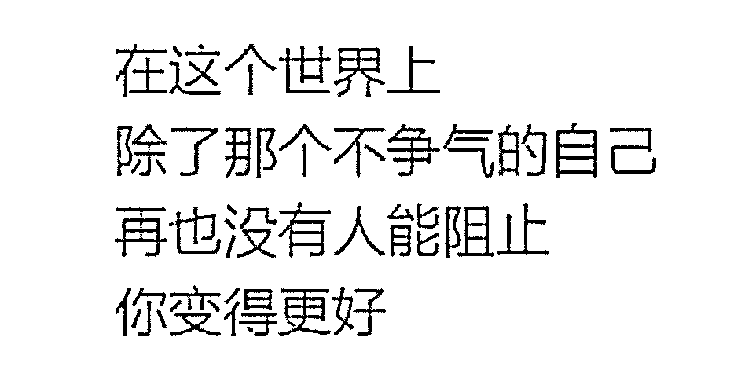

我干过的兼职一箩筐：当家教、发传单、开网店、做微商。只要是来钱且不耽误上课的，我都扑上去试，也被人反复割韭菜。可我从没放弃过一个想法：人穷不是因为命，而是因为不想赚钱。只要你发自内心想搞钱，自然会想方设法把事做好、多赚一点。

为了凑学费，我和妹妹还批发塑料花来编，摆摊卖。花材不贵，但编好看很难。我专门在网上学别人的花型，琢磨着编出差异化。每晚回家姐妹俩练手艺，别人的花卖五块一朵，我的卖十块二十块。一天，一个香港客人经过，见我编的花漂亮，正好家里要办大宴，一口气订了两万块的货。我和妹妹赶工赶了一个多星期，赚到了人生里第一笔像样的收入。

后来年纪渐长，做过的事越来越多，我却发现，自己一直在重复那些辛苦、收入不稳、又没什么复利的事。回报率不高，还消耗时间。如果一辈子都这样，想想都让人绝望。

2021年初，我报名了十点读书的写作训练课。在那之前，我是十点的铁杆粉丝。黑暗中，十点的文章陪我度过无数夜晚，每晚听着优美的音频，总感觉明天会好一点。我那时心想，这些文字一定是大作家写的——普通人怎么可能写出来？更别提靠它赚钱。

那期课程的带课老师，就是你们听过的徐公。从我点下报名键那一刻起，命运的齿轮开始转动，像一句话说的：长风起于青萍之末。

课程主要教观点论述文，内容发去百家号和头条。对毫无文笔、零基础的我来说，写作简直像受刑。一周写不出一个字，发出去了也没人看，灰心到极点。

后来在十点的直播课里，我链接上徐公老师。通过他，又结识了朝闻道的半糖和徐言——两位主打情感和故事方向的导师。和他们深聊后，我才意识到，写作的路原来这么宽，观点文只是其中一条，不是唯一的路。

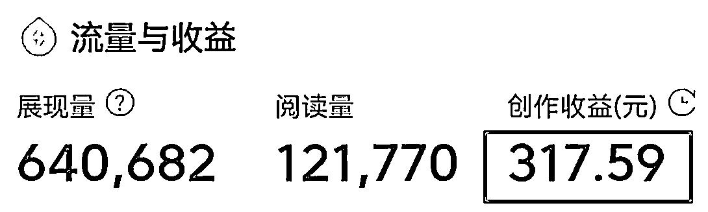

可我基础差，脑子也不够快，学起来依然费力。那阵子我记住了“开幕雷击”四个字，却不会用。我不服输，苦练几周后，总算摸出一套自己的笨办法：每天刷大量生活类和情感类的微头条，看到爆款就存下来，反复拆解研究。刷多了，发现爆款几乎一个模子——用大白话平铺直叙地讲一件事，压根不需要文采。

我记下这个规律，照葫芦画瓢写了一篇保姆故事。没想到阅读量冲到60万，收益300多块，开心得不行。必须说明，那时候微头条单价高，现在不行了。

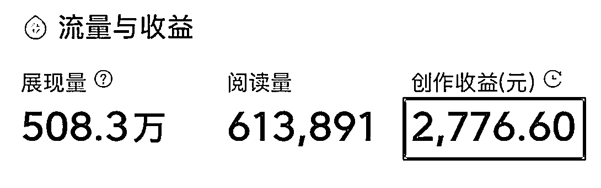

靠着同样的路子，我继续写。之后几乎每天都能出10万+，偶尔还有500万+。

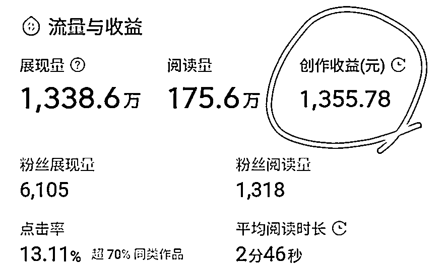

也有一篇阅读过了千万。故事短，不足千字，单价不高。

写多了，我慢慢总结出自己的公式：**一个故事 = 标题 + 主角 + 事件主干 + 收尾**。按这个框架写下去，越写越熟，一个多月后，月收入过了万，粉丝也很快破了万。

头条粉丝过万就能带货。正巧那阵子有带货红利，社群也办了带货营，我马上报名。

当时的导师是徐言随谈，也是我一直敬重的老师。到现在，我们还经常聊天，他就像我观察朝闻道社群的一扇窗。

经过无数次打磨，我终于等来机会。我把所有经验塞进货文里，第一篇文章卖出一单，第二篇84单，第三篇23单，三篇都推同一本书——《心的力量》。

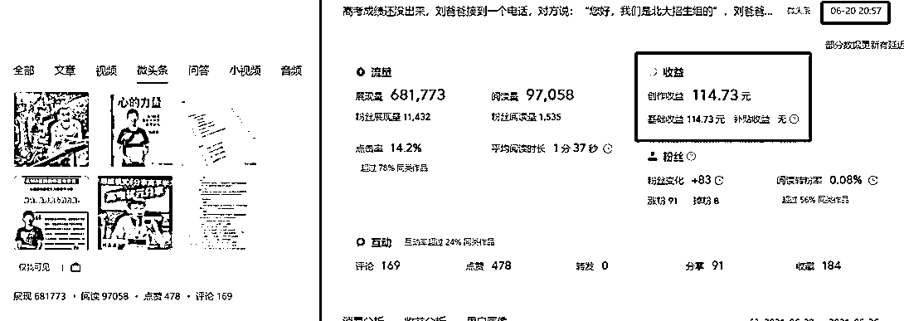

那段时间平台发带货补贴，钱虽然不多，也是一份收入。只要有活动，我基本都报名，三十块也愿意赚。

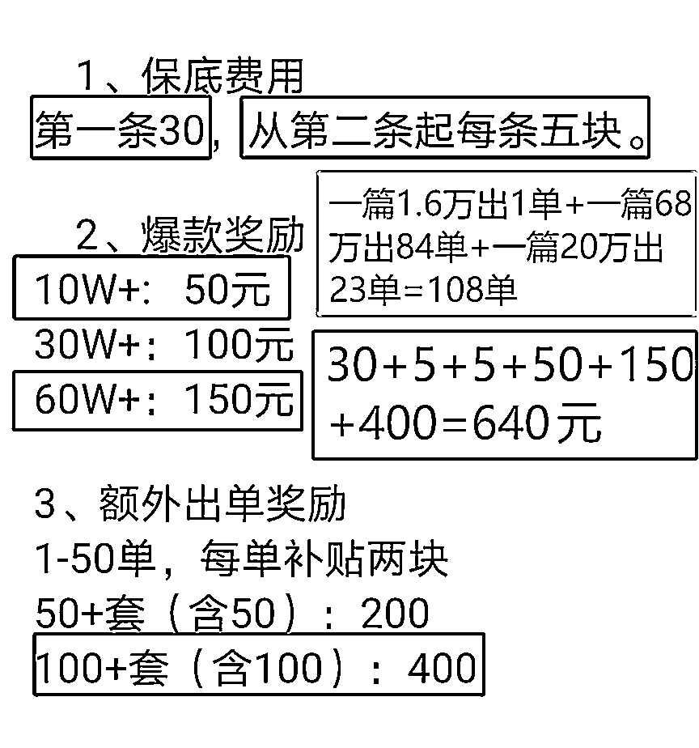

从此，我才正式踏上自媒体这条路，写作能力也有了质的跃升。我不再只写微头条，开始尝试长故事、把图文改成视频，还把作品分发到多个平台，一份内容吃多份流量。可惜我接触自媒体太晚，才写了半年，头条单价就大跌，平台也开始严打编故事的微头条。加上要备考，头条慢慢就被我放了。

注册头条一年多一点，真正动笔只有半年，赚了15万，粉丝近3万。下面是一些收益记录：

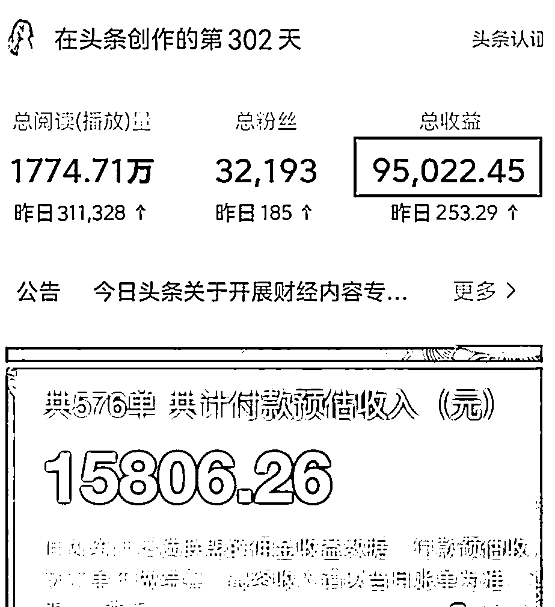

之后我一边备考，一边学炒股。手头有了余钱可以试水，几个账户收益都还可以。为了打新，我开了8个股票号。这是其中一个小号的收益：

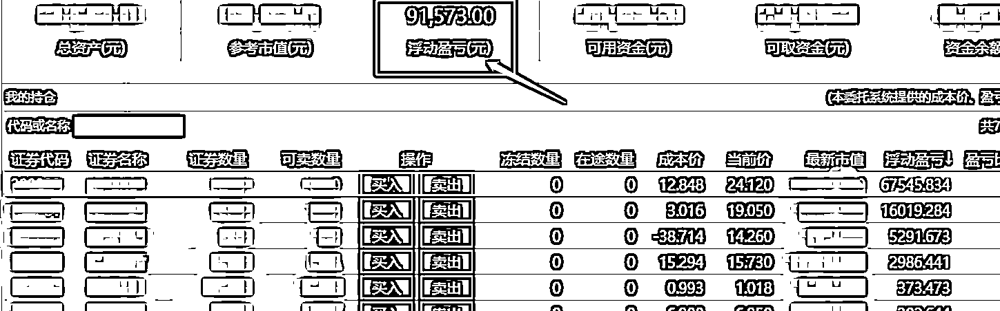

2022年初，朋友跟我说公号流量主收入很香。我尝试把头条爆款搬到微信公号。搬的过程中发现，我的爆款早就被别人搬走了，对方还靠这些稿子拿到不少10万+，全是中老年情感故事。我一边搬一边投诉，但大部分没成功。后来干脆用老办法，按当年的公式写公号情感故事，连带素材库也重新启用。平时看到有趣的家长里短，就分门别类扔进库里；写稿时像搭积木一样组合，很快能拼出一篇。

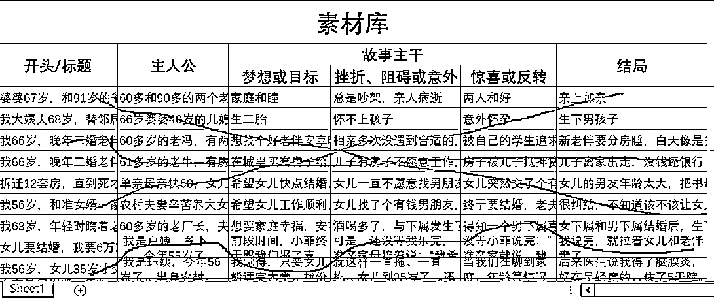

有了资料库，写故事变得像照抄：按公式把标题、主角、主干、结尾四样填齐，主线马上出来，再往里面补细节，一篇文章就完工了。这类情感故事特别受中老年读者喜欢。我熬过70多天流量低谷，才开始有起色。那阵子，我几乎天天都能碰见10万+。到2022年6月，两个号陆续做到月入过万。

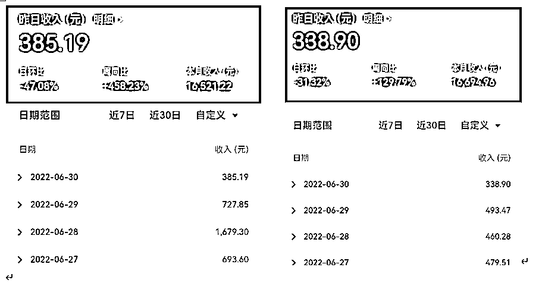

7月，一个号赚了四万多，另一个两万多。

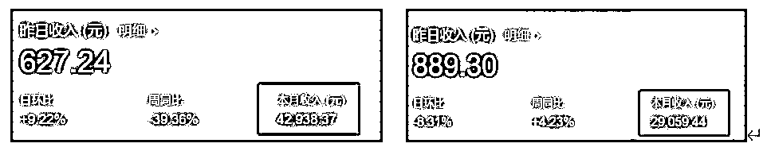

那段时间我特别高兴，跑到群里晒收益。老话说“敢晒才会赢”，还真是越晒越好。

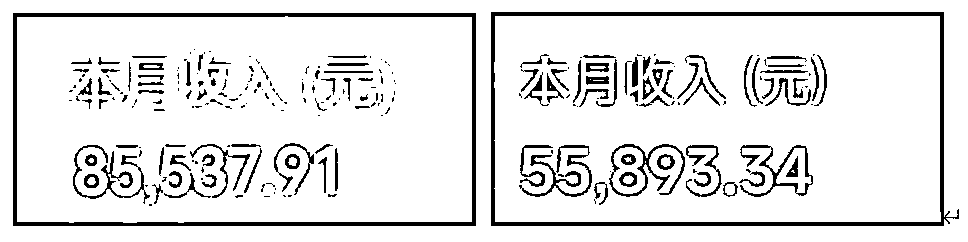

同学们天天看我晒，就起哄让我开课。我犹豫了两个月，最后还是决定带着大家一起赚钱。去年9月底，两位徐老师帮我搭台，第一期公号训练营就这么开了。

我原本以为最多50人，所以拍着胸脯承诺逐篇精批。结果来了120多人，一期26天，我每天要评100多篇故事，还要应付群内答疑，眼睛差点瞎掉。

第一期没有经验，只能把自己走过的路原样教给大家。没想到成绩相当给力：120多个学员里，8个人收入过万，3个人9000多，25个人以上做到四位数。我特意发了条朋友圈：

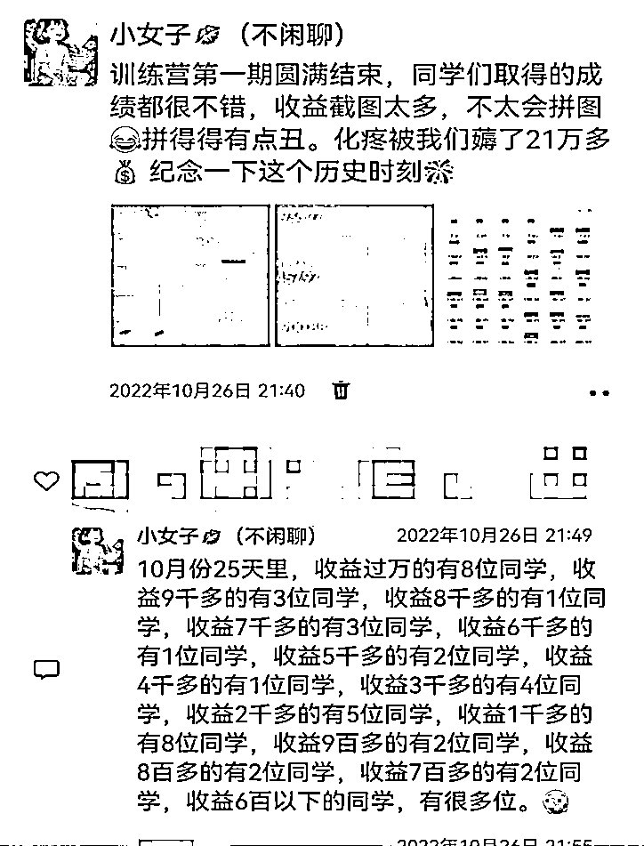

第一期刚结束，又有人喊着要学。我们紧接着开了第二期，时长21天，课件也优化过。报名人数冲到200多。最意外的是，第二期蹦出一匹黑马：一篇稿子赚了6万，当月20天赚了7万多。

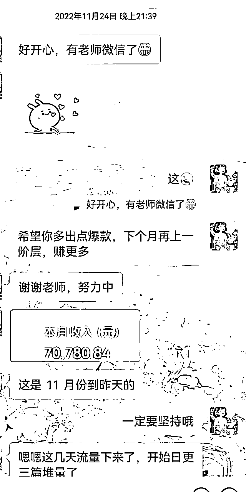

第二期整体比第一期还好，过万的人更多。

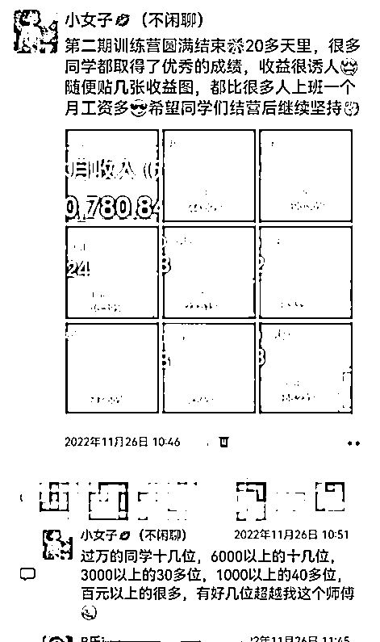

这个方法算是被验证了。后来，我和两位徐老师把打法扩展到历史、法律案例、影视剧评、热点、穿搭、鸡汤、公号带货等赛道，最近又添了养老金，未来可能还会继续加。

每次开新领域，我们不只是拆解，而是先自己开号跑通、真的赚到钱，才把经验带进课程。所以我自己手里的号也越开越多，一度忙得晕头转向。

就这样，第三期、第四期、第五期……一直开到现在的第十二期，每期都做得不错。

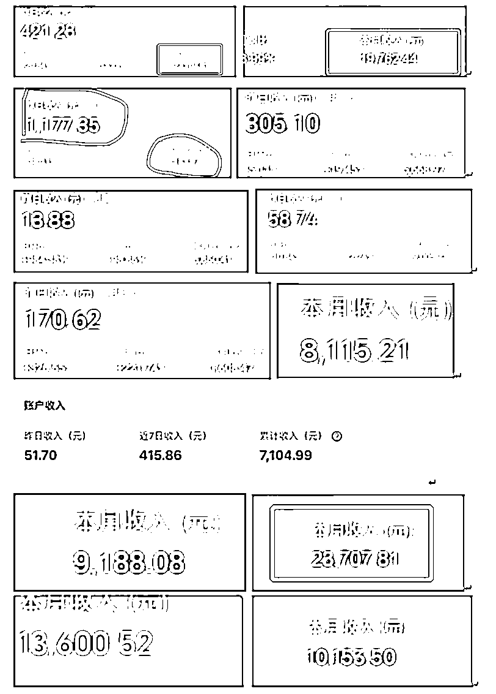

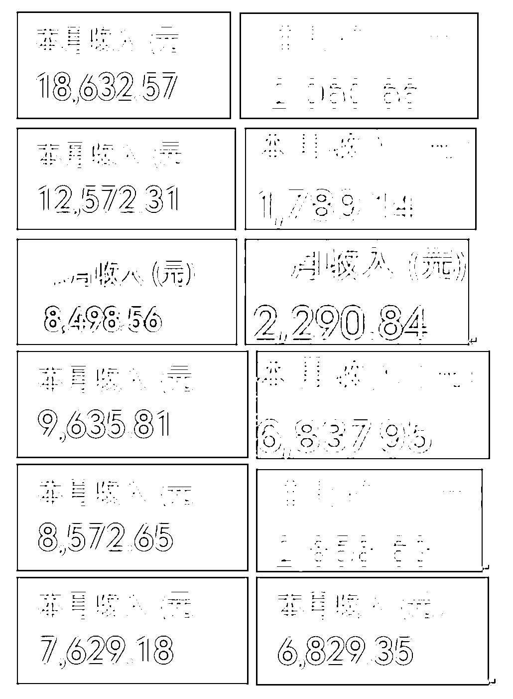

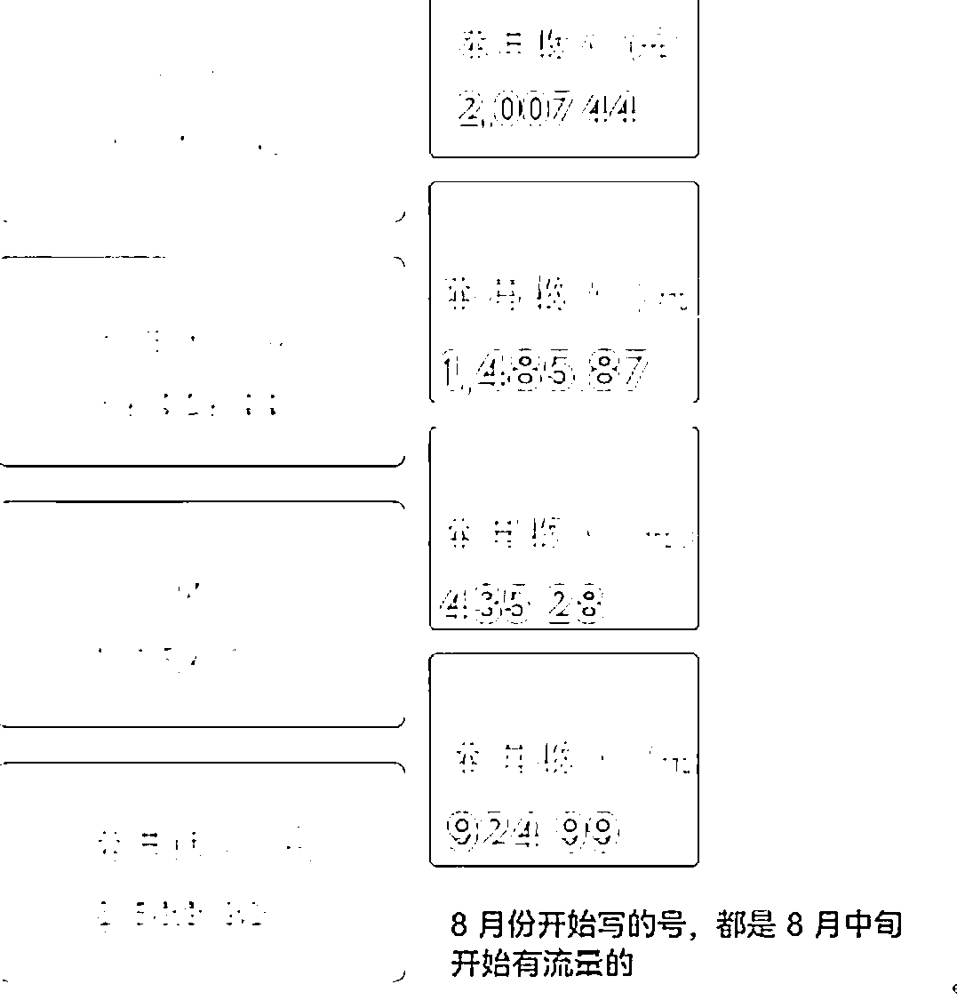

今年2月，两位徐老师带我去龙哥盟开了第一期公号航海。进了这个圈我才发现，原来有好几万人都在做自媒体，真的大开眼界。航海结束后不久，正赶上赚钱招新，我果断加入，正式成了赚钱的一员。

如今公号航海已经开到第三期，就是8月这期，目前正进行中。

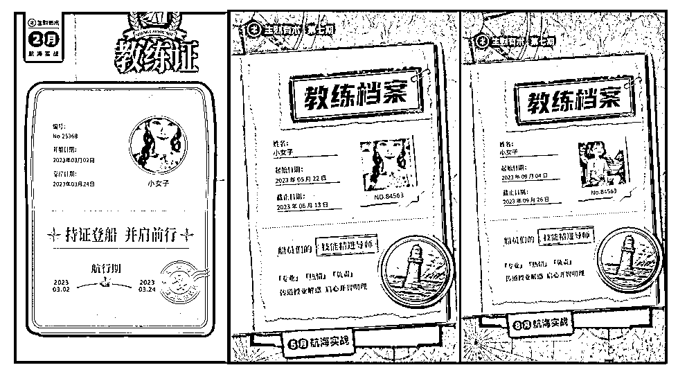

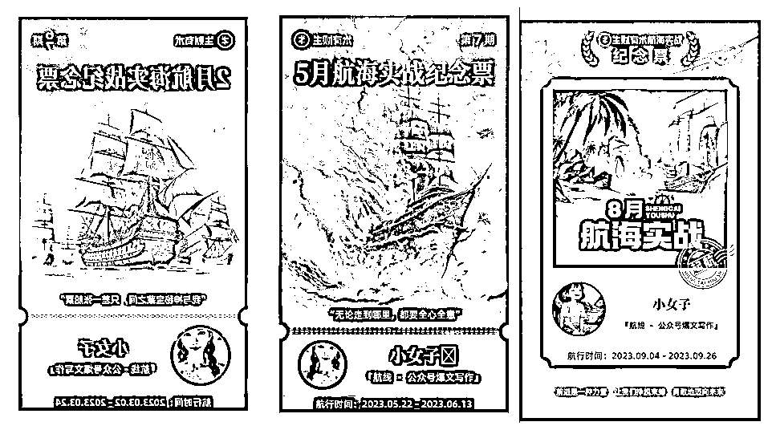

前两期航海学员的成绩相当能打，月入过万的不在少数，还有几位做到单日赚一万。

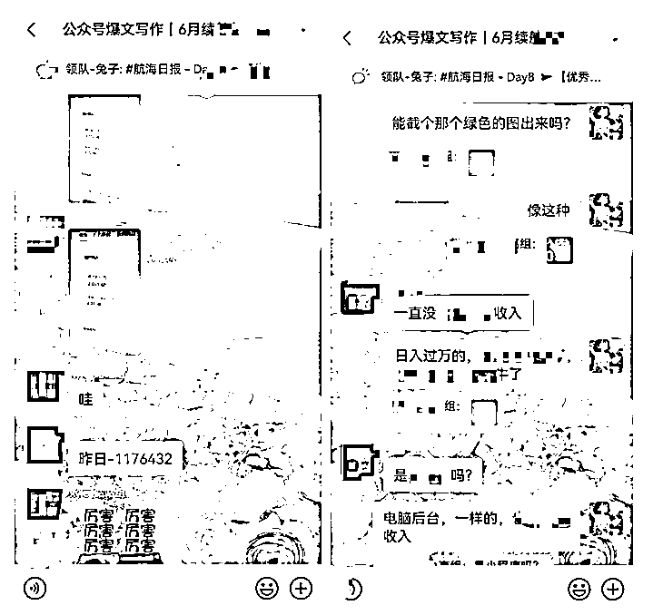

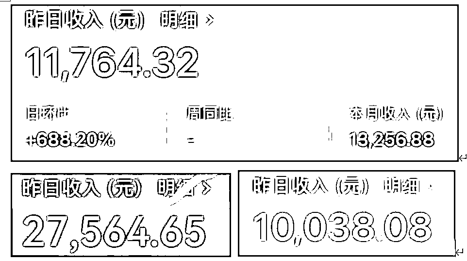

公号航海学员的变现率高达90%。如今第三期，学员超过2600人，这是我想都没想过的规模。

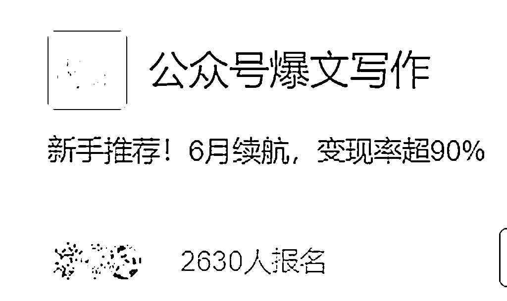

今年2月AI写作工具开始流行，我第一时间上手，学着用AI写稿。3月起，我的文章基本都靠AI辅助完成。

没用AI前，一天最多写6篇，几乎把下班时间全占了。号越来越多，真有点喘不过气。有了AI，这个问题立刻化解。我从一小时写3篇，慢慢进步到一小时写30篇，质量也有保证。为了开更多号，我借了亲友的身份证，号从几个增加到20个。

每天下班后，我抽出60分钟，用AI更新30篇文章。下面这八张图，是我其中8个号截至目前的累计收益。

这两张是情感号。去年4月开始写，写了一年多：

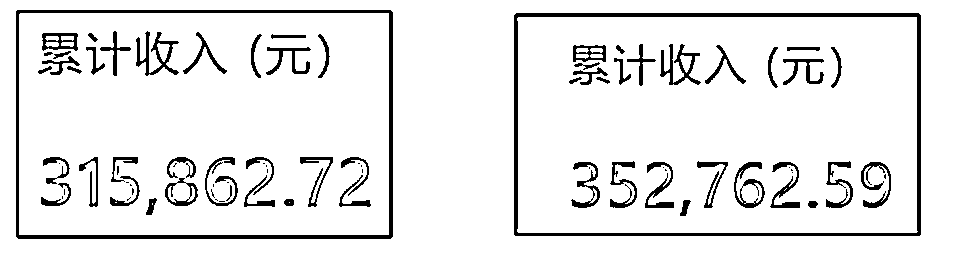

这两张分别对应影视剧评和热点。影视赛道是第四期增开的，12月30日开始，写了8个月；热点是第五期加的，1月开始写，写了7个月，不是天天更。

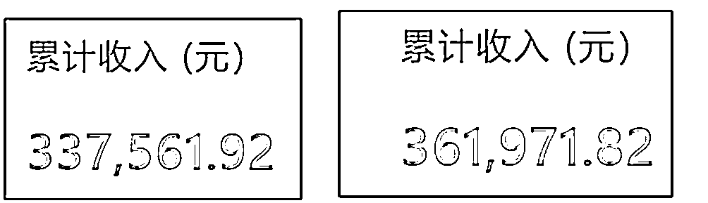

这两张是鸡汤和穿搭。鸡汤7月开始，穿搭6月开始。

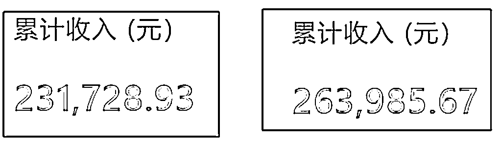

这两张也属情感。17万这个号先写律例，后来转型情感；13万那个从4月起一直写情感，到现在4个多月：

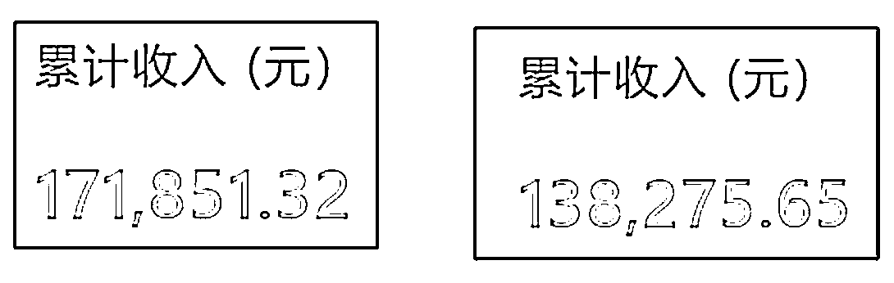

剩下10个号里，2个写三农和养老金，1个健康科普，1个穿搭，1个文案，2个鸡汤，3个情感。

这20个号中，4个收益超过30万，2个超过20万，2个超过10万，其余也有6万以上。最近两个月才开的小号同样争气，几乎每天都有几个爆款，单日收益过千。

现在我没有全职做自媒体，白天还在外企做管理工作。下班回家，除了想办法赚钱，每晚还会抽一小时练古筝、一小时学画画。生活不能只剩下搞钱。

回看这一路，确实够拼。有人说我是蔡少芬plus——她妈好赌，我爸好赌。幸运的是，一路上遇到了很多贵人，真的很感谢他们。

最后，说几点实用的写作心得，给还没找到手感的朋友。

**1. 用好“开幕雷击”**

别的元素可以没有，异常或悬念必须有。文章的爆与不爆，标题能决定一半。标题不够吸引人，读者根本不会点进来；点击量高，系统就会觉得你受欢迎，不断加推，爆款就是这么来的。

我常说的开幕雷击有七个要素，其中最核心的是异常/悬念。再加上金钱、捷径之类的要素，力度可以翻几倍。不少爆款都带着金钱元素，再叠一个反常动作。比如：

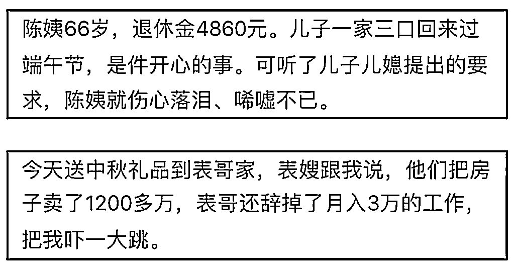

先简单交代人物背景，中间放一个金额，再用一个反常行为做钩子，写到一半停住。读者心里痒痒，就会点进来看。

需要注意，异常是指与人们正常的感受或行为相反。狗咬人没人看，人咬狗才是新闻。而且异常要足够直白，一眼能看懂。说到底，写爆款不靠文笔，能把一件事说清楚就够了。

**2. 随时随地收集素材**

多数读者看文章不是为了学习，而是找乐子，所以故事比干货更吸睛。争房产、婆媳矛盾、两性关系、婚姻危机、借钱不还……这些家长里短贴近生活，大家最爱看。

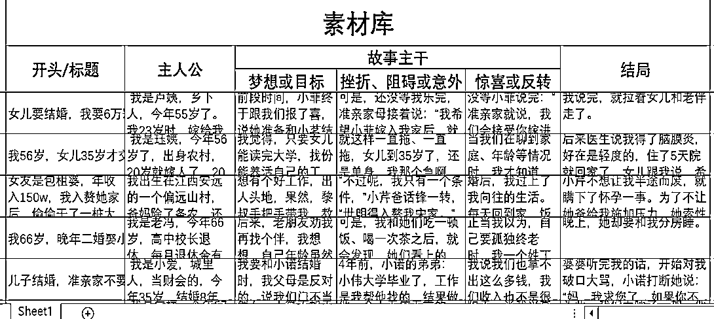

平时可以多留意这类素材，随手拍下有地域特色、新奇的东西，尤其是能跟金钱扯上关系的。现在有了AI，没有素材库也能写；但要是素材库加AI一起用，效率会翻倍。

**3. 坚持写，心态要稳**

刚起步时，谁都可能抓耳挠腮，半天憋不出一个字。但坚持一段时间，你会发现自己在不知不觉中能写出几百字、几千字。这就是成长。更何况现在有AI辅助。

我没有任何文笔和写作基础，公号写了一年，收入超过200万。其中前半年只有30多万，后半年靠AI加持赚了170多万。要注意：前半年我也是挺了将近3个月才开始赚钱。

如果你能像我一样咬牙坚持，一定也能赚到钱，甚至赚得比我多。可如果你以为开号就有钱，又不注重内容质量和持续输出，那大概率会失望。

这一路走来，我最深的感受是：**那些没能击垮我的，最终都让我更强大。**

写作让我找到了适合自己的赛道，也让我越来越相信：对普通人来说，写作是最好的翻身工具，它没有门槛，只看你肯不肯写、敢不敢写。文字能带去远方，也会反过来塑造你自己。

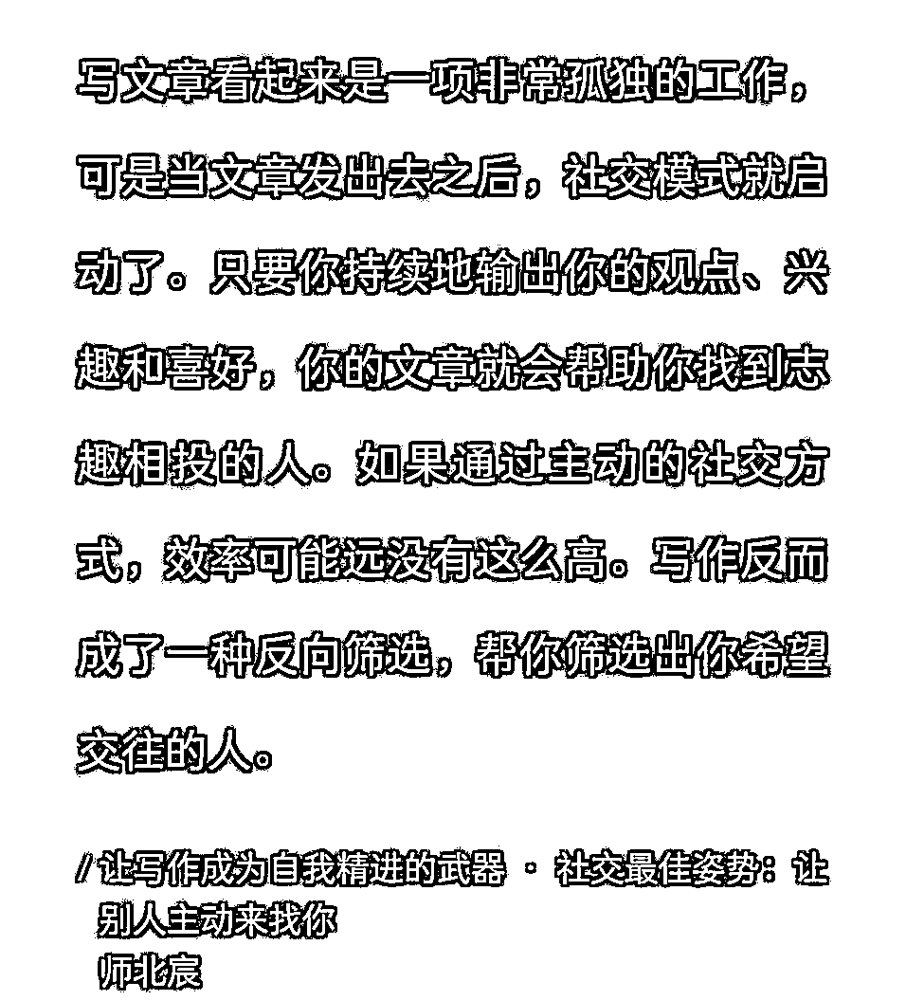

所有副业里，写作的门槛低得感人。干实体要投入，做短视频得买设备、学剪辑配音，流程也复杂。而写作只需要你会写字，愿意分享，够了。写作与天赋无关，只需要勤奋；与基础、学历无关，只需要坚持；与现在的身份无关，只和你将来想成为谁有关。

这条路，最重要的就是不放弃，一直走下去。

我的写作之路还很长，以后我们会继续在这条赛道里，跑出更多适合普通人的细分方向，帮到更多人。

未来，咱们一起往更宽阔的地方走，做一个能一直赚钱的人！

很开心你能看到这里。如果你正处在写了很多却没什么回音的阶段，请先别急着否定自己，也别让焦虑把你带走。

坦白讲，我的文字谈不上优美，写作功底约等于零。但就是靠写公众号，一年时间赚到了200W+。别觉得这是天赋，我真的只是一个普通人。既然我可以，你当然更可以——你本来就比我优秀得多。

评论区里有人感叹“太牛了”，有人说“后悔没报名这期航海”，还有人把收益截图存下来当动力。谢谢你们这么给力。没赶上这趟车的朋友也别遗憾，下一期再有，记得果断上车。

最后想和你共勉：暂时没有收益，不代表没有价值；坚持下去，时间会给你答案。一起加油！

