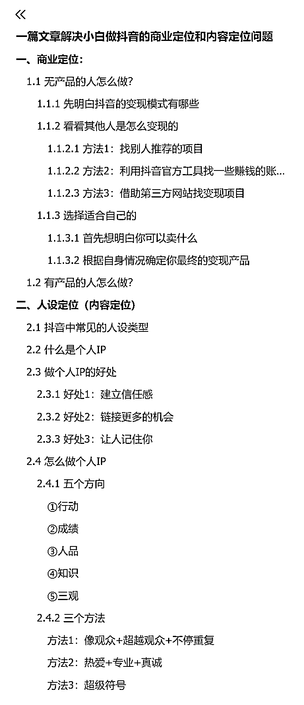

# ('一篇文章解决小白做抖音的商业定位和内容定位问题', (2, 25))

抖音新手避坑指南：定位定不好，努力全白费

做抖音，你是不是也这样？拍摄剪辑样样学，日更不停，却一直没等来流量，更别说变现了。问题可能出在一个被很多人跳过的步骤——定位。方向没定，努力就容易白费。

今天要分享的，是行舟在一篇有关抖音实操的文章里讲的干货。他之前那篇《我是怎么从0-1做一个抖音号，单月变现15W的》已经很受欢迎，这次他专门把“定位”这一环拿出来讲透，而且明确说是所有做抖音的人都绕不开的步骤。

这篇文章的价值在于：它解决的是小白最容易犯迷糊的两个问题——商业定位和内容定位。简单说，就是先想清楚靠什么赚钱，再想清楚发什么内容。更难得的是，里面给了可直接落地的方法，关于怎么变现、怎么打造人设，都有清晰的思路，看完就能搬到自己账号上试。

先放目录感受一下框架：

因为图文信息量比较大，完整版放在了飞书文档，想看的直接点：

https://lspknkwu7b.feishu.cn/wiki/CqR1w4xEqifz6EkvhnOcbCcynJc?from=from_copylink

这篇内容发出来后，在龙哥盟的圈子里反响很热烈。有人正好要做个人IP，觉得帮了大忙；也有人说内容很实在；还有人夸它细致且好上手。圈友龙哥更是直接给了精华，说明确实值得花几分钟读完。

如果你现在正准备做抖音，但还没想好账号怎么定位，建议先别急着开拍。把这篇看完，把“商业定位”和“内容定位”这两件事理清楚，再动手运营，你会少走很多弯路。

别忘了，定位就是那个“1”，内容、运营、变现都是后面的“0”。

