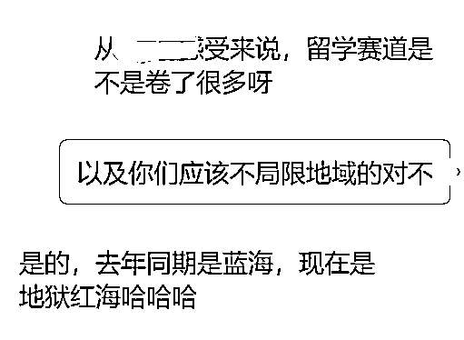
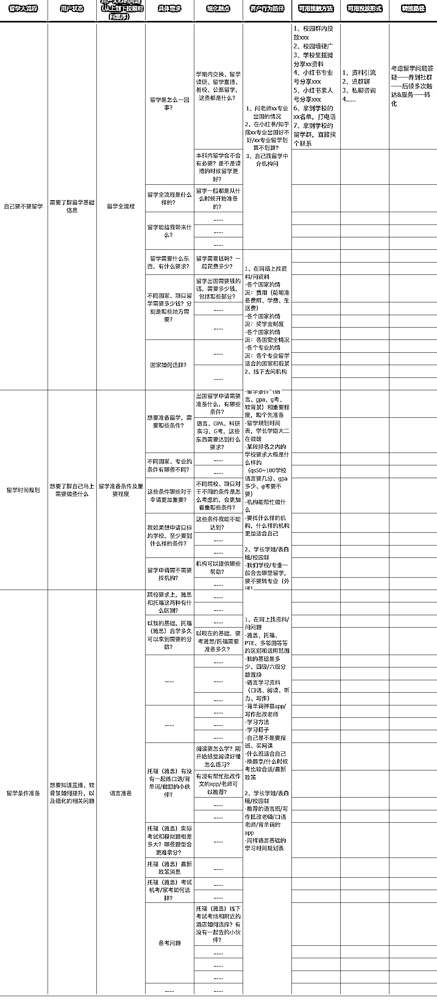

很多人一听“红海”两个字，眉头就先皱起来了——觉得赛道拥挤、对手凶猛、机会渺茫。但我想说，红海并不代表死局，恰恰相反，只要你找对打法，完全有机会从 0 到 1 硬生生杀出重围，甚至拿下 20% 的市场份额。

先交代下背景：我本人深耕职业教育与留学行业七年，副业在做人生教练和领导力教练的公域操盘。之前和一位赚钱的龙珠圈友聊行业时，碰撞出了一个共识：

想在红海市场里切下自己的蛋糕，核心就三件事：

第一，你的产品和服务本身到底硬不硬？  
第二，你有没有办法比对手搞到更多流量？  
第三，你能不能建立长期渠道或者长期品牌？

这篇文章，就围绕这三个问题展开，重点解决：

1. 怎么在红海市场里找到真正能切入并站稳脚跟的支点；  
2. 怎么找到精准客户，同时把销售漏斗的转化率提上去；  
3. 怎么跳出互联网的局限，把客户自己的私域力量也调动起来。

正式开讲之前，先抛三个很有意思的场景，大家可以边读边想：

**场景一：微信红包 vs 微信群里的广告链接**  
同样出现在群里，为什么广告没人点，红包却总被秒抢？  
红包刚出来的时候，难道没人怀疑过它是诈骗链接吗？  
用户到底是什么时候养成了“红包要抢、陌生链接慎点”的条件反射？

**场景二：彩票为什么永远有人买？**  
因为人们买的不是彩票，是一个中大奖的机会。  
那份巨额奖金，才是驱动大家不断下注的“杠杆”。

**场景三：赚钱有术几乎不做公域投放，怎么还能持续有新流量？**  
除了本身质量和口碑过硬之外，更厉害的是它的拉新政策、志愿者机制——把一大批用户的私域流量全都调动了起来。而且这批用户的私域每年都在更新、在增长。

所以，反过来想：  
如果你的产品也能让用户觉得“这是红包，我得赶紧抢”——那市场份额不占你占谁？  
如果你的产品也能让用户觉得“这是中千万大奖的机会”——那用户不抢你的抢谁的？  
如果你能让足够多的人知道“我有这么个产品”，哪怕他不刷互联网、蹲在厕所里都能听说你——那渠道得多强？

下面我用留学相关的产品（中介、申请、机票、保险等）作为例子，拆解一套从打市场到打转化的完整逻辑。

## 一、总体概念：客户是谁、客户在哪、怎么触达

做项目先别急着找渠道，先把全链条捋清楚：客户到底是谁？他们聚集在哪里？只有先知道怎么触达，才能进一步考虑用什么名义、走什么路径、用什么方式去转化，才会更顺畅。

**客户是谁？**  
本科高校里有海外读研意向的留学用户。

**客户在哪？**  
你当然可以说“用户在学校里”。  
但更颗粒度一点，他们在：

- 寝室里  
- 教室里  
- 某个民间新生群里  
- 某位老师建的班级/课程群里  
- 某驾校、考研机构、考证机构社群里  
- 某公众号的关注列表里  
- 小红书、抖音、B站、微博上刷内容  

**怎么触达？**  
我们在真空环境里头脑风暴一下：

用户在寝室？可以发寝室群广告，可以让室友帮忙推，可以让宿管阿姨帮忙贴海报，也可以直接扫楼。  
用户在教室？可以在课程群发广告，可以让同学/老师帮忙推广，也可以在教学楼里贴海报。  
用户在新生群？可以直接进群发，可以让同学帮转，也可以一个个加好友去聊。  
在老师建的群里？可以进群发，可以让同学帮发，可以让老师帮发，或者逐个私聊。  
在驾校/考研机构/考证机构群里？可以进群发，可以让同学帮发，可以让群主帮发，也可以群里一个个问。  
在公众号关注列表里？可以让号主帮推，也可以私信触达。  
在公域平台刷内容？可以截流、引流、私信。

但问题是：这些方法对手也能想到，凭什么你就更能抢到份额？而且从投入产出比看，哪种打法更划算？这就引出了下文。

## 二、对行业的理解：没有标准的行业，恰恰是最大的机会

留学行业不像医院，有三甲、有主治医师、主任医师，一切都有清晰标准。  
留学行业没有标准。这会带来什么问题？

**问题：用户不知道怎么筛选。**  
用户没被教育过，往往“头疼医头、脚疼医脚”。  
但换个角度看，一个“头疼”的用户走进“心血管科”，医生跨界给点建议、收点钱，也不是不行。  
留学顾问就乐意这么干——虽然不一定对症，但至少能给点帮助，顺便赚点钱。  
可这对病人不一定好。

**机会：如果你能告诉用户“你该去挂头疼科”，他会很感激你，还会为你付费。**  
再加上服务本身很难拉开差距，不像老中医和小中医那样一眼可分高下，所以留学行业的本质是：**谁掌握客户量，谁就掌握话语权。**

所以，真正的解法是：

1. 你能搞来大量“患者”；  
2. 你还能帮“患者”找到最对口的“医生”。

能做到这两点，既积德又赚钱。  
但第 1 点极难——对手不会白白把客户让给你。  
而第 2 点只要有了第 1 点，自然会有大量“好医生”主动找上门。

所以，关键中的关键，就是第 1 点：搞来大量精准客户。

## 三、对市场的理解：沙漠、大海、鱼塘，你想在哪里捕鱼？

很多人没有“市场密度”的概念。  
但在我眼里，人群一旦打上标签，选择变多，采购逻辑也会不同。

人群标签可以是：年龄、性别、收入、城市……  
对应到留学客户，标签就是：年级、性别、城市、学校层次（985、211、一本、二本）、学校类别（综合、财经、理工、中外合办）。

标签越细，客户越精准。  
你在互联网操盘手里找“赚钱有术”用户，比在制造业工程师里找容易得多。  
你在 985 高校找留学客户，也比在二本院校里找容易得多。

**密度直接影响打法。**  
举个例子：

在满是鱼的池塘里，随手撒网，80% 可能捞到 10 条鱼；  
在大海里，随手撒网，50% 可能捞到 5 条鱼；  
在沙漠里，随手撒网，0% 能捞到鱼。

放到高校里：

中外合办高校（A类）留学率约 80%；  
985 高校（B类）约 20%；  
普通一本 211（C类）约 10%。

如果我随便建个外卖群，群内 100 人：  
A 类群天然有 80 个留学客户，B 类群有 20 个，C 类群只有 10 个。  
注意，这还没开始做转化。

**更妙的是：细化标签能在客观密度不变的情况下，提高你的捕鱼概率。**  
比如 C 类大学整体留学率 10%，但如果加上“奖学金获得者”这个标签，比例会不会变成 40%？  
如果是“金融专业”呢？会不会到 25%？  
如果是“学生会部长”呢？会不会到 15%？

这么一想，市场是不是完全变了？

再看传统获客方法：  
要么找校园公众号/媒体发文，全是常规网眼、常规鱼池，效率低、拉不开差距；  
要么在互联网平台做内容，要懂平台规则，最后往往陷入互联网“死局”。

## 四、对渠道的理解：渠道无大小，能触达就是好渠道

不是做项目就一定要冲抖音、B站、小红书、知乎。  
第一反应应该是：我的客户在哪里？什么渠道能触达他？

**校园级渠道**，可以从覆盖范围、关注度、可靠性三个维度来评估。

**覆盖范围越大越好。**  
校园渠道可分为全校级、全年级、全院级、全班级。  
比如在金融专业捞留学客户，比全校撒网留学率高 15%。  
如果产能有限，就要做选择：  
是要 10000×10%×转化率α，还是要 100×25%×转化率β？

**用户关注度越高越好。**  
渠道载体有 QQ群、微信群、钉钉群、校园论坛、小程序、公众号等。  
现在很多学生更习惯看微信群，不太看 QQ 群——那微信群的关注度自然更高。  
同样一个载体，如果日常发布内容对大家有实用价值，关注度就高；反之，就会被屏蔽。

**渠道可靠性越高越好。**  
渠道背后是谁在运营很重要。  
个人运营、院校官方、校园团队、社会机构，天然带有不同信任等级。  
如果渠道在用户心里偏官方、偏权威，而且过往内容价值高，大家自然更信任，转化率也会更好。

所以，从信息投放角度，权重排序很明显：

- 微信群 > QQ群  
- 校园媒体平台 > 学生自建平台 > 校外机构平台  
- 老师发 > 同学发 > 机构发  

于是，脑海里就该浮现一张触达路径图：先找老师帮发到校内微信群，再找同学帮发到班级群……层层递进。

**互联网渠道呢？**  
互联网没有大小之分，更多是算法推流和搜索流量。  
但它逃不过三个宿命：

1. 你做得好，同行马上来抄；  
2. 平台后面出各种规则限制你；  
3. 用户被同行和你自己反复骚扰，最后烦了。

想从找对标到超越对标的具体玩法，我之前有篇精华帖讲过，这里就不展开了。

## 五、对产品的理解：用“前置位诉求”做降维打击

互联网渠道和校园渠道一比，覆盖深度和广度明显逊色。  
你可以不看抖音、小红书，但只要你还在学校里，就一定会看微信群、老师消息、同学朋友圈、校园墙……

公域要靠大数据推荐，私域却能全面辐射。

这时候问题来了：  
老师凭什么帮你发留学广告？同学凭什么帮你推留学用户？  
毕竟学校非常反商业。

但换个思路呢？  
如果你请老师/同学帮忙做的是这些事：

1. 推荐奖学金获得者  
2. 推荐学生会主席、部长  
3. 帮忙发布投行/券商实习继任信息  
4. 帮忙传播高质量大学生活动  

这些动作是不是就容易接受多了？  
而且，这些人本身就藏在高留学密度的人群里。

再进一步，很多产品离用户真正产生留学需求还很远。  
但你要理解两个转化真相：

1. 用户哪怕在考虑买服务，可没到临近决策那一刻，他都不会急着下单。  
2. 用户在决策链路上，离采购决策越近，越容易成交。

所以，引流品的设计就很有讲究。  
很多人以为“用户前置位的产品”都能做引流品，或者“体验类产品”就能引流。  
我觉得还有一种更狠的做法，叫**降维打击**。

**我做留学，但我的引流品根本不在留学赛道里玩。**  
我做的是大学生群体里刚需、顶尖、甚至唯一的产品，对手怎么跟？

比如：  
我专门做一个面向奖学金获得者的产品，然后对其中想留学的同学，推出一个“名校冲刺申请计划”——一听就很牛，你会觉得自己配得上这个服务。  
我专门做一个面向高校精英群体的产品，不断让大家感知到“我资源多、我服务好、我什么都能解决”，那等你哪天想留学了，第一反应是不是想到我？

这种产品，天然就自带裂变属性。  
互联网逃不过被抄、被限、被烦的宿命，但校园私域不一样——学生每年都有新生进来、老生毕业，**学生流量天然就是更替流量**，所以私域流量可以无限增长。

## 六、对布局的理解：打市场，而不是打客户

找客户就像是摘果子。  
你可以选择摘野果子，也可以选择自己种果树。

摘野果子，得看天气、看外界资源，还要和一堆人抢。  
但如果是自家的果园呢？  
你可以施肥、催熟、培育新种，还能源源不断收获自然生长的果实。

所以，真正聪明的打法，不是满世界追着客户跑，而是建立自己的“果园”，让客户主动长出来。  
你做的每一个渠道、每一个产品、每一层标签，都是在给自己的果园修枝、浇水、扩建。

最后再补一个例子：  
如果一家饺子店好到让人愿意跑很远去吃，那它根本不用担心地段流量。  
很多产品其实不靠互联网也能活得很好，关键在于——你有没有好到让人“愿意跑很远”的程度。

红海不可怕。  
可怕的是你用别人的标准、在别人的战场、打一场没准备的仗。  
当你把产品、流量、渠道、标签、私域都串成一套系统，红海也会变成你的蓝海。

 记住了：真正厉害的人，不是在红海里抢鱼，而是自己挖鱼塘，然后让鱼源源不断游进来。

做留学申请这门生意，单笔金额摆在那里，天然就吃信任。就算现在线上公司满天飞，大部分家长和学生还是会下意识更信得过能见面、能聊到的本地团队。像我人在杭州，杭州本地的客户成交起来顺手得多，隔着一整个东北的客户谈起来阻力就明显不同。

这其实不是留学行业的特例，几乎所有重决策的产品都一样。

拿我自己举例，我住在西湖区，肚子想吃饺子，第一反应一定是检索家门口一公里内的几家店。除非三公里外那家饺子已经好吃到成为区域标杆，否则我很难为这多走的路买单。留学服务在线上成交的逻辑也基本如此，你要么品牌势能强到行业头部、产品力强到无法质疑、口碑强到自来水无数，我才有跨区签约的理由。否则，地头蛇永远比强龙好用。

现在的获客现状，大多数人做的是逮住一个客户就死磕，而不是去经营一片市场。

打客户像在野外摘野果，得看天吃饭，看资源脸色，还得和一帮人抢。今天有果明天可能没果。经营市场像自己种果园，你能控光照、能施肥、能育新品系、能让果子年年自己长出来。

打市场和打客户，本质完全不同。

打客户是什么模样？一个线索进来，我去跟；一个潜在客户在那里，我去找。劳动密集，效率不稳定。

打市场是什么模样？第一，市场已经被你提前养熟了，品牌先入脑；第二，市场里的潜在用户已经被你的引流品提前触达、提前种草；第三，市场渠道在你手里，客户产生需求的第一反应是找你，你是默认选项。

哪个更省力，哪个更有复利，不言自明。

如果说公域流量更像打客户，是因为公域来的用户和你所在的场景没有强关联，来的快走的也快。那打市场就必须做五件事：

产品和服务本身要过硬；品牌体系要完整清晰；获客手段要多元并行，形成体系；渠道要谈下来、建起来；设计一个有采购前置诉求的引流品或上游产品。

比如做校园端获客，核心思考点不在一个个学生，而是校领导能否谈定、校园社团能否拿下、校园群主能否绑定、本地同城公域能否做透。

就像微软想在杭州卖Windows，如果只是派销售一个个找企业客户，根本吃不下市场。真正的做法是拿下杭州全部电脑城，做区域代理，在商圈和写字楼密集区布点线下店，同时在公域做好同城广告覆盖。

下面是我常用的获客SOP模型：

回到开头留下的三个真实场景。

【微信红包 vs 微信群广告】

同样的微信群里放一样的东西，为什么有人抢着点红包，却对不明广告链接避之不及？

刚开始大家也不是天然知道红包靠谱、链接危险。这种意识是被反复教育出来的。

对大学生和留学人群来说，什么是红包、什么是广告？

直接卖留学的产品，在他们眼里就是广告，容易产生防御。实习推荐、接力实习、面向奖学金获得者的服务，这才是他们眼中的红包，有即时价值、有利益感。

关键在于，这个红包丢到一个高留学密度的池子里，抢的人天然就是你的目标客户。就像在留学率80%的环境里，随便建个外卖群，活跃的都是潜在留学用户。

【彩票为什么有人愿意一直买】

因为买彩票本质上是买一个暴富的机会杠杆。彩票的驱动力是奖金、通道、政策三合一。

产品设计也可以借用这个杠杆思维。奖金通道政策如果本产品给不了，就放在引流品或上游产品上做。

之前我做过两个操作：一个是面向奖学金获得者的基础产品，然后给里面的留学用户一个叫「名校冲刺申请计划」的进阶服务，听起来就很匹配他们的身份自尊。

另一个是面向高校精英的人群产品，持续不断输出我方资源丰富、服务靠谱的信号，等用户产生留学需求的瞬间，第一个想到的就是我。

留学本身很难直接给奖金，但推荐返佣可以；通道政策可以由关联产品来承载。

【赚钱为什么不怎么打公域却一直有新流量】

口碑和产品力是底座，更核心的是它撬动了大量私域，并且这批私域每年都在自我更新增长。

能自发调动别人私域的项目，通常有三个特质：受众面够宽、能给到身份价值感、传播机制清晰。

赚钱的本质是实习比留学受众更广，且大学生高质量实习和人脉本身就是有含金量的身份标签。再加上拉新佣金和志愿者机制，让传播变成自愿行为。

以上。

