# 20 天起号 480 万，第 2 个月直接飙到 1840 万，俄罗斯的“妙鸭相机”到底玩了什么套路？

> 原文：[`www.yuque.com/for_lazy/thfiu8/nocei42nccqacl4b`](https://www.yuque.com/for_lazy/thfiu8/nocei42nccqacl4b)

## 建站不到一个月破 480 万，次月 1840 万，俄罗斯版妙鸭相机的爆火拆解

作者： 哥飞

日期：2023-09-15

先说个更新。之前这篇我是在 8 月 11 日写的，当时 Similarweb 显示 BaiRBIE.me 七月有 480 万访问，我还保守估计八月能到 650 万左右。结果现在数据出来了，八月直接干到 1840 万。

这个案例太典型了，操盘逻辑完全可以复用到别的项目，做成一套可复制的打法。下面这套信息收集思路，拿去套任何网站都管用。

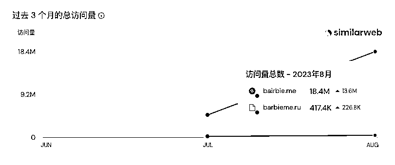

下面进入正文，文中时间如果没特别说明，都是按 8 月 11 日来算的。

事情是这样的，8 月 10 号那天，MoneyHunter 群主在群里丢了个消息：BaiRBIE.me 当月访问 480 万，而且是凭空冒出来的。

我顺手查了下域名信息，7 月 17 日才注册，archive 显示 7 月 22 日页面就被收录了。算下来从上线到写这篇文章，也就 20 天出头。

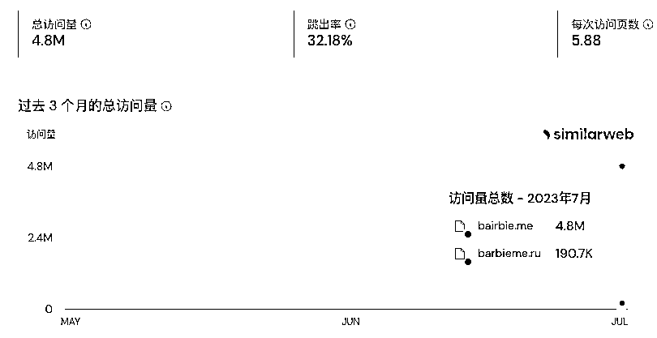

从流量曲线看，七月 480 万基本是实打实的，八月数据当时还没全出来，粗略算是七月最后 10 天完成的。但就算是这样，增速也已经很恐怖了。我当时心里估八月 650 万，显然严重低估。

朋友 TT 看到这个势头就问我，这流量哪来的？我去扒了一下，发现它的爆发路径跟国内的妙鸭相机几乎一模一样。

接下来就是完整的扒信息流程，拿去抄作业都行。

先看 Similarweb 的地域分布，流量基本集中在北半球几个国家：俄罗斯占 60.65%，哈萨克斯坦 7.57%，乌克兰 4.55%，波兰 4.37%，土耳其 3.84%，白俄罗斯 3.07%，其余非常分散。

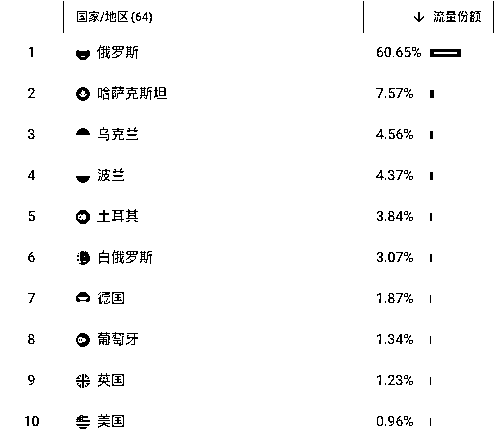

再看流量入口构成：直接访问 57.44%，搜索引擎 21.51%，社交网络 14.51%，外链 6.24%，邮件 0.28%。没有付费搜索、没有展示广告投放，纯自然增长。

补充一下，我看的是 Similarweb Pro 数据，免费版的数据会滞后，参考我这边的截图为准。

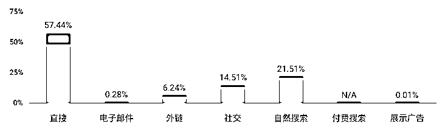

设备端分布也很有意思：PC 只有 11.38%，手机加平板占了 88.62%。基本是移动端在社交圈子里疯传。

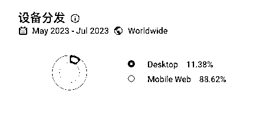

搜索引擎那 21.51% 其实不是冷启动入口。看关键词列表，绝大部分都是带品牌名的搜索，比如 bairbie me。用户先在别的地方看到名字，再去搜索验证，而不是靠SEO抢到热词。

顺便说一句，七月刚好是电影《Barbie》上映期，电影名是 Barbie，网站域名是 BaiRBIE.me，多了一个 i，和 a 拼成了 ai。搜索词里 barbie 后面也跟着 me，所以用户搜索的就是这个站的品牌词，不是电影流量。

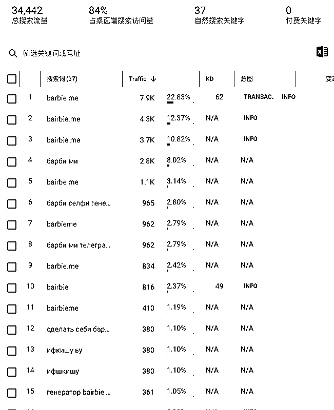

直接访问占了近六成，这部分可以理解为用户记住了网址、通过即时通讯软件传播、加了书签，或者因为某些站点做了 noreferrer 导致来源丢失。总之，先放一边，先去看可追踪的入口。

外链只占 6.24%，按总量算大概 30 万左右，我把前 12 名拎出来看。

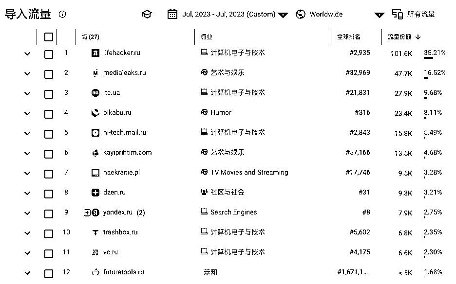

做成表格并补了站点简介：

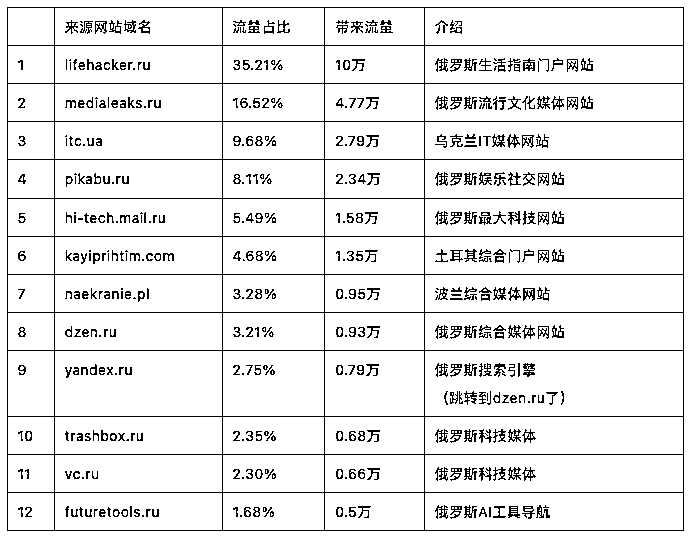

然后我在 Google 上用 `site:来源域名 bairbie` 搜索，时间区间限定在 7 月 17 日到 7 月 25 日，想找出最早的宣传源。

以 lifehacker.ru 为例，搜出来只有 7 条，最早的显示是 7 月 18 日。但仔细看关键词只出现在描述里，没进标题，基本可以判断是文章列表的关联推荐。

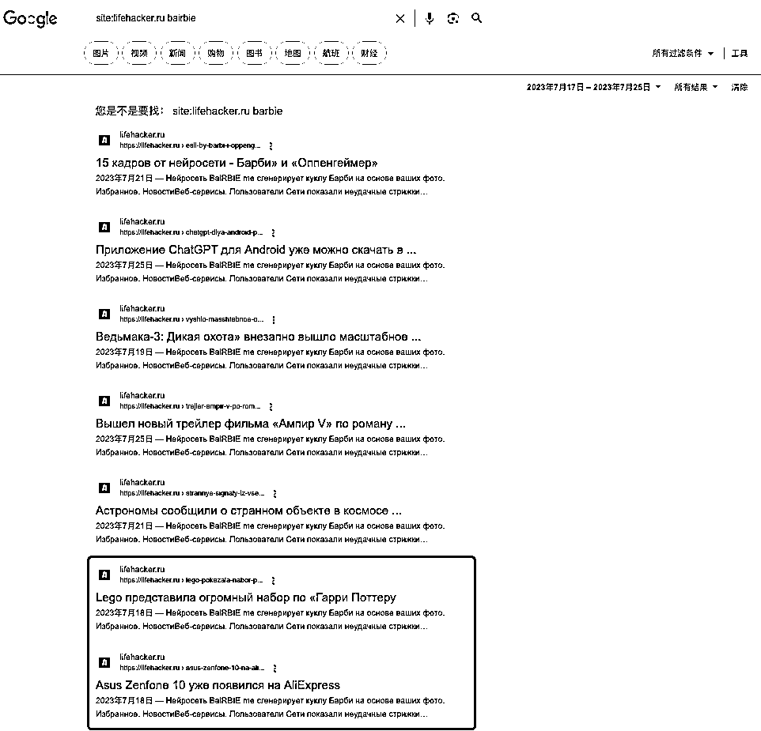

把时间窗往后挪，测试到 7 月 26-28 日，才真正定位到原文。

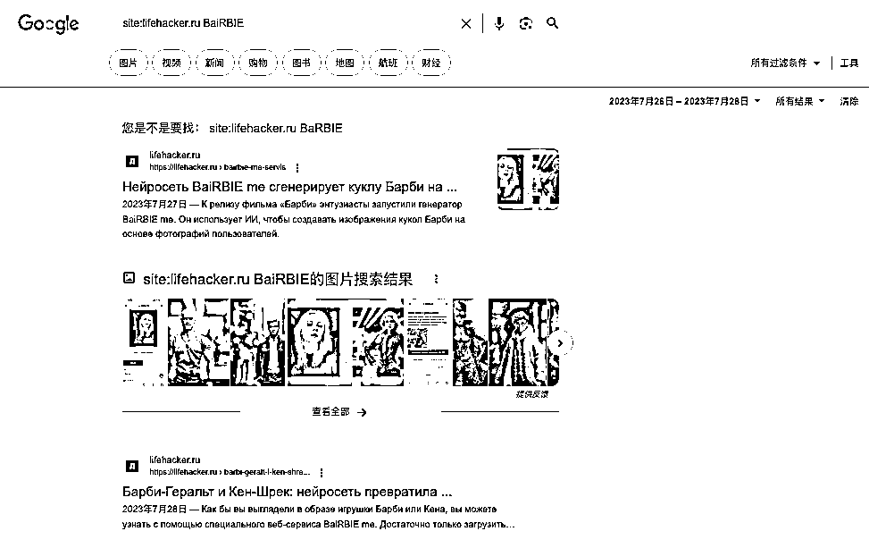

最终 URL 是 `lifehacker.ru/bairbie-me-servis/`，发布时间 7 月 27 日，页面截图如下。

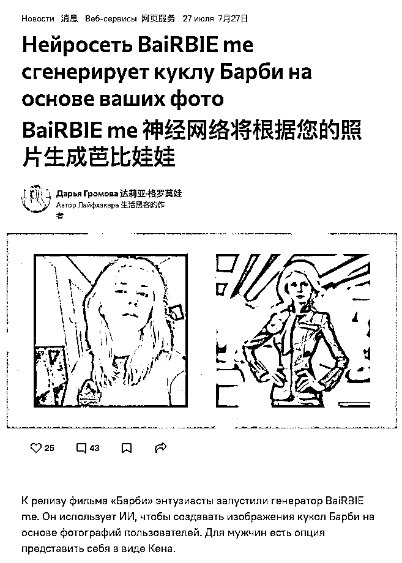

文章很长，我只截了开头和结尾，结尾处有 BaiRBIE.me 的直链。

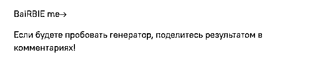

这篇是 lifehacker.ru 编辑达莉亚·格罗莫娃发的，目前看不出是付费稿还是常规报道，先不下结论。

用 intitle 语法再验证一遍，限定关键词必须在标题里，时间拉长后，该站就只有这一篇在讲 BaiRBIE。

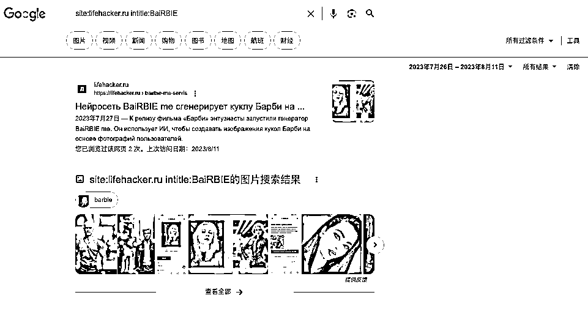

第二个来源 medialeaks.ru，限定 7 月 17 日到 8 月 11 日，只找到一篇。

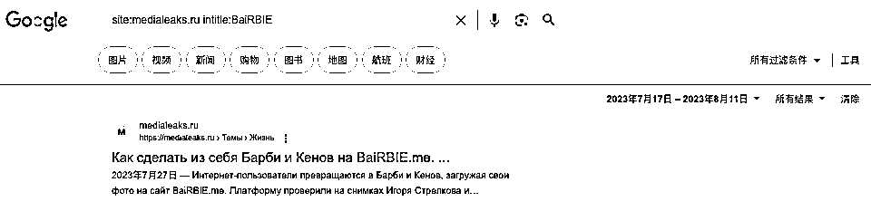

链接是 `medialeaks.ru/2707tat-str-int-bairbie-me/`，发于 7 月 27 日。

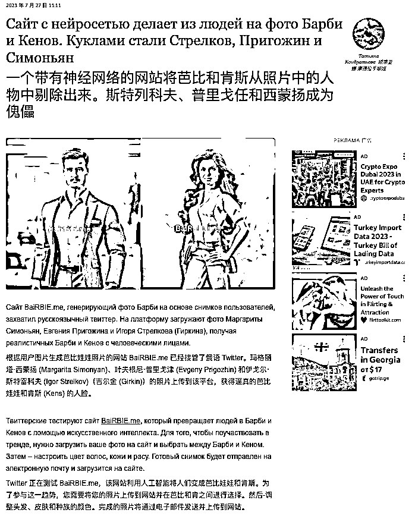

文章里提到了 Twitter，说明 BaiRBIE 很可能最早就是在 Twitter 上被放出来的。

再看第三个来源 itc.ua，搜出来四条，两条 7 月 26 日，两条 8 月 1 日。

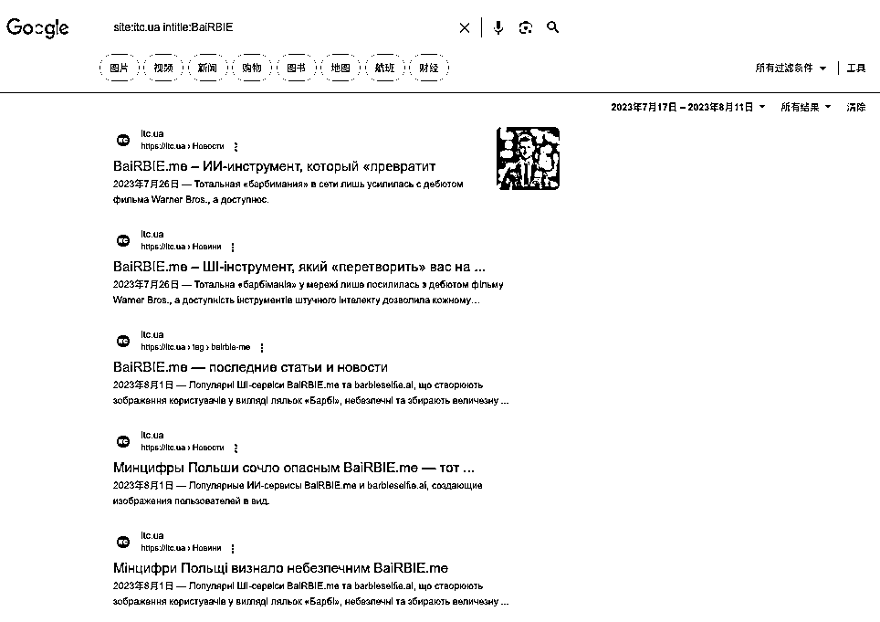

看 7 月 26 日的那两条：

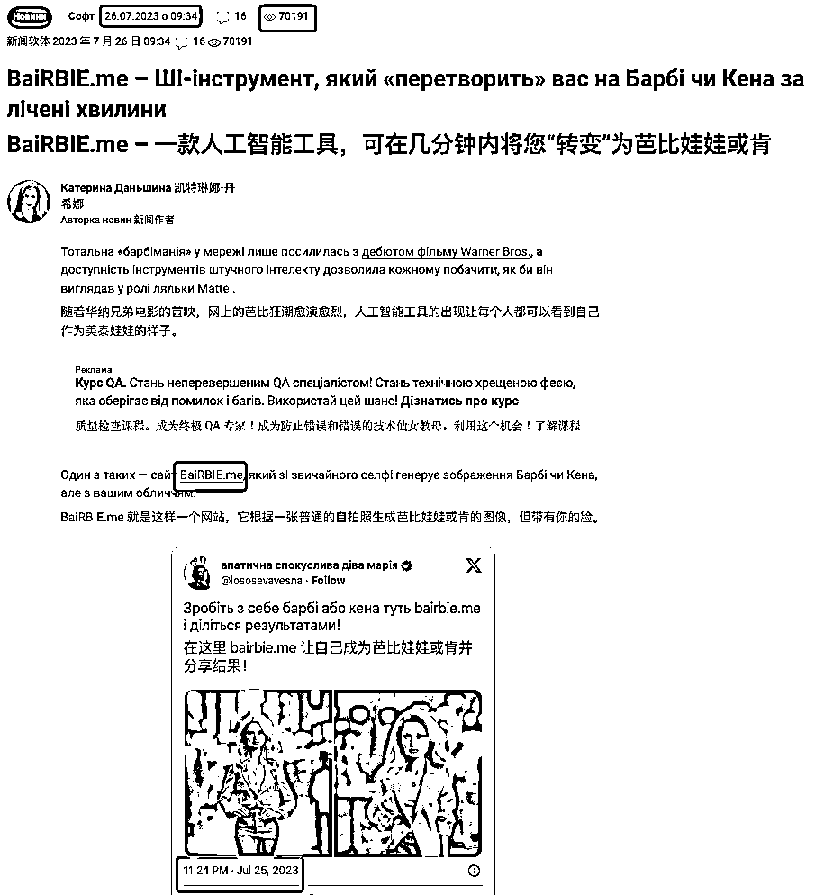

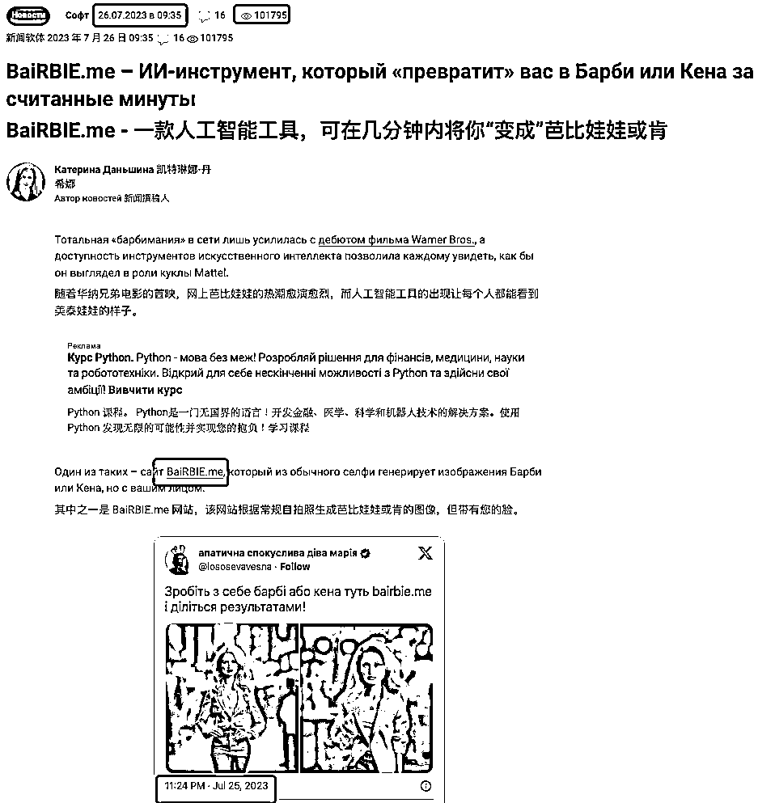

有几个细节很值得注意：

1、发布时间只差一分钟，09:34 和 09:35；
2、阅读量分别是 70191 和 101795；
3、两篇文章都嵌入了同一条推文；
4、推文发布时间是 7 月 25 日。

前面两个网站的稿子也都关联到了推特，这个时间线很关键，先记着。

第四个来源 pikabu.ru，直接搜 `site:pikabu.ru intitle:BaiRBIE` 搜不到结果，说明标题里没有关键词。改成站内搜索 `pikabu.ru/search?q=bairbie&st=3`，找到 4 个帖子：

`pikabu.ru/story/v_volne_novogo_filma_pro_barbi_i_pro_ai_neyronku_10502953` 7 月 26 日
`pikabu.ru/story/stat_barbi_za_1_minutu_10509430` 7 月 28 日
`pikabu.ru/story/now_i_am_become_death_the_destroyer_of_barbieworlds_10511321` 7 月 29 日，帖子里还提到了去水印工具，明显是用户自发发帖
`pikabu.ru/story/prevrati_sebya_v_barbi_ili_kena_v_odin_klik_onlayn_10527031` 8 月 3 日

再看 hi-tech.mail.ru，7 月 28 日一篇软文，已经把 BaiRBIE 的使用流程和链接写得很完整了。

`hi-tech.mail.ru/news/101583-internet-shodit-s-uma-po-barbi-nejroseti/`

剩下的我就不逐条演示了，直接把按发布时间整理好的传播节点列出来：

7 月 26 日发布：
`itc.ua/news/bairbie-me-yy-ynstrument-kotoryj-prevratyt-vas-v-barby-yly-kena-za-schytannye-mynuty/`
`itc.ua/ua/novini/bairbie-me-shi-instrument-yakyj-peretvoryt-vas-na-barbi-chy-kena-za-licheni-hvylyny/`
`pikabu.ru/story/v_volne_novogo_filma_pro_barbi_i_pro_ai_neyronku_10502953`

7 月 27 日发布：
`lifehacker.ru/bairbie-me-servis/`
`medialeaks.ru/2707tat-str-int-bairbie-me/`
`naekranie.pl/lekkie/barbie-ken-generator-wlasne-zdjecie-bairbie-me-1690446081`
`trashbox.ru/link/2023-07-27-nejroset-delaet-barbi-ili-kena-s-vashim-licom`

7 月 28 日发布：
`hi-tech.mail.ru/news/101583-internet-shodit-s-uma-po-barbi-nejroseti/`
`pikabu.ru/story/stat_barbi_za_1_minutu_10509430`
`kayiprihtim.com/haber/yapay-zeka-fotograf-barbie-evreni-site/`
https://[vc.ru/u/1986849-neurotrends-neyroseti-chatgpt/774679-bairbie-me-ii-instrument-kotoryy-prevratit-vas-v-barbi-ili-kena-za-schitannye-minuty](http://vc.ru/u/1986849-neurotrends-neyroseti-chatgpt/774679-bairbie-me-ii-instrument-kotoryy-prevratit-vas-v-barbi-ili-kena-za-schitannye-minuty)
https://[vc.ru/flood/775096-obrabotay-svoe-foto-v-stile-barbie](http://vc.ru/flood/775096-obrabotay-svoe-foto-v-stile-barbie)
https://[vc.ru/marketing/774797-ya-tozhe-hochu-na-plyazh-predstavili-zvezd-rossiyskogo-it-v-obraze-barbie](http://vc.ru/marketing/774797-ya-tozhe-hochu-na-plyazh-predstavili-zvezd-rossiyskogo-it-v-obraze-barbie)

7 月 29 日发布：
`pikabu.ru/story/now_i_am_become_death_the_destroyer_of_barbieworlds_10511321`
https://[vc.ru/u/2105782-elena-valitova/776159-bairbie-me-zavoevyvaet-mir-v-chem-opasnost-neyronok-i-chat-botov](http://vc.ru/u/2105782-elena-valitova/776159-bairbie-me-zavoevyvaet-mir-v-chem-opasnost-neyronok-i-chat-botov)

7 月 31 日发布：
`dzen.ru/a/ZMfUO_fpOHtoOGmj`

关于 BaiRBIE.me 这波流量是怎么被做起来的，哥飞梳理了一下全网痕迹，给出了一份相当清晰的复盘。

先看媒体端。8 月 1 日上线的一批链接，以及 8 月 3 日集中出现的几篇 Pikabu、Dzen、VC.RU 的相关稿件，加上那 21 个被圈出来的网页，哥飞根据从业经验判断：除了 Pikabu 和 VC.RU 上有一部分是用户自己发的之外，其他页面基本都是典型的媒体投放特征——单个站点只出现一两篇，但阅读量都不小，可以归为软文推广。

再把视线转到社交带来的那部分流量。整个站的访客里，有 14.51% 来自社交网络，这 14.51% 的具体构成是：

55.27% 出自 VKontakte，即俄罗斯最大的社交平台 VK；

17.93% 来自 Facebook；

10.97% 来自 Twitter，如今应该叫 X；

9.54% 来自 TG web app；

3.60% 来自 Instagram。

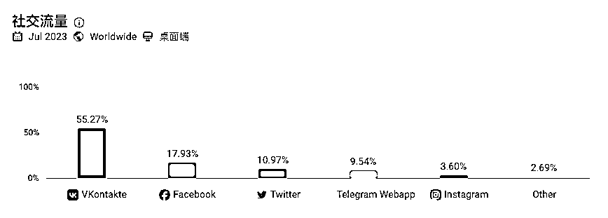

先拆解 VK。先用 Google 搜，出来 915 条，结果受限于发布时间显示不准，仍是老问题，索引时间≠真实发布时间。

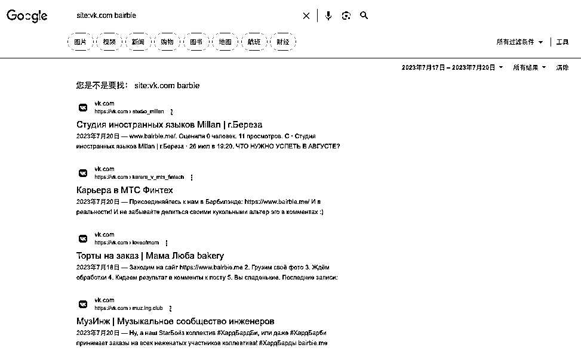

拿搜索结果里显示 7 月 18 日发布的 https://vk.com/loveofmom 举例，点进作者主页 https://vk.com/wall-83478798_15142 实际发布时间是 7 月 28 日。https://vk.com/muz.ing.club 也是 8 月 1 日才转载自当天发布的 https://vk.com/wall-192863412_651。

换到俄罗斯本土搜索引擎 Yandex，用 [site:vk.com] inurl:wall bairbie.me 这条语法，一次性筛出五千多条用户原创内容。因为没法按时间精准过滤，哥飞手动抽样了 100 条并做了天数统计，表格如下：

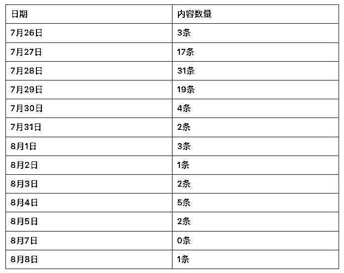

数据很直观：7 月 26 日首见内容，27 日开始扩散，28 日达到峰值，29 日后热度明显下滑，之后基本平淡。这与前面媒体软文的投放节奏完全吻合。

再看 Twitter 的搜索统计：

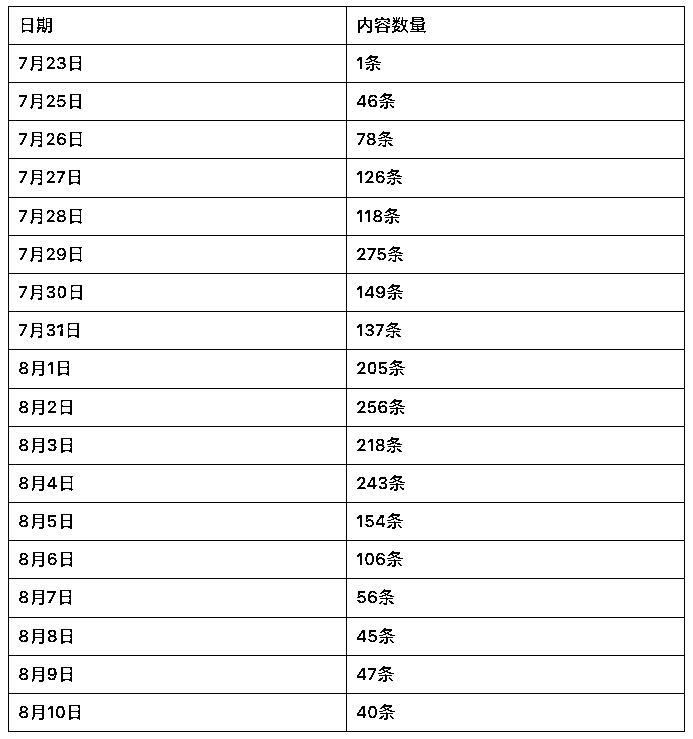

23 号像是小范围测试，25 号才正式对外开放，之后在 29 号出现一个明显高峰，随后回落一段，8 月 1 日到 4 日又有一波不错的数据，之后便一路走低。

Facebook 部分哥飞没有做细致统计，推测走势与上述类似，有兴趣的可以自行验证。

综合到一起，BaiRBIE.me 的完整时间线可以这样总结：

1、7 月 17 日 完成域名注册；
2、7 月 20 日 好莱坞电影《芭比 Barbie》正式上映；
3、7 月 22 日 Archive 已能抓取到 BaiRBIE.me 的页面快照；
4、7 月 23 日 Twitter 上出现首条分享记录；
5、7 月 25 日 团队先邀请部分用户和 KOL 内测，并在 Twitter 引发第一波扩散；
6、7 月 26 日 开始投放科技媒体软文，重仓 itc.ua；
7、7 月 26 日 Pikabu.ru 上出现首批用户自发帖子；
8、7 月 27 日 软文覆盖 lifehacker.ru、medialeaks.ru、naekranie.pl、trashbox.ru；
9、7 月 28 日 软文再上一轮 hi-tech.mail.ru、kayiprihtim.com；
10、7 月 28 日 VC.ru 上开始出现用户自发扩散的内容。

从 7 月 25 日起，Twitter 上既有自然传播的用户，也有团队合作的 KOL 同步助力。整体来看，Twitter 的裂变效率依然非常惊人，值得重点经营。

这套打法和当初的妙鸭相机思路高度相似：先在核心社区做内测种草，公测后借社交裂变放大，再配合其他平台的二次传播。最值得借鉴的环节是媒体软文的冷启动，先用媒体背书制造声量，再靠社交网络完成放大和裂变。

以上就是本次复盘，文末评论区也热闹得很。

黄小刀 : 飞哥，你也太高产了……

三林 : 之前提到哥飞这个案例，关联的中标帖 t.zsxq.com/12WsOzkny

阿彪 : 牛逼的分析啊！！！

哥飞 : 感谢阿彪的认可

涛 : 想知道飞哥写这篇文章花了多久，尤其是人肉翻看俄搜索引擎 100 条还总结表格花了多长时间[捂脸]

哥飞 : 8 小时

龙哥 : 感谢分享，已加精华。

Jacky 杰克 : 先用小红书种草，没有小红书的话就发点软文[奸笑]

