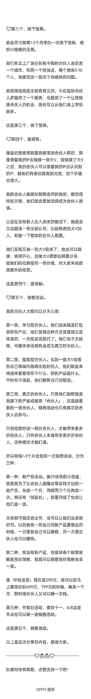

# 3个月做到100万利润，我和合伙人是怎么“互惠共赢”的？

应粥左罗老师邀请，我做了一次内部分享。现在把这套打法完整整理出来，希望能给想做合伙人模式或高客单价产品的朋友一点启发。

先简单介绍一下自己：我是阿猫，金融硕士，留学背景，公众号“阿猫读书”创始人。目前有一个合伙人加4名全职员工，主要负责知识星球和多平台运营。

2017年毕业时，我选择了做自媒体。原因很简单：当时接广告很容易，一个月4条广告就有一万多收入，而打工很难有这样的天花板。从接广告到社群，再到视频号、直播，最后做到现在的“7年觉醒合伙人”项目；对我来说，这就像打游戏闯关，总想试试下一关怎么过。

这次项目的成绩是：合伙人产品客单价1万左右，卖了200份，整体利润约100万。下面把“为什么做”“怎么卖”“合伙人得到什么”三个问题拆开讲。

**为什么做？**

第一个原因，流量。

做自媒体最痛苦的就是流量。过去我只有两条路：要么花时间创作等平台给量，要么花钱买量。买量我花了近100万，投到各个大号上，但后期会饱和，也有风险。合伙人模式让我发现了第三条路：他们帮我卖产品，他们赚钱，我得到曝光。现在我等于有三条腿走路——付费投放、内容流量、合伙人分销。

这条路怎么被验证的？一方面我算过账：我自己的产品已经卖得差不多了，如果愿意把利润全让给合伙人，他们卖出去是本事，我也不亏，完全可以试。另一方面，我观察“玩赚新媒”就是这么干的：创始人芷蓝做小IP，不靠个人影响力卖货，而是用100%分佣招募了五六百个合伙人，冷启动后靠裂变把星球做到5000多人，相当于创造了几百万利润。这让我确信，模式可行。

第二个原因，我能帮合伙人补齐“产品和转化”。

说实话，能像粥老师那样把流量、产品、转化都做得很强的人非常少。很多小IP，每一个环节都要磨练两三年。我不需要他们做全部，只要专注自己最擅长的事，比如内容引流，然后卖我的产品就行。我的创富社卖了5000多份，说明我确实有转化能力。我还会开带货营，教他们怎么卖。他们解决了产品和转化，我解决了流量，刚好互补。

这尤其能帮早期阶段的IP。比如有些合伙人公众号只有一两百阅读，接不到广告，很难变现。但成为合伙人后，卖我的低客单价产品，一个月能赚几百块，至少不再只是“为爱发电”。再往后，他们还可以卖高客单价产品，提前开启高客单生涯。像理白，公众号阅读不高，但朋友圈精细化运营做得好，硬是转化了100多个人成为合伙人。

第三个原因，合伙人能分担交付压力。

当合伙人卖我的“合伙人”产品时，他不只是在卖“阿猫的合伙人”，而是在卖“觉醒品牌”的合伙人。比如B站UP主包子，已经帮我卖了近10个名额。他会对自己带进来的人负责，自己承担一部分交付，我的压力就小很多。而对用户来说，相当于两个IP同时服务；对包子来说，他原本可能要三年后才能卖一万多的产品，现在提前就卖起来了。更重要的是，每个新进来的合伙人又会成为新的分销者，继续卖产品、招合伙人，形成裂变。这是三方都赢的事情。

**怎么发售？**

我原本是成长类IP，转型卖自媒体产品其实很难。最早的自媒体星球定价999涨到1499，我有30万粉丝也只卖出了100份。后来我花了很长时间转型，把价格降到499，定位成“IP创业营”，专门用来给合伙人产品引流。整个发售分四步走。

第一步，低价引流。先把499元的IP创业营推出去，靠自己的IP影响力卖出去大约1000份。单看这个不赚钱，但为后面铺好了路。

第二步，找种子分销。我从老用户里挑了10个左右比较信任我的小IP，给他们80%的分佣，请他们每周在星球分享一次，顺便帮我卖货。这个利益点太诱人了——一份499元，他们能拿近400元，卖10个就是4000元，比自己卖产品还赚钱。结果他们很猛，又卖出了约500份，星球总人数到了1500。

第三步，盲订。我在IP创业营里宣布要推出合伙人产品，先用简单的图文把权益列出来，马上一批铁粉付款。之后再放出一张精致海报，告诉大家权益还没正式公布，可以趁最后几天盲订。这样持续了半个多月到一个月，盲订阶段积累了约100人。

第四步，正式招募加合伙人分销。我写了一份详细的产品介绍，说明包含哪些产品、怎么分佣、为什么能做。正式招募又来了十几二十人，总数约120。之后涨价到9999元，基本卖不动了。于是我开始让合伙人一起来卖。每个小IP身边都有几个铁杆粉，只要条件允许，都会支持。两三个月里，合伙人帮我消化了几十个名额，最终凑齐200份。

发售前还有一个细节：我给部分早期合伙人开小灶，让他们半价4999元加入，同时把分佣从80%提到100%，之前卖IP创业营的佣金也按100%结算。这个条件打动了十几个人，成了我最核心的种子合伙人，未来还能持续帮我卖新产品。

**合伙人得到什么？**

第一，钱。卖我的低价产品，佣金100%；卖高价产品，佣金50%。我甚至希望低客单价产品定价低一点，这样用户划算，合伙人也好卖。当他们真的赚到钱，做内容和引流的动力就来了。

第二，影响力。虽然我给出去100%分佣，但某种程度上我也在“借”他们的流量——他们的粉丝会慢慢认识我。作为回馈，我也会把我的流量导给他们。合伙人如果成功带出一个新合伙人，就可以来我的100个读书群做分享，或在我的核心社群里露面，这些都能帮他们涨粉。我有个类似新媒体变现圈的群，每周都会请有成果的合伙人来分享，既给群友内容，也给合伙人曝光。通过合伙人卖合伙人，我自己也赚了差不多10万，所以我很乐意把流量分享给他们。

第三，联合训练营。我会和合伙人一起开训练营，比如带货营、公众号营、朋友圈文案营。参考赚钱有术的航海模式，我提供平台和学员，合伙人负责讲课。每次训练营约200人参与，合伙人既能曝光，还有保底1000元讲师费，加上额外奖励。比如最近创富社的带货营，就是合伙人老马负责的，效果非常好。训练营分大小两种：大的是带货营，小的像朋友圈文案、公众号互推，一般7到14天，覆盖很细分的技能。

最后总结一下：这个项目能在3个月做到百万利润，核心不是靠我单打独斗，而是搭建了一个让大家都受益的结构——我解决产品、转化、交付，合伙人解决流量和裂变。彼此都在付出，也彼此都在得到。

如果你正在考虑类似的产品，希望这篇复盘对你有帮助。觉得有用的话，点赞收藏一下，也欢迎在评论区聊聊你的看法。

做自媒体最头疼的事情是什么？流量来了留不住，粉丝买了不回购，辛辛苦苦攒起来的影响力，很难变成持续的收入。很多人做到一半就卡住了。

想不想知道，有人靠一套“合伙人”玩法，把这个问题拆得干干净净？今天就用大白话拆给你看。

先说合伙人能得到什么。

第一，小体量IP也能轻松入场。你不需要多牛，也不用我额外掏一笔讲师费来请你，因为能进这个圈子，对你来说已经是很大的收获了。

第二，这叫“群”而不是“课”。做内容的人最难的是找到同频的人。大家能聊到一块儿，产生信任，才有可能一起干点事。你把愿意掏一万块左右的人筛进来，这群人会自动开始互动、自发聊合作，圈子的价值一下就出来了。

第三，流量可以反复榨干。虚拟产品有个麻烦事儿——复购率低到可怜。流量想重复变现，通常只能靠反复卖不同的东西。可大多数人没有团队，做一款产品就到头了，后面就只能接广告，等广告没了、产品卖不动了，收入也就断了。但如果你是我的合伙人，情况就不一样了：你可以挑不同的产品去卖，每隔两三个月就能变一次现。所有合伙人都能持续把这件事做下去，而我也顺便拿到了稳定的流量池。说白了，变现的两条路，要么持续搞新流量，要么把手里的流量反复用。搞不到新流量的时候，选第二条路准没错。

再来看我自己拿到了什么。

最直接的是门票收益，上一次招合伙人，这一项利润差不多是一百万。不过这只是表面。

合伙人卖我的产品，是在帮我带流量；他们拉人进合伙人，是直接帮我赚钱。产品还是那个产品，但把流量和钱的问题一起解决了。我见过一个做这类模式的姑娘，每天就是开开舞蹈室、到处旅行、带带孩子，看起来闲得不像话，但钱一点没少赚。她搞的就是这种“加盟式”打法，借力放大，不用自己扛。

还有几个隐性好处。能挖到以后可以做深度合作的潜力股；能反着跟合伙人学东西。我做这个项目，最早就是因为在星球合作里跟几个人学到了很多东西。包括现在跟老马合作带货营，我一直以为自己是销售天才，结果一比，才知道什么叫真正的会卖。以及，我能拥有一个极高浓度的分享阵地。从三十万粉丝里筛出两百个最认可我、最同频的人，建个私密群。平时乱七八糟的话不敢在大群里说，但在这两百人里，我随便抛个想法，回应都是正向的。这个群基本就是我最亲密的自己人，每个月还会聚一聚，合伙人是能做终身朋友的。

最后说说这个模式的核心打法。

第一是轻交付。合伙人真正买的是高佣门票，光冲这个权益，一万块就值了。我只要再给一点点服务，产品就瞬间很能打。我做的分享，更像内部特训，教他们怎么卖货、怎么做内容，恨不得他们赶紧成长起来，以后能有自己的IP。没成长起来也没关系，先卖我的产品过渡，起码能熬过最冷的阶段。

第二是圆桌会议。我最烦一对一私聊，一次只能服务一个人，效率太低。所以干脆把问题都收上来，每个月第三周开一场线上圆桌会，一次两三个小时，集中答疑。这样一来，我回答的时候知道有很多人在听，也会答得更卖力。答疑分三级：能公开的圆桌直接讲；不太要紧的群里直接问；实在私密的，才走一对一咨询。早年我也会担心人多了应付不过来，但后来发现，真愿意提问的就那么几个，后面基本没人问了。 

说到底，“合伙人”这套东西，本质上是把一个又一个的流量、人才、信任，全部盘活成了一个可持续运转的杠杆。不必单打独斗，也不怕流量枯竭，因为总有新的人加入，也总有人在跟着你一起赚钱。

如果这个拆解对你有启发，记得点个赞支持一下。

