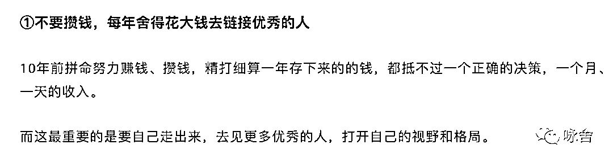
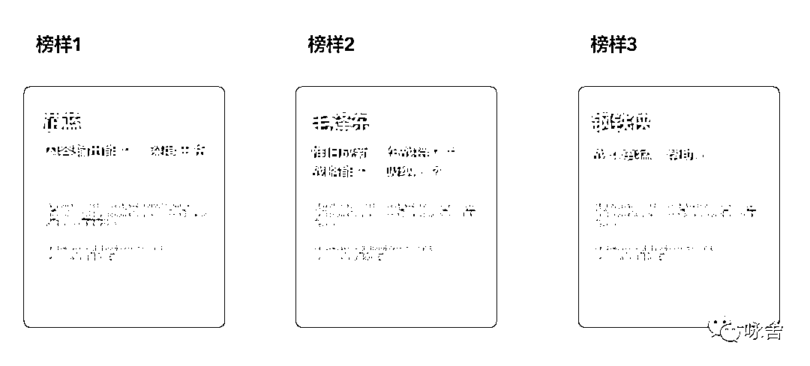

# 付费学习这些年，我踩过的坑和换来的清醒

这段时间后台总有人问我：知识付费到底值不值得？我的答案一直没变：值，但前提是你得会选。我自己和身边不少朋友，都在这个事情上交过学费。

前两天在写《如果倒回10年前》那篇文章时，我回顾了自己的十年，第一条给自己的话是这样写的：

说实话，交学费本身不可怕，真正拉开差距的，是交完学费之后的态度：从此对知识付费一棍子打死，还是收拾心情、复盘继续往前走。

先说说我踩过的几个典型坑：

- 囤了一堆课，买了就吃灰；
- 看到营销文案“轻松月入百万”，真以为自己上手也能行；
- 压根没想明白自己为什么买，也没想过能学到什么；
- 买回来发现并不喜欢，上几节就悄悄放弃。

真正让我发生改变的，是今年花高价跟了几位老师，才慢慢摸到门道。想把这几点经验分享出来。

**第一，先把自己搞清楚，再去看老师**

了解自己不是空话，而是要能回答：我喜欢什么，擅长什么，接下来想做什么？更重要的是，清楚自己处在哪一段：是0到1的新手，是1到2的进阶，还是2到N的成熟玩家。

如果你是刚起步的0到1小白，其实不一定非要追顶级大牛。离你近、能给你充分1v1辅导、能陪你跑通第一个小闭环的老师，反而是更优选择。就好比小学生做数学题，找一个会教、有耐心的大学生就够了，非要请金牌奥数教练，既浪费也不一定有效。

再就是价格。挑一个自己能接受、又和自己当前需求匹配的价格。对小白来说，投入产出比比名气重要得多。那些动辄几万、十几万的“高价圈子”，其实大多没什么课程，本质是资源链接，更适合已经在2到N阶段、需要放大价值的人，而不是新手。

**第二，小心被营销拿捏**

“小白轻松月入10万”这类话，听听就好。如果真的这么容易，身边应该早就是遍地富翁了。赚钱对还在摸索阶段的人来说，是有门槛的。如果没准备好，先踏实上班没问题。

但现实是，越是迷茫的小白，越容易被这种急迫速成的心理牵着走。今天刷到“抖音带货月入10万”就想冲抖音，明天看到“小红书日入2k”又想去小红书，后天再被“剧本杀年入30w”打动……市面机会很多，真正适合你的一定要结合自己的兴趣和积累去判断。

**第三，找榜样，而不是只看招牌**

你可以列出3到7个你真心欣赏的榜样，去挖他们身上的共同特质。

我是今年才突然想明白，为什么跟着刘津老师学习，效果来得那么快。因为从2016年读《破茧成蝶》开始，她就是我一路对照的榜样。

榜样法的底层是：你喜欢的那个人身上，有一部分正是你想成为的样子。但光有喜欢还不够，还要去看对方的修为和格局。很多外在包装未必真实，翻翻她早期写过的文字、发过的视频，能看出更多真实经历。

看修为，主要看三点：
- 她怎么和高段位的人相处；
- 她怎么和同段位的人相处；
- 她怎么和低段位的人相处。

我理想中的状态是：不卑不亢地向上链接破圈，向下兼容时足够包容，和同路人共同成长、彼此成就。这些细节里藏着一个人的价值观，也会告诉你和这个人在一起舒不舒服。

如果足够了解后，依然深深被吸引，那就可以认真考虑。请相信：跟一个自己并不喜欢的老师，很难学出结果。哪怕人家教的是真本事，你心里也会不断怀疑、反复拉扯。我观察自己付费跟的几位老师，能出结果，不只因为方法好，更因为价值观同频、相处舒服。如果决定之前心里有一丝犹豫，那就别强扭，顺着自己的感觉走，也许只是还没到时机。

**第四，多做一步验证，别靠冲动下单**

付钱以前，多去看看老师本人做了什么，带出的学员做出过什么案例。但也要警惕：营销往往会放大结果。10个学员里只有1个赚钱，宣传可能只给你看这1个；剩下9个沉默的人，你很难注意到。人很容易被那一个赚钱故事点燃，多问一句、多查一点，就是对自己钱包负责，也能少一次事后后悔。

**第五，清楚自己想从中得到什么**

每个老师都有长板和短板，人无完人。你不用追求面面俱到，只要明确这一阶段能从对方身上学到什么就好。是学流量，学产品，还是学朋友圈文案？

比如某个老师特别擅长朋友圈内容输出，写的东西总给人很足的情绪价值，而这恰好是我现在需要的，那我就可以定向去学这一段。知道自己要拿什么，再去看老师能提供什么，知己知彼，这钱才花得值。

**第六，学会精简学习，而不是减掉学习**

精简学习不是让你不学，而是让你分阶段学，减少信息焦虑。如果什么都想学，一口气报七八个课，最后容易越学越慌，越学越没底气。

正确做法是：先定阶段目标，再找对应学习内容。比如：
- 5月主攻演讲；
- 6月主攻做课；
- 7月主攻视频号。

是先有目标、再找课程，而不是先囤课、再硬找目标，那样就本末倒置了。像赚钱有术的小航海，21天行动制，完全可以根据需求选着报，尤其适合小白和初级阶段的提升，里面高手也多。而且航海本身的交付质量，不输市面上几百到几千元的训练营，还是押金制，差不多等于免费参加。

**第七，尽量触达核心，减少重复信息**

我最有价值的收获，大多来自和老师直接交流。比如靠谱1v1带我梳理销售框架，实战观摩加方法总结，直接精准，比一堆通用课程有用得多。

也不是说低客单价内容完全不能买，而是要有意识地减少。买太多不仅容易信息焦虑，还会信息重复。低价课程大多承担引流功能，属于“信息知识类产品”，基本很难帮你链接到真正有价值的资源和人脉。如果你想单纯补充知识，得到、极客时间这类平台上就有不错的优质内容，真不必反复堆积。赚钱的精华帖、航海手册，涵盖得已经够详细，后者甚至是保姆级教程。

但别忘了：学了不等于会了，发了不等于钱来了。最终还是要看你自己有没有足够的意志，能不能沉下心深入研究，主动跳出舒适区。

说了这么多，我的结论很明确：付费学习是借别人肩膀看世界的好方式，能让你更快拿到结果。但前提是，你得先了解自己，知道到底要什么。不迷茫，不焦虑，顺从内心，才是更好的状态。

评论区也看到有人提到：他们公司专门承接低价课程的售后，学员根本接触不到真正带学的人。低价课程说白了，更多是让你“知道还能这么做”，遇到问题时有个人能问，仅此而已。
