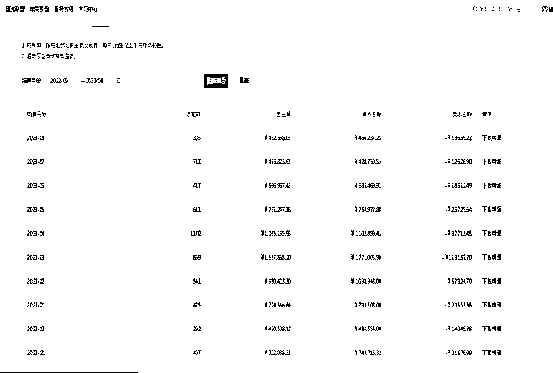
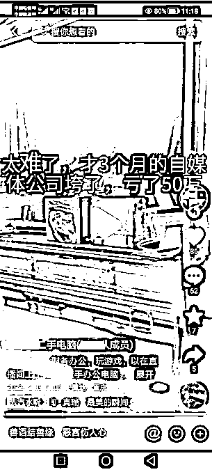
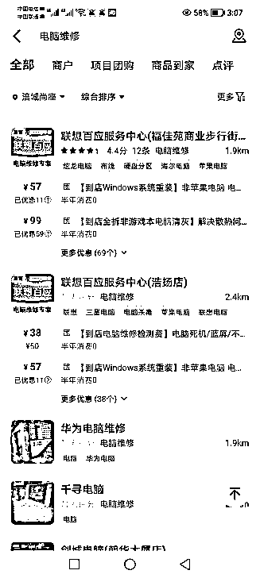
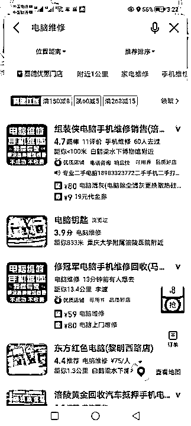
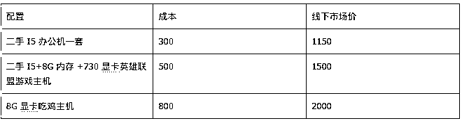

# 同城二手电脑 + 上门维修，一年做到近 2000 万销售额和 5 家盈利门店的实操复盘

> 原文：[`www.yuque.com/for_lazy/thfiu8/larl03ayiagwip45`](https://www.yuque.com/for_lazy/thfiu8/larl03ayiagwip45)

## 一年卖出近 2000 万二手电脑，5 家手机电脑上门维修门店当月盈利的全过程

作者：回望起点
日期：2023-09-22

靠老婆发朋友圈和拍几条抖音，我们一周就把家里闲置的 30 多台电脑处理掉了。这一单让我看到二手电脑同城需求被严重低估，于是开始放大做。

视频越拍越多，私信私约上门维修的电话也跟着暴涨。我才意识到，真正没人抢的蓝海是维修的后市场。

后来就把模式升级成线下门店：以同城上门维修为基本盘，二手电脑销售为利润放大器。

目前二手电脑累计销售额接近 2000 万，5 家实体维修门店全部做到当月盈利。下面把这一年摸爬滚打的经验整理出来，供大家参考。

我是回望起点，重庆人，互联网创业 8 年，团队 40 人左右，偏好轻资产打法。1 年多前在赚钱分享过一次，这段时间一直沉在业务里，很少更新。

这几年赚钱很多精华内容都给到我们运营启发。在手机电脑维修和二手数码的赛道里折腾一年多，也算有点小成绩：二手电脑卖了近 2000 万，5 家维修连锁门店落地。我把经历写下来，希望能给同行一点思路。有不足的地方欢迎指正交流。

今天的主题就是《新手入局二手电脑销售 + 同城手机电脑上门维修，一年卖 2000 万二手电脑，5 家维修门店当月盈利》。

# 一、项目是怎么起来的

2022 年初受朋友介绍，我去一家全国前五的货运平台做新媒体负责人。公司堆着 50 台闲置办公电脑，放久了怕坏，就让老婆帮忙发朋友圈和抖音试试。

她没有任何销售背景，就随意发了几条。结果一周卖出 30 多台，大多是熟人、同城自提。价格没谈、质量没挑、售后也不讲。每台 850 元，正好是当年采购价。

这件事点醒了我：需求是真实的，而且被低估了。一个月后我从货运平台离职，回到自己公司全力启动这个项目。

经过一年迭代，现在我们有接近 10 个二手电脑直播间，5 家线下手机电脑维修门店，二手电脑总销售额近 2000 万，5 家门店全部实现当月盈利。

当时办公室闲置电脑处理情况和某店直播收入截图：

# 二、主要获客渠道现状和遇到的问题

**1、抖音短视频**
同城二手电脑的核心打法就是发同城回收视频来吸意向客户，再拉到私域微信预约到店成交。

起初合伙人出镜我负责拍摄，前几条播放只有千把点。后来把内容换成“上门回收”类，流量立刻起来了。回收视频一发，同城客户经常视频刚上线就转定金。

成交逻辑是：视频只负责引流，前期没有真实回收单也可以先演一遍，找朋友家拍回收现场就行。抖音同城流量非常猛。第一条爆款带动了 8 万的二手电脑成交，疫情期间一条普通视频 10 万播放，卖出 100 多台笔记本。

**2、微信社群**
微信群并没有被淘汰，尤其是小城市，活跃度很高。本地二手销售群转化也不错。

我们有合作伙伴专做线下群发，每个月能稳定卖几十台。关键是文案，不要写“低价处理二手电脑”，而是写“朋友公司搬迁，出一批二手电脑，一套千多”。话术要软。

**3、微信朋友圈**
跟微商逻辑一样，先让身边人知道你在做这个行业。文案风格跟社群类似，都是以处理闲置、公司搬迁为由头。

**4、美团、高德、百度地图、58 同城等本地生活平台**
20 多个平台主要用来拿上门维修单。区县上门维修几乎是空白，抖音本地生活维修类目开放后，又多了一个流量入口。

**5、瓶颈**
二手电脑直播的红利期已经过去，我们恰好卡在红利年。现在小白想靠直播起量很难。同城销售和上门维修在小城市竞争依然很小，我们的员工都是小白，培训半个月就能上岗成交。

# 三、双剑合璧：上门维修 + 抖音二手销售的空白市场

拍二手电脑视频时，上门维修的询单量也在同步增加。起初我们只收个成本费，后面主动打电话来修的人越来越多，才发现维修后市场几乎没人做。

按互联网思路，迅速开通了美团、高德、百度、58 到家等平台。开通后每天 3-10 单，上门维修成交率高，因为周边没有竞争对手，客户没有比价空间，客单价被拉得很漂亮。

我们所在的小城市，只有 1 家维修店开通了这些获客平台。做点数据就稳居类目第一，完全是白捡客户。

摸索 3 个月后获客稳定。梳理平台数据发现，全国大部分小县城几乎没有商家在这些平台获客。只要在县城租个便宜门面开通平台就能免费获客，模式复制性极强。

于是开始在周边区县复制。门店不选商业街，选小区门面或租金便宜的背街，30-60 平米足够。月租控制在 1500 元以内。简单装修＋货架桌椅＋门头，1 万搞定，平台费 5000 左右。开一家门店固定成本 2 万左右。

一个月开了 4 家，全部验证成功。开通平台后几乎立刻有维修单，当月盈利。

同时抖音二手电脑销售的优势还在，维修客户修不好可以直接推二手，二次成交自然形成。于是形成“平台获客做上门维修 + 抖音获客卖二手电脑”的门店商业模式。

三四线城市在美团、高德、百度搜索维修，优质商户几乎没有，基本都是个体店、装修简陋。

# 四、上门维修新手常见疑问

**1、没维修技术怎么办？**
这是最大误区。现在电子产品维修基本都是换件、换总成，很少动焊。会常见故障诊断和换件就能接 90% 的单。主板级维修的单可以外包给同行，拿 50-200 元介绍费。有师傅带，15-30 天就能上手。我们员工全是小白，很快就开始独立接单。

**2、怕没有客户？**
3-4 线城市这个市场基本空白，平台上就是捡客户。同城抖音卖二手也是同理，简单学习或模仿同行就能拍，行业视频普遍不专业，但依然有流量，天生就有想捡便宜的人。

**3、怎么判断自己城市能不能做？**
直接查数据。抖音搜“区县名+二手电脑/二手手机”，看是否有同行在发视频。再用美团搜“电脑维修”，看平台开通的商家数量。基本在三四线城市，结果就是没人做或极少。

**4、维修市场这么大，为什么没资本进来？**
头部如极客修、啄木鸟、京东到家，主攻一二线。三四线市场体量小，资本运营成本高。所以区县依然是夫妻店绝对空白。

**5、区县竞争大吗？**
一二线平台维修有竞争，区县个体店几乎不从平台获客，属于绝对蓝海。开通生活服务平台基本等于白嫖客户。

**6、开店要投多少钱？**
几万元就能启动。维修客户稳定，信息差大。手机维修一单 50-200 元，电脑维修 100-500 元，笔记本 200-500 元。数据恢复一单抵一季度房租。资料重要的单位客户，一单利润 1000-8000 很正常。

下图是我们做的一个数据恢复案例，利润 3000 元，用软件恢复，成本几乎为零。

**7、没表现力能拍抖音吗？**
同城二手回收同行少，短视频没太多技巧，真实展示回收现场就有精准客户。维修部分只要办理营业执照开通平台就能获客，不靠个人能力，花钱就能跑。维修月收入 1-5 万，根据城市规模不同，能覆盖房租、工资还有结余。二手销售收入是纯利润。

维修还会带来二手需求，修不好就推二手，维修成本高就推新购。回收二手利润也很高，一单 500-1000 元常见。

**8、有哪些坑？**
一是故障判断需要经验，接不到的单别硬接，先给同行做赚点差价。二是销售和接单技巧需要练习，内向无销售经验的人慎入。三是接单时先弱化问题，上门再沟通，修不好也能带回店里修。上门就是变相接单。四是要主动推产品、换配件增值服务，否则客单价上不去。

# 五、适合什么城市做

二手电脑适合三线及以下城市。一二线有专业电脑交易市场，价格透明，竞争激烈。

电脑是刚需：开公司、上网课、开店、打游戏都需要。但传统电脑城普遍做什么都做不精，网线、摄像头、弱电一起做。老板学历普遍不高，还是等客上门或靠关系拿政府企业单。

竞争对手很弱：没有互联网思维，不敢突破创新，扎堆在电脑城，房租高、口碑差、价格贵。3 线以下城市几乎没人拍短视频卖二手电脑，上门维修服务基本 1 家或没有。

下图是 20 平米店面，月租 1000 元。我们有 2 家店 1000 元/月，3 家店 1500 元/月。

# 六、门店选址建议

远离传统电脑城。只要停车方便、附近有地标即可，二楼也可以。线上引流到线下，不需要自然客流。小城市本身到店客流就少。

远离电脑城可以提升到店成交率，客户不会货比三家。抖音来的客户有天然信任感，到店成交率我们做到 90%。再结合生活服务平台做上门维修，收入更稳定。

# 七、产品本身的优势

1、信息差大。二手电脑价格受成色、品牌、暗病、购买年份影响，价格不透明，可以慢慢沟通成交。新电脑京东淘宝价格透明，信息差小。上门维修的上门费只要出门就收，区县是先收上门费后出门，不可退款。客户不付定金就不上门。

2、售后成本低。客户电脑故障直接换一台，换回来的旧机修好一样原价卖，外人不看出手次数。售后几乎没有成本，新电脑做不到。

3、宣传有噱头。可以承诺一年质保、不满意随时退。新电脑开箱就不能二次销售，会折旧，二手电脑随时退换不影响再卖，零风险。

4、消费降级催生需求。中小创业公司为省成本选择二手，需求持续放大。

# 八、初期货源怎么找

初期去省会或本地较大的电脑城找二手电脑供应商、多家对比报价，摸清底价。实地看质量成色后拿第一批货。第一次别进太多，等需求跑顺再加码。

下面附常见配置成本和市场价对比表。

# 九、结语

做二手电脑一年多，直播火的时候月销 200-300 万，内心也担心明天流量就没了。随着同行增多，节奏变快。现在转到同城维修 + 同城销售二手，节奏变慢、更稳。以前要竞争全国的店铺，现在只用打赢县城几十个个体户。手机电脑维修后市场是巨大蛋糕，目前服务者大多不懂互联网。

希望这篇复盘对需要的朋友有帮助。赚钱做本地生活服务的朋友多交流。

评论区互动：

专注电脑配件行业 20* : 大佬，给个好友位

随想 : 牛，这样的执行力[强]

回望起点 : fei7777

芷蓝 : 有启发，想不到需求量这么大，能不能做成加盟连锁？

龙哥 : 利润率大概有多少？

朱明晔 : 大佬关注你很久了[呲牙]终于出来分享啦

回望起点 : 相互学习，赚钱大佬太多

回望起点 : 维修利润可达 70% 甚至更高，二手线下买卖一般 40-50% 左右

