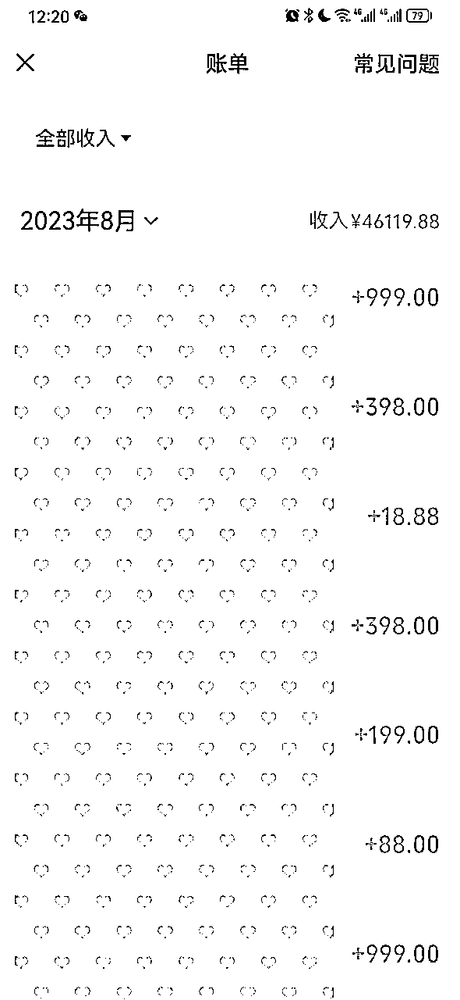
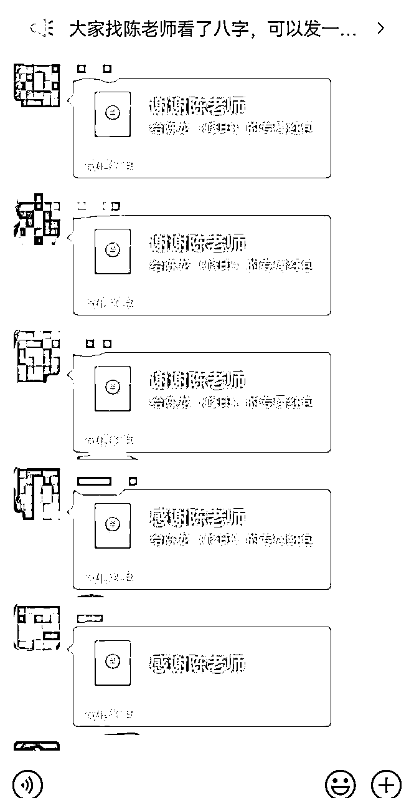

# ('周易咨询师破局，从0到1搭建社群，一个月实现营收4万+的复盘', (2, 32))

月入4万+的周易咨询师：不想当神算子，我只想点亮每个人心里的光

大家好，我是陈龙，赚钱龙珠圈友，平时做周易咨询，靠八字这面镜子，帮来访者看见自己。

说起来有点惭愧，没接触周易前，我是个“易燃易爆”的人，动不动就发火，典型的情绪无能。后来系统学了几年八字，才慢慢跟自己和解，看清自己的长板和短板，生活也一步步走上坡路。到现在，我已经陪伴1000多位来访者，借周易看清当下和未来的方向。

很多来访者听完分析会问：“你也太准了吧！这玩意儿是不是靠天赋？我能学会吗？”好奇就是最好的引路人，既然大家想学，我就分享了一些基础书，心想一周怎么也能啃下来吧。结果一问，好家伙，全卡住了：书里概念绕，字都认识，连起来就不像人话。我也没法一对一慢慢讲，毕竟时间真耗不起。

于是我想，不如做一门课，把基础内容掰开揉碎讲清楚。一份时间，能同时帮到更多人，学费也能摊薄，值。

8月1号，我发了条朋友圈，问有没有人想一起凑个小班。当时心里预期：能凑5个就开班。结果真有5个人报名！一个从0到1的小社群，就这么冒出了芽。那赶紧写大纲吧。可人嘛，一没截止日期就开始摸鱼——看麻雀、刷B站，日子哗哗过。

第三天，突然有位小伙伴直接打款预付学费。我啥都还没准备好呢！钱一收，压力瞬间上来了，赶紧承诺：下周五一定把课磨出来。本来想周末好好规划课程卖点，结果被娃缠得啥也没干成。

周一晚上，离周五只剩4天，我终于找到课程的“命门”——财运。说白了，没人愿意啃复杂知识，除非告诉他这跟你钱包有关。如果学了国学，能看清自己的优劣势，还能针对性调整，让财运变好，这逻辑不就自洽了吗？我赶紧发了条朋友圈汇报进度，当晚又收到好几笔预付款。

周五晚上，大纲终于整出来了，顺手做了张海报。有海报就是方便，朋友圈好发，别人也愿意帮忙转介绍。这时候靠谱老师出手相助，学员直接翻倍，太猛了。很多人加好友一句话不说，直接转账，我一边收钱一边慌，怕被封号，后来改走支付宝。第一次因为收钱担心封号，只能说靠谱老师势能太强，我也很荣幸成了他的合伙人。

周末继续带娃，手机却响个不停。我忽然意识到，这就是被动收益啊——哪怕我忙着哄娃，钱也在进账。这也让我下定决心，必须把课做好，让这门课成为我的名片。

到了周一，逐字稿还没写，我推掉所有合作和杂事，一门心思扑在课程上。晚上7点50，终于完工，休息10分钟，8点开讲第一课。

国学课有个特殊顾虑：有些人得知自己八字弱或不足，容易自暴自弃。所以我特意在课里植入一个概念——修行者的命，算不准。八字能推演人生轨迹，但努力、选择、付出，完全可以改写原来的格局。没人躺床上玩玩手机就能财富自由，那种人背后有父辈祖辈托底，咱普通人不指望。你看咱们赚钱圈很多年入几十万几百万的人，哪个不是凌晨一两点还在拼命？航海群里凌晨两三点还在打卡的伙伴比比皆是。每一份收获，背后都是十倍百倍的付出。

哪怕出身不好，我们照样能靠自己的努力和选择改命。这才是我做国学课的初心——不是当神算子，而是希望学员因为我，点燃内心那束光。

其实周易一点不玄乎，它就是个工具，跟盖洛普一样，帮我们认识自己，学会就能用。更像一个导航软件，提前帮你看到坑，提前避雷，让人生顺一点。

第一节课后，好多小伙伴自发帮我宣传。因为课程做得用心，也解开了一些人的心结：原来周易不是玄学，而是一套成体系的学问，认真学就有收获。他们慢慢看见自己的优劣势，接纳情绪，人生方向也清晰了。这种感觉真好。

8月份，我收入四万多，一部分来自课程，一部分是一对一咨询、转介绍和其他费用。

课程结束后，很多人来问二期复训价格。说实话，我纠结过——如果按半价收复训费，也能再赚小两万，我也爱钱。但这些都是盲报我课程的小伙伴，第一节课前根本不知道我会讲什么。这份信任无价，所以我直接定成：终生免费复训。

写这篇时正好是9月10日教师节，我收到好多小伙伴的感谢红包。很开心能帮到这么多人，我也会让这份善意继续流动下去。

感谢龙哥老大搭建的赚钱星球，让我有机会发光发热；感谢靠谱老师和各位贵人；也感谢每一位信任我的小伙伴。如果这篇帖子对你有启发，欢迎来和我聊聊。愿大家都能借助周易这个工具，财源广进，平安喜乐。（微信号cc61318）