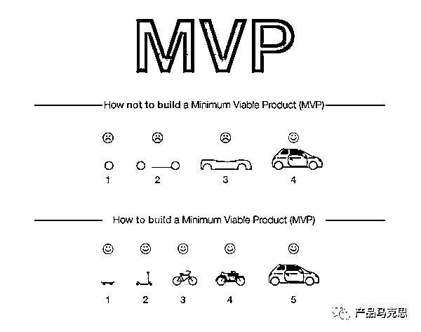

# 用AI产品拆解，彻底搞懂MVP该怎么规划

> 来源：[https://bqmg6drbq77.feishu.cn/docx/Ifafdu8awoS9YXxRh4ScjTw2nHc](https://bqmg6drbq77.feishu.cn/docx/Ifafdu8awoS9YXxRh4ScjTw2nHc)

赚钱的朋友们大家好。

自从四月入圈以来，每天刷帖、和群友聊项目，给我带来了很多启发。

最触动的点是，无论是大佬还是新人，大家都特别真诚地把自己的方法、经验和认知拿出来分享。

我在赚钱收获了很多，也在一直琢磨一件事：怎么把自己沉淀的东西，沉淀回给伙伴们。

机缘巧合之下，这篇内容就诞生了。

为了不让文章太硬核，我就拿现在最热的AI产品来举例，想帮大家理清MVP到底该怎么规划、怎么思考。

为什么要聊MVP？

入圈后发现，大家做项目基本都是从0到1做验证，而且圈里对MVP的讨论很多。

但实际理解和落地时，往往走偏了、想偏了。

结合自己多年做互联网产品MVP的实战经验，希望能帮大家拨云见日，把MVP这个工具用好，真正跑通从0到1，赚到该赚的钱。

# MVP到底要解决什么问题

先说清楚，MVP是什么。

MVP是 Minimum Viable Product，最小可行产品。

拆开看，两个关键词：最小、可行。

最小，就是投入要少、成本要低、做得刚好够用。

可行，就是能用、能验证、能跑起来。

所以MVP的本质，就是用最小的投入，做出一个能用、能验证的产品。

这个概念源自埃里克·莱斯在《精益创业》里提出来的。

他提出MVP是为了解决一个核心焦虑：好东西没人要。

举个例子来理解。

假设你想造汽车卖。

很多人会觉得很直接：先做轮子，再做底盘，再做车身，最后组装起来。

按部就班能造出来一辆车没错，但造出来会有人买吗？

万一没人买，前期的所有投入都打水漂，还无法及时止损。

如果我们回到汽车诞生前的那个时代去想，显然没那么确定。

那如果想边造边验证、边做边调整，该怎么办？

先想明白造车的目的是什么，让人更快地移动。

那先做个滑板吧，低成本，能让人更快移动。

推出来看看市场反应，大家是不是真的需要更快移动。

有人接受了，但反馈滑板转弯难、不好控制。

那给滑板加个把手，变成滑板车，双手可控，体验更好。

又有人说，站着太累，能不能坐着？

于是有了自行车，坐着骑，脚不用着地，省力很多。

再有人说，骑车还是累，能不能不用自己发力？

于是摩托车出现了，不用人力，操控方便，市场大火。

再后来，有人提出雨天不能骑、载不了家人，安全也堪忧。

这时你才意识到，这里面有更大的机会，开始造可以遮风挡雨、载多人、更安全的汽车。

在这个过程中，每一步都是有效的、可以验证的。

只要哪一步走不通，后面就没必要继续投了。

埃里克·莱斯提出MVP，就是为了让投入可控，避免做出没人要的东西，让验证贯穿全程。

所以MVP的核心使命，一直是回答两个关键问题：

一、需求是否真的存在，通过最小可行产品具象化验证

二、客户对这个最小可行方案怎么看，认不认可，接下来该怎么迭代

这两个问题，决定了产品能不能活。

# 把生死问题想透

既然是生死攸关，就要认真拆这两个问题。

第一个问题：需求是否真实存在。

光问客户“你要不要”是最不靠谱的。

有个经典段子：记者问老农愿不愿意把地、房子、牛捐出一半给国家。

老农都说愿意，最后问到两头牛时说不愿意，因为他真的有两头牛。

所以口头的需求不可信，真正的需求是用钱投票。

客户愿意掏钱买、愿意用起来，才说明需求是真的。

而且很多时候，没有具体的东西摆在面前，客户根本理解不了价值。

就像马云当年证明互联网，他拨号等了三小时才出来半张图。

他用三小时和半张图具象化了互联网，让大家眼见为实。

如果只是嘴上讲，我相信很多人会觉得他疯了。

第二个问题：客户怎么看这个最小方案，认不认同，怎么迭代。

比如你渴了，我给你一杯可乐，你说在控糖不要。

换成雪碧，你说在减肥不要。

换成白开水，你说没味道喝不下去。

最后给你一瓶0糖0脂0卡的元气森林，你说就是它了。

做一个叫得响的产品，从来都伴随着大量失败。

MVP的价值，就是把失败的成本控制在可承受范围内。

别辛辛苦苦做一堆没人要的功能。

想清楚这一点前，先要搞明白：你的产品到底是什么？

# 先搞清你的产品本质是什么

回到开头的问题：AI产品的MVP该怎么规划？

既然是AI产品，就绕不开AI算法模型。

为了好讨论，我们把包含AI算法的产品都先归为AI产品。

很多人会觉得这点不重要，无非是AI用得多用得少的区别。

但AI的使用程度不同，产品的本质就完全不同。

大概可以分成三类。

第一类，AI算法就是产品本身。

比如前段时间火的妙鸭相机。

用户上传20张不同角度的照片，就能生成像专业摄影师拍的写真，价格还很香。

这款产品的核心就是AI算法。

你可能会问，它也有上传照片的功能啊，为什么说是算法？

换个角度想，如果有十家都在做妙鸭相机，你会因为上传方式不同而选择吗？

你真正关心的是，生成出来的写真像不像、好不好看、能不能发朋友圈。

评价标准就是算法效果，所以本质就是算法。

这要求我们从用户视角判断，而不是从产品设计者视角。

第二类，AI算法是主业务流程里的关键一环。

比如滴滴打车。

乘客打开App，输入起点终点，下单，等待匹配，坐车，到达，付费，评价。

整个流程里，AI智能派单是关键一步，没了这一步，体验就崩了。

这就是AI作为核心环节的产品。

第三类，AI算法只是锦上添花，提升体验或效率。

比如输入法。

以前只能拼音五笔打字，现在加了AI语音转文字，让打字更快更方便。

它不是闭环必需品，只是提升体验。

分清这三类，才能规划对MVP。

# 不同类型的AI产品，MVP怎么规划

第一类，AI算法就是产品本身。

这种产品的MVP，必须包含算法，而且要验证算法在真实场景下的可行性和效果。

比如妙鸭相机的MVP，用户能上传照片生成写真，可能风格只有几种，但必须能跑通AI生成这件事。

又比如会议AI语音转写，要在真实会议场景下验证：多人发言、口音差异、噪音干扰、说话打断。

这些问题没有算法根本验证不了。

第二类，AI算法是主业务流程的关键环节。

这里要分情况。

以早期滴滴为例，它的MVP根本不需要AI算法。

用人工调度把司机和乘客匹配起来就行。

它要验证的是模式：用App叫车的需求是否存在，乘客和司机是否接受这种方式。

不是算法快不快、准不准的问题。

程维当年用十万块做出来的App，匹配靠的是规则，不是AI。

再看视频号。

用户上滑下滑刷短视频，点赞评论分享，靠AI推荐。

视频号属于第二类，算法是核心环节。

但视频号的MVP不能像滴滴一样不用算法。

因为滴滴之前没有类似产品，视频号之前已经有抖音快手。

本质上都是短视频，差异在用户群体和定位。需求是否强烈已经不需要验证。

但用户对视频号的推荐是否满意，必须验证。

视频号要回答的是：能不能推到用户喜欢、有价值的视频？

这直接取决于算法能力。

我上线初期就体验过，早期推荐很差，重复、雷同、不对味。

现在明显好很多，能刷到喜欢的内容，也不会过度茧房。这种迭代就是MVP的意义。

第三类，AI算法只是提升体验或效率。

这种产品的MVP完全可以不考虑AI。

要验证的核心是需求本身和核心业务流程是否成立。

比如做带AI语音转文字的输入法，MVP阶段完全不用考虑语音功能。

除非你的产品就是AI语音输入法，那它就属于第一类，必须包含算法。

否则，先把传统键盘输入法的核心做好。

# 总结

通过以上拆解，MVP要做的事情其实很清晰：验证需求是否存在，以及用户对最小方案的真实反馈从而迭代。

AI只是工具，关键在于你把AI放在产品里的位置。

未来一定是AI的时代，这个趋势不可逆。

不管现在有多少限制、焦虑、抵制，AI这列车都会一直往前开。

历史不会简单重复，但总在押韵。

农耕取代游牧，工业取代农耕，今天AI正在重塑一切。

我们不用纠结AI会不会取代我们，要思考的是怎么用好AI，成为AI时代的受益者。

最后祝赚钱的伙伴们，能把MVP用起来，把AI玩明白，在这个时代大放异彩。