# 4周累计4万+收入！我0成本带100多名新手用AI做大众点评投稿实现首份变现

> 来源：[https://zb30cprf4w.feishu.cn/docx/MEZZd1AmCow4k2xdS2gc64G5nEh](https://zb30cprf4w.feishu.cn/docx/MEZZd1AmCow4k2xdS2gc64G5nEh)

# 开篇

各位赚钱的朋友大家好，我是小贝，这是第一次在赚钱社区发复盘，表达不到位的地方请多包涵。

这次想和大家拆解的实践是：《一个月4w+流水，我免费携手百名小白借助GPT完成大众点评投稿项目》

过去的28天，我们把整套打法从零搭建起来，并迭代出完整的操作手册，同时带出了一批真正实现现金流的伙伴。今天把全过程整理出来，希望能给大家一些启发。

特别感谢@子潦的引荐，让我了解到大众点评的投稿玩法。也要感谢@七小 哥和@EVE 小杰帮忙把内容做了细化润色。

先做个简单的自我介绍。

我是小贝
【网名】小贝
【所在】重庆，在读985
【个人标签】
AI尝鲜者、校园流量运营、篮球爱好者
【过往项目】
🔹 0门槛招募百余名互联网新手，用GPT参与大众点评投稿实现变现；
🔹 参与选品项目操盘，带领校园团队拿到第一笔盈利；
🔹 假期独立负责篮球训练营运营，单期招募学员20+
【可分享资源】
🔹 GPT、MJ等AI工具账号；
🔹 校园端后端对接；
🔹 篮球领域交流

联合人@彦肼
【网名】彦井
【所在】南昌
【个人标签】
19岁在校创业者、情感博主、黄昏热恋派
【过往经历】
🔹 大一下学期尝试社群运营、项目实操、课程售卖，半年私域流水5w+；
🔹 认知觉醒阶段，暑假走访三座城市；
🔹 为私域近50位朋友提供情感咨询，获一致认可
【可分享资源】
🔹 情感咨询服务
🔹 朋友圈黄昏影像分享
🔹 私域运营经验交流

先放几张真实的数据截图，一个月带百人实操的累计结果：

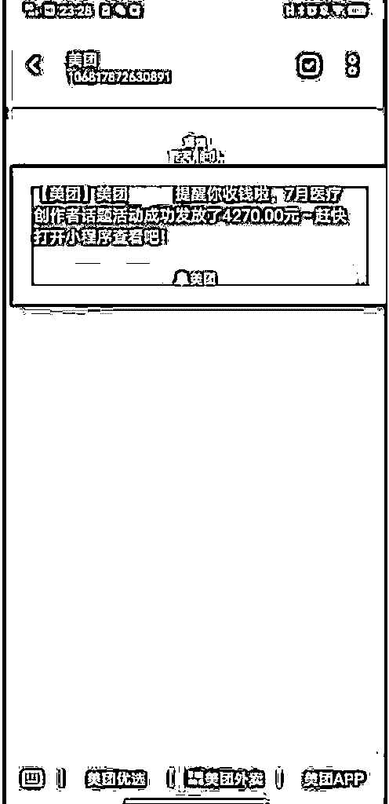

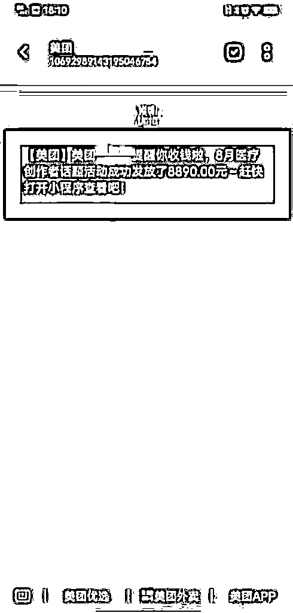

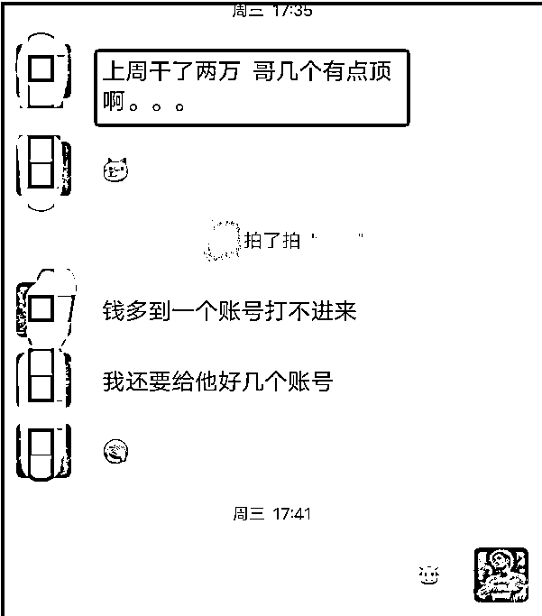

下面进入正文

# 一、线下交流碰撞出合作点子

7月6日，我在曹大和张哥主办的AIGC商业化峰会上和好友子潦聊天，聊到了大众点评的投稿赚钱模式。

这个赛道当时相对小众，我就向子潦请教了具体玩法。

## 1）这个玩法是怎么来的

大众点评正在推进内容化升级，希望用大量用户原创内容来满足用户需求。
因此平台推出投稿奖励机制，鼓励用户发布点评、评分、照片等内容，审核通过后官方发放现金激励。

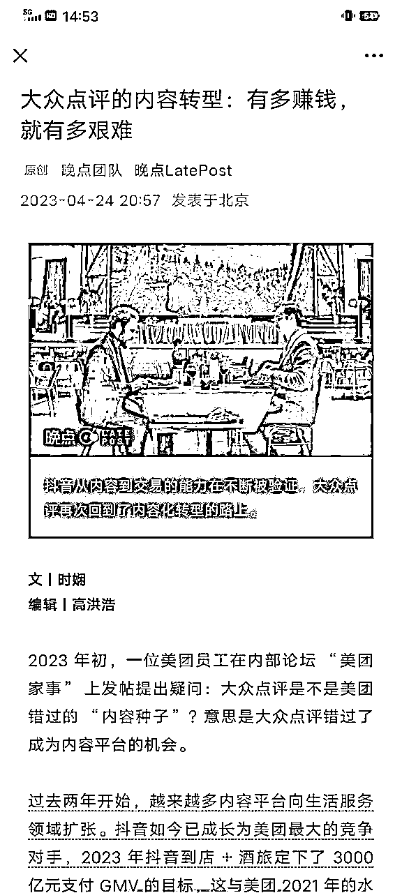

通俗说就是和大众点评官方合作，在APP里提交笔记，通过审核即可获得回报。
子潦已经跑了一个月，数据还不错。
因为活动是在AI峰会认识的，自然聊到如何用AI提效。GPT这类文本生成工具正好能解决文案撰写的痛点。

越聊越觉得有潜力，原因主要有三点：

### 1.官方在主推，合规安全不踩线
这是和平台官方直接合作的正规激励，不用担心封号风险。
内容投稿本身就属于平台内容化转型的过程，项目是平台在力推，平台获内容，用户获现金，双赢。

### 2.门槛极低，新手也能快速上手
目前处于推广初期，平台对内容要求比较宽松。
我们提前准备好了图片模版，配合GPT生成文案【下文详解】。
新人上手通过率常见在20%-40%，熟练后能到50%-60%，正反馈很快。

【部分伙伴的实操截图】

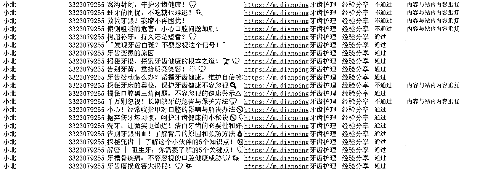

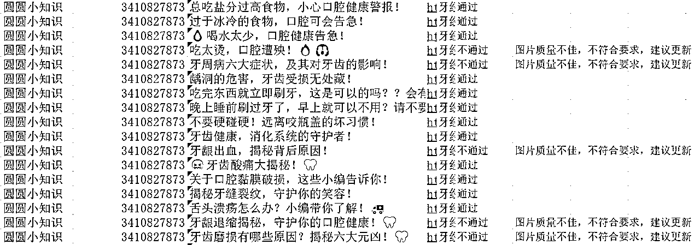

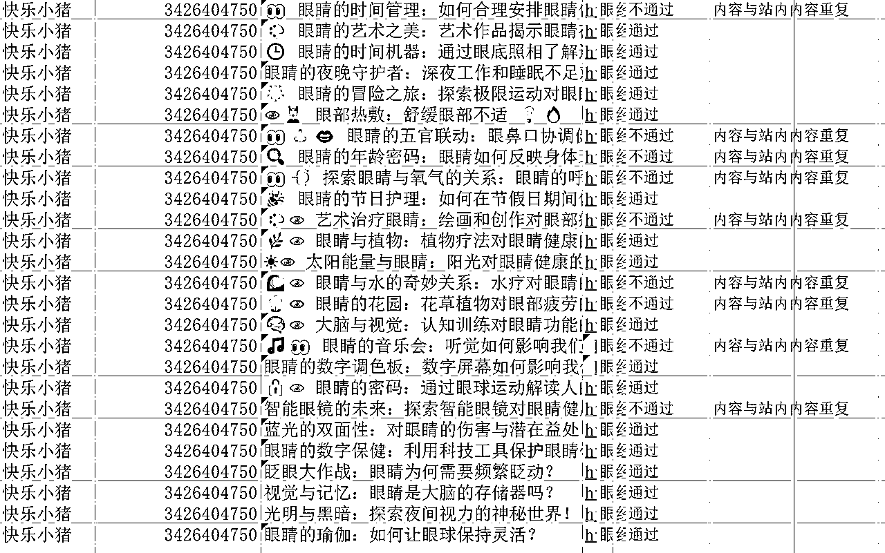

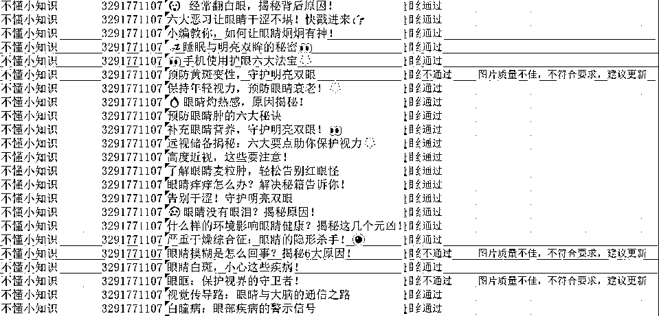

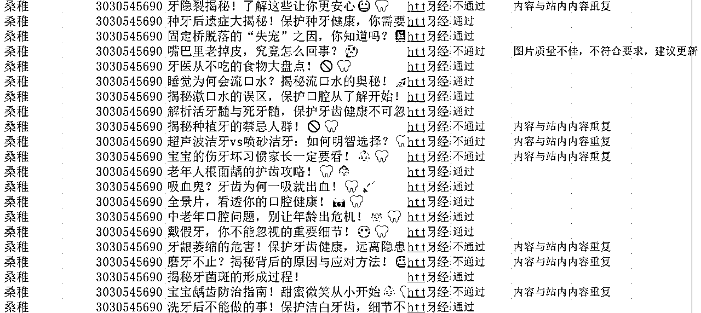

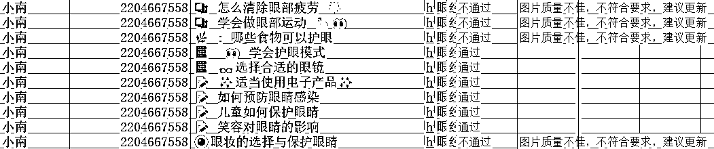

更有趣的是，有伙伴做出成绩后，自发帮我们扩散，把身边对互联网不了解的朋友也拉进来一起实践。

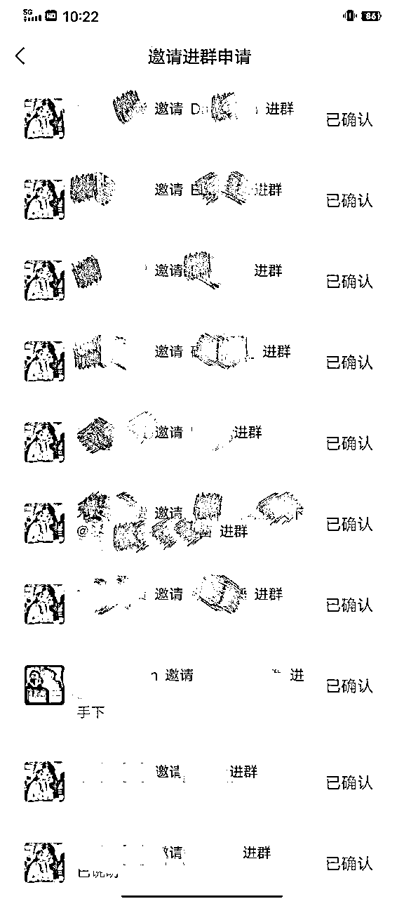

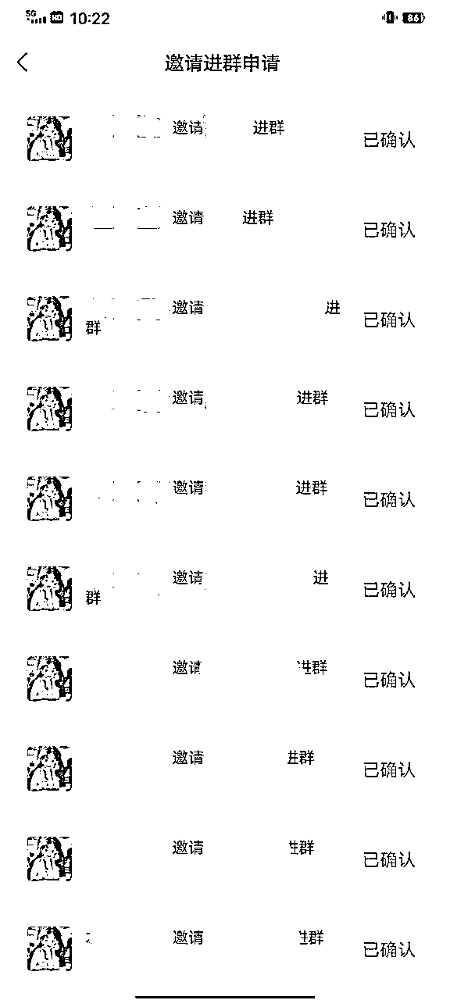

### 3.重执行轻获客，重复复制就有产出
不需要考虑前端引流和后端成交，只需复刻已过审的优质笔记提交给官方。
一篇笔记制作时长约5-20分钟，结合过审概率，执行即变现。
对于想拿第一桶金的互联网新手来说，非常合适。

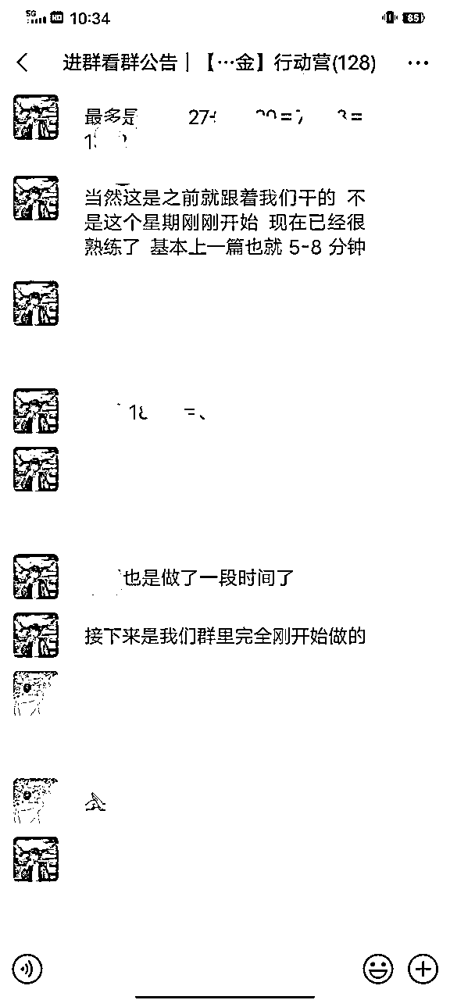

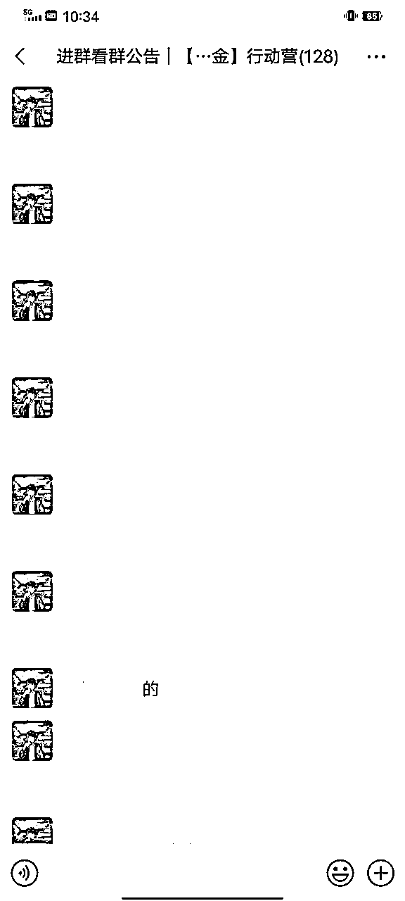

# 二、用利他心态做一次迷你航海，免费带百人入场

方案确认后，我们迅速整理了第一版SOP手册。
原本打算收费带队，最后我们决定0门槛免费开班，带着信任我们的伙伴一起赚钱。

## 1）趁推广期立刻入场实操

我们把项目简报发布在之前搭建的GPT大学城，和@七小 哥的创富研习社，号召大家做一次迷你航海。

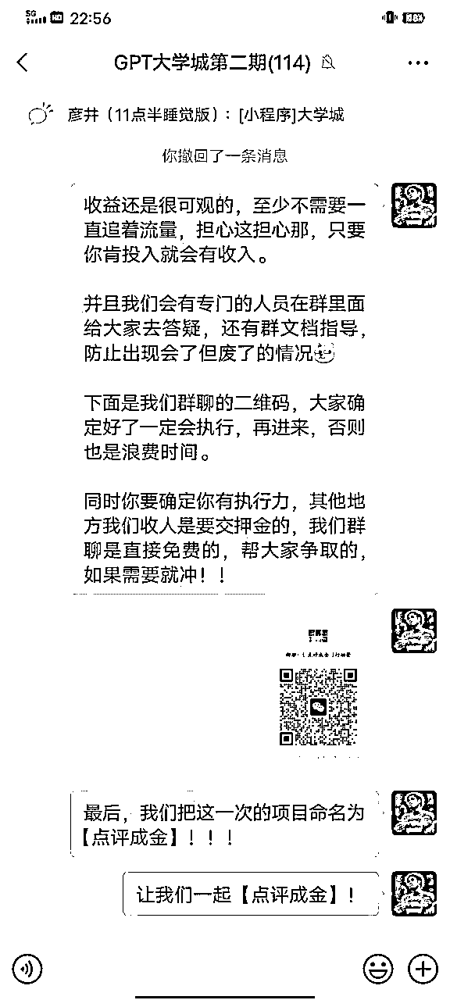

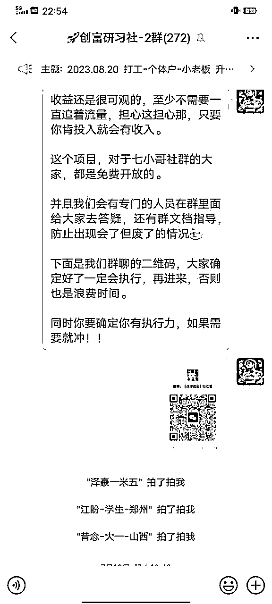

就这样，我们正式组织了100多位朋友入场大众点评，其中绝大部分都是互联网新手。

## 2）跟做的人都拿到了反馈

第一周熟悉，第二周熟练，正向反馈来的很快。
实现变现的人数从最初的几位，扩散到几十位。

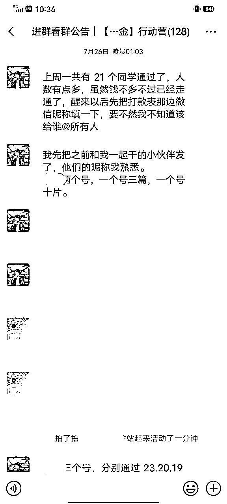

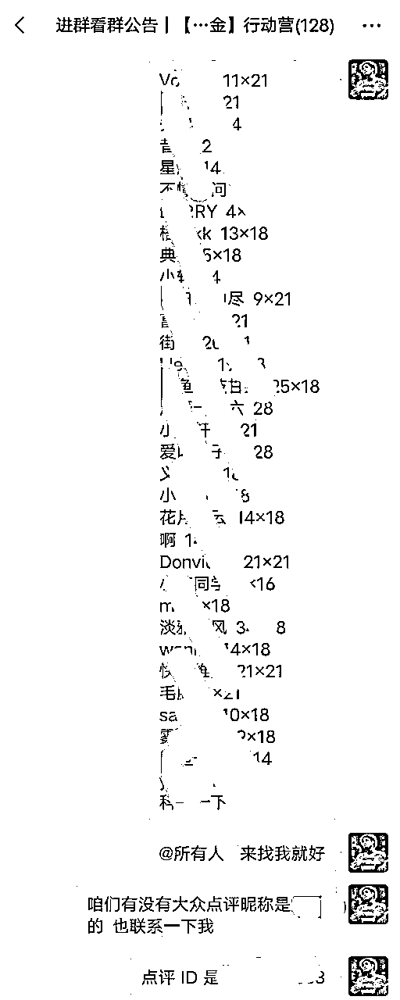

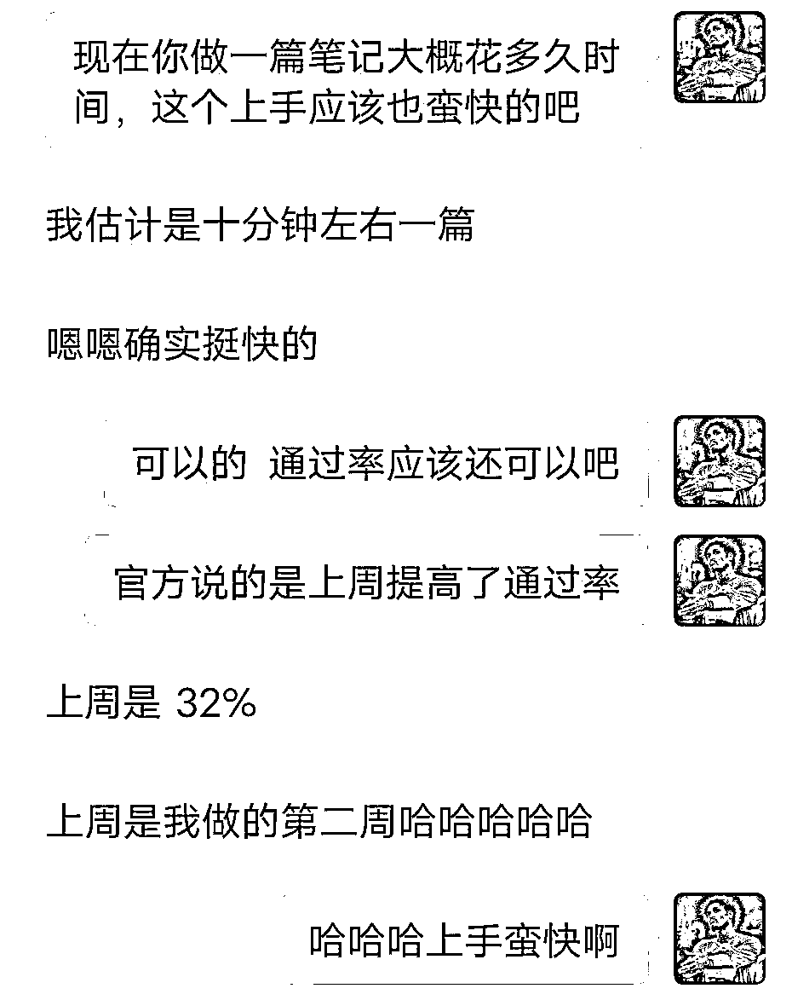

## 3）现在还来得及吗？

完全来得及，只要官方还在发放投稿奖励，只要持续执行就有产出。
只要推广期不结束，这个项目就能持续做下去，直到官方停止激励为止。

# 三、大众点评项目操作手册

下面把整体流程拆开讲。

## 1）先加入大众点评白名单

因为是官方对接，我们统一收集白名单后提交。
第一步先在大众点评里复制昵称和ID，ID的获取方式：打开APP - 我的 - 个人主页 - 右上角··· - 分享 - 复制链接

把链接中"userprofile"后面的10位数字就是ID。

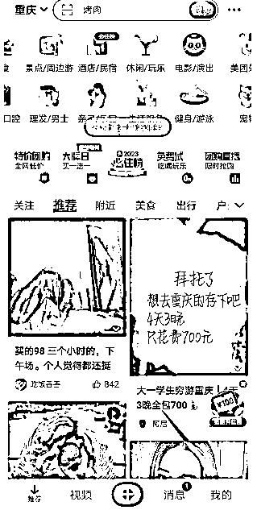

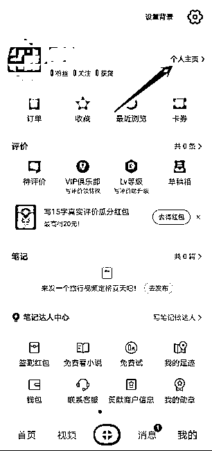

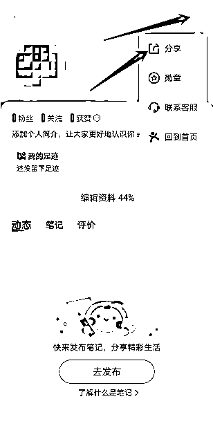

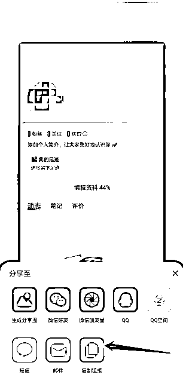

举例：【点小评5553529362 正在#大众点评#分享自己的生活】来大众点评发现好去处 https://m.dianping.com/userprofile/3105409993?shareid=Nx2cLhEnHm_1689147189966 的ID为3105409993

复制后填入表格，我们统一同步给官方，官方会开通权限。开通后即可按要求制作笔记上传。

## 2）笔记如何制作

大众点评笔记和同类平台相似，分正文和配图两部分。

### 1.正文
这里借助GPT。
以口腔主题为例，先让GPT给出50个细分方向，再挑一个让它展开说明。注意把背景和要求写清楚，关键词可参考小红书写法。
例如：请你扮演一名文案专家，帮我写一篇300字左右的文案。主题是xxx，要求带emoji，内容生动有趣。

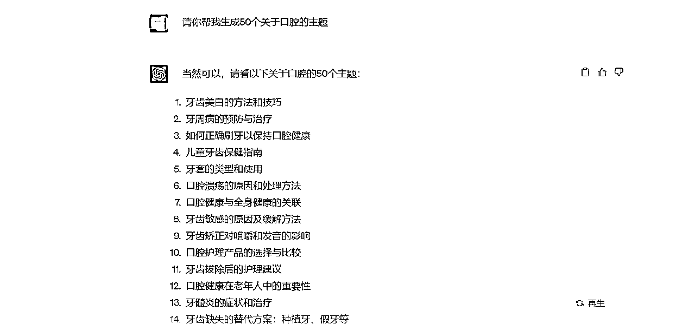

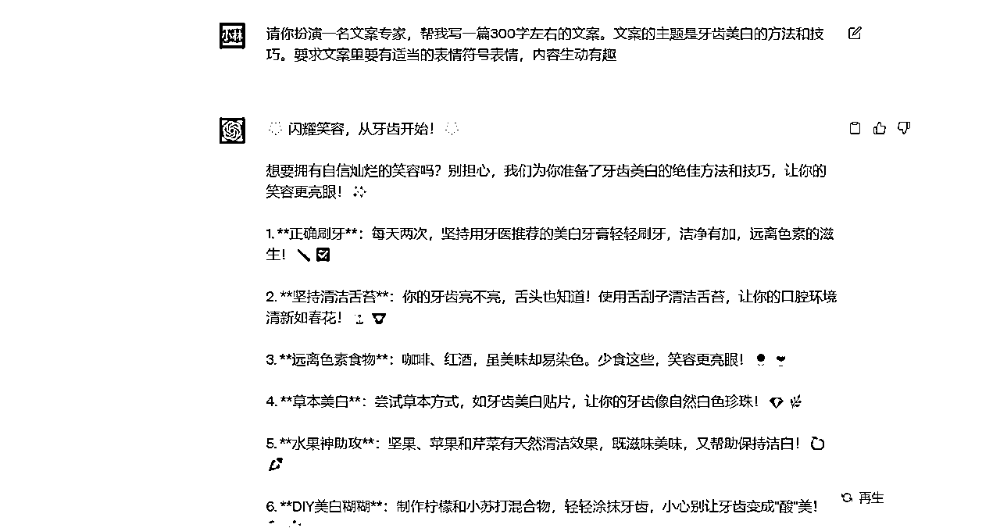

如果单篇字数不足，可补充“每个小主题不少于150字”，或直接提问：请你以xxx为主题写200字文案。

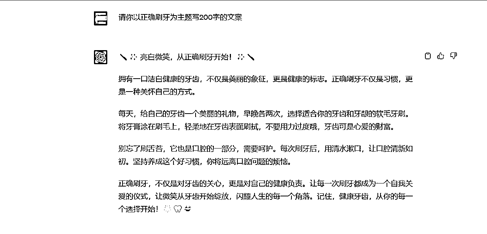

可见生成正文对GPT要求不高，就是基础指令，零基础新手也能掌握。

### 2.配图
使用稿定设计或其他在线作图工具，套用我们提供的模版，把正文分段搬入做简单排版即可。

以“稿定设计”左数第二个模版为例，下面是约2分钟的制作演示视频。

制作不难，但有几个关键细节决定过审率，是我们从前期低通过案例中总结出来的：

* 图片模版里的贴纸、卡通元素全部删除，越简洁官方越偏爱。
* 模版背景不要有网格线或横竖条纹，基本不会过审，像下图这种网格背景就很忌讳。

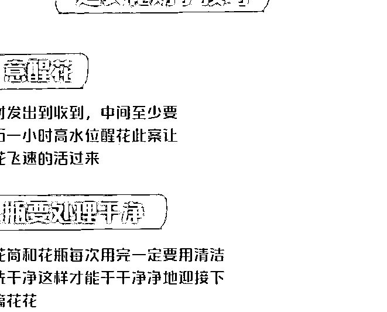

* 标题、小标题、正文的字号可直接套用下图标准。

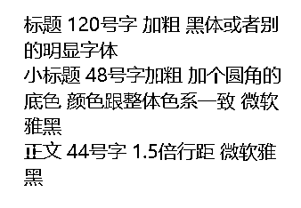

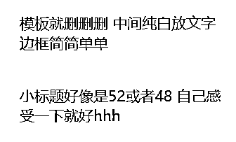

到此，正文和配图均完成。

## 3）上传步骤

### 1.下载注册
在应用商店下载大众点评，用手机号注册。一个手机可同时登录两个账号，多账号可避免内容同质化判定。

### 2.熟悉界面
进入APP逛一逛，了解基础功能布局。

### 3.完善资料
设置昵称、性别、头像等，再按上文方法复制个人主页链接。

### 4.制作笔记
参考上文制作方法。注意：以口腔大话题为例，“好好刷牙”是一个小话题，同一账号内只能发布一次，否则会被判同质。图片模版最多在一个账号里使用2-3次。

### 5.上传
点首页“+”上传。非常关键！！！一定要带官方活动标签# xxx，比如口腔笔记结尾加#暑期护牙指南

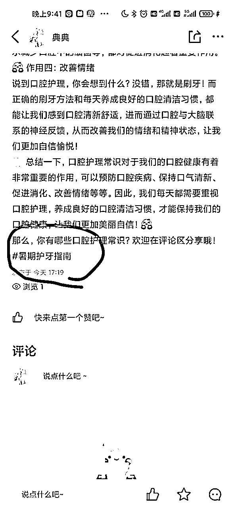

### 6.互动
可适当回复评论提升曝光，但不允许互粉互赞，无意义。

# 四、一个月来的感受

## 1）躬身入局，才能抓住窗口

得知子潦在做这个项目后，我第一时间去核实数据，判断能否放大。
验证有效后，立刻小范围测试，确认OK后就免费带100+人一起入局。

4周下来，社群总流水突破4万+，最近一周单周就有2w+。
越来越多的人参与实战，一周赚1k+、拿到互联网第一桶金的人越来越多。

这让我更坚信：窗口期到来时，搞清楚项目本质和方向，就立刻下场，在实操中迭代SOP，赚钱能力自然提升。
敢下场的人，总是先一步享受红利。

希望大家都能成为敢于躬身入局的人。

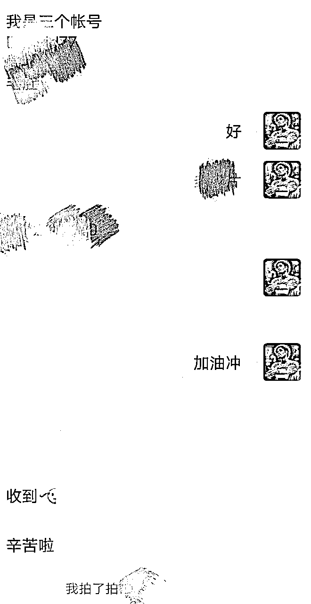

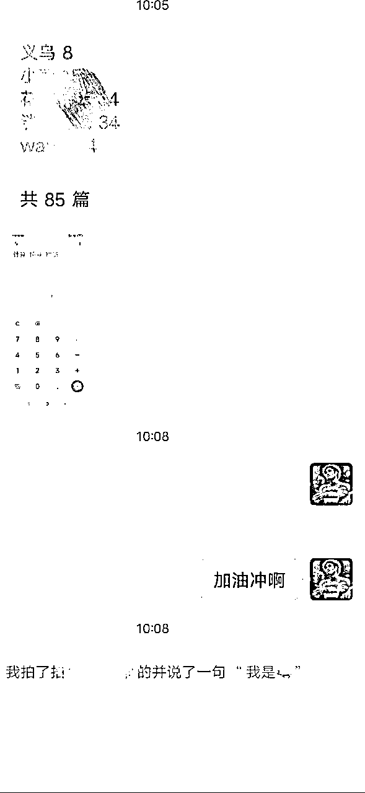

## 2）真诚利他，收获长久回响

项目启动后，我们免费带了近百人入局。
从最初几人，到十几人，再到几十人，越来越多伙伴愿意实操。
大家也在群里互相交流优化，我们也知无不言答疑。

实战让我更清晰什么内容过审率高，也更明白只有实战和利他，才能拿到看不见的增益。
虽然是免费营，我们依然尽力解答，所以才有伙伴主动拉人进来，也收获了大量好评。

更珍贵的是结识了很多真诚的朋友。

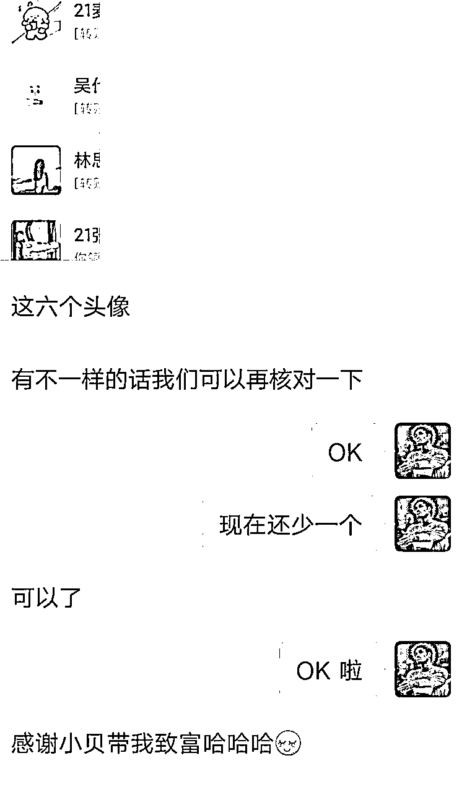

真诚是唯一有效的武器。

## 3）二八规律，执行者吃到蛋糕

这次项目再次验证二八规律。
在数百人的实战营里，最终能拿到结果并坚持下来的，只有约20%真正动手的人。
他们越做越熟，收益也越高。大多数人只是观望。

这个项目操作极简，基本不费时间，但还是有人总担心、总犹豫、总觉得准备不够。
想太多只会卡住自己，确定方向就迈出第一步，干就完了！

从文案生成到图片制作再到迭代优化，即便SOP不断升级，最终去实践的依然只有20%，享受到红利的也是这20%。

免费无门槛也导致部分人不够珍惜，这让我们思考后续需要设置门槛做双向筛选，结识更多有执行力的伙伴。

感谢@子潦的推荐，没有你就没有这次百人实战！
感谢@七小 哥和@EVE 小杰的润色，文章才更清晰！
感谢龙哥盟提供的交流平台，让我们相互成长！
也谢谢点赞评论的圈友们，觉得有价值就回头点个赞吧！

# 最后祝大家龙哥盟！