# 《小红书冷门蓝海：p掉路人，12天观察5天实操，收入1159，私域沉淀260人》

> 来源：[https://qnfoes1o78.feishu.cn/docx/TXwrdLSEIoSsUhxAD9icDXRqnoI](https://qnfoes1o78.feishu.cn/docx/TXwrdLSEIoSsUhxAD9icDXRqnoI)

各位圈友大家好，我是林歌，白天在杭州做电商，晚上在平潭跑民宿。

最近刚把小红书上的【p掉路人】这条副业从0到1跑通了。

风向标一发出来，很多人来私信要细节，先谢过大家的信任，

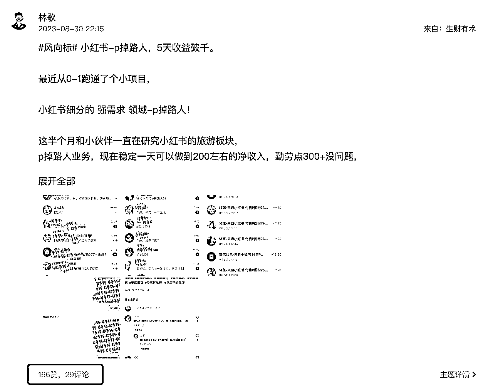

我整理出来，也是给赚钱社区做点增量。

先说结果

实操5天到手1159，小红书涨粉430+，微信沉淀260人，付费成交105单；

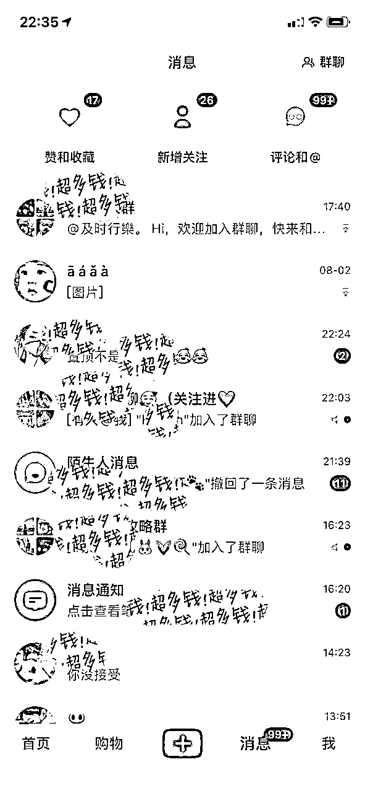

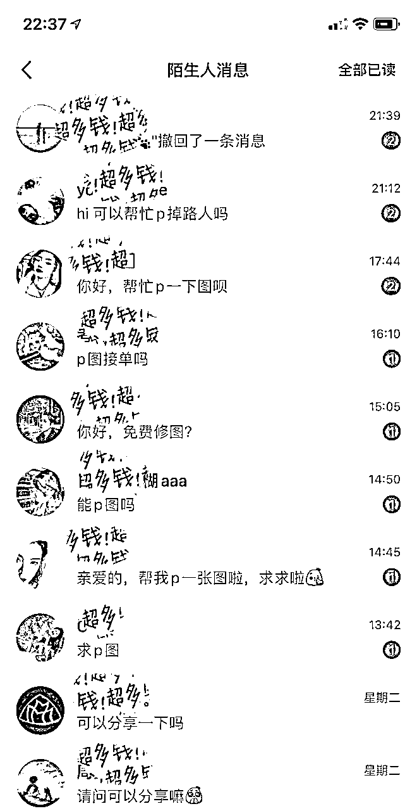

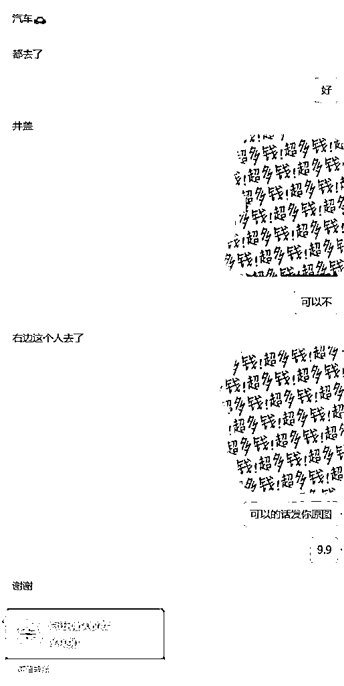

# 一、为什么做这个

起因是我想给平潭的民宿做小红书引流，拉意图来玩的客群入住变现。

在研究用户画像时，我发现了一个被严重低估的需求：p掉路人。

这个需求旺得很，天天都有新帖子在冒。

出来玩的大多是年轻人、情侣、旅游党，对照片的要求极其苛刻。发朋友圈前一张图磨个十几分钟很正常，合照更是人手一部手机轮流修。

用后羿浏览器去扒数据，#p掉路人# 这个话题本身就是千万级标签池；

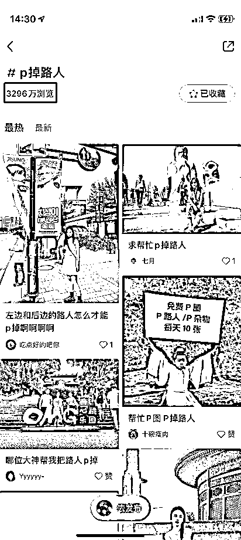

正好看到赚钱圈里一个中标案例↓

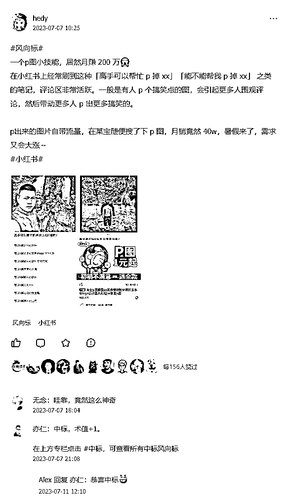

看似只是一个小小的修图诉求，按5元/单算月流水就有200w，

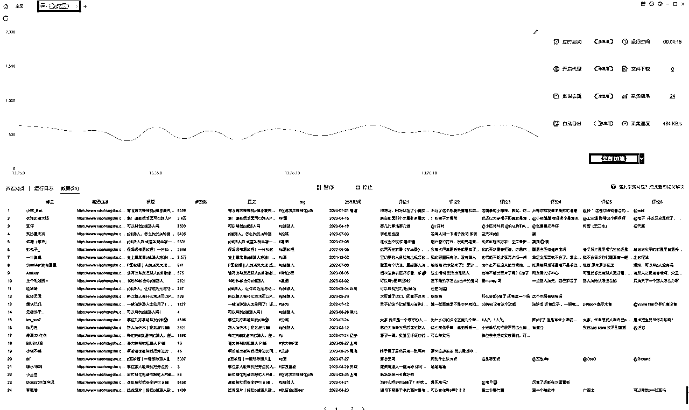

我估计真实体量至少翻倍。

这条赛道感觉能做起来！

# 二、工具与打法

第一步是找工具。想要放大就不能靠美图秀秀、醒图的画笔一笔一笔抠，眼睛都快抠瞎了也做不完美。

我做电商的习惯是先算ROI，投入时间与收益必须匹配。

所以工具的标准很简单：免费 + 极致效率。

我先看过手工修图师的操作，一张图起码10分钟，效率太低直接放弃。

去淘宝一问，报价80元/张，5分钟交付。效率差这么多，肯定有信息差。

花了两天在抖音、知乎、小红书、ins、推特、YouTube上换关键词搜修复方案，最终挖到一款AI神器。原本不是为p路人设计的，我把它改造成专门的路人清除方案。

效率对比非常明显。

PS自带的AI功能也试了，可以用提示词生成不同场景，有点意思，下午研究就上手了。

上手后我用旧的小红书号去找求p图的帖子，先免费修。

一是可以练手，二是可以攒案例。

为了提高曝光，我在自己账号发引流帖，带上 #p掉路人 #p掉多余的人 等标签。

起初账号是品牌号，互动只有个位数，根本起不来。

后来想明白了，要借别人的高流量帖起号。

之前在知乎用过后羿采集器，这次直接搬到小红书。

操作思路：

把【p掉路人】相关话题下所有笔记全部抓取下来，形成数据表做分析。

我一般会抓：博主昵称、笔记链接、标题、点赞数、正文、标签、发布时间、评论前6条。

这样一目了然：哪个帖子点赞最高、发了多久、带了什么tag、评论区在聊什么；最新求助帖是哪篇。

经验是可以迁移的，平台不一样，方法相通。

## 采集细节

1）把话题页的全部数据一次性爬下来；

2）按点赞或发布时间排序；

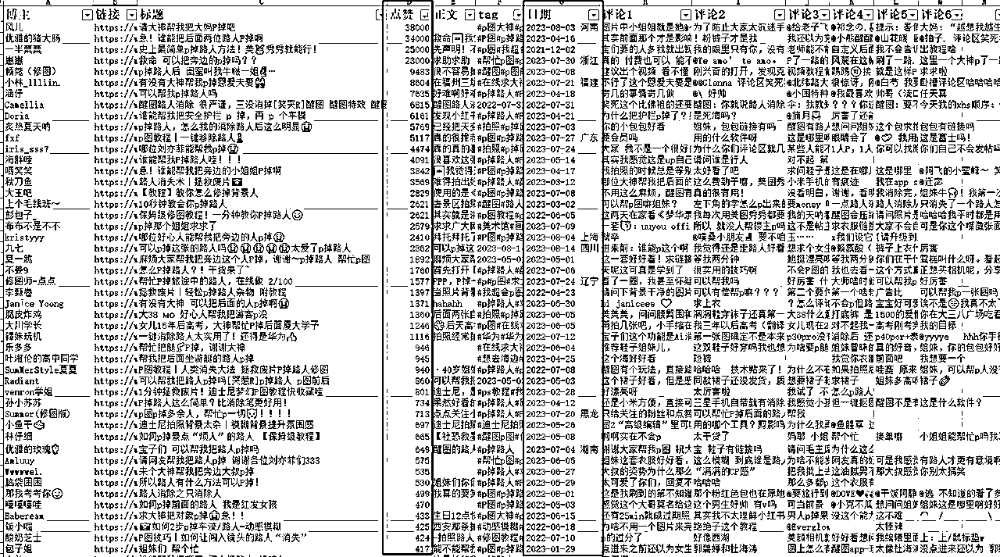

数据量大时，点赞数会显示成1万、2万这种形式，不利于排序。手动改不现实，得靠公式处理。

3）善用赚钱的检索思路，借别人的踩坑经验快速过河。

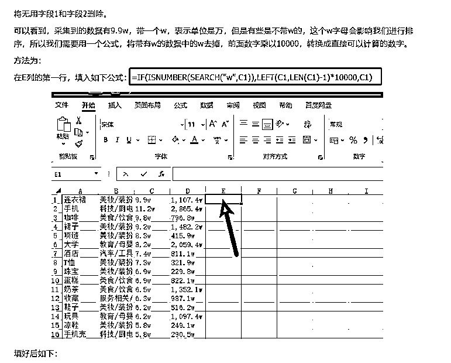

非常感谢@沙丘笔记 老哥的分享。

找到小红书里爆款需求帖，评论区往下翻，三天内总能看到大量求p图的留言。先免费帮修，展示实力。

也可以按时间排序找近期求助的帖子，再结合账号粉丝量和活跃度判断是否值得投入。

当时每天晚上加班后，就去翻热帖、修图、回评论，并在评论里埋钩子。

筛选标准：近三天、互动>50的帖子优先。作品留得多了，号就起来了。

第二天数据开始涨，第三天持续攀升：

点赞、关注、评论、私信都在往上走：

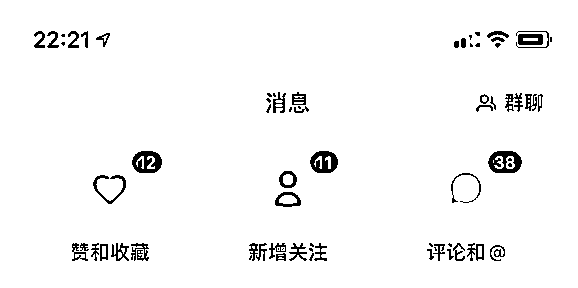

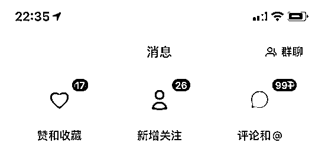

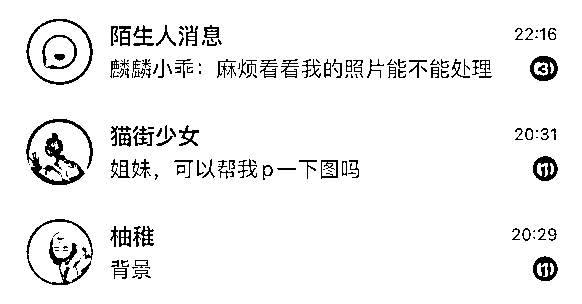

小红书私信管控很严，我从不回复带v、谐音之类的引导语。

让用户进群看公告，自己加微信。能加上的基本都是年轻女性，需求强烈且急。

这是我二次筛选后的精准用户。

加微信后开门见山，从【你好，要p图吗？】进化成【你好，要p什么图？】

砍价、嫌贵的很多，通过话术优化后成交率稳定在80%左右。

熟练后我能1分钟搞定一张图。

粉丝反馈也很有趣，有人夸我配享太庙、你是我的神。其实我只是用了几天工具的小白，美图秀秀技术根本比不过她们。

当然也有发烧友客户，需要修4、5稿。

即使我连续2、3天没发新帖，私信依然是99+。后台看流量来源，72%来自搜索，长尾效应很强；

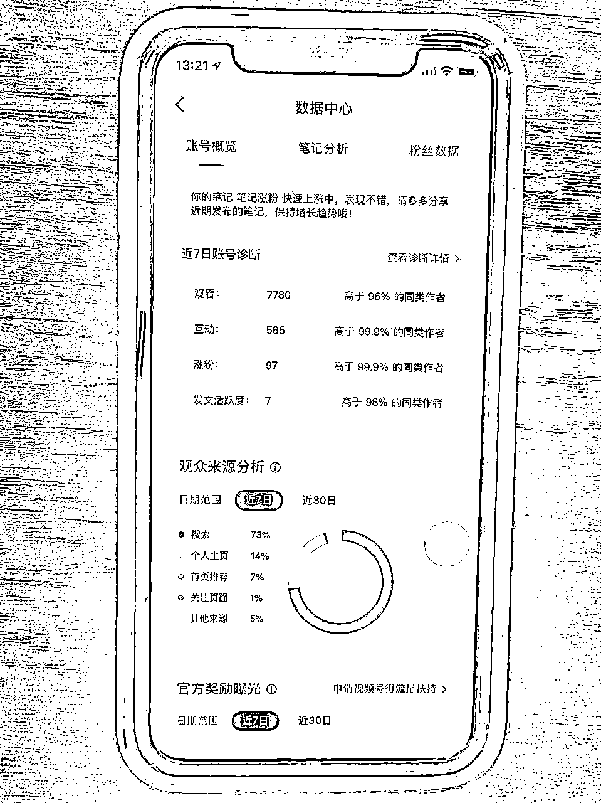

之前测过，5天破千完全没问题。

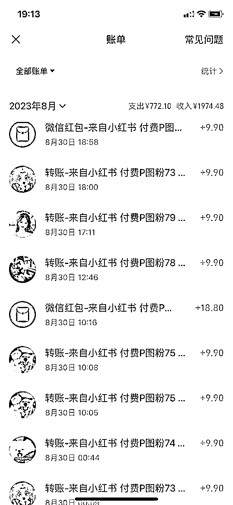

# 三、后续变现延伸

我觉得小红书这批p图用户价值很高，p图只是钩子，后面可以做二次变现。

比如去哪儿的大搜码玩法，小红书上很早就有。

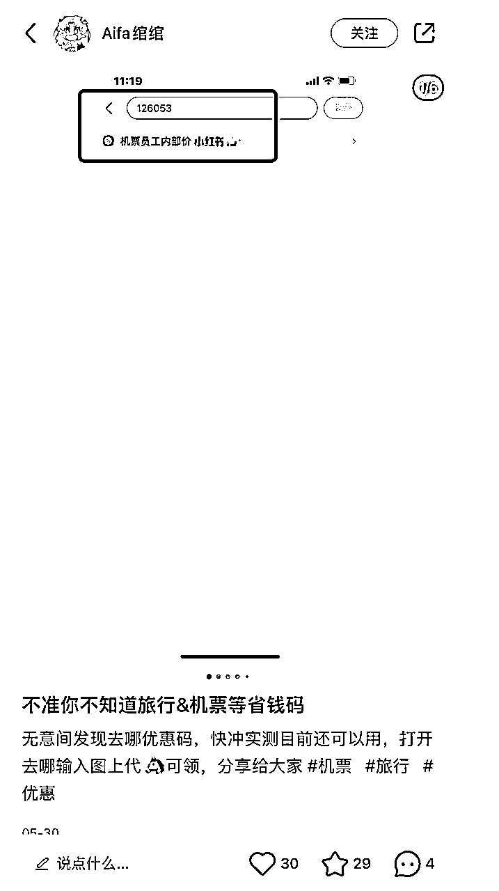

我已经谈妥合作，这是我的国庆产品集合页；

在去哪儿搜索：334739

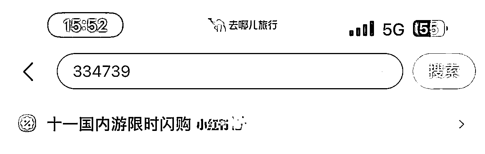

通过这个码下单都有佣金。

想做资源变现的可以联动。

另外，p图引流来的旅游粉，如果有大佬能后端承接，欢迎对接。我负责前端持续拉人，你负责后端持续转化。

# 四、项目亮点

### 1、评论区自带增长

不管你修不修，她第一步都是要把图发出来求助。评论区自然就会不断有人留言，热度一直被推高。

三亚、云南、迪士尼这些人多的景区，照片基本都需要处理。

评论区常看到一句话：女生对发型和妆容同时满意的图有多难得。

### 2、需求形态丰富，市场足够大

分手要p掉前男友；

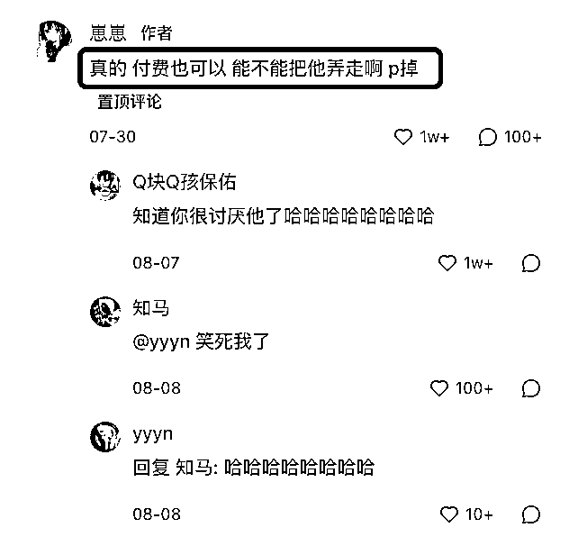

闹掰要p掉闺蜜；

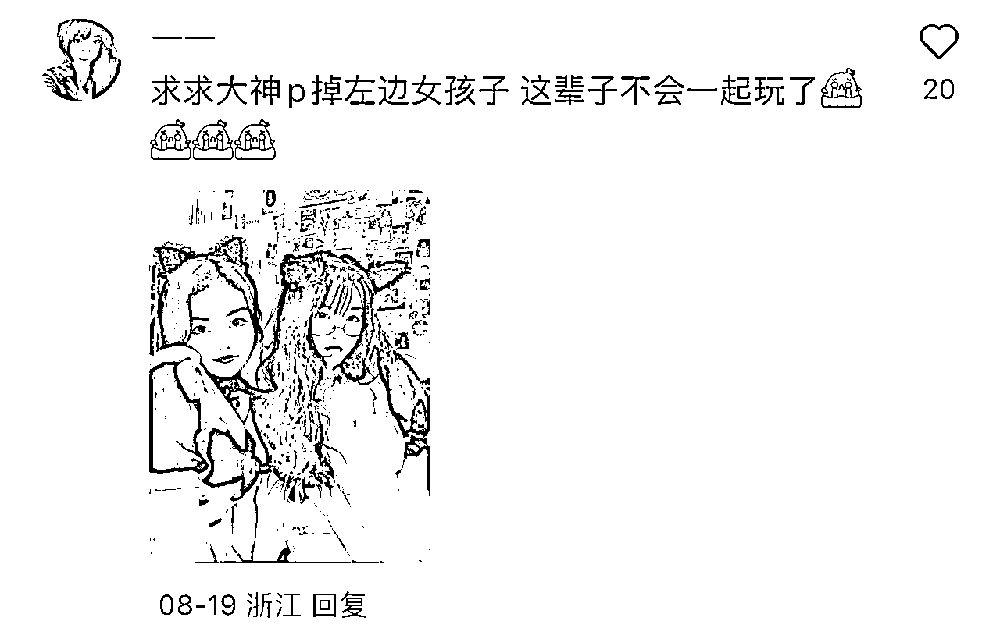

宝妈要小朋友的单人照；

婚礼照要p掉司仪；

生日照要p掉服务员；

万物皆可p。

下面几个热帖留言里就有明确付费意愿：

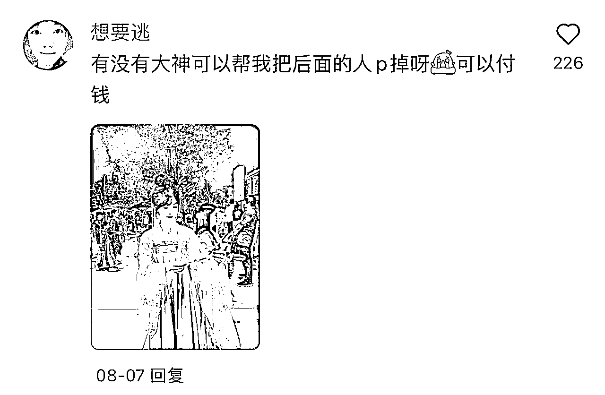

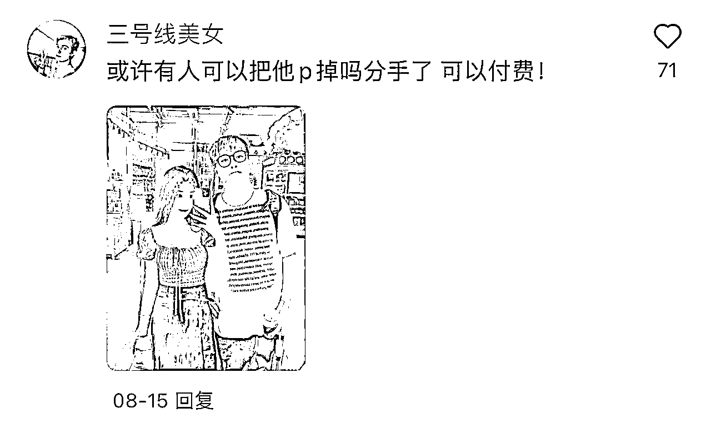

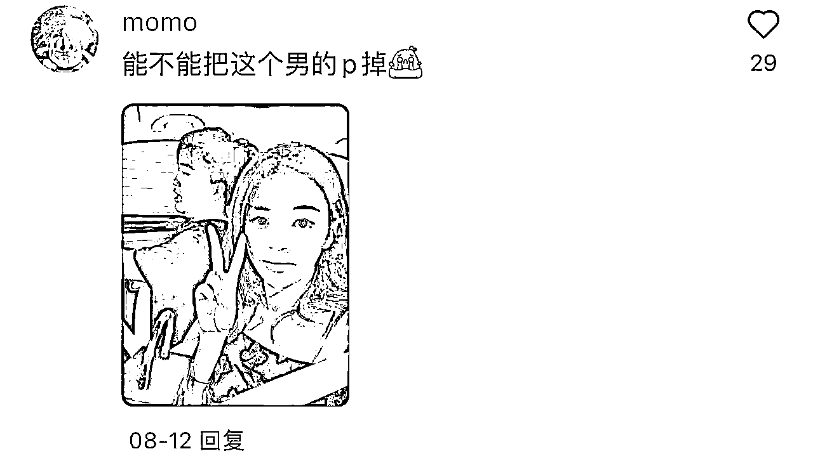

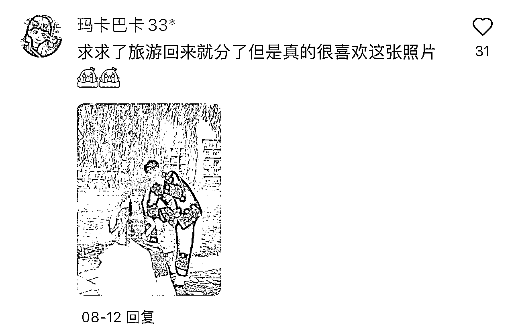

甚至还有人想把狗p成人...

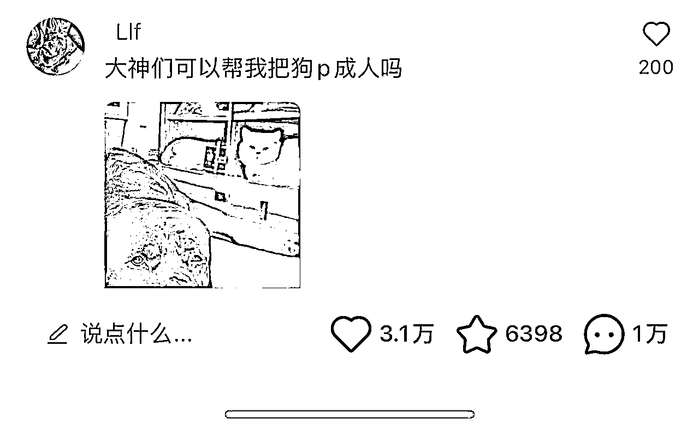

整体来看，旅游市场热门景点大家都愿意排队拍照，但拍照时间有限，拍出来总不完美，回来就想修。需求是持续性的，不是单次生意。

而且愿意为一张图付9.9元的女性、旅游、年轻用户，消费力很强。

我自己可能不会为一张图花10块，但小红书的客群会。

目前私域里已有百来个付费用户，后端玩法很多。

这条线其实就是小红书电商的内容形态，只是沉淀到了私域，用服务完成闭环。

符合非标品、强复购的特征，回头客很稳定。

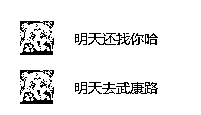

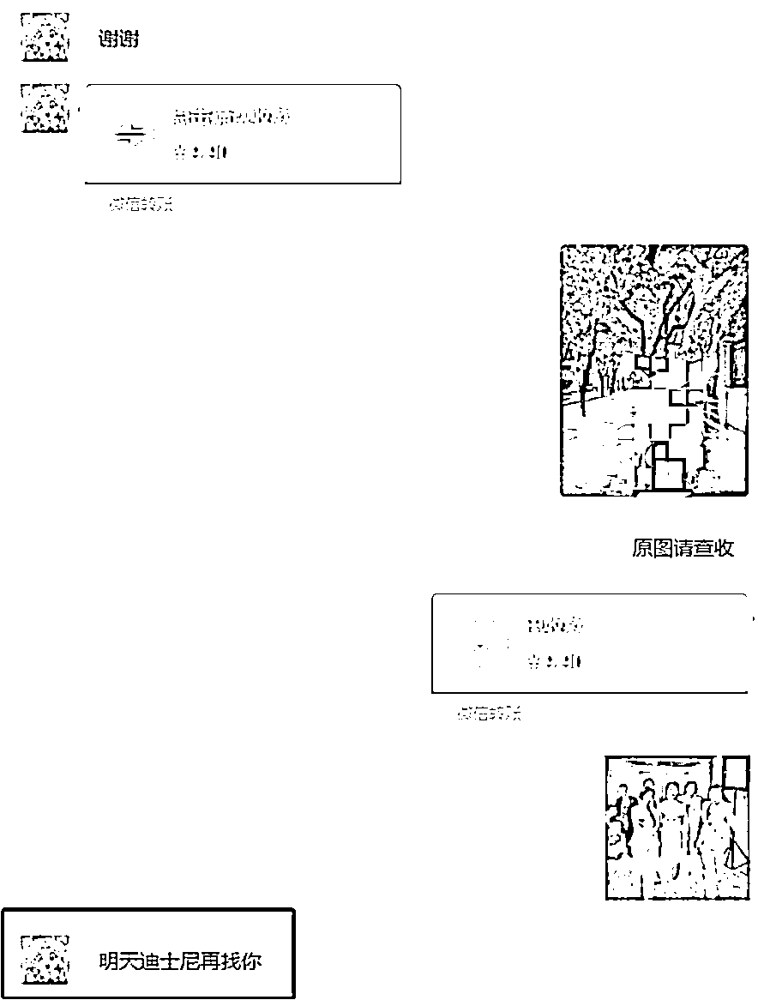

转介绍也很多。

# 五、复盘与瓶颈

做了段时间后感觉业务很稳，但单人很难放大。

## 5-1、在线率问题
我不在线不修图，流量就会流失。女生很多是急着发朋友圈，找不到人就会去找同行。

## 5-2、模型化需求
我更想把模型跑通后交给团队交付，而不是自己一直重复劳动。否则就会陷入有锤子到处找钉子的困境。

这块的市场很大，之前爆火的妙鸭相机就是程序化接单。p图是否也能做成系统化交付，值得程序大佬研究。

欢迎圈友交流，共创赚钱。

另外，有人问要p图软件，不要去淘宝花钱买，我这有安装包，

v：916255491