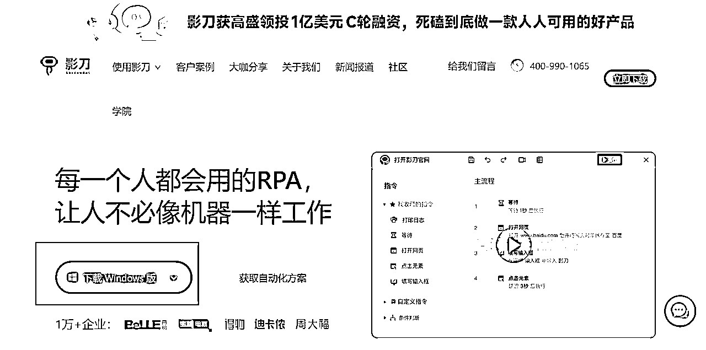
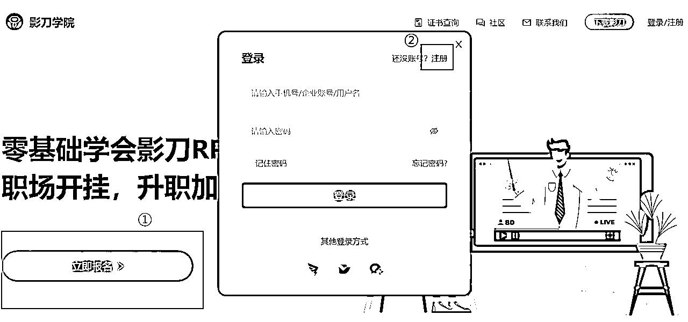
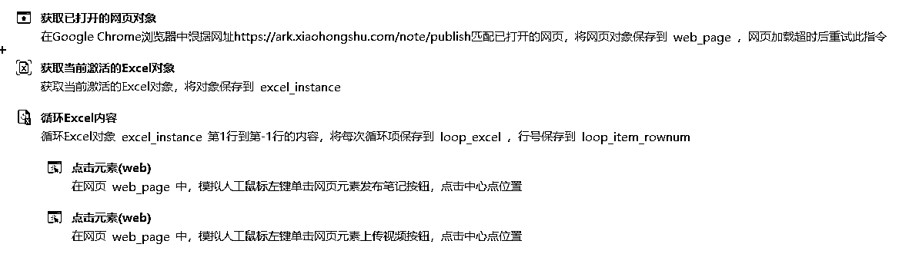
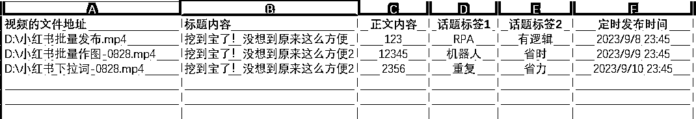
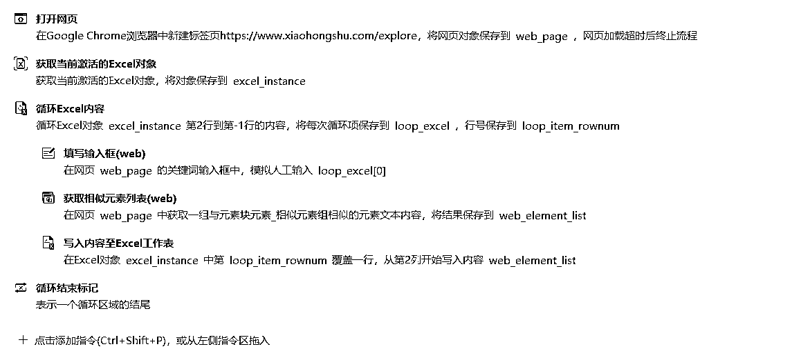
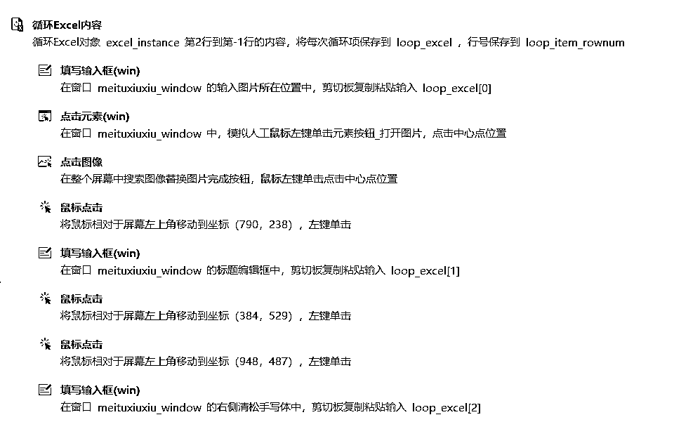

# ('《如何利用RPA提升小红书店铺10倍以上的效率？》@Leeka', (2, 33))

**把重复工作扔给机器人，我的小红书店铺效率提升了10倍+**

大家好，我是Leeka，一个影刀认证的RPA工程师。先同步一个成绩：我现在已经让RPA深入参与到自己的项目中，还靠出售机器人赚到了四位数。感谢赚钱有术让我认识RPA，也感谢自己当初下定决心学好影刀。今天应阿蓝邀请，来聊聊我是怎么用RPA给小红书店铺降本增效的。

**首先，RPA到底是什么？**

用一句话说：RPA就是让机器人替你干那些重复、不想干、但又有规律的工作。它像一个不用休息的助手，只要你的指令给得对，它就能准确、快速、不喊累地完成。而且它不受时间限制，你睡觉的时候，它还能继续干活。换句话说，凡是机械、规则明确的活儿，都可以考虑交给RPA。它的好处很直接：不出错、不休息、效率高。

**需要用到的工具有哪些？**

我推荐影刀，因为它把底层代码都封装成了可视化功能块，对零基础的人特别友好。去官网 https://www.yingdao.com/ 下载适合自己电脑的版本，然后给浏览器装上影刀插件，Chrome、Edge、360、火狐都支持。

**零基础怎么学？**

影刀学院（https://college.yingdao.com/）的课程更系统，比B站上的零散内容更适合新手。打开网站点击“立即报名”，新用户注册手机号登录就行。 登录后就进入到学习页面。 等你在影刀学院把该拿的证拿到手，基础操作基本就通了。

**进阶学习**

把影刀学院的内容学完、证件到手后，可以去B站搜更多关键词，比如我搜的是“小红书RPA”，看看别人是怎么玩的，思路会打开不少。 不一定非要锁定某个UP主，按你自己的需求搜就行。

**RPA在小红书项目里的几个实战玩法**

我的判断标准很简单：这件事是不是机械动作？是不是有固定套路？如果是，那就值得交给RPA。

**1. 批量定时发布笔记**

市面上有些第三方工具，一个月要收费98元。学会自己写RPA之后，这笔钱能省下来。原理不复杂：你提前告诉机器人要做什么——打开小红书商家后台、点击发布、选择视频或图文、上传文件、写标题正文、加标签、设定定时发布时间。操作时，你在影刀软件里把这些步骤录进去。 更妙的是，你可以用Excel表格跟机器人对接：在Excel里填好视频路径、标题、正文、标签、发布时间，机器人就会按列表一个一个执行。它的核心逻辑就是这么一张Excel表： 执行完还能把成功/失败状态写回Excel，让你一目了然，这样就实现了人机协作。最终呈现的效果就是这样：

**2. 抓取下拉词做SEO**

做多类目或多产品时，手动搜索关键词太累。而精准长尾词在小红书SEO里非常重要。比如你卖“微胖身材的连衣裙”，只铺“连衣裙”这个词，来的用户不一定精准，转化可能不高；但用“连衣裙微胖”这种下拉词，来的用户就更有针对性。手动去搜、去记录很麻烦，RPA可以代劳：输入主关键词，自动抓取下拉框里的10个词。整个流程如下：

**3. 批量做图**

做图文账号时，为了统一风格，我经常用同一个模板改图。最初我想让RPA从模板自动生成内容，但图和文字的位置不好控制，硬磕不太值得。于是我把需求简化成：让RPA直接在现有模板上修改。这样能解决80%的问题就已经很棒了，剩下的手动调一调，整体依然省时省力。流程大致是：

**写在最后**

看到其他船员已经跑通0-1或者单量暴涨，心里难免会有落差。这时候别急着否定自己，而是想想能不能把步骤优化一下：别人一天发3条，我能不能用RPA让一个账号一天发10条？别人一天发10条，我能不能用下拉词让搜索流量再上一个台阶？今天分享的下拉词机器人，我已经交给志愿者了，想要的老板可以找他们聊聊。我一直相信，赚钱不是非要累死累活，找对提效方法，一个人也能做好矩阵。很多程序员觉得RPA不如代码灵活，但对我们这些不会写代码的人来说，这恰恰是个机会。我是Leeka，持续研究RPA中，感兴趣的朋友欢迎来交流。最后，祝大家赚钱有术！