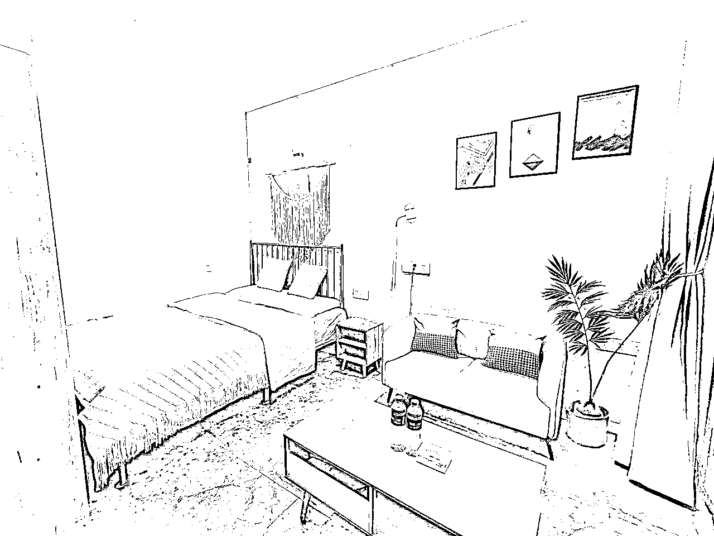
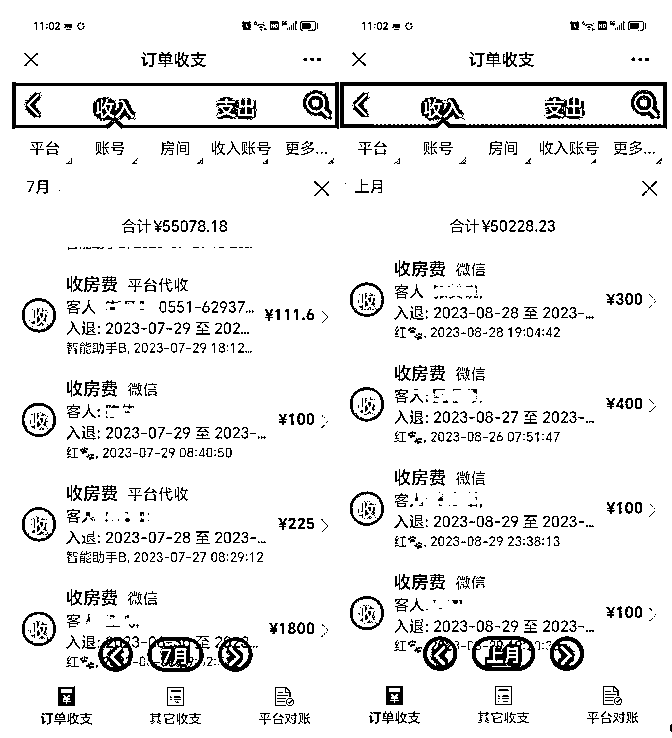
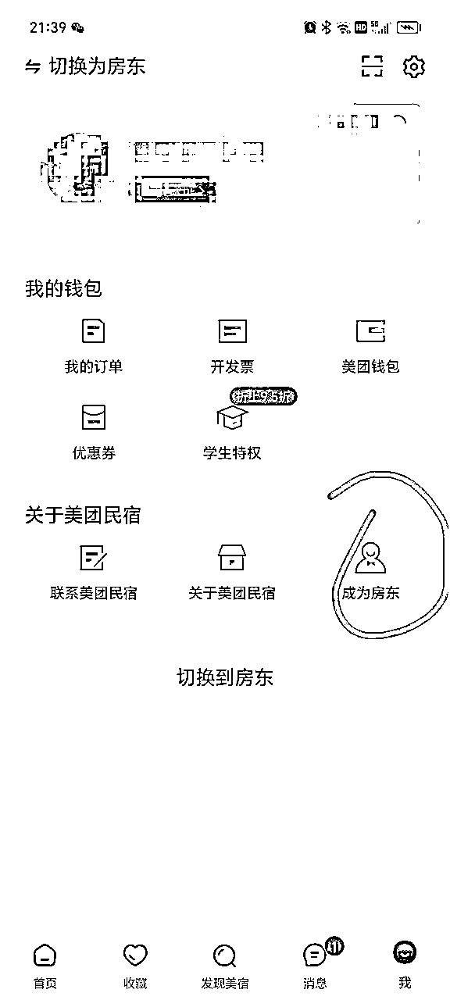
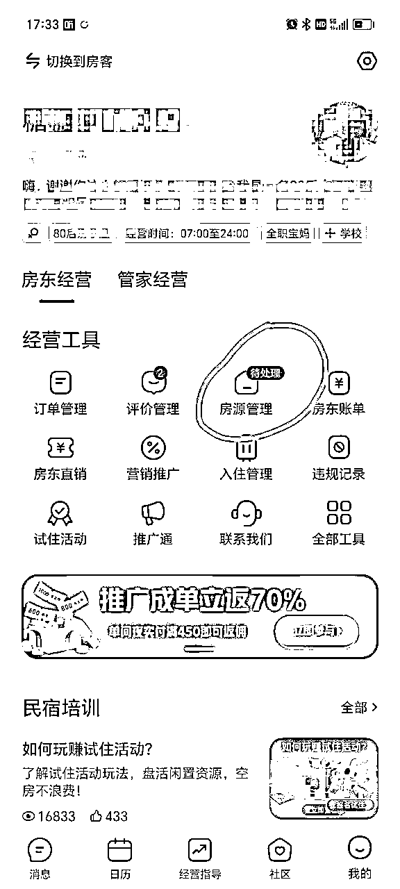
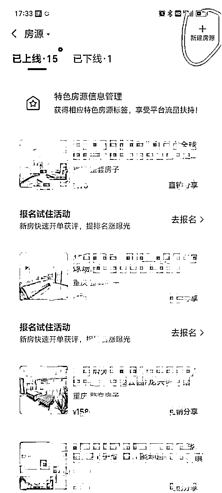
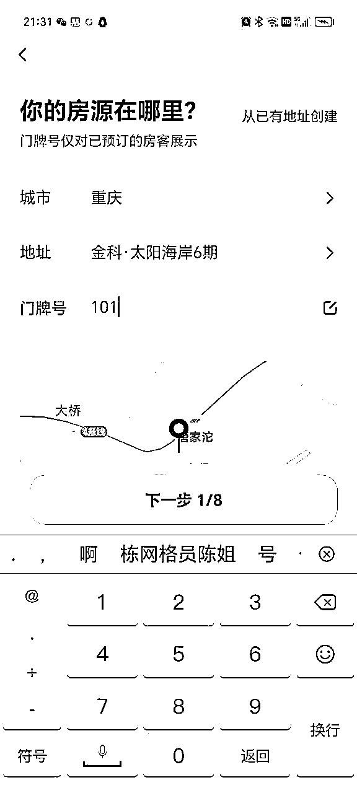
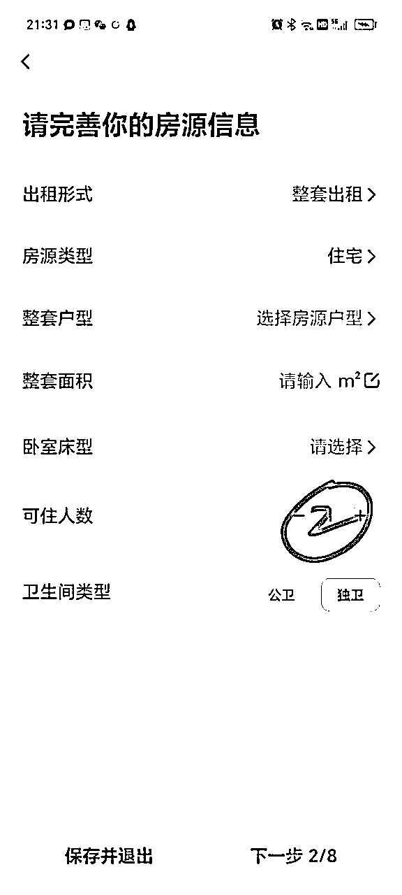
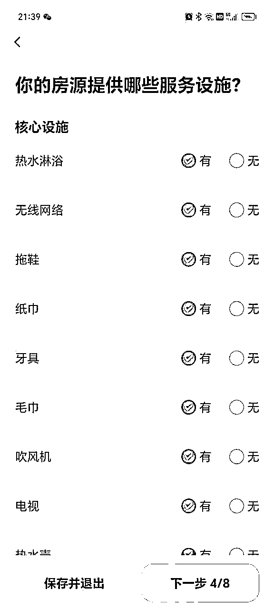
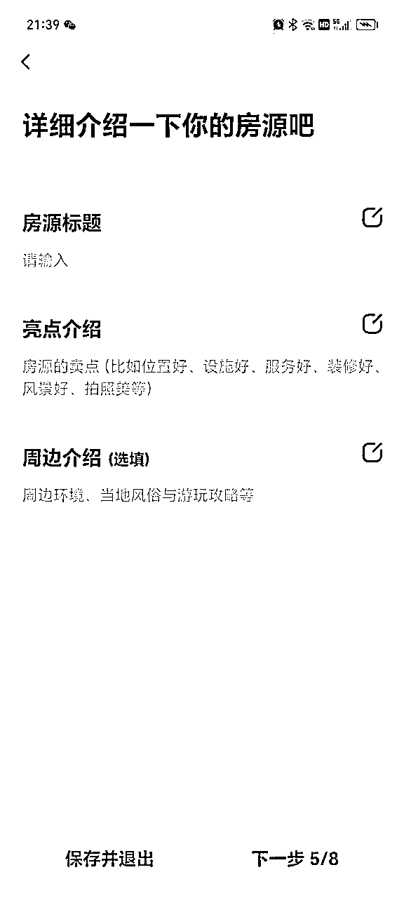

# 一个重庆全职宝妈的民宿实操笔记：从3间房到月入3万+

> 来源：[https://fwsgkdbb3og.feishu.cn/docx/VF75dim8AoRcaKxq9fGceh90nyg](https://fwsgkdbb3og.feishu.cn/docx/VF75dim8AoRcaKxq9fGceh90nyg)

大家好，我是糖糖家，重庆本地的全职妈妈。2022年4月入了赚钱，后厨潜水一年多，今年才开始发声，也去参加了线下聚会。学历不高，星球里那些高精尖项目我基本看不懂，看到群里大佬动辄月入几万上十万，自己既焦虑又热血。

跟着航海跑过好几期，也试做过几个方向，都没起色，有点挫败感。后来认识了赚钱里做二手书最有名的老瞿Qu，本来想跟他学闲鱼卖二手书，毕竟带娃之余空闲挺多的。

结果老瞿反问我：为什么要去硬闯一个不熟悉的赛道？民宿你已经做了两年多，现金流也稳定了，为什么不把手里的盘子做深做大，比如用小红书引流？

我当时这么回的：第一，我的房基本常年满房，入住率常年90%以上，引流需求不大，回头客维护得也还行。第二，赚钱里都是高科技高逼格项目，我这种低门槛的二房东民宿太掉价了。

这话把老瞿整沉默了，有点凡尔赛，但说真的我没那个意思。

被他一激，今天鼓起勇气把自己的经验摊开讲讲，希望对同样想在家带娃做点事的妈妈们有点用，也欢迎大家多提意见。

### 一、我为什么会入局民宿

2021年之前我就是个伸手要钱的宝妈，老公月薪7-8千，我每个月的生活费只有3000左右，生活很紧巴。偶尔出去做点零工贴补家用。

做民宿之前我也做过副业，比如儿子爱吃面食，我报网课学了果蔬卡通包，既给娃做，又想在小区群里卖。做了三个月，累到颈椎都压坏了，收入也就2000出头，最后放弃了。

一次和朋友聊天，她说她朋友的一套日租房一个月能净赚2500左右。我心算了一下，自己租一间除去成本能赚一千多，有3-5间就能有4000-6000的月收入，比做卡通包轻松太多。

让我下定决心的两点很简单：时间自由，能带娃同时赚钱；启动资金小，风险可控。

我做的是社区型民宿，一开始没办证。2年半时间，从3间起步到现在15间，月利润从几百块涨到现在3万+，全靠自己一点点啃下来。

上个月刚收的一套单间，房租押金加软装总共花了9000左右

起步阶段没人带，全靠自己摸索，踩过无数坑。刚开始孩子哄睡后，我就撸起袖子看运营教程，经常学到凌晨一两点。当时老公常年外地，一个月回两三次，家里和民宿的事全压我身上。

颈椎腰椎老毛病犯了，忙起来腰都直不起来，只能贴个膏药继续扛。有客人半夜两三点找不到路，我也得裹着大衣从被窝里爬起来带路。房子老旧，电器常坏，客人不会用，我都得上门排查。

每天很累，但心里是踏实的，因为这份钱是我自己赚的，还能照顾孩子。暑假两个月的流水放这里：7月大概5万5，8月大概5万，扣除房租和其他成本，净利稳定在3万以上。我这位置在重庆郊区，没啥旅游资源，大学放假反而是淡季，价格会下调一点。

### 二、从零开始做民宿的实操路径

从选房到装修，从上线到运营，我把自己的打法拆开说说。

1、和大家想的民宿有什么不一样

很多人脑子里民宿是洱海大理那样的网红民宿，几十上百万的投入，卖的是情怀。

我做的是轻资产的二房东日租短租，前期投入少，回本快，可以长期沉淀成被动现金流，既能当主业也能当副业。

住建部数据里全国有近6亿栋城乡房屋，商品房民宅保守估计4亿，服务28亿人口。房源基数这么大，二房东赛道完全是蓝海，普通人都能借房生钱。

2、启动资金大概多少

我起步租了3套35平左右的单身公寓，前期总投入3万左右，含租金押金和软装。小白建议先从1套练手，跑通模型再复制。

提醒一下，别上来就拿毛坯房，投入和回本周期都很长。简装或精装房更适合新手上手。

3、证照问题怎么处理

小区民宿初期我也没办证。美团、途家、携程这些平台目前不办证也能挂。抖音小红书上架才需要证。携程门槛相对高，要合同或执照，且同址房源5套以上。

我上个月认识一个同行，在原营业执照上加了住宿经营范围，现在就能发小红书了。是否办证主要看你想上哪些渠道，目前国家没有强制要求，也有人不办证做小红书引流。

4、选址思路

4.1 线下生意选址第一

网红打卡地如解放碑洪崖洞、成都春熙路，流量大但租金高，抗风险能力差。疫情三年，重庆解放碑观音桥倒掉一批民宿。竞争也激烈，新手不建议碰，除非自有物业。

新手建议先拿家附近5公里内的房源，离得近方便打扫和应急，刚起盘没稳定收入时很关键。当然请管家另说。

4.2 选址参考要素

临近大学、工厂、商圈、医院、写字楼、景点都行。我的客源主要靠旁边一所大学和周边工厂，没商圈景点，所以寒暑假反而要降价或转月租来保入住率。

5、房源怎么挑

5.1 选房核心标准

优先挑装修较新、家具家电齐全、交通便利的房源，体验更好。老旧房租便宜但易被差评。也不是绝对，老小区如果离地铁近、吃喝方便也有优势，公寓体更好。

注意房态，有些35平单身公寓被硬改成一室一厅甚至两室一厅，床位狭小，有的卧室没窗户，采光通风极差，客人住着压抑。

装修风格尽量清爽，别选花里胡哨的电视背景墙，特别是“花好月圆”“青松迎客”那种老派风格，后期改砸手。别选墙布墙纸，脏了难翻新，乳胶漆墙面自己就能修补。

做民宿两年多，我从一个啥也不会的宝妈，学会刷墙漆、组装家具、简单维修，房间里的很多小摆件都是自己手工做的，能自己干的绝不花钱，省下的都是利润。

5.2 租房合同怎么签

签合同要先和房东说清楚用途是民宿，把合同里的“不得转租”删掉。问清楚月租有没有优惠。

担心人员复杂的房东，可以说明民宿在派出所登记，每位入住都要上传身份证正-facing照。定期清洁，问题第一时间处理，不养宠物，保持原貌。长租还能给房东免空置期，大多数房东都能接受。我的一个房东大姐后来还帮我介绍了几套优质房源。

年限至少签3年，能签5-10年最好，民宿需要投入布置。如果只签一年，刚回本房东要收回或涨租就白干了。精装房投入小，签一年也可。

5.3 几室怎么选

我基本都是单身公寓，只有一套是两室。因为我这客群多是情侣，单间更吃香。旅游打卡地则建议以套房为主，客群不同策略不同。

6、民宿必备物品清单

* 密码锁：推荐通通锁，小程序生成密码短，好记。拼多多淘宝100多到1000多都有。之前我买的密码锁生成12位，客人老输错，还出现过客人半夜憋尿开不了锁的情况，体验极差。
* 四件套：纯白宾馆款，可用84消毒，其他颜色需专用消毒剂。
* 小装饰摆件：物美价廉即可
* 浴巾毛巾、一次性牙刷拖鞋凉拖
* 消毒用品
* 吹风机、烧水壶、共享充电线、计生用品
* 洗护用品、纸巾等消耗品
* 瓶装水：美团优选、多多买菜的冰露冰点水很便宜，按人头放，务必放水

7、如何销售和运营

平台主要有携程、美团、途家、小猪、木鸟。我主要用前三个，后两个使用频率低，生意淡季经常没单。

美团途家门槛低，一套房源就能上，有房产证或租房合同即可。携程要求合同或执照，且同址5套以上，但流量大。

携程客人习惯酒店标准，发现是小区民宿容易取消订单。美团途家客群预期更合理，取消率更低。

我现在订单来源：美团约30-40%，携程30-40%，回头客40%左右，其余来自途家。

以美团为例的上线步骤：

1.下载“美团民宿”APP
2.选择“成为房东”

3.我的-房源管理

4.新建房源

5.按步骤填写地址等信息

6.上传多角度图片，卧室厨房卫生间都要有
7.发布房源
8.审核通过后可设置新房特惠等活动

7.1 新房如何获取平台流量

新房多参加平台活动：新房特惠、今夜特价、早鸟优惠。每个活动都是流量入口，先把数据跑起来，排名上去了才更容易被搜到，平台也会给更多推荐。

7.2 定价技巧

参考同区域同行价格。五一十一等大促，关注同行是否售罄，若全满即可提价，旺季不愁卖。

8、客房接待流程

订单来后立刻联系客人，加微信，让客人提供身份证正面照和联系方式，说明派出所实名登记要求，基本都会配合。不配合可走平台入住登记或上门登记，保护自身权益。

加微信后发定位和入住密码，并附入住须知：退房时间、关门关空调等。这样还能沉淀私域，后续可做多元变现。

9、一键管理多平台

我用的是宝寓小程序，把各平台绑定后，一上来订单会自动关掉其他平台的房源，避免超售被罚。百居易等类似工具也行，看顺手就行。

定价建议参考同行，别打价格战，拼服务更长久。我靠真诚服务积累了一批老客。起初3间单间练手，后来出差客增多，我开始上标间。两室房平时不理想，寒暑假还行。旅游区建议多做套房。从月入1000到月入2万+用了1年半，全靠实操沉淀。

### 三、踩过的坑

一开始图便宜买的沙发茶几质量差，用几个月就散架，反而多花钱。二手市场淘品质好的更划算。

床品别买深色，拍照难看，易掉色看起来旧。我曾因床单掉色被客人投诉要求退房。

最致命的是重单，一定要常关注各平台房态。我有一次重单，客人空跑被投诉，平台全额退款还罚一晚房费，相当于损失两晚收入。

### 四、未来规划

目前以日租短租为主，后续准备加入长租，长租收益更稳定，接近睡后收入，管理成本低。

民宿发展趋势：品牌连锁化、服务和品质标准化；多元化，融入生活体验如DIY早餐包饺子等，增强分享欲；集群化，区域抱团，比如解放碑的日月光小区70%都是民宿。

近期目标是做到100套房源，同时在小红书抖音打造个人IP，用新媒体放大获客，期待月入10万、20万。

2023年一起赚钱有术，欢迎做民宿的朋友多交流。