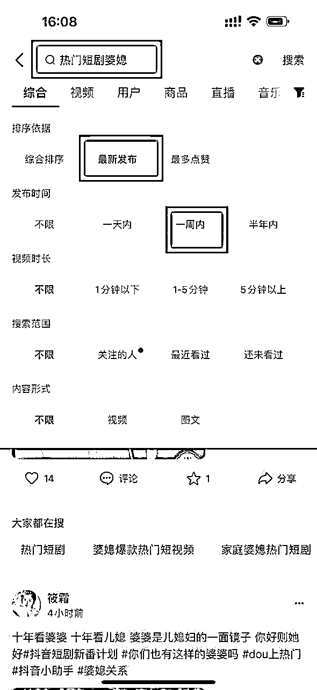
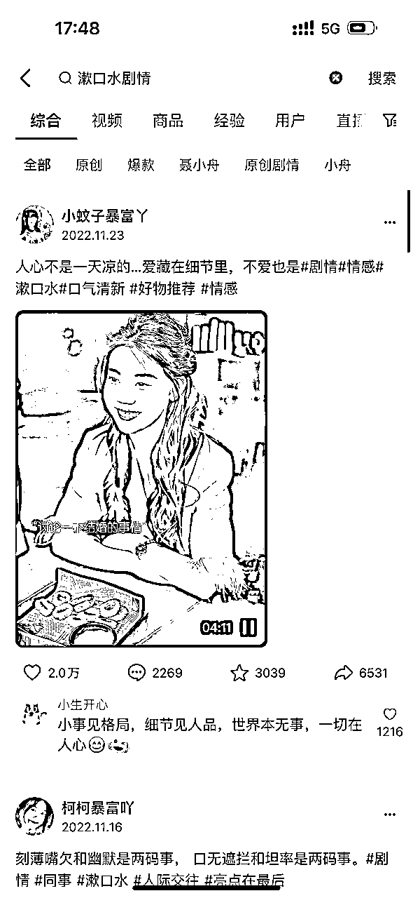
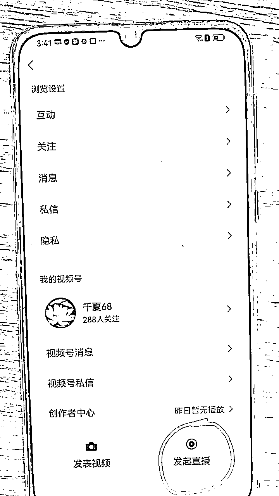
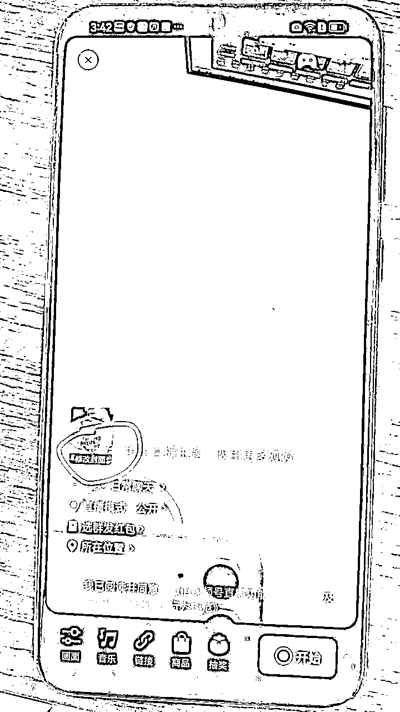
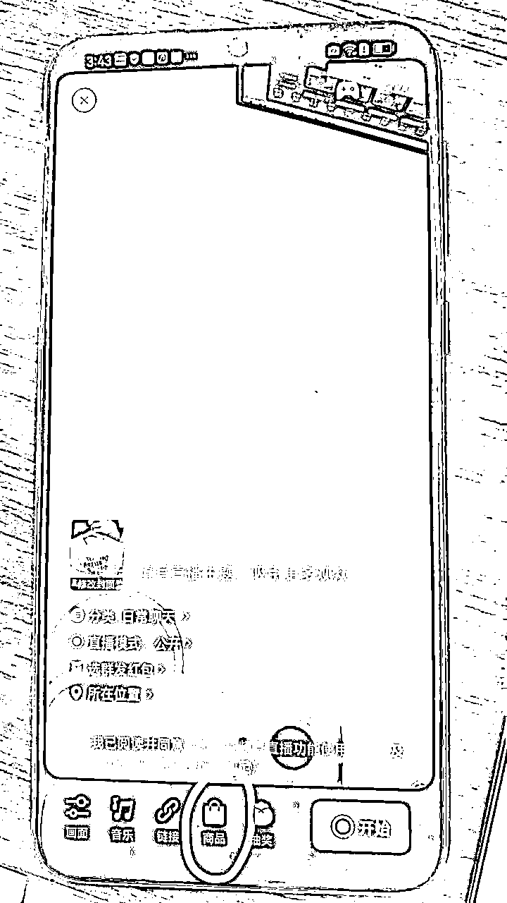
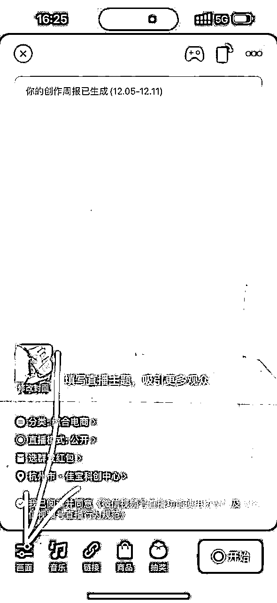
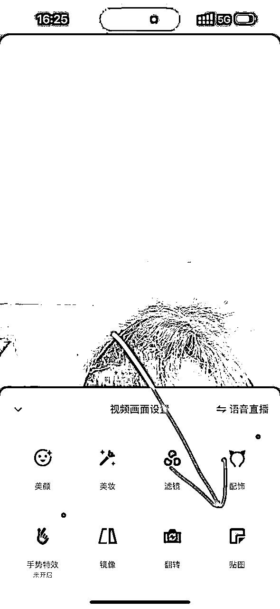
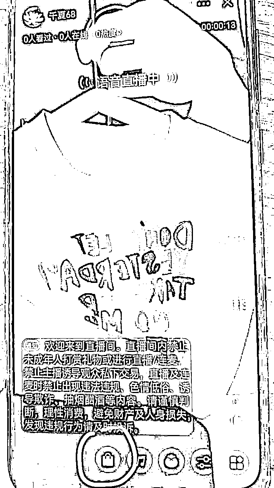

# 视频号做内容变现的航海指南

> 来源：[https://k4h4dcpi91.feishu.cn/docx/VlR0dRPw1onLDCxevL5cbaWTnph](https://k4h4dcpi91.feishu.cn/docx/VlR0dRPw1onLDCxevL5cbaWTnph)

大家好，我是李百万。感谢赚钱，记录了我从0到1再到1到10的成长。

在视频号深耕8个月，6月单月播放破51万+，收益12万+，已经摸到了一套可复用的方法论。

很开心能和大家交流，刚开始我也是从零起步，完全没有体系、没有人带，一路摸索很迷茫。接下来就把我实操跑通的思路和过程毫无保留地分享出来，希望能帮到正在起步的你。

在正式开始前，先感谢赚钱官方的小霸王、肉松小姐姐的指点，还有圈内朋友达达、小刀、靠谱姐、芷蓝姐、理白哥、比比等一路的陪伴和鼓励。正是有赚钱的生态和大家的支持，我才走到了今天。真的感谢。

* * *

进入正题。

先说清楚一件事，做视频号带货，选品是第一性原理。内容再好，品不对也是白搭。

赚钱有一篇选品攻略对我启发很大，建议大家有空去看看：https://search01.shengcaiyoushu.com/docx/doxcnWV9yAMFfoCGuaT2wvmWGBf

我自己也整理过一套选品笔记，可以参考《视频号6月单月12w+》：https://t.zsxq.com/11YdPqF3l

选品的话题已经有很多前辈讲过，我就不赘述了。下面重点讲选好品之后，内容怎么准备、如何用直播承接转化。

## 实战拆解

### 第一步：确定玩法和素材方向

拿到品之后，怎么用内容把流量引到直播间成交？我的做法是准备三类内容，玩法差异化但底层逻辑一致：先发视频测试流量，有数据就开播承接，再在直播中转化。

#### 1. 百货类带货短视频引流

用短视频展示产品拉新，直播完成成交。这是门槛最低、最适合新手上手的打法。家居百货、服饰、美食、新奇特都适用。核心在内容本身，封面占七分、脚本框架占三分。框架关键在前三秒抓人以及种草感，直播不需要很强的货架感，平播即可，核心是坚持和复盘。具体节奏航海手册里有更细的说明。

#### 2. 狗血短剧引流

用抖音的短剧素材引流到直播间卖货，有两个前提要注意：

选品受限，基本只适合9.9这类低价爆款，视频号中老年用户多，低价更容易在直播间触发冲动购买。

对素材挑选能力要求高，视频号用户偏爱婆媳关系等类型的剧情，且要选近期、搬运少的素材，避免流量被分食。

短剧怎么找？直接去抖音、快手搜索栏搜“热门短剧”“热门剧情”，剪辑后发到视频号。

也可以用品名+剧情的方式去搜，比如我之前搜漱口水剧情：

可延展的剧情品类很多：

漱口水剧情、牙膏剧情、七子粉面膜剧情、冻干粉面膜剧情、内裤洗衣液剧情、留香珠剧情、大运河肥皂剧情、毛巾剧情、一次性保鲜膜套剧情、洗碗抹布剧情、洗碗毛巾剧情、厨房湿巾剧情、男士手工皂剧情、香薰片香蜡片剧情、一次性手套剧情、鞋子除臭喷雾剂剧情、沐浴露剧情、喷雾身体乳剧情、垃圾袋剧情、眼影棒剧情、鞋油五件套剧情、油污净剧情

水果奶盖沙琪玛剧情、酸汤面叶剧情、五黑沙琪玛剧情、牛奶燕麦酥剧情、红糖姜枣茶剧情、阿尔卑斯巧禾棒剧情、干吃面剧情、酸辣粉剧情、鱿鱼爱上虾剧情、玉米酥剧情、小麻花剧情、山药脆片剧情、榴莲酥剧情、冰糖金桔千剧情

想做零食剧情可以对标这些账号：佳佳油甄选、小花妞、明欣电商、阳哥电子商务、古古达电商、熊一君、贫穷玩家、碧姐百货、林有志、燕儿电子商务、泊洋心选、鑫源电子商务、放牛姐电子商务、脆美人、老谭先生、慕柄商贸店、穆梵心选、小发哥、宇泽百货、兵哥哥吖、欧阳电子商务、春美婆媳电商、兴兴优选、海达电商、E哥严选、冷小七、盯当侠、俞顺六、鑫阳文化传媒、王二帅优选、人生如戏、星哥哥、朵朵优选鸡、梦达萍姐、明嘴电子亲妈、贾嘻嘻爱吃零食 等等。

#### 3. 精准带货视频

和百货泛流量不同，精准带货账号是品类高度垂直，品类少但客单价在中腰部，利润更高，标题直击痛点，流量更集中。比如养生炖汤类视频：

可对标：忆膳堂、木膳食语、汤汤煲汤、粤先森广东靓汤等，学习它们简单粗暴的种草表达。

养生内容怎么找：去抖音搜滋补煲汤近7天视频，下载转发量少的素材，去重后发布。临近秋季，可以重点找秋季滋补汤包，比如竹蔗茅根雪梨茶、五指毛桃茯苓茶等。

书籍赛道也很稳，像家庭关系、中国人情世故、厚黑学这类主题流量很足。

可对标：醒悟书摘、清晨每日阅读、柒月读书3、柒月读书等。

书籍素材怎么收集：抖音搜家庭教育、自我提升、个人成长、历史人物等标签，批量下载去重发布即可。清晨每日阅读的留人方式值得学：前三秒用图片+痛点文字抓人，后面实拍书籍，比纯混剪更持久。

具体单品可以结合蝉妈妈或考古加来筛选。

### 第二步：做好素材去重

下载的素材必须做去重，否则重复度高直接没流量。常用工具是剪映，电脑效率更高，手机也能做。

手机版剪映去重流程我一般这样做：

#### 1. 导入已去水印的视频素材
#### 2. 掐头去尾，删掉原视频的开头结尾
#### 3. 修改画面比例，双指略微放大/缩小即可
#### 4. 加贴纸，最好四个角都加上
#### 5. 加滤镜，改变整体观感
#### 6. 调整音频音色，改变声音质感
#### 7. 调节画面色彩
#### 8. 加特效提升新鲜感

电脑版剪映操作逻辑类似，步骤更顺手。

### 第三步：直播承接变现

开播时机有标准：第一条视频发布后达到200播放就补第二条，两条累计到1000播放补第三条，此时可以开播。开播后任意一条达到1万播放再补一条，2万再补，之后按5万、10万递增补。

设备方面，苹果手机可以直接边播边发，直播间右上角最小化后发视频，发完立刻切回直播；安卓手机不支持中途发，需要提前把视频存到草稿箱，至少准备10条，直播中最小化后从草稿箱发布。也可用电脑登录视频号创作助手，手机播电脑发。

直播形式建议视频直播，买个转台把产品放上去。如果用贴纸展示，贴纸别挡脸、别太大。

开播前1小时流量一般不会猛涨，别焦虑。重点看视频是否爆，没数据就按标准持续补视频，实在跑不到标准就直接补量。

直播操作流程：

#### 1. 进入视频号点击开始直播

#### 2. 修改封面
封面最好放你要卖的产品，让进直播广场的人一眼知道你是做什么的

#### 3. 上商品
点【商品】把要卖的商品挂上，建议新手走单品打爆路线，不要多品同时上

直播贴纸
如果手上没有现货，也可以用贴纸模拟展示

注意贴纸不要过大，不要遮挡面部，否则封号风险会升高。

#### 4. 选择直播分类
日常聊天或购物都可以。

#### 5. 话术准备
百货类话术比较简单，先用低客单价做引流，再简单介绍产品功能和使用场景。

参考话术：
欢迎新来的朋友们，晚上好。今天给大家讲讲我们的xx
这款xx真的很实用，既能xxx，还能xxx，适合xxx场景
今天是新直播间首播，原价xxx，现在xxx，库存有限，先到先得，喜欢的姐姐哥哥赶紧拍
如果买回去不合适，可以联系客服，支持无忧退换，大家放心下单
已拍的朋友回来给我发个已拍加急，我这边帮你备注并加急发货

精准带货的直播，观众对产品已有认知，所以话术重在引导下单动作，补充信任和紧迫感即可。

#### 6. 开播后的注意事项
讲解商品时，点击直播间下方购物车里的商品，按【讲解】按钮

开播后用小号自检一下直播间，检查声音是否清晰流畅、商品链接是否挂好。

心态放平，直播间流量通常半小时后才开始起来，耐心播，持续做引导即可。