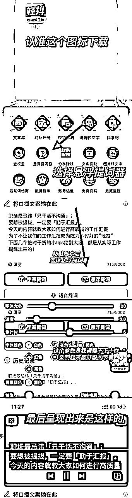
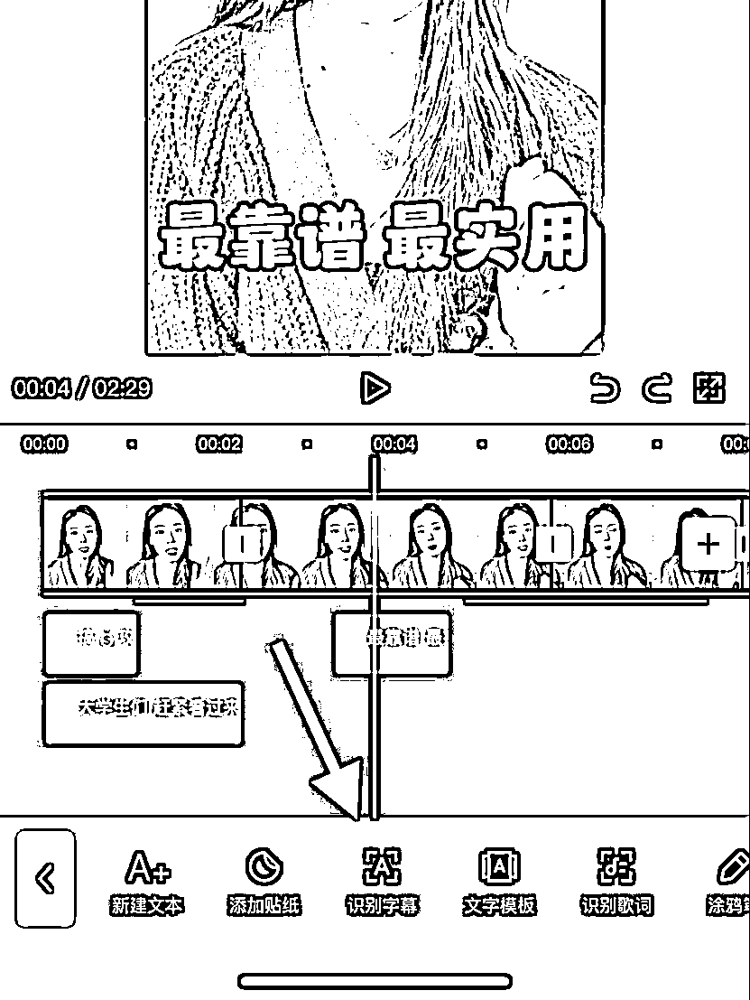
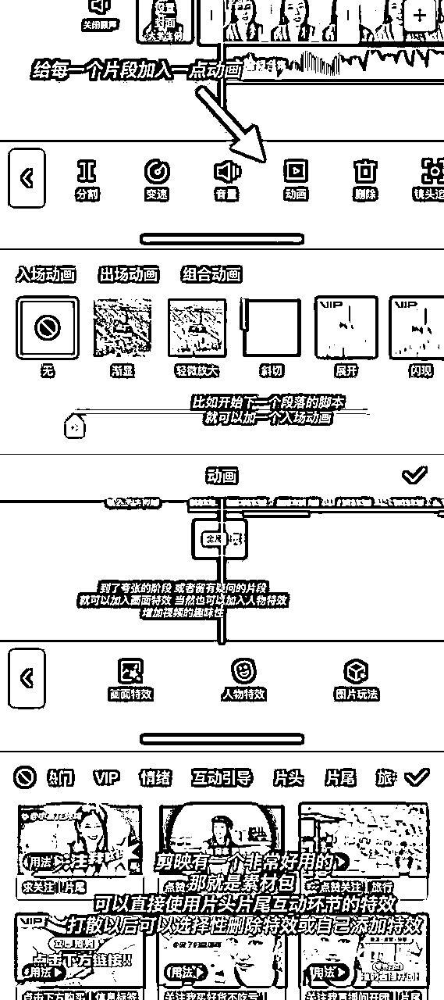
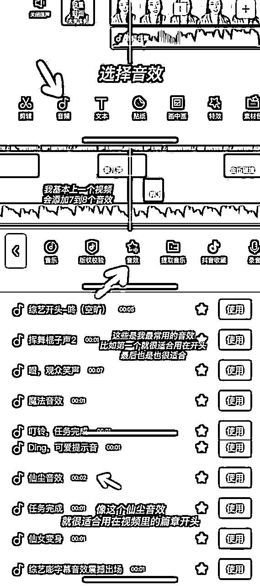
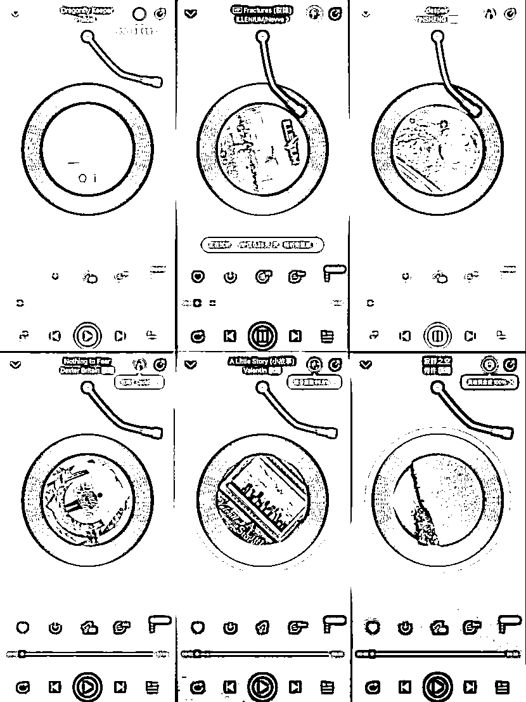
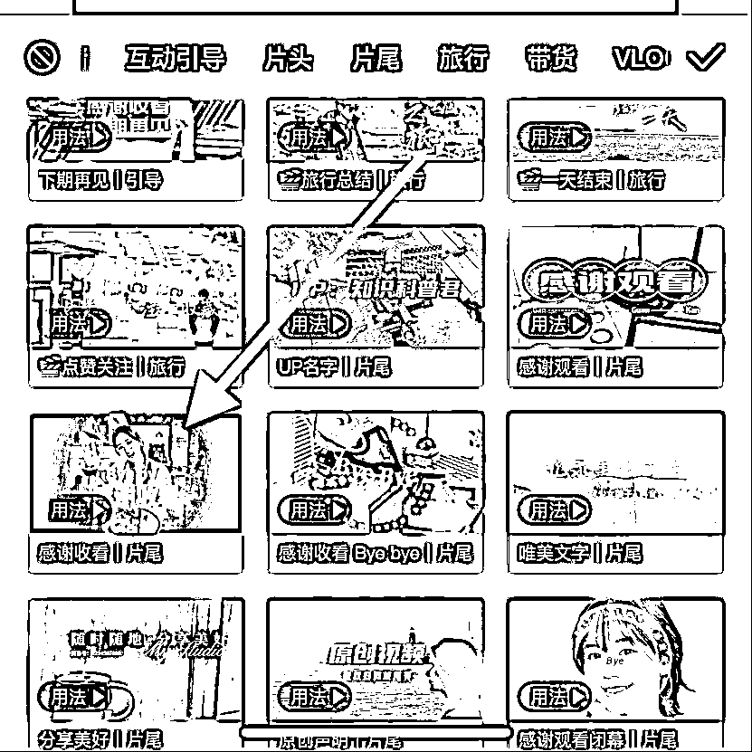

# 从零起步做口播，半年变现20万+，我的爆款方法论全公开

大家好，我是清一，见字如面，很开心在这里与你相遇。

今天不聊虚的，直接分享一套我自己亲身验证过的口播变现路径：从一个完全不懂镜头、不会写脚本的小白，到产出多条刷屏级爆款，累计变现超过20万。先亮一亮成绩单：两个小红书账号，发布了200多条口播作品，职场赛道半年入账8万多，图文情感赛道又带来12万多。

这篇文章，我会把口播从0到1的核心打法拆给你看。先放几条我做过的口播片段，以及这几年从“死亡视角”到高清构图、从脚本混乱到稳住黄金五秒、从做了100多个视频零收入到总变现20万+的全过程对比：

接下来，我会从三个维度展开，帮你解决口播视频的爆款难题：

一、拍摄：怎么用低成本拍出电影感？
二、脚本：爆款口播的结构与自然表达秘籍
三、剪辑：小白也能标准化的高效出片SOP

## 一、拍出高级感，其实不用花大钱

很多朋友和我当初一样，一录视频就开美颜，结果画质发虚，角度也找不好。想买专业相机，成本太高；想配柔光灯，又大又占地方。其实用手机完全能拍出质感大片。口播画面上，只要抓住两个关键词：人物突出、画面干净。具体可以从下面5个方向来调。

**1. 打光：自然光就是最好的滤镜**

我也试过各种美颜灯，后来发现容易过曝，画质还下降。最终我回归自然光，配合手机自带的曝光调节。人造光源本质上都是在模仿自然光，所以采光好的朝南窗户，就是最佳的拍摄场地。我一般在下午1点到4点之间录制，人正对窗户，手机放在正前方，摄像头高度大约在额头或眉毛的位置。拍16:9竖版，后期裁成3:4，让主体占满画面的三分之二，光线均匀，人也很精神。

**2. 拍摄软件：美颜相机yyds**

原相机、抖音、轻颜我都试过，最后还是觉得美颜相机最顺手。具体操作如下：

打开美颜相机 → 选择“相机” → 切到“苹果模式” → 打开“夜拍补光”，数值调到75 → 在“打光”里选“补光灯” → 再按自己喜好微调美颜参数。

这样在自然光下拍出来，画质很清晰，质感也够。后期就算再调色、再磨皮，也不会损伤画面清晰度。

**3. 设备：手机 + 三脚架 + 蓝牙耳机就够了**

我一直用苹果12或13，甚至用苹果8P拍也没问题。安卓手机同样可以。再配一个三脚架固定机位，收音就用蓝牙耳机，后期用剪映降噪，基本能达到清晰收音的效果。这套组合主打低成本。当然，如果对音质要求更高，我还是建议入一支专业麦克风。

**4. 提词器：轻抖免费版就够用**

我选轻抖的原因是免费，美颜相机自带提词器但要会员。轻抖里的参数我前前后后调了不下十次，最终这版节奏比较适合我的语速。大家也可以根据自己的语速再做调整，操作界面如下：

## 二、爆款脚本的底层结构

拍摄问题解决后，就到关键脚本科目了。分享几套我亲测好用的口播结构。

### 1. 开头：抓住黄金五秒

口播最要紧的就是开头能不能留住人。大家都在抢用户注意力，前5秒留不住人，后面再精彩也白搭。我有三个百试百灵的开头法：

**① 预告法：直接把价值亮出来**
比如“分享三个月入过万的副业”“刷到这个视频，说明你要发财了”“只要做到这三点，升职加薪不用愁”“减脂难、运动累？这期带你无痛瘦下来”。

**② 前置法：把最炸的片段放最前面**
我经常会在一开头就剪进“一年赚了1000w”“一年加薪3次”这类最有冲击力的画面。

**③ 挽留法：让用户舍不得划走**
比如“千万别划走，不然你的损失就大了”“这期你要是划走，等于错过一个亿”。

记住，口播的前5秒，宁可夸张，不可平淡。开头就是设计一个“诱因”，让人好奇、共鸣、想看下去。

叙事部分一定要紧凑，尤其是知识分享，信息密度要够。同时叙事节奏要与后面的高潮形成反差，中间穿插真实案例，因为大家都爱听故事。

高潮部分要有独特的价值观输出，这样才能激发点赞、评论和转发。

### 2. 结尾：埋钩子或引导互动

我常用的结尾话术是：“评论区留言，我会一一回复”“把你感兴趣的副业打在评论区，我给你挨个建议”。

### 3. 表演细节：越放松越出效果

很多人拍口播表情僵硬，显得很像念稿。我的办法是：把镜头当成自己的学员，每次录制就是在给学员讲课，像发语音、打电话一样自然。讲到兴奋点的时候，不要克制动作和表情，越释放，回看效果越好。目标就是找到和朋友聊天的那种松弛感。

另外还有两个关键点：一是协同性，文案、内容、音乐、画面、情绪状态、整体风格都要统一；二是镜头表现力，要有强烈的表达欲，眼神跟镜头有交流，表情贴合内容，情绪有喜怒哀乐的变化，并且多拍多练。

我几乎每次拍完都会反复回放，找出可改进的地方，再录一遍。这个“复盘-重拍”的循环，是跑出爆款的重要步骤。

## 三、剪辑SOP：把出片变成固定流程

口播剪辑在短视频里算简单的。我一开始剪一条要一两个小时，现在半小时就能搞定。直接上流程。

**1. 画面比例：优先竖屏**

我常用16:9或3:4。横屏虽然能发抖音、快手、视频号和小红书，但到了抖音快手会显得不清晰。所以我推荐大家用竖屏。如果想全平台铺，就用横屏拍，最后导出16:9和9:16两种尺寸。我个人只在发小红书时用3:4，比例观感更舒服。

**2. 粗剪和识别字幕**

把口误、停顿、无用片段剪掉，在需要加动画或特效的位置做好标记，接着用剪映一键识别字幕，操作就像下图这样：

**3. 文案和特效优化**

对需要强调的重点文案，重新调整字号、颜色或位置。字幕和画面都可以加动画、贴纸或特效，能有效避免口播枯燥：

**4. 音效搭配**

音效也很重要。比如视频开头我用有震撼感或悬疑感的音效，把人瞬间抓住；结尾引导点赞关注时，加一个提示铃，把注意力拉回来；中间适当加入章节提示音，让用户清晰感知内容进度。

**5. 背景音乐**

我偏爱节奏感强的BGM，有一种推着人把视频看完的作用。下面几首歌都是我在网易云找的免费音乐，不需要会员。用法是先保存或录屏，再在剪映里“提取音频”，把录好的视频导入即可：

**6. 片尾与引流**

片尾我会放到固定的素材包里，提醒用户“主页进群聊可免费领取资料”。因为很多用户不知道如何领取，一个明确的钩子很有必要。如果你没有引流需求，就引导用户点赞、关注、留言，这样也能拉高视频数据。

## 四、最后总结：口播的核心是“自然”

回过头看，这套流程其实相当标准化。口播就是“内容 + 画面感 + 剪辑技巧”的组合。最重要的还是自然。

别对服装、场景要求太高，上手比vlog容易太多。第一次做口播的朋友，尽量不要对着提词器一字一句念，那会特别像背稿。你可以念稿，但要不留痕迹：加一点语气词，把脚本写得更口语化。就像大家都喜欢看电影，但没人喜欢看“表演”。脚本宁可像随口说的话，也不要像书面文章。

我目前很推荐用飞书来写稿，它的语音转文字功能很好用，生成的口播稿直接就能录。

最后，我还是很建议大家做口播。我自己从口播转到图文后，明显感觉图文的转化不如口播。口播吸引来的粉丝，往往一聊就能成交，因为真人出镜的信任度太高了。

当然，我也想说说实话：我做口播的前100个视频几乎没什么流量，最高点赞也就50多个，身边人还一直在泼冷水。口播制作成本高，心态很容易崩，也特别容易自我怀疑。但记住一句话：努力和效果之间，永远有一段距离；成功和失败的区别，就在于你能不能挺过这段距离。

每个人都是从不会表达到慢慢能在镜头前说话，再到张口就来。心在哪里，收获就在哪里。

最后，祝大家都能赚钱有术，一起加油！