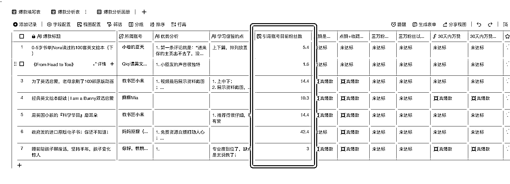
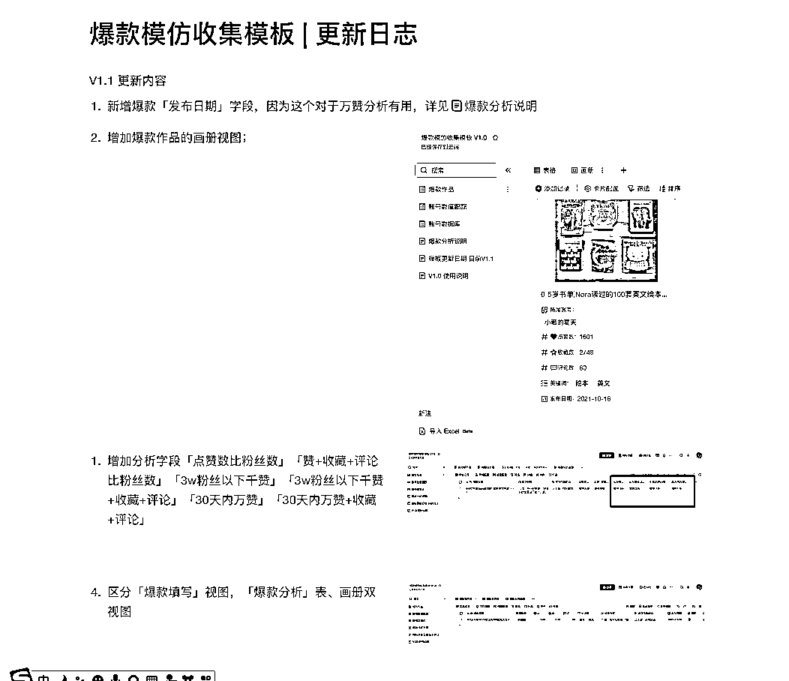
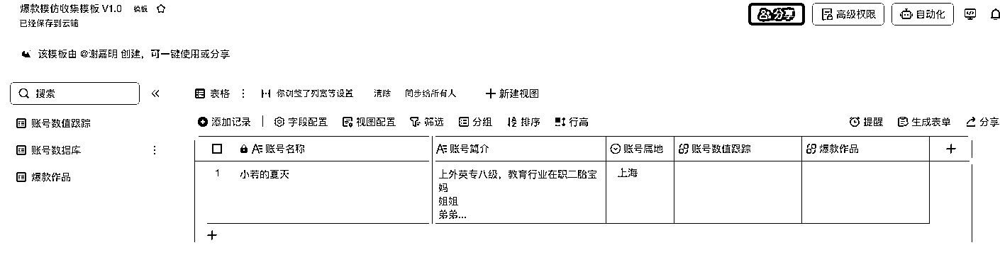
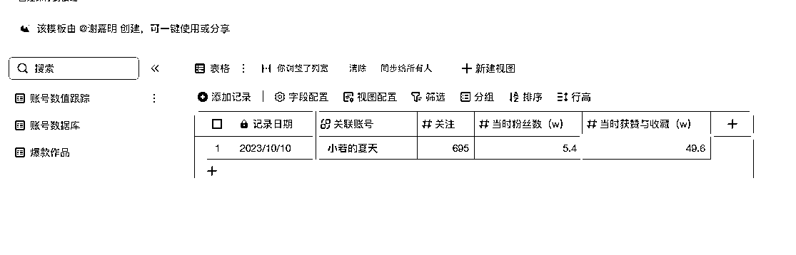
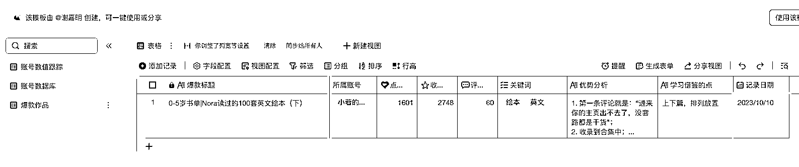

# 流量玩家都在用的爆款拆解笔记，本次免费开源 V1.2 版本

## 76 个赞在夸的 爆款分析数据库 流量人必备 V1.2 模板分享

作者：嘉明 Lock
发布时间：2023-10-10

在翻航海手册时我发现一个共性问题：为了找对标素材，我们经常需要在不同平台里东拼西凑。单纯用 Excel 记录虽然能用，但功能和联动上实在捉襟见肘。于是我顺手搭建了一套「爆款模仿收集模板」，专门用来沉淀和复盘爆款，希望能给做流量的朋友省点时间。

模板地址 V1.2 更新：https://jyzigyb0ly.feishu.cn/base/STzvbyI7ja5SfQseNsMc9qrwnoh?from=from_copylink

2023 年 10 月 11 日 说明一下，我本人已经用了段时间，模板里已经沉淀了一部分真实的爆款案例。为了让大家上手更快，这批数据我保留了不清理，同时更新日志也放进模板里了。之前权限没开全，现在已全部开放可访问。

同类工具如果你用得顺手，也完全可以迁移。个人比较推荐的替代品有：维格表、Notion、Wolai、Flowus。

V1.2 更新要点 2023 年 10 月 11 日

1. 爆款作品表新增了『感觉可以模仿指数』，方便快速判断优先级；
2. 爆款作品表新增了 “图文”“视频”两种内容形态的分类标签；
3. 在「爆款分析」视图里，补上了账号的实时粉丝数，取自账号数值跟踪的数据，用来辅助判断是否真爆、是否值得模仿。

4. 账号单独分析页也补上了对应的「粉丝数」字段。

V1.1 说明 2023 年 10 月 10 日 下午

V1.0 说明 2023 年 10 月 10 日 上午

使用方式简介：

1. 先把目标账号录入「账号数据库」。账号名填进去就好，后续需要的话可以自行扩展字段，比如「账号属地」「账号简介」「头像链接」等。

2. 在「账号数值跟踪」表里做动态记录。先关联好账号，再填写「关注数」「当时粉丝量」「当时获赞收藏量」。关注和获赞那两列如果用不上，直接删掉即可。

3. 在「爆款作品」表里补录爆款信息。同样先关联账号，然后填写「点赞」「收藏」「评论」「关键词」「优势拆解」「可借鉴点」。「记录时间」是系统自动生成的创建时间，无需手动操作。

数据积累到一定量级后，就可以通过筛选、分组、视图和仪表盘来做批量分析、找选题规律和模仿方向啦，祝大伙都能多出爆款多赚钱。

如果这套模板对你有帮助，给个小拇指鼓励一下新手作者吧。后续我还会出数据分析实操攻略，记得关注。

* * *

评论区精选：

Mr. 胡添翼 : 先点赞再看，养成好习惯[呲牙]

嘉明 Lock : V1.1 已更新，沿着航海手册的思路补充了一些判断维度，具体看更新日志，欢迎试用新版。

大家如果有类似多维表格的搭建需求，也可以找我帮忙，乐意协助。

嘉明 Lock : 这类表格其实能做出很多轻量系统，比如 CRM、ERP 等简单功能。

小黄 : 大佬太强了[强]我回去就上手试试

* * *