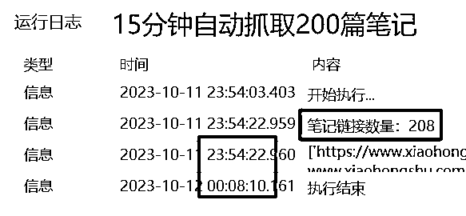
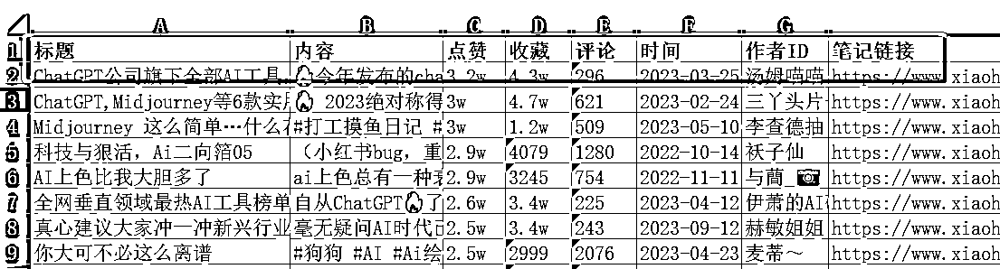

# 从零到上手：15 分钟用影刀 RPA 批量采集 200 条小红书笔记

## 零基础也能做 RPA：15 分钟搞定小红书笔记批量抓取

作者：阿盛
日期：2023-10-13

工作里重复点点点、复制粘贴到手软？想把一份流程变成自动跑的 SOP？那这篇干货你一定要看。

大家好，我是阿盛，在广州。去年开始玩 RPA，到现在用影刀 RPA 跑通了 100 多个自动化项目，也是影刀官方认证的优质开发者社区成员。

今年 4 月我发过一篇影刀 RPA 的实战分享后，私信里不断有人问我：RPA 到底能怎么用在小红书、微信、抖音、电商这些场景？线下同城交流时我也做过手把手搭建演示，发现大家都觉得这个效率工具很香，却总卡在“第一步怎么开始”。

所以我把这次入门思路整理成了这篇教程。目标很明确：跟着做一个抓取小红书笔记的实战案例，搞懂 RPA 应用是怎么搭起来的。帮你真正用起来这款“解放双手”的神器，让变现效率直接拉满。

## RPA 具体能解决哪些痛点？

不废话，直接上电商和自媒体圈最常用的几类玩法：

1.  内容分发：批量发布小红书图文视频，有网页版的平台都能同理操作
2.  数据监控：抓取小红书店铺商品销量，辅助选品和运营决策
3.  资源挖掘：按关键词批量采集 TikTok/INS 网红主页，拿到联系方式用于商务邀约
4.  微信内容采集：在微信搜一搜里批量抓取👸号爆文或最新推文
5.  账号运营：以微信为例，批量加好友、导出通讯录、群发图文、群成员去重
6.  AI 自动化：联动 ChatGPT、Midjourney、Stable Diffusion 等工具，实现内容批量生成

本篇我们从最简开始，先用 3 个步骤搭一个最小可用的 RPA 应用感受下自动化是什么味儿，再用半小时左右实操一个小红书笔记自动抓取的完整流程。最终运行效果如图，搞完你会发现：其实也没想象中那么复杂~

正文里配有图文和视频演示，完整版请移步飞书查看：

《零基础上手影刀 RPA：15 分钟抓取 200 条小红书笔记，解锁电商自媒体自动化操作》

希望能和更多圈友一起交流，互相借鉴、一起把自动化玩明白，搞钱更快更稳。

* * *

评论区精选：

良辰美 : 太强了。昨天我也在研究小红书链接抓取，搜索页用爬虫不好搞，我就用 RPA 慢慢跑，话题标签页倒是能直接用插件，几秒就出来了

阿盛 : 哈哈，直抓确实有点绕，得换个思路[调皮]我最后那个案例也是摸索了很久，思路和关联代码都截出来了，老手一看就懂[机智]

黄承德 : 链接点不开，得复制到浏览器才行

阿盛 : 收到，感谢提醒，已改成可点链接了

* * *