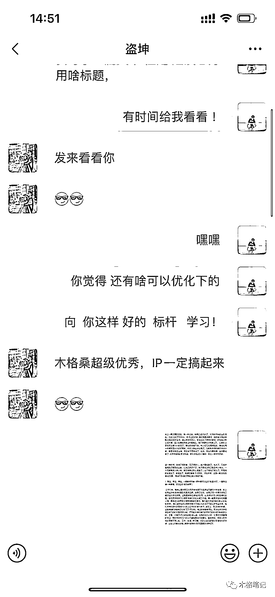
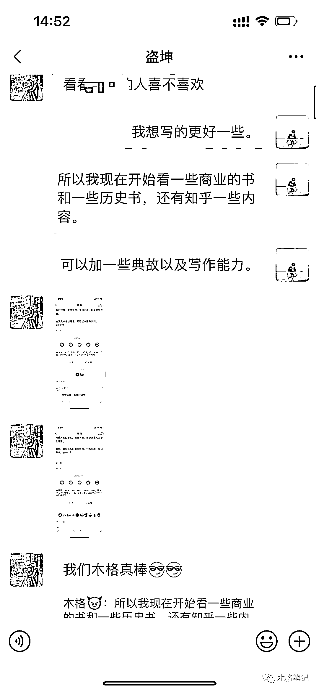
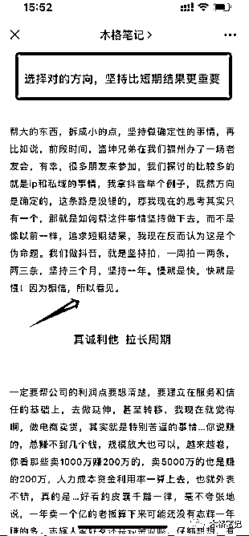
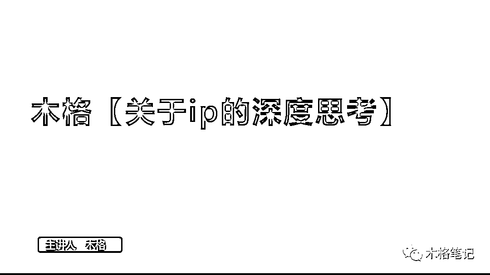
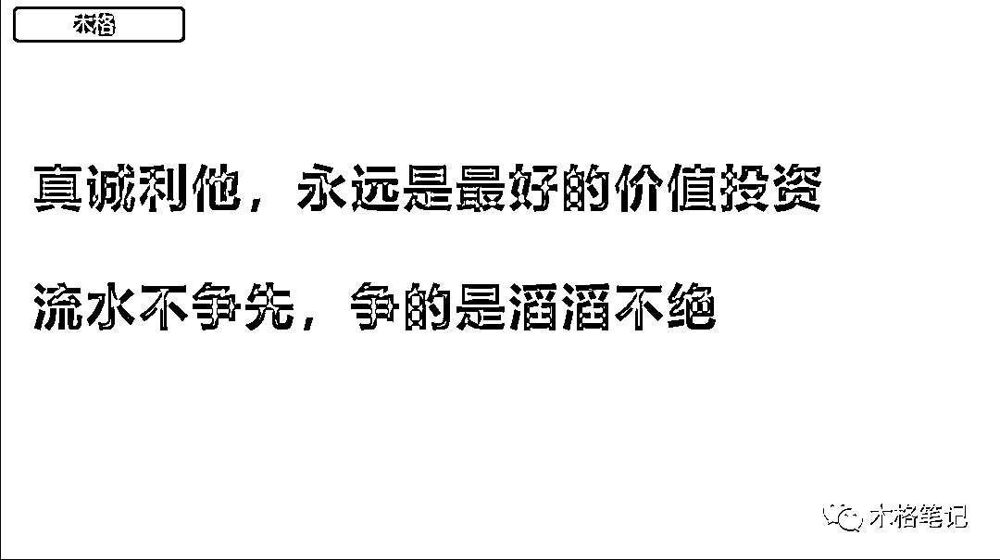
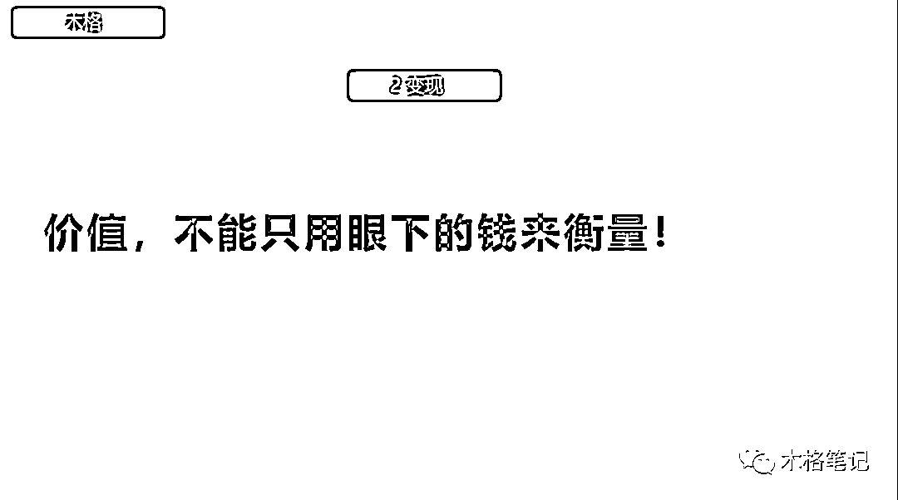
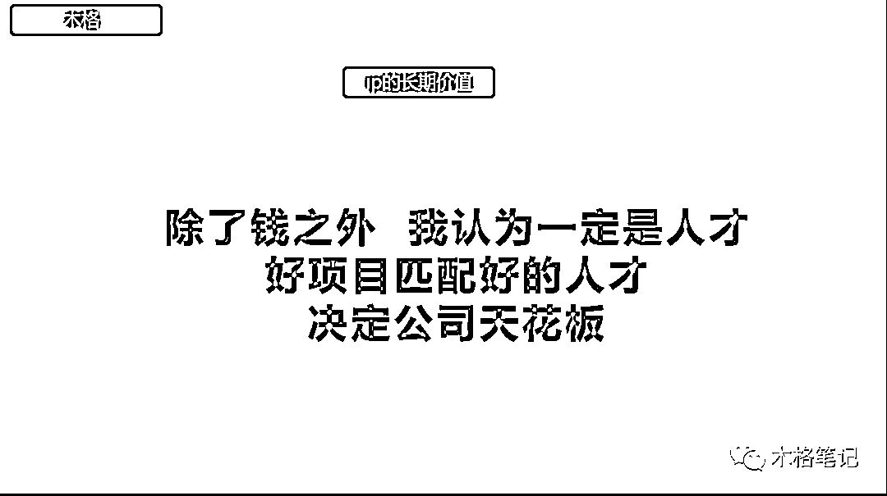

# 用一年时间把“个人品牌”做成三百万生意，我总结了这 5 条
作者：龙哥

## 在赚钱经营个人IP十八个月，累计收入近三百万，我的完整复盘

作者： 木格

日期：2023-10-07

各位赚钱圈的朋友，先自我介绍一下，我叫木格。这篇文字，我想认真交代一下自己靠经营个人品牌，在赚钱待了大约十八个月后拿到近三百万收入，同时攒下一批隐形资产的完整经历。它对我个人的改变，远超那些数字本身。

先说说从前的我。那个阶段，我更像一个追逐浪潮的投机者，哪里的风大就往哪里跑，图的就是赚笔热钱。到现在，我的做事逻辑彻底变了，只看一件事有没有长线复利。个人品牌这件事我持续投入已有五百多天，整个过程给我的感觉不是累，而是开心。许多人觉得这是一条“难但正确”的路，甚至不知道怎么起步。我的思考可能和主流声音不太一样，但底层的道理大同小异。下面就是我关于即时回报、远期资产和具体打法的所有心得。

我们必须承认，未来没法精确预测，能握住的是此刻。把眼下的一件件小事做扎实，大方向自然会向好。教训是养料，弯路是学费。多去啃那些不好啃的骨头，做别人不愿意沾的事，总会有回报。**这五百多天，我在经营个人品牌上最核心的体会，全在这里了。**

我会用五个关键词来串联：发心、方向、转化、回报、同路人。

### 发心：你为什么开始，决定了你能走多久

一切要回溯到去年夏天。那段时间，我挺迷茫的，疫情过后，身边不少朋友都过得不太顺，眼界也像是被框住了。当时大家私底下流传一种说法：关系没那么近的人，反而各个看着风生水起；真正腻在一起、无话不谈的兄弟，却常常为生计发愁。现在来想，这背后其实是圈层窄、视野窄的锅。

我萌生经营个人品牌的想法，起因在盗坤和志辉两位朋友身上。这几年，他们俩的变化实在太大，资产的厚度、头脑的深度，全都上了一个台阶。刚认识他们那阵子，我还困在抖音店铺的生意里，他已经在研究蓝海电商了。记得有一次看他直播，我被彻底颠覆了三观。他的关注者对他几乎是言听计从，这种信任的基础，是他通过自己的品牌持续传递正确的东西。那一刻我意识到，品牌的能量可以这么大。

早年我们做电商时，脑子里只有生意和快钱。现在我看到的坐标系完全换掉了。我经常泡在赚钱里读热门文章，边看边想：这些内容我也完全可以写啊，我的经历也不差，能讲的也不少，为什么不试试呢？

这里要特别感谢坤桑。他给予我的指点太多了，笔记、思路、复盘，全是实打实的干货。浓缩到一句话就是：**守住发心，真诚待人，始终利他。**

**图片是我翻出来的对话截图，时间在去年夏天。**

前几天线下训练营，我也讲过当时的处境。其实，我刚起步时，手里没有任何可以卖的课。天猫那种盘子显然不适合我；那些见效快的东西，我又打心底觉得不长久。所以我就是先开始写。因为认定了方向，就先相信，再去看见。为什么讲这个？因为我想劝你别等什么都齐了再动手。产品以后可以造，后端以后可以搭，先跑起来就行。我本人的路径就是模板，走一步补一步。哪怕最后没做成，当作日记也足够有意思。

经营个人品牌，不需要万事俱备。**它的核心，是你能够一次次拿出真正有用的东西，让人有所收获，也让自己逐渐变得更有分量。**当你积攒到一定程度，该放大的放大，该收费的收费，没有想象中那么难。

### 方向：你能给什么，比你想红更重要

发心解决之后，方向就容易定了。核心是彻底搞明白，自己到底能做出什么样的内容，能帮上谁的忙。这句话看似简单，操作起来并不轻松。我在抖音上交过一笔学费，就是为了一些镜子般的数据，做了不少回头看很尴尬的动作。

就拿我曾经的想法举例。以前我会下结论，说抖音用户质量不高，赶不上某些深度内容社区。后来我知道，这种说法大错特错。差别根本不在人群，而在你产出的是什么。我过去写的东西，多是“抖音店铺月入五万”“某书平台日进斗金”一类的标题。那类内容不是完全不能写，但若一直盯着它写，会把人带偏。个人品牌要立的是你这个人的信服力，而不是某个生意的热度。生意会迭代，会过时，唯一能穿越周期的是你自己的判断力。

你创作什么，就会吸引什么样的目光。天天把“某某赚了多少”挂在嘴边，招来的大概率是认知尚浅、急着翻身的人。我也反思过：那些混深度社区、泡知识星球、读长文的人，难道不碰抖音吗？他们当然碰。所以根本不存在所谓低质用户，低质的只会是你给的料和表达。试着多谈自己的创业故事、栽过的跟头、遇过的坎，以及管理和财务上的感悟、对人生的观察、对当下的思考，这些才是有长久吸引力的东西。

修到这里，核心已经浮出水面：**发心纯净，持续供给对创业者有真实帮助的内容。**很多大道理掰开揉碎，不过如此。

### 转化：我把节奏放得很慢，但钱还是进来了

谈到赚钱，每个人的想法都不太一样。我是挺松弛的那种，不会把变现当作唯一标尺。**但比起金额，我更在意做这件事带给我眼前和长远的不同厚度。**

眼前的厚度是这样：这五百多天里，我并没有频繁地做商业转化，大概半年才动一次。私人社交账号里，更多是创业相关的所思所想，很少晒入账截图。即使如此，累计收入也接近三百万了。说多不多，但每一笔都干净。如果我把动作改成一个季度一次，结果肯定完全两样。但我没这么做，是因为我真正在意的是后面的增量。

我一直有一个顺序：先把人做厚，再谈输出；先把业务做深，再谈转化。要是只顾着立刻开课收钱，自己的主业一定会被拖垮，也不可能有长线主义，更做不出深度。以大健康板块来说，我选择先把供给端、渠道端、团队端全部打牢，这套功夫没有足够的时间沉淀不下来。我不想同时铺太多摊子，只盼找到那么几条线，打磨到真正能打。个人品牌的转化节奏，说到底由我说了算；但是业务本质上能做到多好，却不是我一个人能决定的。因此我又挑了那条“麻烦”的路：先把事做成，赚钱往后排。业务没了，一切才是真的没了。

再聊长远的意义。我和那些高频收割的博主最大的不同，也在这里。年初，我招过一轮联合共创者。如今留下来的人不算多，就几位，但他们形成的能量场，谁看了都会羡慕。什么叫“上下同欲”？这就是。我很清楚，优秀的人永远比现金更值钱。**经营个人品牌真正的长线回报，在于吸引到高度认可你的同路人。生意的根基，说到底是人；很多生意做不出结果，病根就在人身上。**机构的投资逻辑也是同样的道理，创始人排在首位，生意反而次之。光凭这一点，这件事就值得我继续投入。找到对味的人，一起搞点有意思的事，诚心以待，各取所需，那才是我想做的生意。

### 回报：先相信，你才可能看见

渔夫驾船出海前，并不知道鱼群在哪里，但他还是会起锚，因为他信自己能收获满满。很多时候，是先有了选择，机会才出现；先笃信，好事才会发生。

把我走过的路浓缩成几步，也许能给你一点启发。

第一步，守住发心。这件事我反复提，因为它再怎么强调都不为过。一个人如果人品有问题，信用破产，那他再有本事也没有用。**守住发心，花自会开，蝶自会来；自己站直了，全世界都会给你让路。**

第二步，别让“我还没有产品”挡住你。重要的是先动起来。答案其实早就摆在那里了，别再像无头苍蝇一样乱转。**走出去，答案才会长出来；走出去，同路人才会来；走出去，贵人和机会才会迎面而来。出发吧。**

第三步，你得真正有东西。靠运气赢一两回不叫本事。**想让人信你，先让自己有厚度。只有善心、没有故事，创作也撑不起来。**这又绕回内容，怎么做出有分量、能戳中人的表达，值得反复琢磨。

第四步，转化的频率你自己定。口袋里没粮时，频率可以拉高；腰包有余粮时，不妨放慢。**先让正在做的事变好，把赚银子的事放到后面，押注在人和未来上。**

可能你们想不到，我的个人品牌经营得并不算出色，甚至有点普通。做这件事根本不复杂，我只是把平时写在备忘录上的想法，移过来公开发表。写作的节奏也很随性，大概个把月才写一篇，一篇也就花小半天光景。

请放下对“个人品牌”的敬畏心。再难的事情，都能拆得极简。比如写作，我从不给自己布置任务，心情来了就写，灵感到了就记。我甚至没设过阶段性指标，因为我理解得很透：一直做下去，远比短期跑出成绩重要。这一点在前面几篇内容中也提到过。

这就是我关于个人品牌整整十八个月的复盘，每一句都真诚。**另外，我准备了一份相关的PPT原件，需要的朋友可以自取。**里面拆得更细：包括我对个人品牌定义的理解、具体的执行步骤，也包括接下来我准备怎么做抖音——从账号站位、表达风格、选题库、底线意识、节奏稳定性，再到货源、通路、成交、留存、复利这些完整链条，全都有。希望能派上用场。

**想要完整PPT，评论区扣个“1”，我会陆续发给你。**

最后，送大家一句来自心底的话：

**说实话，此刻赚了多少钱，没有那么要紧。能够不断创造出将来的增量，才是真正的重点。而最核心的是，你正在做的这件事，是否让自己满意，是否体面磊落。那才是值得你奔赴的远方。**

—— 全文完 ——

评论区：

花天卓：好项目匹配好人才👍

郭耀天：1

快印老司机唐应群：1

徐欢：非常认可你的观点，眼光放长远，人比钱重要

小花：1

小花：1，向大佬学习

黄紫：1

KiteQi：1

—— 完 ——