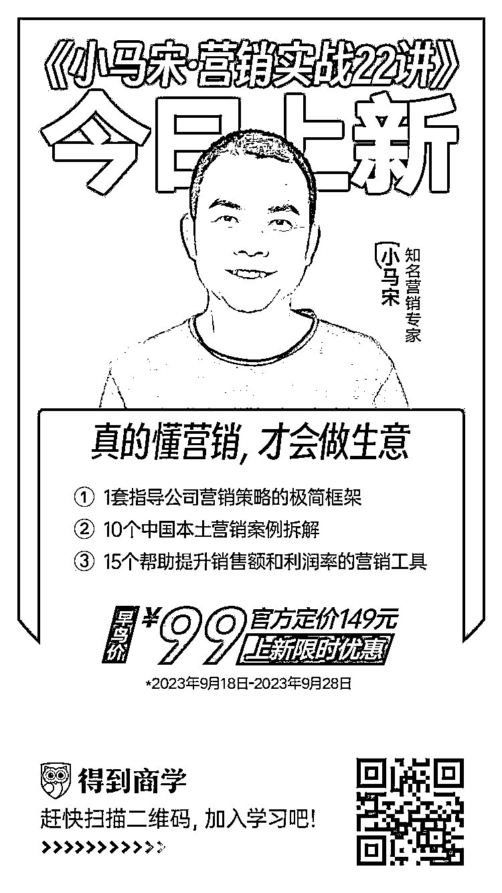

# 服装即高明政治，政治亦是精致着装

## 服装就是一种高明的政治，政治就是一种高明的服装

作者： 小马宋

日期：2023-09-28

服装就是一种高明的政治，政治就是一种高明的服装

前一阵子在学习群里聊到模仿这件事，我忽然意识到一个规律：每个人心里都有参照系，而每个参照系背后，都有一个更早的引路人。今天就梳理一下我早期最着迷的几位创意圈的头部人物，他们也是我长期效仿的对象。

**尼尔 法兰奇**

2003 年左右，我还未正式踏入广告业，只是对这行充满向往。那时我在《地产观察》做事。老板当时请来一位创意大咖蔡仕伟，他来自台湾，曾在奥美担任过创意总监，设计出身，还拿下过中国首个金铅笔奖，当年已属凤毛麟角。

请他来是为北京一处超级豪宅做楼书，该盘仅五栋，六百亩地。蔡仕伟负责美术，我负责文字。他给我看了一份参考，说要体会奢侈品的书写质感。那就是法兰奇为金牌马爹利写的长篇大作。

第一次读到那样的稿子，我感觉认知被打开了，后来那篇上千字的文章我几乎能倒背如流。

随后我接到第一份广告委托，为宁夏红枸杞果酒写解说视频，直接照搬了马爹利那套写法，客户之前纠结数月的文案，一次就通过了。

法兰奇的人生本身就是传奇：年轻时混迹街头靠钓凯子维生，还涉足过三级片，最终成为奥美的全球创意主理人。他的文字极具穿透力。

写生活困顿时他说，生活是个妓女，而你偏偏娶了她。

写皇家芝华士的段落尤为狠辣：

这是皇家芝华士的广告。

若你仍需要端详瓶身，说明你不在正确的社交圈层活动。

若你仍需要品尝味道，说明你缺乏鉴赏经验。

若你仍想知道价格，请翻页吧，年青人。

我曾大量临摹他的手法，他的作品集堪称创意金矿。后来国内出版社准备推出他的作品合集，还邀请我翻译并安排与他的对话，我因档期太满放弃了，这一直是个遗憾。想了解他可读《文案之神》，建议找赵宁的译本；民间流传最广的其实是盗版的《neil french》，现在已很难找到。

**乔治 路易斯**

这位大概就是《广告狂人》的灵感来源之一，风格狂放且有点疯。他有很多段子流传。

一次他为一家加油站设计标识，图形类似带箭头的路牌。有客户提出异议，说像男性生殖器官。

他的回应是：我不知道你那东西长什么样，但我的绝对不像这个。

他留下的代表作有《广告的艺术》和《蔚蓝诡计》。他是艺术总监出身，所以文案不多，却在策略层面天赋异禀。

**霍普金斯**

霍普金斯和乔治 路易斯是两条路线。路易斯主张广告是艺术，霍普金斯则写出了《科学的广告》。

他被视作大卫 奥格威的精神导师，也是拉斯克尔最推崇的人。拉斯克尔后来人尽皆知的那句话“不做总统就做广告人”里说的正是他，据说他是史上最富有的广告人之一。他创立FCB，后被西奥多 罗斯福邀请担任美国宣传部部长——注意是西奥多，不是富兰克林。

霍普金斯把广告当成一门科学，他首创优惠券距今已逾百年。他当年寄发广告单页时会先投放数千份不同版本，靠电话回拨和回信率来判断效果，这正是如今互联网A/B测试的雏形。

**许舜英**

我起家是文案，所以对文字流派格外在意。能留下系统作品的创作者不多，法兰奇、伯恩巴克有出版物，奥格威的文字反而散落。许舜英的作品主要靠网络传播，数量庞大，她自己有一篇就叫《大量流出》。

她最知名的是中兴百货系列，也是李欣频的导师与老板，但李欣频的文字锋利度不及她。地产界的揽胜公司创始人杨海华自称摇滚歌手，其调性里也能见到许舜英的痕迹。她写过：

服装就是一种高明的政治，政治就是一种高明的服装

因为有了新衣，才有了过年。

逛服装店是来展示气质，逛书店是来展示穿着

三天不买衣服会觉得脸面难堪，三天不购物会觉得灵魂难堪

我本人消费欲望很淡，却被这些句子震住，原来中文广告圈竟藏着这样的大师。若排中文文案作者，许舜英在我心中排第一。她与法兰奇相比略逊的原因是，法兰奇能通吃各种风格，许舜英个性太强，写不了王老吉也写不了农夫山泉。她是台湾意识形态广告的开创者，后来主持过奥美的时尚业务。

**伯恩巴克**

最后说伯恩巴克，DDB的缔造者。我认识他是通过一位台湾创意总监。那时我首进一家合资4A公司，叫斐思态，后改名LG广告。我的主管给我看了一本甲壳虫广告集，是DDB的作品，后来他把整本送我，几十则文案我能熟背。可惜试用期结束就被辞了，命运弄人。

甲壳虫的文案为我打开新视野。后来我写过一本书《那些让文案绝望的文案》，其中八成内容是重新翻译的甲壳虫系列。很多人批评我剽窃，说我没有原创。后来我让出版社下架了。我的本意只是想把甲壳虫的文案搬出来，并不是想写理论，是读者误解了。想看的去旧书店碰运气。

---

明天就是中秋节，祝大家节日愉快。

我在得到上的《小马宋营销实战课》已上线，今天是早鸟价最后一天，需要的话抓紧购买

* * *

评论区：

周彦充 : 只看过科学的广告，其他的都没接触到，形象最深的就是广告要把产品说清楚，而不是搞娱乐。

英麒 Ryan : 蔡仕伟，十年前的《守艺精神》开始喜欢他

* * *