# 聊聊怎么用好龙哥盟这个平台
作者：龙哥

大家好，我是龙哥，一个04年出生的女生，这次在AI绘画+自媒体航海里担任教练。短短21天，我完成了1场直播、1次高手分享、4轮加餐（加起来超过1万字）、回答了100多个问题，还收到了150多位船员的主动链接，以及3000多块的打赏。连我自己的名字，都在13页打卡记录里被反复提到。

说真的，以前我习惯了躲在幕后干活，现在的热闹完全出乎意料。那种被认可、被需要的感觉，让我既幸福又充实。趁着回家的路上，我把这些感受写下来，也算给这段经历一个交代。

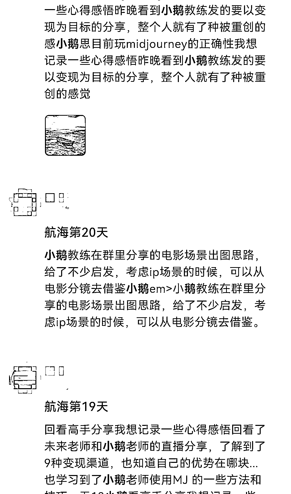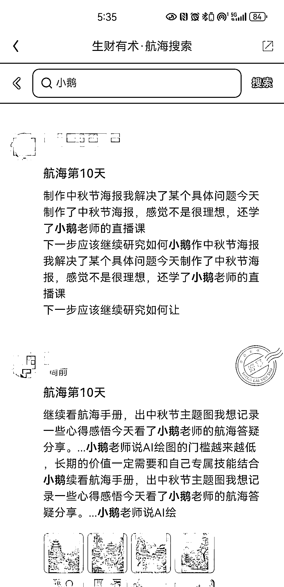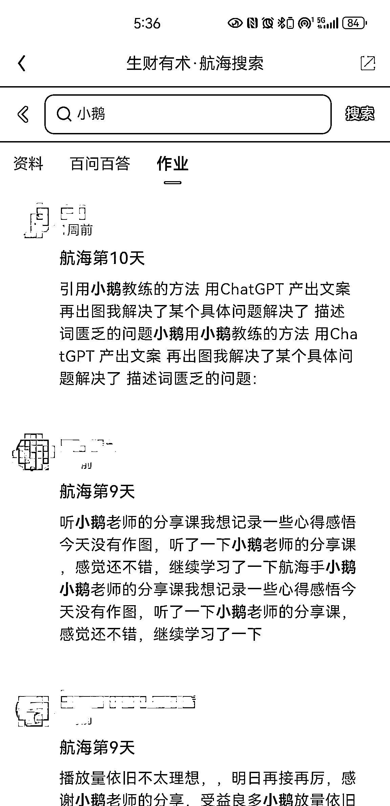

其实我在赚钱里也就泡了五个月，认识了不少圈友，大家见到我的第一句话几乎都是：“你才19岁？”

是啊，19岁，别人还在享受大学生活，而我却总是一个人泡在咖啡店里，做到腰酸脖子疼；拖着行李箱到处跑，只为抓住一些虚无缥缈的机会；夜里躲在宿舍帘子里无声崩溃，擦干眼泪还得笑着说“没事”。

但我依然庆幸自己是个爱折腾、敢闯敢拼的女孩。正是因为这样，我才一步一步爬上更高的台阶，而“龙哥盟”在其中帮了我大忙。

不过说实话，刚加入的时候，我有很长一段时间根本不会用这个平台。所以今天，我想认真聊聊：怎样让赚钱真正成为你向上生长的助推器。

## 第一阶段：把赚钱当工具，先把输入做透

### ① 它像一本写满信息差的百科全书

刚进来时，赚钱彻底打破了我原有的认知边界。以前我对📕这类平台几乎放弃，觉得那是有天赋的人才能玩转的东西。直到我打开了航海手册，才意识到——原来所有事情都有路径可循。

说实话，我最初买赚钱会员纯属“凑热闹”，因为当时做培训赚了点钱，又赶上四月份有优惠，只花了一千四就入手了。买完我甚至忘了去领门票，直到快五月才想起来，赶紧问鱼丸怎么入圈。

刚进索引站的那几天，我这个没见过世面的小孩跟疯了似的，疯狂吸收里面的内容，就像婴儿见到母乳一样，贪婪地获取一切。

我的学习方式基本是：

+   翻航海实战手册、看高手分享、查百问百答，边做笔记边实操；
+   精读精华帖，把对自己有用的标记下来，时不时回头复习；
+   实操中一卡壳，就去赚钱里搜索解决方案；
+   添加内容优质的圈友，默默围观他们的朋友圈动态。

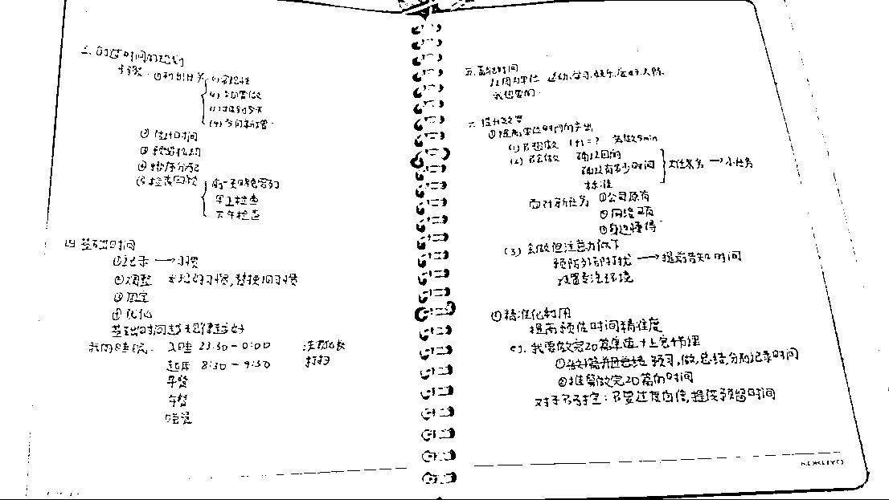

就这样，我老老实实地记录、实践、复盘、提炼、反复琢磨，一条条爆文居然真的从手里长了出来。有时候忙得忘记看的账号，一打开全是未读的99+。

半年之后，原本让我无从下手的事情，忽然变得简单了。爬数据、做分析、做SEO……我给我赚钱外的合伙人讲起这些，她惊讶地问我是怎么知道的，我脱口而出：“赚钱里学的。”

### ② 它是我的私人搜索引擎

我没什么社会经验，很多行业术语对我来说像天书。但在外面跑的时候，难免会碰到各种高深莫测的概念。我每次都会默默记下来，然后回赚钱里搜索。

就这样，我的一个又一个盲区被快速扫清。赚钱的优势在于信息质量高，筛选机制也明确。像📕、抖音这类平台，真假混杂，很多作者自己都没弄明白就到处搬运，筛选成本太高了。而赚钱里能被贴上“航海家”或“精华”标签的内容，基本都经过了层层把关，你可以放心阅读。各种优质合集更是省时省力，直接帮你拉平信息差。

不过，现在回头看，头四个月的我其实并没有真正用发赚钱。天天查资料、看帖子、刷内容，学完就去做，再加一些萍水相逢的人。那时赚钱对我来说，顶多算个“高配版📕”而已。

曾经带我的一位贵人跟我说过：做生意，最关键的是“人”。当时我完全不懂，直到我自己当了教练，才明白这句话的深意。

## 第二阶段：从输入到输出，学会放大影响力

### 前传：当教练是个意外

当教练这件事，其实来得很突然。我交了申请后一直没消息，还专门问过鱼丸。结果到了报名截止的最后一天，我都已经准备当志愿者了，突然九鹅加了我的🛰️。

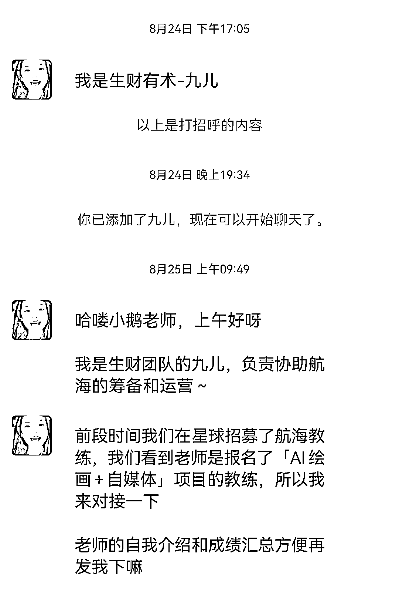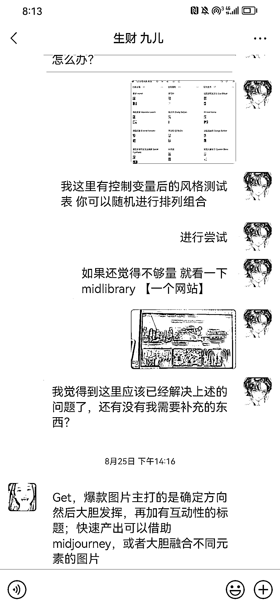

当时我脑子有点懵，完全没预料到。九儿问了我一些问题，我几乎没怎么思考就开始输出。因为这些内容早就在我脑子里翻来覆去过无数遍——那些独自在图书馆、在星巴克佝着背反复经历的日子。

于是，我过审了。

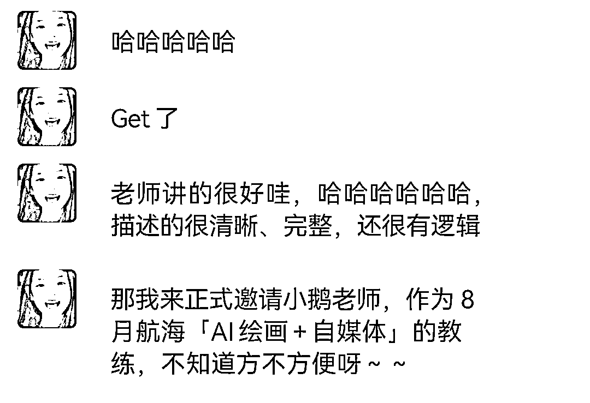

说实话，开心是有的，但也混合着期待和迷茫。九儿让我做分享的时候，我脑子里一片空白，第一次站上这么大的舞台，紧张得要命。我开始疯狂思考，逢人就问该怎么做。

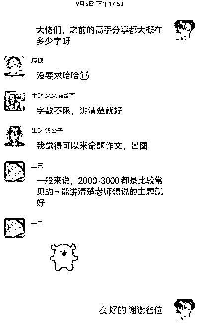

插一句，九儿还吓我一下，什么人啊！

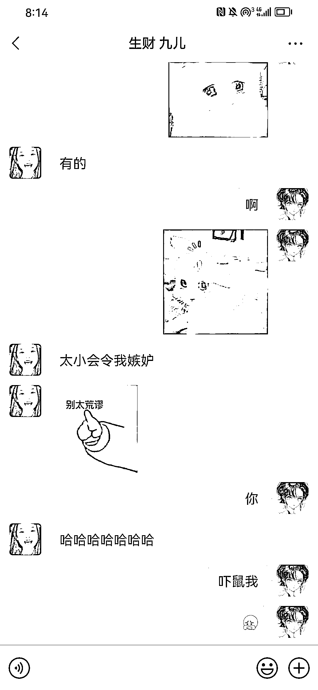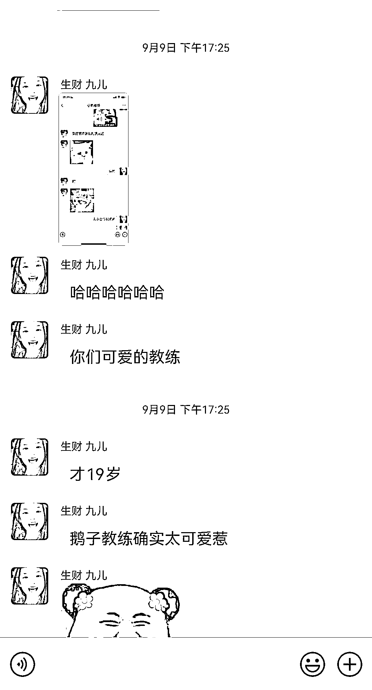

好了，废话到此为止。我想说的是，这21天里，我真正悟到一些能受益终生的东西。

### ① 走出线上，线下才能建立强链接

#### （1）我的心路历程

我其实是个自卑又敏感的人，总觉得自己不好看、声音不好听，怕表达、怕被讨厌、怕被人指指点点。所以我习惯性给自包了好几层壳，默默观察别人，自己躲在后面。第一次航海时我几乎全程沉默——那是我的防御机制。

同时，我也很孤独。身边没有可以深度交流的人，虽然在学校里朋友不少，但我一直习惯独来独往，缺少真正的反馈。我逐渐走到了瓶颈期，越来越emo，每天都丧得宅在家里。

转机来自一次偶然的线下活动（不是赚钱办的）。那原本只是我随便出门散心，没想到真遇见了贵人。当时一听说对面是行业大牛，我瞬间两眼放光，现场做了个PPT，把自己试过的项目全盘托出，冲上去一顿输出。那半小时的临场发挥，让我拿到了高单价代理权和一个AI落地应用的实践项目，后来带来六七万收入。

从那以后，我的思维完成了转变。我开始主动参加赚钱的线下活动，学着展示自己，开口分享经验。紧接着一切就像踩了油门，正反馈越来越多，越来越强。过去一个人苦苦挣扎的事情，只要有大佬愿意带我，就会轻松很多，我们一起赚钱的速度像坐上了快车。

#### （2）为什么一定要去线下？

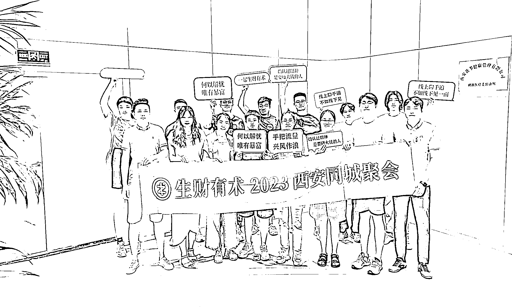

“线上聊千遍，不如线下见一面”这句话，我是真的体会到了。线上的关系大多是弱关系，加了🛰️后，除了自我介绍就再无下文。但线下认识的人，我们会真的在一起做事、互相分享经验（再插一句：也感谢赚钱让我遇见了现在的对象）。

原因有三点：

##### ① 信任感

线上了解一个人，往往只看到标签，看不到立体的人格。你的魅力、做事方式，很难通过屏幕传递。但见面一次，对方就能对你建立起真实的信任。

##### ② 关系建立的效率

线上聊天多半是一对一，效率太低。线下不一样，你同一份时间可以对十几个人输出标签、印象和口碑。而且这种口碑会自带传播和裂变效应，很快，一个区域大群里几百个人都记住了你。

##### ③ 快速获得向上的能量

线下面对面交流，是打破信息差、直接向有结果的人提问的最佳途径。平时刷大佬帖，总觉得对方有所保留，看完了心里反而空落落。但真正见面时，大佬的分享往往真诚到毫无保留，你之前的困惑一下子就被解决了。

这里特别想感谢西安经常组局的朋友，千城、安神、清华……每次听他们讲话都能学到很多，提问也总是得到温暖而实在的回答。

### ② 真诚利他，享受表达的“红利”

以前我习惯闷头发力，相信“星光不负赶路人”。同时我又特别在意别人的评价，每说一句话都要忐忑半天。

现在我想开了。在赚钱里分享，你收获的反馈绝大多数是正面的。我有段时间总担心：不会讲怎么办？讲不好怎么办？做高手分享那天，我紧张到开场前半小时还在改稿子，高考都没这么慌。

后来的事实证明，全是我想多了。

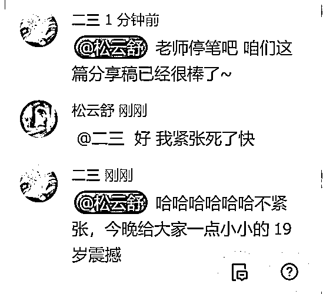

原因很简单：

##### ① 认知的水位

很多自己习以为常的小事，可能会解决别人的大问题。比如第二周直播答疑时，我根本没直播过，全程靠本能操作，自己都不敢回看。结果竟然有好多人在日志里说，把直播看完了，还学到了不少东西。

我：啊？？？真的假的？

后来我才发现，那些不过是我的“顺手操作”，但对别人来说却是实实在在的困惑。我随便弄一弄，居然就解决了问题。

所以，每个人都能找到自己的“认知水位”：

+   **理解水位**：你比别人做得更早、理解更深，就能形成降维打击；
+   **问题水位**：你处理过的真实问题更多，别人遇到同类问题时，你就能提供帮助；
+   **应用水位**：你亲身跑过的项目、落地的案例，很多人是接触不到的；哪怕你只是单纯讲讲做项目的故事，都能给人大量启发与想象空间。

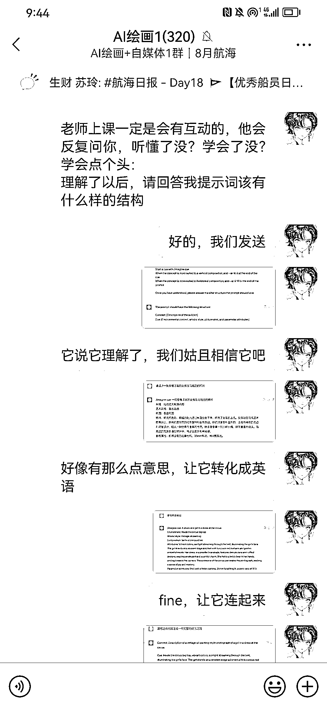

##### ② 价值互换

航海期间，我跟三四个学员约了线下见面。大家的履历都极其亮眼，有早就财富自由的，有开连锁机构开了七八家的……但他们都跟我说要向我学习，我当时是懵的。

真正交流之后，我发现哪怕再厉害的大佬，也有自己的舒适区，也有完全不懂的东西。而那些东西恰好是我擅长的，于是价值互换就成立了。

关键是要“田忌赛马”——别拿自己的下等马去换人家的上等马，要拿自己最突出的优势去做交换。

技能价值是最容易置换的，但也不一定人人需要。所以，你还可以提供情绪价值：比如有人就是觉得我说话好玩、有趣，或者单纯因为年龄小，想来和我聊聊天；再比如金钱价值——直接购买对方的高单价产品，你出钱，人家出资源，也是一种平等的交换。

## 第三阶段：用好赚钱的完整方法论

如果你想在这里拿到项目能力的提升，这几项输入可以坚持下去：

+   仔细啃航海手册、高手分享、高手直播；
+   每天看精华帖推送，别只当成刷手机，要真正记下来，拿到实操里去验证；
+   主动搜索风向标、精华帖、航海家帖，把搜索变成习惯。

如果你想扩大自己的影响力，这几项输出值得尝试：

+   在航海群里大胆提问。真的！教练们答疑都是倾囊相授的，出了这个群再想问他们，可能一小时就好几百了。而且最好别在私信里问，教练们都希望把时间花在覆盖更多人身上；
+   坚持发风向标、帖子、经验分享，主动提高自己的曝光量；
+   主动组织同城线下聚会，申请当组局官，把自己的影响力扩散到更大的圈子。

感谢这五个月里所有帮助过我的人。

谢谢黄小刀带我入圈，谢谢芷蓝给我思维上的指引，感谢全体西安赚钱圈友，也感谢AI绘画+自媒体教练团的每一位伙伴——谢谢你们不嫌弃我“清澈的愚蠢”，愿意手把手地教我。

最后，特别感谢老忘。

距离20岁还有最后五个月。这篇文章，写给赚钱，也写给勇敢又跌跌撞撞的自己。

我已亭亭，无忧亦无惧。

