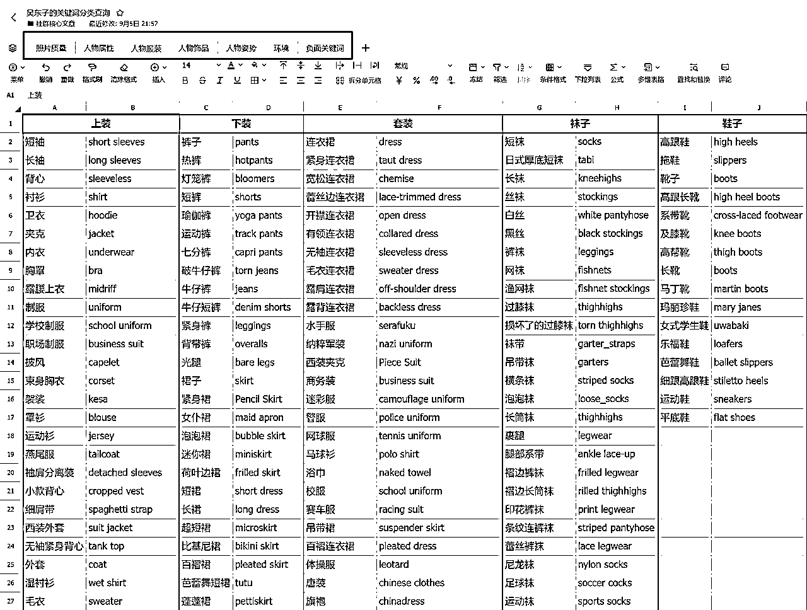
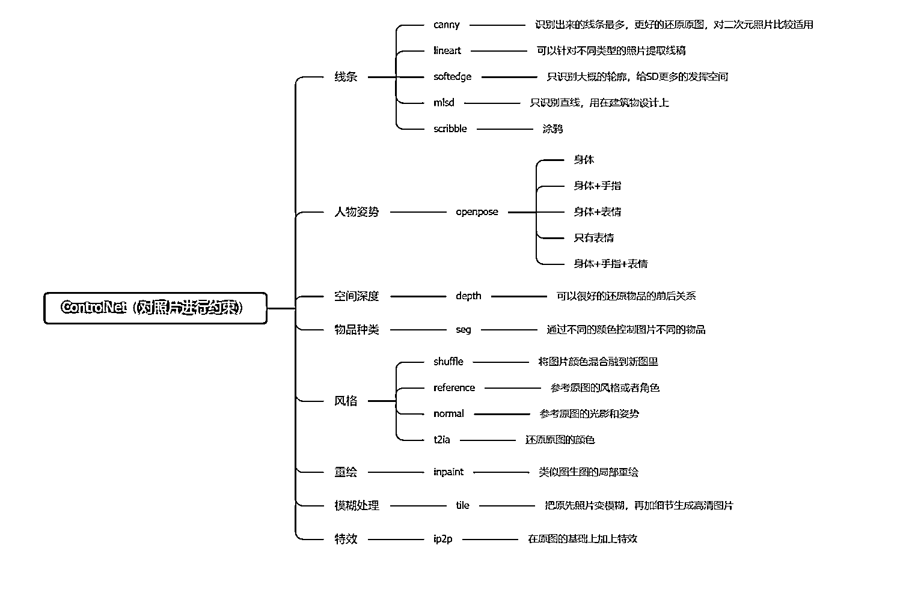
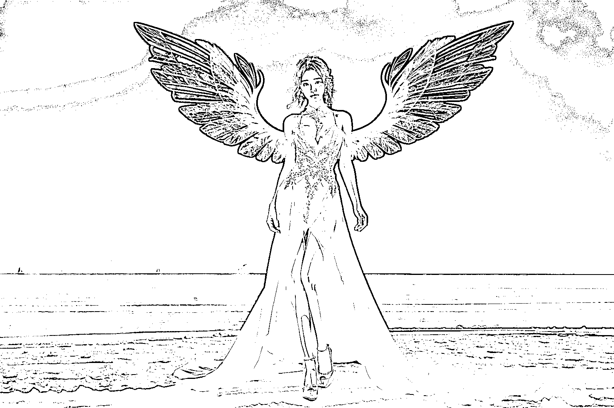
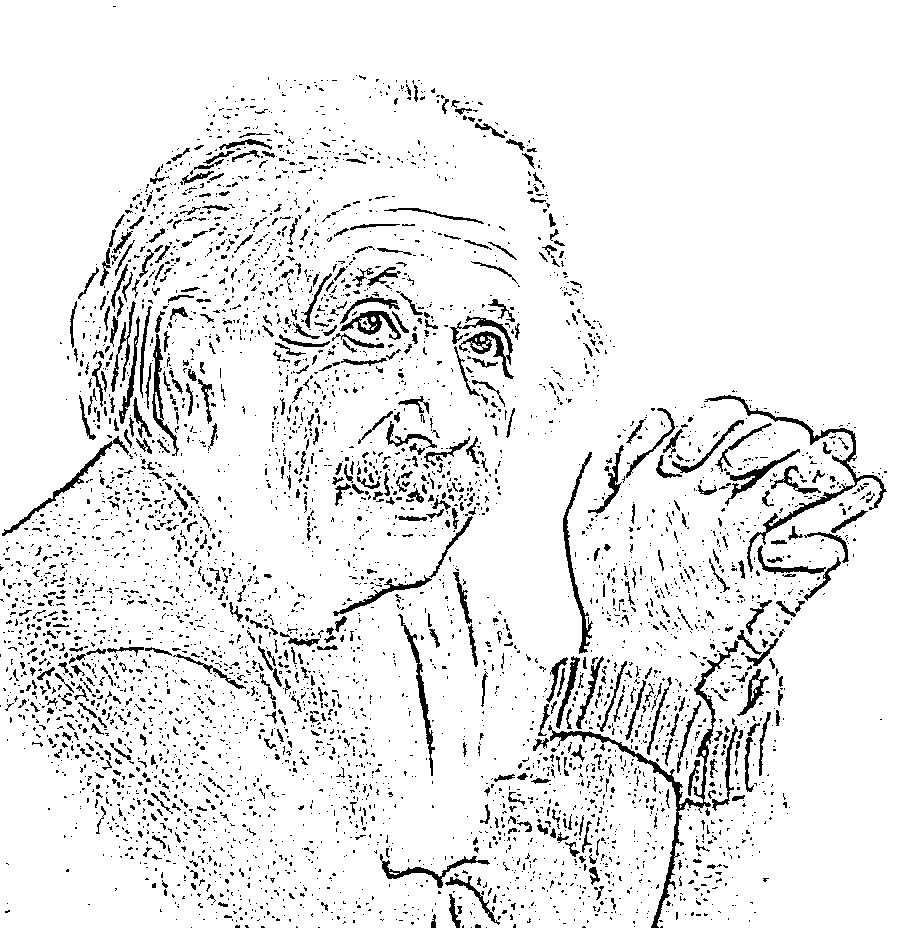
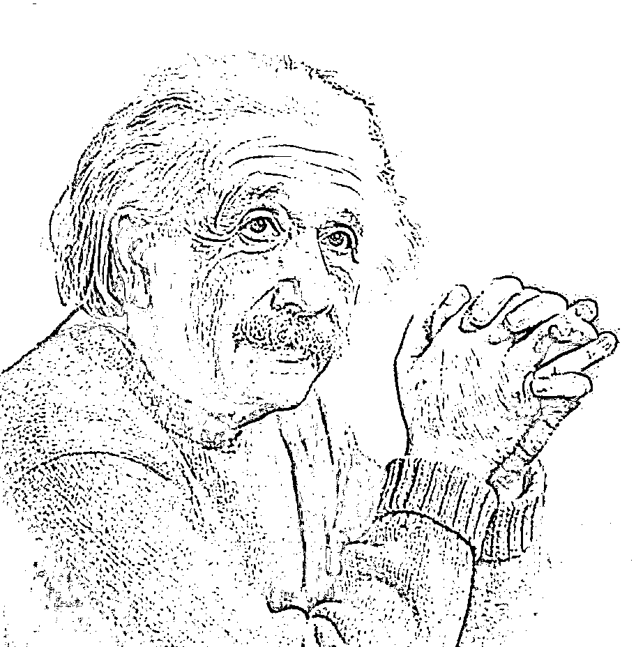
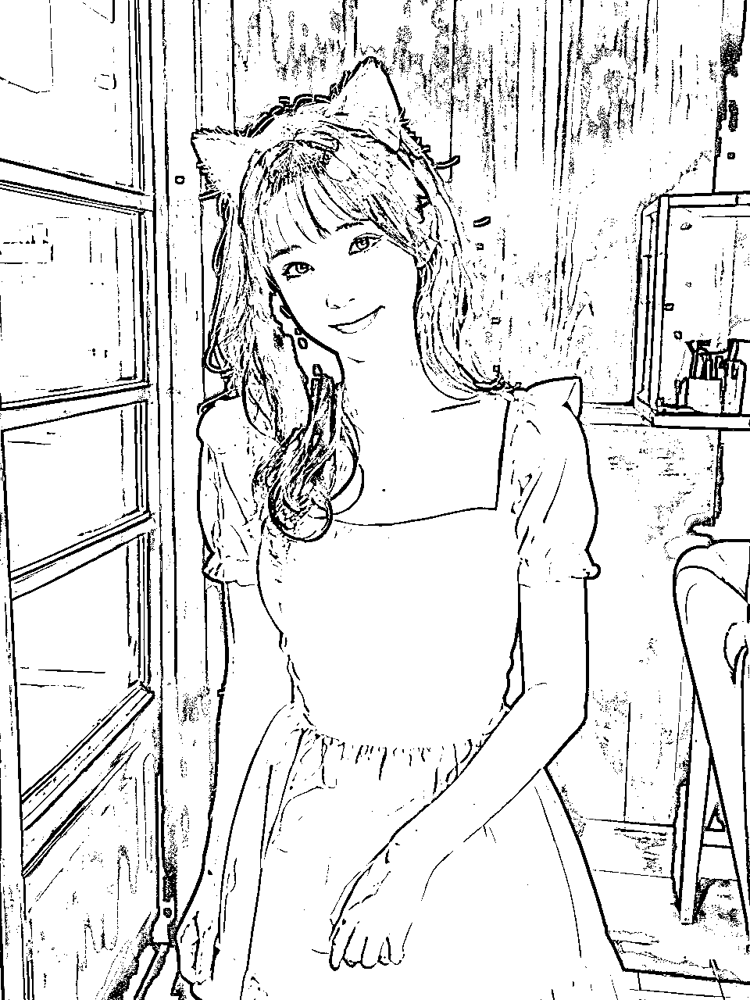
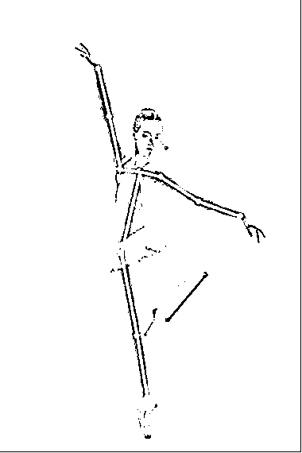
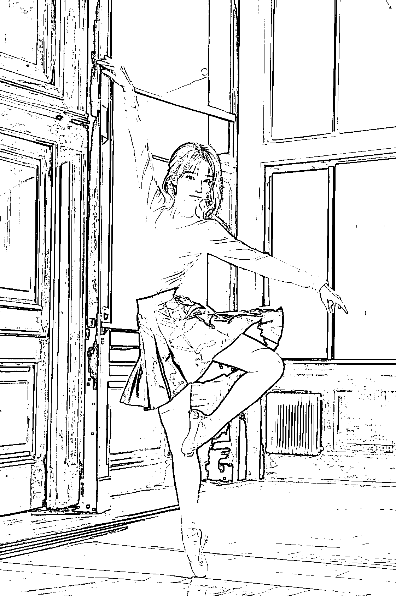

# 给零基础的你，一套真正能上手用的 Stable Diffusion 全流程指南
作者：龙哥

## 从零到会玩，万字拆解 Stable Diffusion 的完整实战笔记

作者：吴东子
日期：2023-10-07

《从零开始学 AI 绘画，万字 Stable Diffusion 终极教程！全新升级版》

大家好，我是龙哥。

2022 年 8 月，Stable Diffusion 正式开源。那一刻，AI 生成图像的热潮真正被点燃了。

转眼一年过去，提前入坑 SD 的玩家已经玩出了不少花样。早期大家都在做 AI 美女、线稿自动上色、真人漫改、头像壁纸等内容，之后又出现了 AI 创意字体、艺术二维码、AI 幻觉画等新玩法。随着技术不断迭代，未来会涌现出更多有趣的应用和机会。

我也常看到不少朋友，看见别人分享的作品后很心动，想自己也试试，但被 Stable Diffusion 复杂的上手门槛劝退了。

所以这次我准备了一套更完整的 SD 实战教程。不会堆砌晦涩的理论，全程用最通俗易懂的表达，一步一步带你把软件跑起来。

通过大量真实案例演示，保证你学完就能复刻出同款效果，在玩乐中自然掌握这项新技能。

整套内容共分为六个模块，覆盖 SD 的核心用法，建立扎实的底层认知：

1. SD 入门
2. 关键词
3. Lora 模型
4. 图生图
5. ControlNet
6. 知识补充

如果你之前看过我的 SD 教程，应该了解我的目标一直是让大家做出真正能看的作品。这篇之前的版本就获得了不错的反响，学习人数接近 3 万。

此次是全面升级后的版本。团队花了半个月重新梳理，内容扩展到 2 万字，配图 400 张，目标就是做到：学 Stable Diffusion，这一篇就够了。

另外，学习过程中会用到的安装包、主模型、Lora 资源、关键词合集，我都整理打包放在网盘里了。

* * *

评论区：

Clown : 感谢感谢，真的很详细！

大吉要发光 : 正好我想学这个．谢谢东子大佬

芷蓝 : 表格很有价值～

涛子 : 太感谢了，小白都能入门了

林勇 : 厉害了！！！如何炼制 Lora 在那一期有？

阿泉 : 感谢大佬分享，正抓脑阔想怎么做呢

龙哥 : 感谢分享，已加精华。

* * *