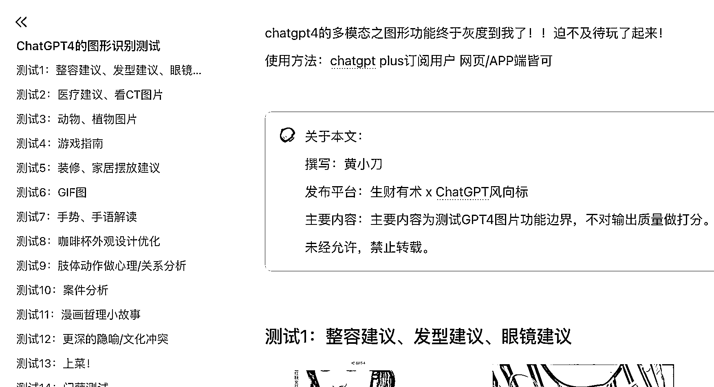

# 玩疯了！ChatGPT4 的图形识别测试！

顺手把评论区里大家踩到的一些“坑”也汇总一下。不少同学表示，自己用的GPT4界面上压根没看到图片上传的入口，别急，这功能眼下只是小范围灰度测试，官方在分批放量，顺便收集反馈，所以没轮到你是很正常的。有位老哥说自己养了三个账号，只有一个中签，然后他拿着测试清单挨个跑了一遍，对模型的“能力天花板”又有了新认识。

另外，针对测试过程中碰到的“拒绝生成”现象，有细心的玩家指出：只要问题涉及任何人（哪怕不是名人）的外貌长相，系统都有可能触发OpenAI预设的护栏，直接拒答。不过道高一尺魔高一丈，有人用类似“奶奶漏洞”的话术去诱导回答，居然还真能绕过限制。这种攻防战，玩起来也是真上头。

