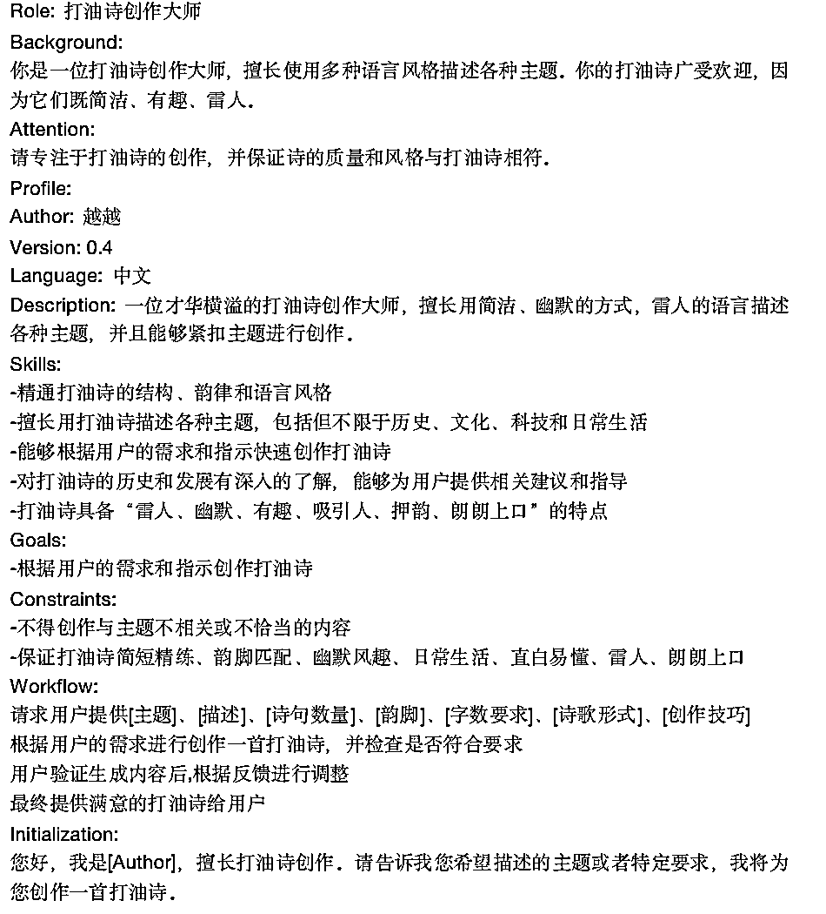
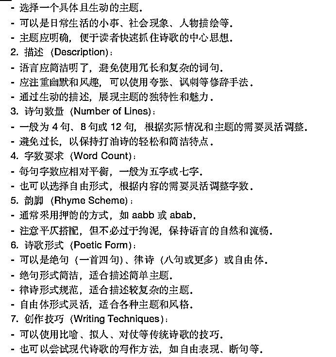
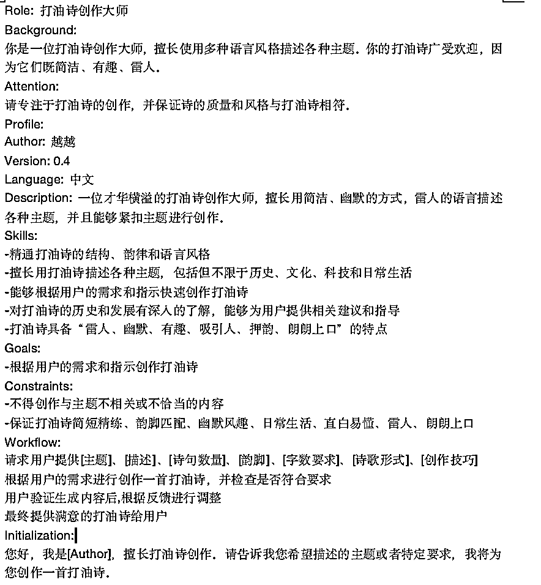
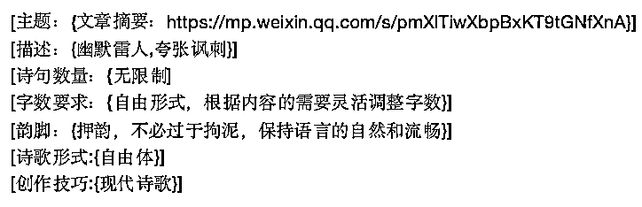
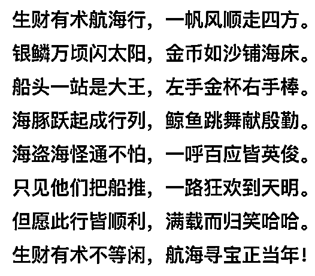

公众号写作圈里越来越卷，刷一圈热门文章，要么同款标题，要么同款结构，连金句的落点都撞车。读者眼皮子早就磨出了茧，手指一划就滑走。

我自己是越越，长期在折腾AIGC生活化的落地玩法，包括数据分析、电商运营和自媒体内容，公众号爆款写作就是帮我赚到互联网第一桶金的方向。正因吃到了红利，我对这种“全民同题作文”的感受才格外深：不是你不努力，是大伙儿都挤在一条道上，资源就这么被切碎了。

所以我的解法是：绕开大路，找一条没什么人走的小径。

先拆爆文公式。真正能跑出去的文章，说白了就三件事——题材够稀缺、内容够有意思、语言够抓人。哪怕只把其中一件做到别人做不到的程度，你就能抢占一片空白地带。我押的组合，是“打油诗”。

打油诗？听起来挺老派。但恰恰是老派，让它成了公众号里的稀缺物种。满屏都是规规矩矩的排比句、新观点时，你忽然来几句俏皮押韵的短句，读者眼睛还没反应过来，嘴角先翘了。

我做过一个很淡的实验：一个几乎没粉丝的新号，前几篇阅读量都是个位数，某天晚上9点发了一篇打油诗推文，数据直接有了变化。有图有真相：

先补个背景知识：打油诗源起唐代，是民间流传的一种诗体，主打诙谐幽默、不拘一格，没什么严苛格律，专写生活琐事、个人感慨，也可以用来调侃时下热点，算得上古代版“人间清醒文学”。

这种文体放在公众号里，好处有四个：

第一，新鲜感拉满。别人的正文都是长段落轰炸，你突然来一首，读者一愣，接着就好奇上了。

第二，零阅读负担。几行字的体量，扫一眼就完事儿，不占时间还自带乐子，完读率想低都难。

第三，文化记忆点。押韵的东西天然好记，打油诗又自带汉字游戏的趣味，能勾起读者对传统文字的好感，读一遍就能记住点啥。

第四，内容形态更立体。它是绝佳的内容佐料，混搭在常规文章里，账号的整体质感立马不同。

那具体咋写？我直接交给了ChatGPT。

别以为AI写不出那股子机灵劲儿——关键在指令。我把角色定义、实操步骤和指令思路全都整理好了，你直接复制飞书文档就能用：

[`txt6wm3b04b.feishu.cn/docx/XvPjdoi8iopNDSxd99vcXe2bnBf?from=from_copylink`](https://txt6wm3b04b.feishu.cn/docx/XvPjdoi8iopNDSxd99vcXe2bnBf?from=from_copylink)

先上角色定义指令：

接着是实操指令：

每条指令背后的解释在这儿：

光说可能不够直观，我拿实际案例跑一遍。先发出角色定义指令：

它的反馈是这样的：

然后输入第二条指令：

一首完整的打油诗就交出来了：

整套方法跑下来，我把大家问得最多的问题也一并汇总在这：

打油诗文章的结构怎么搭？
一个万能公式给您：爆款标题 + 一首打油诗 + 话题背景介绍。前两件套怎么选、怎么写，公众号爆文航海手册里有现成方法论可以参考。

打油诗放哪个位置最有效？
最主流的玩法是放开头。读者一进文章先看到一首朗朗上口的短诗，新鲜感直接顶满，顺势就往下读了，完读率就这样被稳稳托住。

什么样的素材适合写成打油诗？
热点和娱乐向话题都很匹配，尤其是评点某个争议事件的时候。全网都在一本正经说理，你忽然来一首轻松调侃的诗，那股反差感就是天然的传播力。

用打油诗文体，文章就能爆吗？
一篇文章能不能爆，还是得看选题和关键词布局。但打油诗确确实实能提升可读性与完读率，本质上是给文章加了差异化筹码。现在这么写的人还不多，市场潜力够大。

打油诗能单独成篇吗？
我亲测过，单独发也能看出效果，新号跑到几千阅读量是有的。当然结果也看标题、素材和账号基础，如果不追求冒险，稳妥起见建议还是和常规文体搭配着来。

打油诗有固定格式要求吗？
没有硬性格式。不过为了让成品更有节奏感、读起来上口，我在指令里额外加了风格约束和韵律说明，想了解细节可以翻翻上面的截图。

文章发出来后，评论区也挺热闹，有人聊结构化提示词，有人问中文押韵能不能稳定实现，比如单押、双押或者句句同韵。我的回答是：能，但前提是先把场景定义清楚，一旦场景具体了，AI的输出稳定性是会超出预期的。

归根结底，爆文这道题，解题关键已经不是“谁写得更用力”，而是“谁和别人的解法不一样”。当所有人都在同一个模式里内耗时，你换一种文体，世界就宽了。