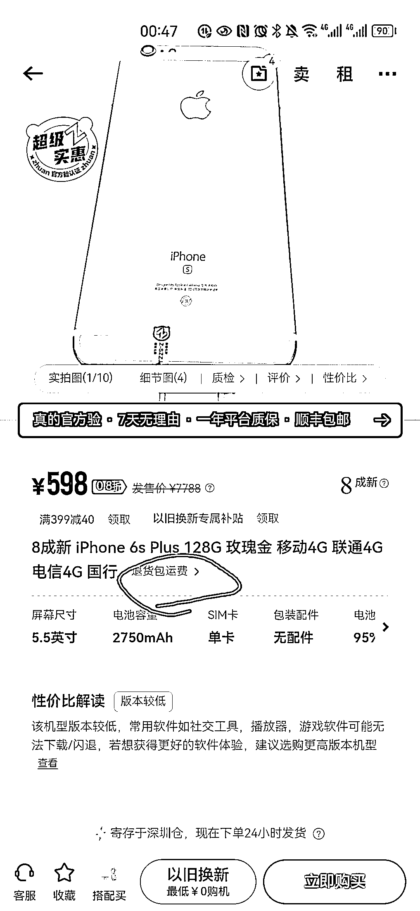
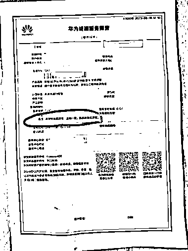
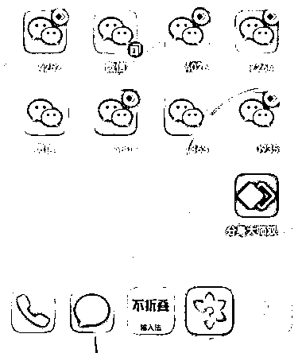
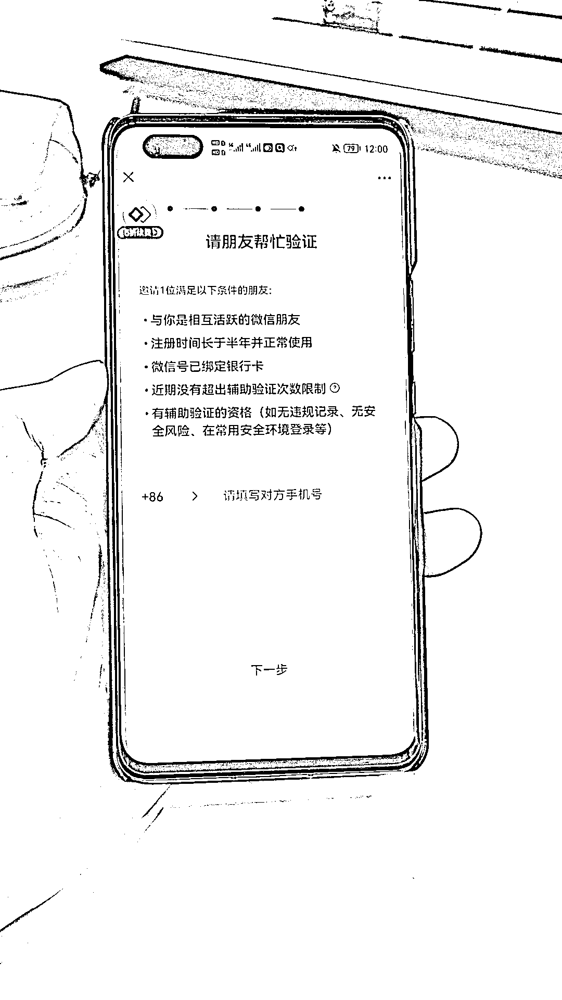

# 私人🛰️怎么玩才不翻车？从建号到被封的完整避坑指南
作者：龙哥

## 【精华】私人🛰️安全运营全流程：注册、养号到封号应对

作者：希平
日期：2023-10-07

现在公域获客成本水涨船高，越来越多的团队把转化、交付、售后这些环节都沉淀到个人🛰️上。

🛰️已经运营十多年了，风控体系相当成熟，一旦触碰红线，账号随时可能被限制使用。

近一年时间，我手上长期在维护 30 多个🛰️号，翻阅了大量相关资料，也自己踩过不少雷。利用国庆假期把这些实战经验整理出来，希望能帮到同样在做私域的朋友。

文章框架：

一、底层基建：设备与手机号的选择和配置
二、账号生命周期：注册方法、养号技巧、日常使用策略、被封后的处理
  使用策略包含：好友自动通过设置、安全操作阈值控制、收款注意事项、如何应对同行竞争
  封号类型包含：违规警告、风险预警、临时冻结、永久封禁

为了阅读更完整，建议移步语雀阅读：[`www.yuque.com/maoxiaodd/operation/fex5ygyhcwimtony`](https://www.yuque.com/maoxiaodd/operation/fex5ygyhcwimtony)

* * *

评论区：

文少 : 优秀啊

希平 : 感谢铁子来支持[呲牙][呲牙][呲牙]

坏脾气的小可爱 : 厉害

希平 : [呲牙][呲牙][呲牙]

远帆 : 这个真解决了我最近的难点

平凡小吴 : 这个对完私域的超级有用，超级干！谢谢圈友

希平 : [呲牙][呲牙][呲牙]

希平 : [玫瑰][玫瑰][玫瑰]

* * *