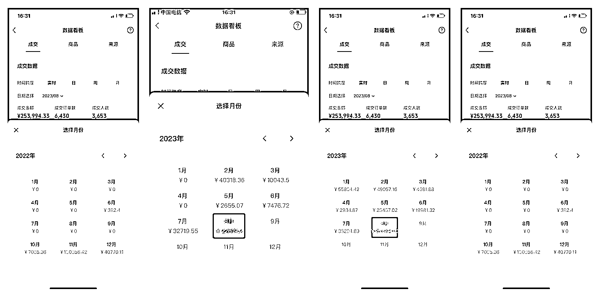
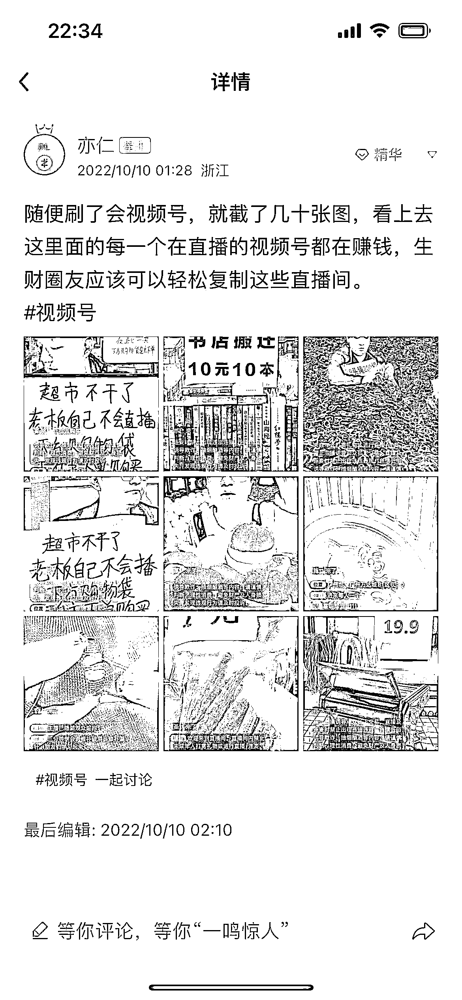
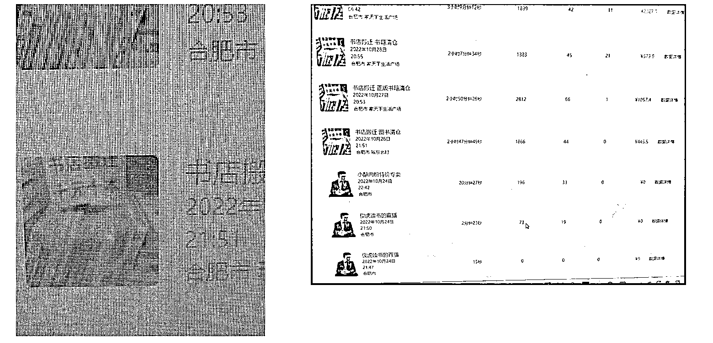
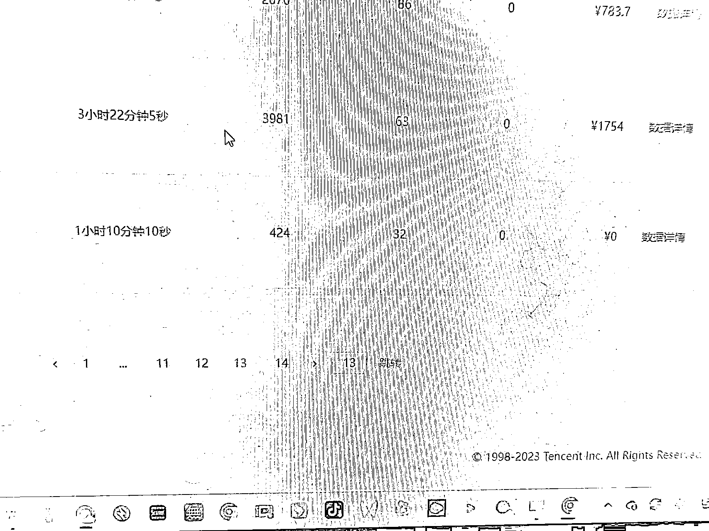
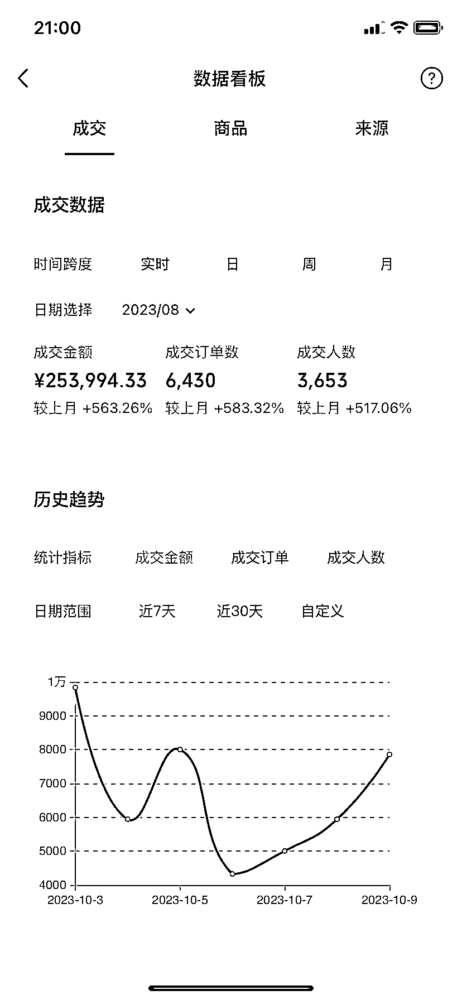

# 从理发师到视频号带货：10个月GMV破100万，普通人的逆袭之路

> 我是夏俊虎，安徽合肥人。去年这时候，我还是一名理发师；现在，我已经全职投入视频号直播带货整整10个月，累计成交额突破了100万。也许这在很多人眼里不算什么，但对我来说，是一个实实在在的转折点。

想当初，我每天面对的是剪刀和染发膏，如今却对着镜头和购物车。这条路并不轻松，但我始终相信：普通人只要有决心、有方法，同样能在这个时代找到属于自己的位置。

在赚钱社群里，我见过太多像我一样独自摸索的伙伴，也有不少刚接触视频号直播的新手。所以我想把自己的这段经历原原本本讲出来，从跳出舒适圈，到一步步找到方向、拿到结果，希望能给你一些参考。

这10个月里踩过的坑、总结的经验，我之前在航海时也做过分享，这里就不展开说了。

## 第一次航海：我用10天跑通了视频号带货的小闭环

我是2022年4月18日加入赚钱的。其实早在2019年就听说过这个圈子，但当时认知不够，白白错过了三年。现在回头看，如果早点进来，或许能少走很多弯路。

当时我的理发店还在营业，空闲时间就抱着手机刷帖子。那些拆解项目的文章让我大开眼界——原来赚钱的方式有这么多！第一个月，我每天至少读两万字，像海绵一样吸收。

但看得越多，反而越焦虑。满眼都是机会，却不知道哪个属于自己。

直到6月航海启动，我选了视频号短视频带货。理由很简单：视频号是新兴平台，竞争比抖音小，而且我在社群里看到不少关于视频号潜力的内容，感觉所有人都在告诉我“快上车”。

那是我第一次正儿八经做互联网项目。我准备了5个号，不会选品就随便挑了一个试试——从大家讨论的产品里选了个“租房合同”，又去抖音找对标视频，下载后用去重软件简单处理就发布。

幸运来得很快。大约10天后，我出单了！第一个成交的品，正是圈友分享过的租房合同。同时，我在另外几个号上发了曹德旺的短视频，正能量内容特别容易爆，其中一个号每天播放量都有几万，最高冲到四五十万，十几天涨了6000多粉丝。

视频爆了以后，我顺势挂了曹德旺的自传《心若菩提》，卖出了两单。航海教练说过：视频爆了一定要直播。于是我从网上买了这本书，回家直接怼脸开播。第一次直播没什么技巧，就是翻翻目录、讲讲曹德旺小时候的故事，播了两小时出了两单。虽然不多，但给我的信心是巨大的。

整个6月航海，我靠直播+短视频实现了300多GMV，佣金100多。**可以说，视频号带货的最小闭环，我算是跑通了。**

## 第二次航海：我补上了直播技能的短板

8月航海，我报名了抖音半无人直播。主要原因是意识到了直播的重要性，而且直播带货的杠杆效应太明显了——就像《纳瓦尔宝典》里说的，互联网平台是普通人最好的杠杆。一个爆款短视频几十万播放，一个爆款直播间几万几十万人同时在线，线下实体店想都不敢想。

半无人直播对主播要求不高，普通人也能上手，这正适合我。

航海手册和教练的分享都很干货，我看了两遍，做了笔记，总算把直播的底层逻辑搞清楚了：为什么平台会推直播间、浅层数据和深层数据的关系、为什么要让人点赞互动加粉丝灯牌……全都通了。

我也准备了一个抖音账号，学了直播伴侣的基本操作。然后在视频号上同步测试，选了个“小酥肉粉”，模仿对标账号——两个东北大姐轮流播，看起来销量不错。

结果我买了样品，照猫画虎开播，一单都没出！话术背得滚瓜烂熟，一上镜就结巴，像背书一样。撑了半小时，我自己都受不了，关了。那天试了三次，每次二三十分钟，毫无头绪。我老婆笑我：“你平时连厨房都不进，卖这个能行吗？”回头一想，她真说对了，这个品完全不适合我。

那段时间，加入赚钱快半年了还没赚到钱，我确实很焦虑。不过中间也做了一些别的事：看到抖音同城引流的帖子，就做了六七个号给理发店导流。主号开蓝V做本地生活团购，小号发短视频引流，都是直接下载同行的视频去重后发布，主推男士烫发套餐。效果还不错，因为多数实体店老板还不会做互联网，竞争不大。每天几个号加起来曝光不少，慢慢真的有客人从抖音过来烫头发，算是间接变现了。

期间还看过小说推文，但感觉做不长久，也不太感兴趣，就放弃了。

## 第三次航海：我终于找到了真正属于自己的方向

转机出现在2022年10月10日。那天龙哥发了一个关于视频号的风向标，就几句话，却让我眼前一亮。

> 

我盯着截图看了很久：那些直播间场景特别简陋，几乎不花钱搭建，主播也不专业，就是普通老百姓。可就是这样的直播间，场观居然有几万甚至几十万！这不就是大家常说的“打得过的同行”吗？这不就是平台红利期吗？**事后回想，这就是典型的项目异常值。**

我立刻想到了8月航海学的直播知识，心里有个声音说：这个我能模仿，我可以下场干，不会比别人差太多。试错成本那么低，为什么不试试？

风向标里第二张图是卖书的直播间。我以前就想过卖书，但不知道怎么开始，这不正好是个测试机会？我有线下销售经验，也会开视频号直播，龙哥说能赚钱，我自己判断也能赚钱——这么简陋的直播间都有这么高场观，随便播播也能出单，这就是信息差啊！

想明白就干。接下来几天我就刷直播广场，专门找这类直播间，锁定了几个对标账号。

我挑了一个做得很好的账号，一比一模仿——账号简介、名字、选品，全都照着来。他卖什么书我就上什么书，还学着划分了福利品、微利品、高利润品。也是那时深刻体会到：**同行就是最好的老师。**

200多本书上架是个大工程。视频号在手机上架特别麻烦，没有链接只能一本一本搜索添加，光这个就花了4个多小时。原计划10号开播，结果拖到了10月26号晚上9点多才正式测试。

第一场是在理发店下班回家后开的。播了2小时46分钟，卖了445元GMV，佣金100多。场景特别简单：用我平时看的旧书、儿子的课外书（四大名著），总共二十来本，再打印一张A4纸写着“书店搬迁，十元十本”。不用真人出镜，露个手就能播。

话术也简单得很，就是一句“书店有活动”，加小号互动一下。去年的视频号自然流是真香啊，就这样简陋的场景，不到3小时场观1800+，卖了400多。

> 

下播后特别激动——终于找到一个自己发自内心喜欢的项目，不反感，以后就算真人出镜也不排斥。而且直播节奏很舒服，照这么播下去，先把赚钱门票钱赚回来没问题！**没错，当时的目标就是赚回门票钱。**

之后我每晚8点从理发店回家开播，播两小时多点，每天稳定600-700GMV，好的时候能到1000。

10月29号我起了个大早，6点半开播，当天卖了2000多；晚上8点多回家又播了两个多小时，再卖大几百，全天3000+。**那时候我开始有了全职搞直播的念头。**

11月8号，直播间迎来小爆发：6个多小时卖了1.4万+GMV。那晚我就决定，接下来几天不去理发店了，全身心试几天。

然后从第二天起，我把理发店交给招来的人打理，自己专注直播。去年11月真是视频号的红利期，那场爆发之后账号权重明显上去了，自然流场观轻松过万。我基本每天都播六七个小时，有时九个小时，反正就是拉时长。整个11月，GMV做到了19万+。

年后我盘算了一下，直播显然比美发更有前途，干脆把理发店转让了。其实也犹豫过，想着两边都占着，实体店有收入、直播也有收入，更稳妥。但我老婆说：“把店关了，全力做肯定更好，大不了以后重新开店。”我想想有道理，自己内心也更倾向全职直播。**所以如果你找到了适合自己的项目，该深挖的时候，一定要全力以赴。**

## 2023年2月：我找到了第二个稳定品类

店转出去后，我学会了电脑绿幕直播，也听了不少圈友的分享，准备试试书以外的产品。

那段时间我刷直播广场，买了各种样品回来测试：人参含片、小夜灯、睡眠香膏、冰箱清洗工具、万能胶水……前后试了七八种，基本都没赚到钱。

我还尝试用直播卖租房合同，结果第一场就违规。后来看到对标同行搞了个律师封面的直播间，我第二天也模仿，开播10分钟就因涉嫌肖像权违规，这条路彻底断了。

直到2月19日，我刷到一个卖养生茶的直播间，感觉很不错。这个品主要面向女性客户和年纪稍大的人群，特别符合视频号用户画像。我直觉认为可以一试，赶紧买样品回来。

结果前三场都是零成交！但我不想放弃——直播广场每天都有人在卖这个品，转化都不错，我认识的朋友也在卖，销量很好。而且这个品受众广，人人都能消费。**第四场直播，三个多小时，终于卖了1700+GMV！**

养生茶的佣金不错，这成了我继书单之后第二个稳定品类。它很适合视频号人群，带一点功效属性，属于弱刚需品，但话术不注意规避敏感词就容易违规。

> 

从2月19日开测，我每天播两三场，时长慢慢拉长。2月23日第一场上午8点多开始，三个多小时卖了3000多；下午3点第二场直接爆了——播到晚上10点多，场观8万，GMV近9万！最后因为违规被平台掐断了。

其实最后那小时我已经累得不行，想休息时就让我老婆拿着产品读话术，简单介绍，我躺下眯五分钟再接着上。直播间在线稳定500多人，播了两小时后几乎每分钟都有成交。

回头看，那时我的话术还不够老练，看到很多订单没付款，如果逼单再熟练些，那场GMV还能更高。

下播后查违规原因——下午4点多说了“秒杀”两个字。不过平台让我播了七个多小时才断，应该是真人掐的。真要谢谢视频号的工作人员，看我爆单没第一时间切断，不然那天收入就没了。

第二天休息一天，第三天开播7个多小时，3万场观又卖了2.6万+。既有努力也有运气吧。

就这样2月份我基本都在播养生茶，但视频号广场上也出现了越来越多的同行，甚至不少人民币玩家入场。到2月底，这个品的转化明显变难了。

## 3月：我的主旋律是焦虑

进入3月，我重新做书单号，用之前的话术节奏直播。可偏偏赶上315，每次开播不定时违规断播，原因永远是“不正当营销”几个字。我申诉好几次都没用，投诉也不通过。

当时我两个书单号轮播，也尝试用别的号卖养生茶，但养生茶也容易违规，只是能播久一点，转化率却很差。

那段时间我每天被迫开播六七场——因为一个号播几分钟十几分钟就被掐，只能换下一个号，活像和平台玩猫鼠游戏。我甚至怀疑视频号直播是不是干不下去了，差点回去重新开店。后来跟圈友交流才知道，养生茶老是违规是因为绿幕的问题，我换了打印的背景广告板，违规就少多了。

更难受的是，2月份刚有过小爆发，3月的业绩一比，心理落差巨大。我一度失眠、状态差。后来把社群里关于焦虑的文章翻了七八篇，慢慢理解了原因和解法。

不直播的时候，我就跑到几乎没人的偏僻公园，一坐两三个小时，手机都不带，彻底放空。这个方法很管用，几天后状态慢慢恢复。

期间我也做了几个调整：

**1. 招兼职主播。** 时薪50到80元，自己能轻松点。

**2. 优化直播间场景和OBS参数。** 画面更清晰，看起来也更专业。

**3. 有意识地把客户加到🛰️。** 比如遇到新疆、内蒙等偏远地区客户，他们那边不支持下单，我就在直播间私信他们，等回复后发🛰️二维码继续转化。这些加过来的客户转化不错，每个月能多卖大几千，还有不少复购的。

所以，如果你卖的品有不能直接下单的客户，或者复购率高，一定要想办法沉淀到🛰️上。视频号对引流到🛰️比较宽松，毕竟是把客户导到自己的产品体系，不像其他平台容易违规。

3月底我去参加了赚钱全国见面会，见到了龙哥、涛哥、Erik教练、感叹哥等很多朋友。线下的交流真的很治愈——你会发现每个人都在克服困难，大家都在努力，焦虑感自然就淡了。

## 度过了瓶颈期，我依然没有停下

做项目大概就是逆水行舟，不进则退。如果只守着当下这一套玩法，迟早会被同行超越，成为别人故事里的“哈尔滨程序员”。

4、5月我还是以养生茶为主，偶尔卖书。虽然养生茶转化不如书单，但佣金高得多，差距还挺大。

到了6月底，暑假快来了，我注意到很多书单号直播间数据都很好，而养生茶正好进入淡季。我又测了一些品，效果一般，于是果断把重心放回书单上。

这就是我一个普通人的10个月。从理发师到全职带货主播，谈不上多成功，但每一步都走得踏实。如果你也正处在迷茫中，希望我的故事能给你一点勇气——**找到适合自己的方向，然后全力以赴，结果往往不会太差。**

回溯上个月的播出节奏，整体算得上平稳。那段时间我把重点放在了主播本人现身卖书的打法上，发现这种形式的成交效率远比只露手操作来得高。实际上更早以前，我就注意到一批后来冒头的同行已经在做现身带货，而且他们的表现一直很亮眼，甚至在某些指标上已经超过我。复盘起来，我当时确实不够警惕，没有把这个提升成单的优势摆在第一位。那会儿也就试水了两次，因为效果没达预期就搁置了，并未持续深挖。

如果当时能保持危机意识，时刻拥抱变化，书单整体的销售额说不定早就翻一番了。

另外，以前我对视频号广场封面和直播间布置都比较随性，觉得能看就行。直到一次偶然的触动彻底扭转了我的认知：

8月7号晚十点左右，我在刷视频号的直播广场，忽然看到一个竞品间出现了爆单。我立刻拆解了他们的差异点，主要就是直播间弹幕用词紧跟当日热点，广场图也搭上了热点的顺风车，观看人数直接冲到二十多万。

见机就动，我马上上线跟了一把，两小时的流水就到了七千多。第二天我便着手升级了广场封面和间内字幕，正好撞上暑期档，整个八月迎来了小高峰，月流水也顺利突破二十万。

现在看来，直播这件事核心在于多找参照对象，并保持持续迭代。如果我仍沿用去年的间内陈设，估计早就被市场淘汰了。我也留意到不少曾经活跃的老面孔很久没出现了，大概率是转赛道了。

结合过去十个月的实操经验我想说：做带货直播，无论是卖哪类商品，先找到可复制的同行，把人、货、场这三要素照着复刻就能起步。视频号上找不全的话，抖音里基本都能找到可学的间。所以这个赛道其实极度透明，没有隐藏的秘诀。确认可行后，先把最小的盈利循环跑通，拿到第一笔收入，再去做优化、放大和深耕，争取更好的结果。

视频号很难看到同行精确的后台，但也有一些观察技巧可以粗略判断，例如看同时观看数、橱窗成交额、是否稳定开播，甚至可以少量投放去测对标号的转化。只要肯花精力，还是能摸出个大概的。

正因为后台不够透明，视频号的直播内卷程度目前还不像抖音那么严重。我认识的几位同行，从年后起就死磕一个单品，已经播了八九个月还在坚持，而且该品的佣金也高。这说明选对品后，这个项目具备一定的稳定性。

当然，任何赛道都离不开持续的投入和时间成本。我从去年首期视频号带货航海开始，后面几乎每期都参加，就是为了多学习圈内伙伴对这个项目的思路和方法。保持开放心态，多行动多实操，实操才有反馈，才有成长。

我自认执行力还凑合。新手起步一定要愿意花时间去做测试，多试几个方向。别只在脑子里空想，还没开始就退缩。只要试错成本可控，就大胆去做，做的过程中问题会暴露，收获和成长也会随之而来。赚钱内部的项目很多，真正上手才知道什么适合自己。

目前我仍以视频号直播带货为主，今年空档期也体验了📕电商、闲鱼旧书、👸号流量主，这些航海我都参与了。有的变现了，有的没起来，但认知是提升了，我现在清楚这些赛道赚钱的逻辑，未来仍可择机重启。

真心建议各位，碰到合适的方向一定要持续深耕。只要这个赛道别人还能赚钱，就不要轻易放弃。

龙哥曾说过，随便哪个互联网赛道，都不缺一个年入百万的人。我能把视频号卖书和养生茶做到现在，很大程度上是“能力+兴趣+资料+平台窗口期”恰好契合。

其一，做实体美发店的经历给我积累了不少销售技巧，这对直播卖养生茶帮助很大，我的话术偏生活化，很对中年群体胃口，也能抓住他们的痛点，有针对性地塑造卖点。

其二，我本身爱读书，讲解书籍的底子也算有一点点。

其三，结合赚钱的航海课程和海量资料，我补足了直播的底层逻辑。

其四，赶上了平台的红利期，才拿到了初步结果。

说实话，日更直播很累。因为不管上一场多好，新一场都是从零开始。前期会有极速推流的红利，但当天状态不在线，成交照样会归零。即便现在，一天只赚几十块的情况也时常出现。

互联网项目本就不会一直平稳。越稳定的赛道越容易被涌入，最终卷爆。有门槛反而是护城河，能筛掉一批人。一旦跨过门槛，收入会逐渐趋稳，也能吃到平台的一部分红利。

接下来的打算是先做口播类IP短视频，再用直播承接转化。希望能走得更久，也更轻松一些。做短视频和直播的朋友欢迎交流，一个人单打独斗确实容易枯燥。

以上是我作为普通一员的亲身经历，篇幅已经不短，但每天的具体行动和感受，用文字很难完全还原。若必须浓缩成一句话，大概就是：只要持续付出，回报就会到来。

最后祝各位在自己的实战方向上都能日入过万！一起龙哥盟！
