# 千人团队，小组业绩稳定第一，社群运营的常见误区和团队架构经验分享

大家好，我是阿佰。前互联网教育大厂运营负责人，在线教育私域增长这条路，我走了整整 7 年。从 0 到 1 搭过私域流量体系，做过单日营收 50 万的爆款课程，也带团队拿过月变现 500 万+的成绩。在千人规模的团队里，我负责的小组业绩一直稳居前列。今天不聊虚的，把社群运营常见的坑和团队架构的经验，一次讲清楚。

先说说我在做社群时观察到的四个典型误区：

1. 把社群转化简单等同于“卖产品”；
2. 嘴上说很懂用户，实际根本没走近用户；
3. 开口就是高转化率，完全不看现实条件；
4. 缺乏体系化、数据化的营销思维。

后面我会结合自己的实战经历，逐个拆解，尤其是前两个，希望看完能帮你少走很多弯路。

---

### 从社群小白到带团队月入 500W，我到底做对了什么？

我算是比较早有规划的人，大学刚毕业就立下目标：成为在线教育行业的营销专家。那会儿在线教育正火，电销如日中天，社群刚冒头，我很幸运成了第一批吃螃蟹的人。

最开始，我的岗位是微信咨询师，每天 1v1 和用户聊天，前后直接沟通了超过 5 万个用户。正是这段泡在一线的经历，让我真正养成了“用户思维”。

不过，从销售菜鸟到事业部 top 级销售，我花了 5 个月。刚开始真的很惨：用户不回消息，我就催；按公司流程走完，用户直接失联，我就慌。每天加班到晚上 11 点，背话术、练话术，业绩还是上不去。

后来我读了一本销售书，叫《做单》，里面一句话点醒了我：优秀的销售，不要模仿事，要模仿人。从那以后，我不再死磕话术，而是把事业部前 20 名 top sales 的人挨个研究。每天下班前，花时间梳理表格，总结他们的共性，提炼关键点。然后我建了各种库：话术库、图片库、朋友圈库、电销库、书籍库……能想到的我全建了。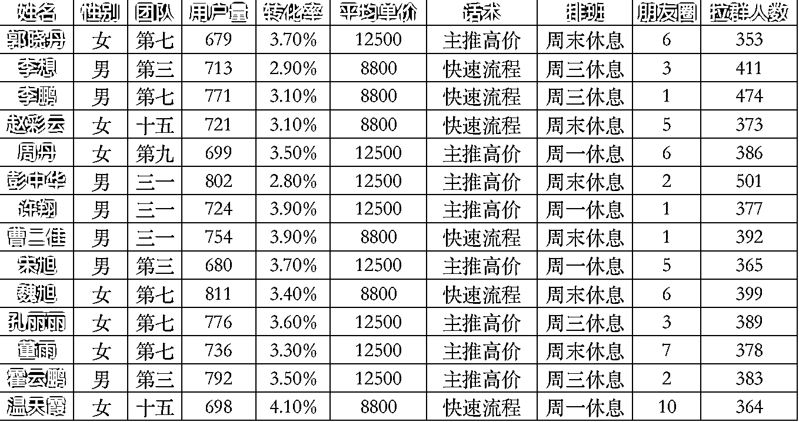

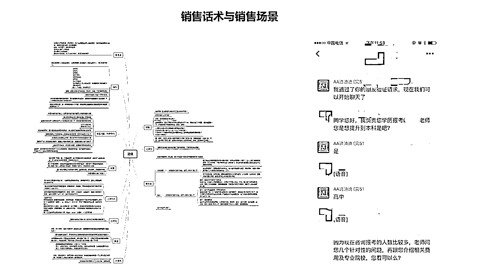

接下来怎么做？很简单，从对标库里找一个和你性别、性格都比较像的人，他干啥你干啥，前 20 天别加戏，照做就行。坚持 20 天以后，你自然而然的会有自己的想法，比如我当时悟出的业绩公式：**业绩 = 用户数 × 转化率 × 客单价**。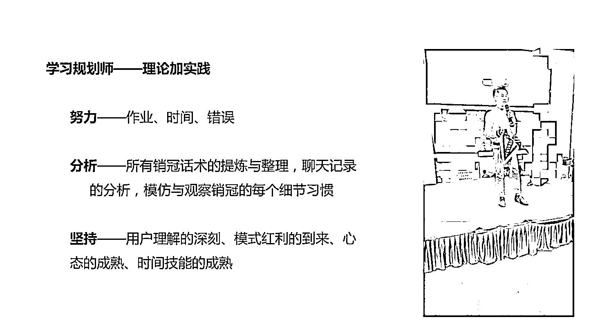

业绩稳下来后，领导让我去带团队。说实话，刚开始带团队我踩了个大坑。团队业绩差、人员流动大、大家都没信心，一环套一环。行业内很多团队是怎么管的？高压、淘汰、逼业绩、催加班。但我知道，新团队如果这么搞，只有死路一条。那些老团队能扛住压力，新团队一压就散。你想想，如果你天天担心明天没饭吃，谁还有心思干活？

最开始两周，团队从 10 个人走了 7 个，业绩全组垫底。最难的时候，我没逼大家加班，而是自己去外面想办法，最拼的一周在公司连睡 4 天。也正是在那个过程中，我沉淀了一套自己的团队管理模型。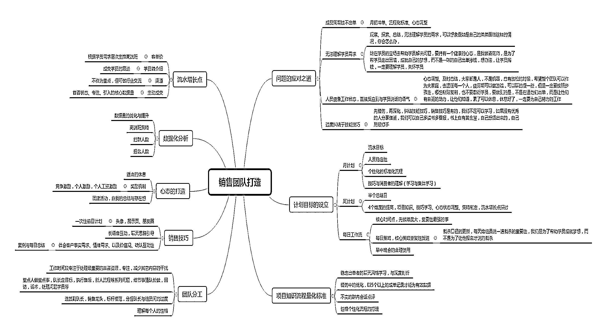

这个模型叫：**团队业绩 = 团队人数 × 人均单产**。看着简单，里面门道不少。

团队人数要增长，核心是两件事：招人和留人。

招人方面，前期团队里每个人都是我亲自面试的。我的标准不多，最关键一条是真诚。我不喜欢开口闭口只谈钱的人，找工作本来就是双向选择。面试时，我从不画那些实现不了的饼，反而会把团队的真实情况，包括缺点和问题，都提前讲清楚。

比如 6-7 年前，我们团队平均月薪过万，最高的人一个月拿几万。但我会明说：你可能达不到这个平均线，但目前客观平均水平就在这，你可以多看几个机会，选合适自己的。后来，团队所有新成员全是内推来的，大家都认识、氛围好，很多事情根本不用我操心，因为大家都把你当自己人。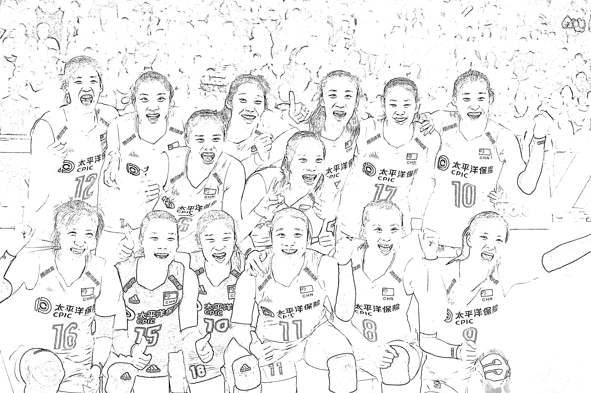

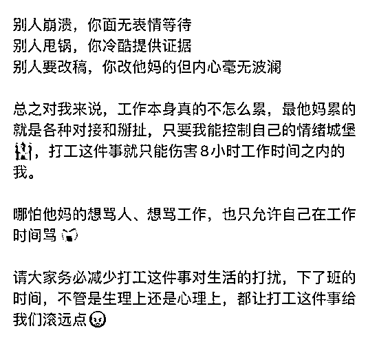

留人呢？我当时带组的离职率是 0。听着像吹牛，但确实是真的。核心就一句话：把伙伴当兄弟。别人逼加班，我不逼；别人定死规矩，我允许自由发挥；我自己去研究科学成交的方法，多劳多得，干得好的升职加薪，干得差的多鼓励，捣乱的骂两句。平时我会自掏腰包带大家吃饭。说白了，就是给空间、给待遇、给方法，不给压力、不罚款、不剥削。

再看人均单产。想提升这个指标，本质是提升效率，需要一套可复制、科学的转化模式，加上合理的资源配置。

人均单产继续拆解，就是 **产品售卖数量 × 平均单价**。而产品售卖数量等于 **流量数 × 转化率**；平均单价则取决于单个产品价格以及多产品的组合策略。

举个例子，你要做 10 万业绩，可以是 10 单 × 1 万元。这 10 单，根据 10% 转化率，需要 100 个流量。1 万元单价，可以是 5000 元的产品卖 5 份，加上 15000 元的产品组合卖 5 份。

落到个人执行，就是三件事：一是数据处理能力，解决流量数；二是成交能力，解决转化率；三是产品组合能力，解决客单价。数据处理能力可以搭建一个运营中台来集中解决；成交能力要理解影响转化率的底层因素；客单价相对容易，多开发好产品、做好组合就行。

### 转化路径怎么设计？

我把常见的转化路径分成了五种：

1. **直接社群转化**：面向高需求用户，做直播运营，配合咨询型答疑，直接促进成交。
2. **二次社群再转化**：面向需求度较低的用户，用录播内容、新的直播课来建立深度信任，再做转化。
3. **社群内再转化**：对还没转化的用户，进行 1v1 点对点精细化运营，通过聊聊天记录、持续跟进，针对性推进。
4. **其他产品转化**：有些用户对当前产品没需求，可以引导到其他产品体验，从而实现这部分用户的转化。
5. **渠道留存与推广**：长时间转化不了大课的用户，就留在微信渠道，通过与其他渠道合作建新社群、送免费课程、做分层变现。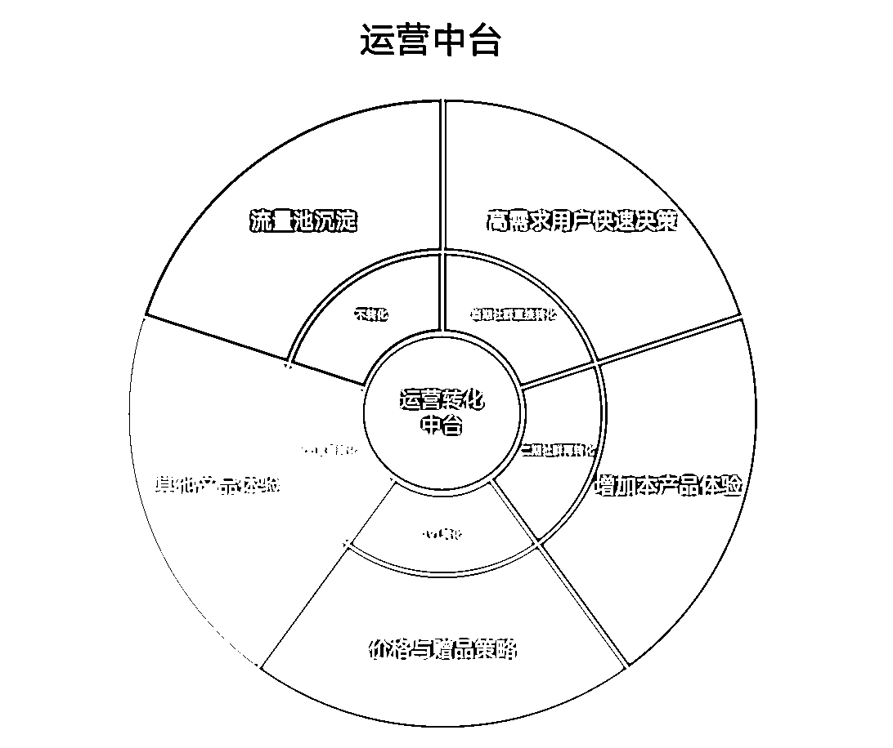

关于社群的运营和维护，需要关注的细节更多。

首先是入群路径，不同产品路径不同，常见的有：公域流量——社群——个人号；公域流量——个人号——社群；公域流量——App/公众号——个人号——社群；公域流量——App/公众号——个人号 A——A 社群——个人号 B——B 社群。

其次是社群规划内容。要明确人设和定位，规划运营节奏，用星网大数据、热榜这类平台或行业平台来规划优质内容。内容上尽量紧跟热点，固定时间分享，并且每天整理存档，形成体系。

最后是转化方式和产品。包括直播产品设计、会员积分产品设计、高利润产品设计、低价产品设计等，每个产品对应不同的社群运营方式。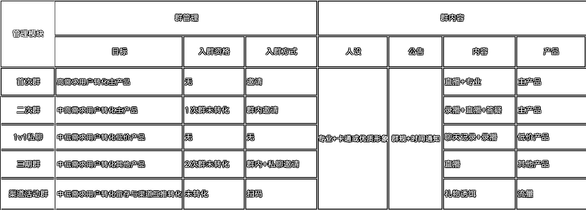

以一门 1000 元的副业课为例：在头条投放广告，引流到公众号后，用渠道码建立头条渠道社群。第一期运营 7 天，500 人进群，转化了 50 个；第二期运营 3 天，3000 人进群，又转化了 50 个；接下来通过个人号私聊发送聊天记录，推荐 9.9 元课程和副业指南，把未转化的用户重新合并，建立三期社群；三期运营 2 天，500 人进群，继续转化剩余用户；最后，进行渠道合作推送、礼物互换等活动，持续转化剩余用户。就这样，一套高效的转化体系就转起来了。

### 操盘 50 万营收爆款课：核心是用户需求

后来，我做到了私域操盘手，这是我职业生涯里最有挑战、也最有成就感的一个阶段。从私域流量池搭建，到导流路径设计，到标签体系下的数据平台，再到企业微信工具化运营，以及复购和转介绍的积分体系，每一步都离不开四个字：用户需求。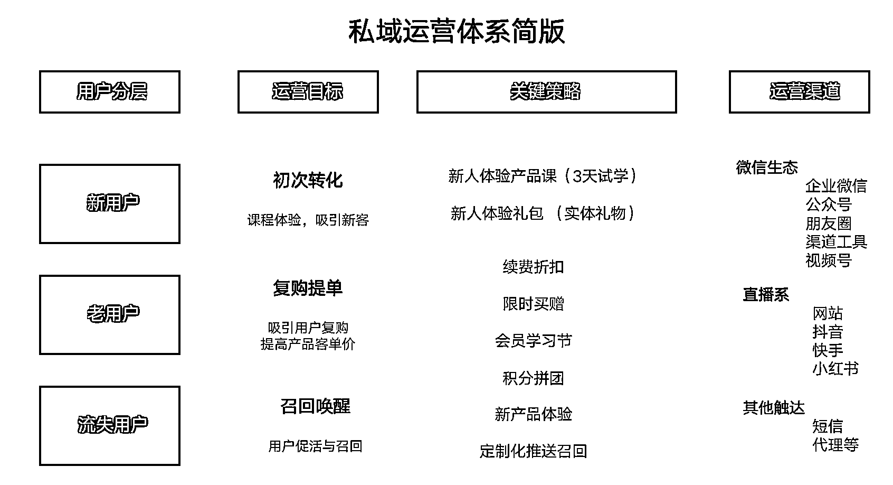

目标很清晰：50 万营收，产品客单价是 365 元，也就是说要卖出大约 1370 单。假设转化率能做到 10%，那就需要 13700 个社群流量。但为了确保完成，我们把目标定到 20000 流量。

信息梳理，我从三方面入手：
- **用户需求**：通过内部数据平台做分析，个人或初创公司可以用 5118 做需求分析，再结合竞品分析、用户调研表，和老用户提前沟通，明确核心需求和周边需求，再打磨产品和路径。
- **内部信息**：复盘过往活动数据，打通部门信息壁垒，成立专门项目组，协调产品、技术、设计、流量、教研等资源，确保问题前置解决。
- **外部信息**：分析竞品情况、竞品官方数据、竞品路径和工具，输出竞品分析报告。

活动执行上，流量侧要做公域和私域的运营规划，20000 数据量超额完成，确保项目目标顺利实现。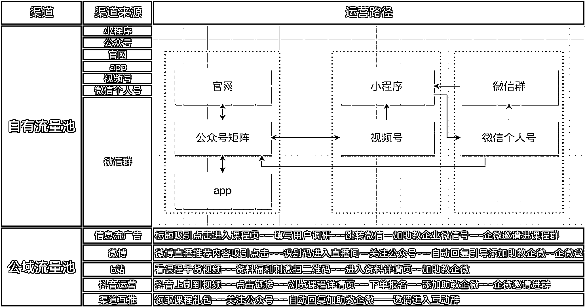

活动路径按不同渠道设计 3 种流程，并且用渠道码来区分不同渠道的数据。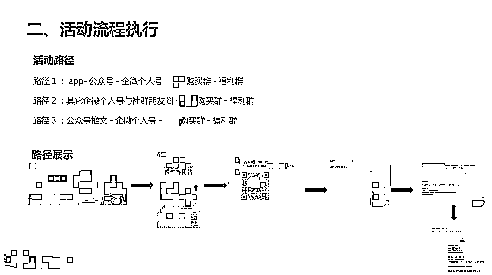

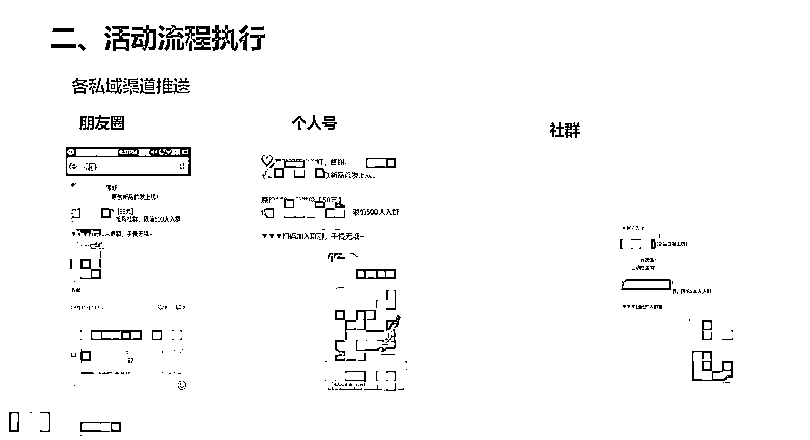

后续成交，仍然沿用运营中台的模型，核心是把用户分层运营。我会把用户分为新用户、习惯养成初期用户、成熟用户、临期用户、流失用户，然后针对不同阶段设计运营目标，比如首单转化、复购、提单、裂变、唤醒。策略上，通过体验课、实体礼包、限时折扣券、学生节等活动，结合短信、微信生态、社群、电商、直播等多平台工具，实现自动化成交。

还要注意策略沉淀。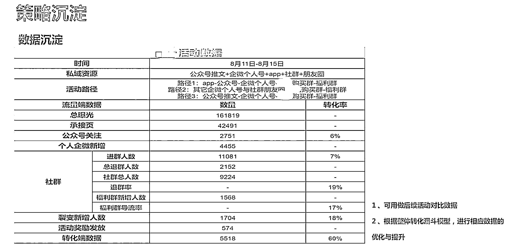

当这套自动化私域成交体系跑通之后，转化率一度达到 50%，远超预期，单日 50 万营收也顺理成章。不过我始终觉得，社群形式千变万化，有共性也有差异。有时候社群是重心，有时候社群只是结果，不同行业、不同业务，还是要具体问题具体分析。

---

### 四个误区，逐个击破

回到开头那四个误区，重点说前两个。

#### 误区一：把社群转化只当成卖产品

先看两张图，感受下很多转化社群的现状。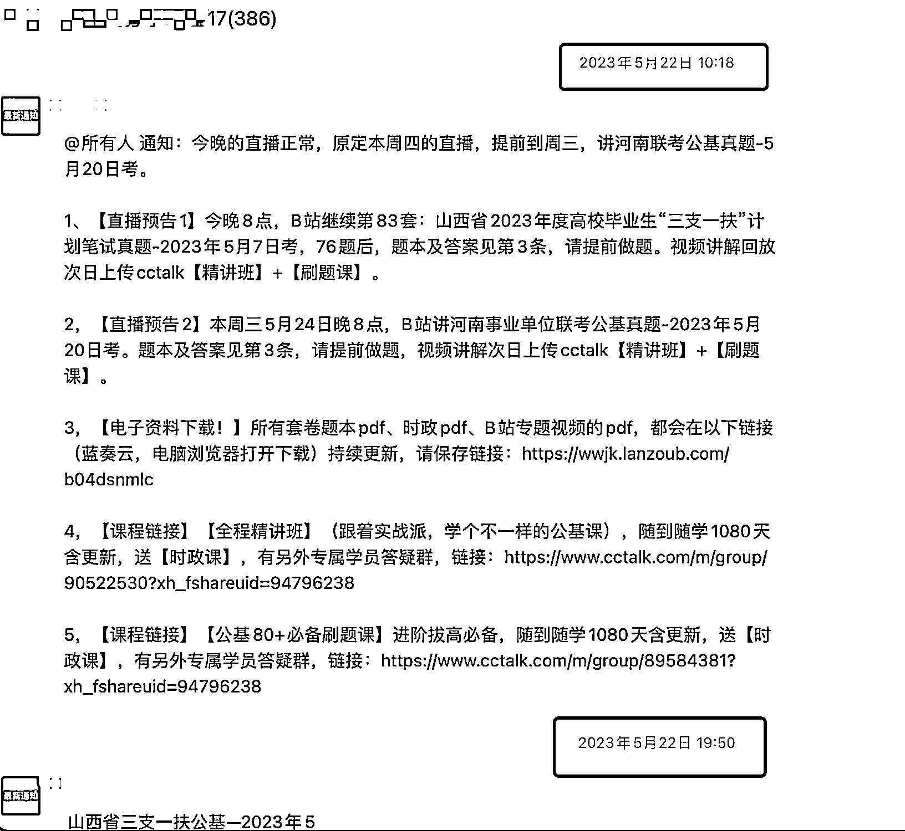

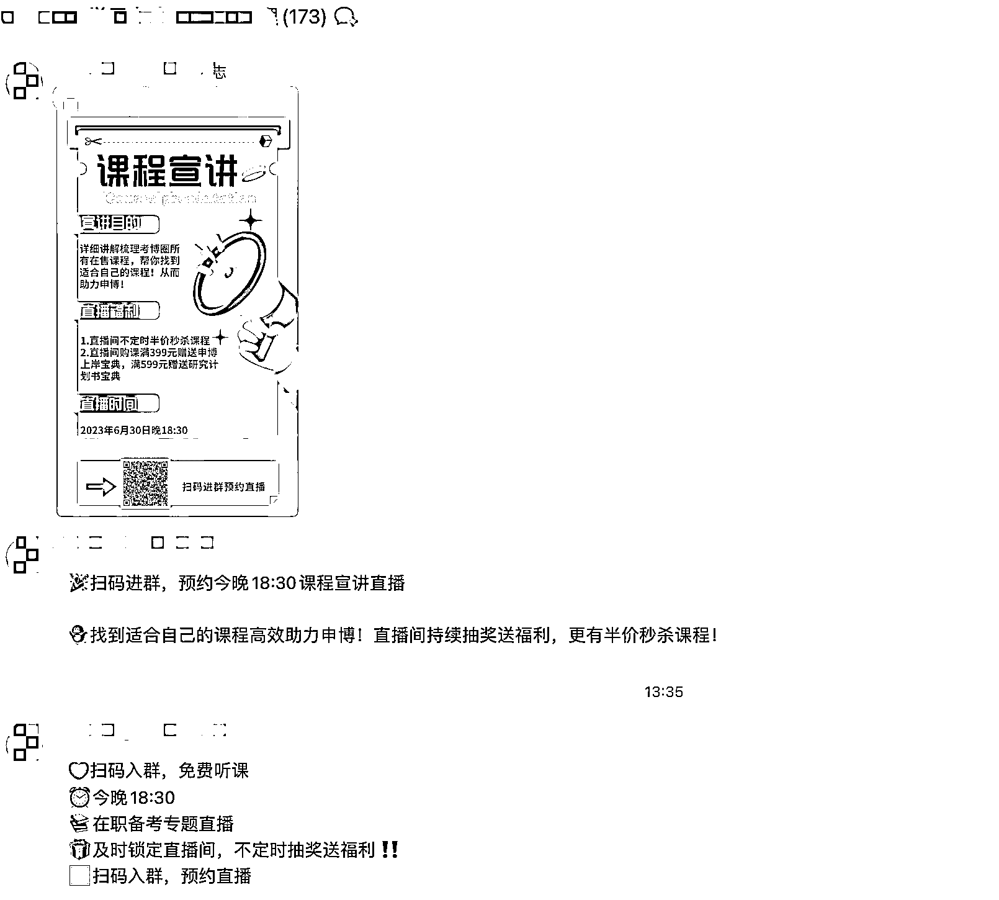

总结起来就是：群发掉粉，不群发没业绩；群越来越多，群内越来越安静，最后变成死群。尴尬的是，同一个互联网从业者，作为用户时非常反感强制推送；一坐到 leader 位置上，脑子里全是 KPI 和 GMV，又让别人去复制粘贴 SOP、群发广告、强推销，把自己和用户都逼疯。直到现在，至少 80% 的转化社群还处于这种状态，挺无奈的。

为什么会这样？很大程度上是因为被误用的漏斗模型。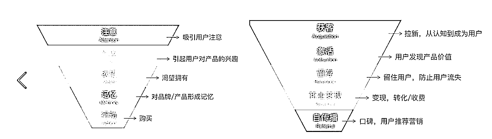 比如公域——私域——个人号——转化社群——付费个人号，这条路径套用了 AARRR 的逻辑，模型本身没错，但在个人运营模式下，从引流、运营、转化、服务到复购都是一个人干，精力根本不够，哪还有空做精细化运营？最后只能在群里硬卖产品。

怎么破？

**第一，与其强卖产品，不如优化产品。** 太多公司总觉得自家产品牛逼，周杰伦的演唱会需要天天给你发广告吗？如果产品真的够硬，转化会自动发生。多花时间打磨产品，多低头问用户，比一切销售技巧都值钱。

**第二，建立正确的培训和沟通机制。** 很少有公司会让新人从头到尾体验一遍自己的产品流程，产品卖点是什么，用户是谁，课程完整听没听过，隔壁同事的流程是什么，用户线下到底什么样。真正的顾问式销售，不是推销产品，而是帮用户解决问题。如果你只是把社群转化当成“卖一波货”，那转化难、数据差、团队乱、成本高，换多少人都是白费。变强推为培育，日拱一卒，结果自然不一样。

#### 误区二：根本不了解用户

这个误区有两个典型表现。

一是主观上觉得自己很懂用户。画像、人群、赛道、需求分析做了一大堆，话术 SOP 也满满当当，但就是忘了用户首先是个活生生的人。很多创业者喜欢对标同行，扒内容、抄文案、卧底社群，但你没有判断对方运营对错的能力，看到的只是皮毛。照搬过来，效果自然好不到哪去，你还找不到问题出在哪。

二是抓不住核心需求。用户最关心的痛点没解决，净整些边缘需求。比如高中考试，核心就一个字：分；副业方向，核心就是钱。其他花里胡哨，都没用。

背后的原因是什么呢？

**第一，跟用户真正沟通得太少，深入沟通更是少得可怜。** 史玉柱说过，做营销，消费者是你最好的老师。你要做到比用户更懂用户，才算真的懂。很多老板拍着胸脯说自己懂用户，要真问他：山东蓬莱一位 43 岁、两个孩子的妈妈，月薪 3000，她现实里真实样子是什么？她最关心什么？她为什么舍不得给自己买衣服？我打赌大多数人答不上来。别骗自己了，没那么厉害就是没那么厉害。低下头，弯下腰，多给用户送点小礼物，好好请教，比那些高高在上、假模假式的调研有用多了。

**第二，缺乏逆向思维，在交付上投入太少。** 你都没解决用户最关心的事，凭什么让人掏钱？

至于后两个误区——高转化率张嘴就来、缺乏体系化数据化思维，其实和前面两个是一脉相承的。把用户研究透，把产品打磨好，把体系搭建起来，转化率自然是结果，而不是口号。

希望我的这些经验，能帮你把社群转化率再往上拉一拉。哪怕只拉高 10 倍，也不枉我们相识一场。

好的交付，才是所有转化的底座。无论是在社群里还是在其他场景里，与用户沟通、促成成交，本质上都不复杂。

举个很直接的例子。以前 K12 领域有一位很擅长的数学老师，跟他学，哪怕是学渣也能慢慢把题做对。用户问你课程怎么样、有啥不一样时，你根本不需要长篇解释。只需要一句事实：我们的张同学高三时数学只有 60 分，学完后高考 120 分；李同学高一就开始跟进，高三直接考了 140 分。数据摆出来，话就不用多说了。

归根结底，不管做什么产品，做社群也好做私域也好，先把交付做好，把用户最在意的核心需求真正解决掉，很多看似棘手的问题自然就不是问题了。

**1、做好用户沟通**

沟通的载体可以是线上也可以是线下。我亲自接触过的用户大概有 5 万人，我更推崇线下走访。真正走到用户身边，沉浸在他们的日常里，你才能直观感受到他们的年龄、性格、生活习惯、真实困惑。把用户当成朋友来相处，而不是当成一个目标去对待，才能摸清他们的心理和最核心的需求。相关参考可看：

[`www.woshipm.com/user-research/4175957.html`](https://www.woshipm.com/user-research/4175957.html) 《用户访谈全流程：深入挖掘用户需求》

[`www.woshipm.com/user-research/4256711.html`](https://www.woshipm.com/user-research/4256711.html) 《需求分析五部曲：需求挖掘，从底层人性洞察用户需求》

**2、模仿用户**

想读懂用户，最有效的方式就是把自己代入成用户。用普通用户的身份去体验产品里的每一个功能，感受他们的反应和情绪，你舒服了用户大概率也舒服，你自己都觉得烦，都不愿意看那些微信的杂讯，都讨厌朋友圈的硬广，用户又怎么会有兴趣？多做几次这样的替代体验，答案就会自己浮现。

**误区 3：高转化率张嘴就来**

**表现：**

**1、盲目拿行业数字说事，不看自身阶段。**
比如听说某家公司的付费产品转化率能到 10%，于是刚起步的新项目也硬要达到 10%。面试回来一个前同事吹嘘原来公司转化 10%，你就真信了，然后把目标一刀切到 10%。现实根本不允许。

**2、把滞后指标当成前置指标来硬压。**
有了产品、有流量、有团队，就觉得转化率必须达标，否则就是团队不行。于是前端只盯流量数字，横向比一比同事的成绩，简单聊聊用户，用户说产品还不错，转化率就应该上来。殊不知用户留存时长、免费资源领取率、体验课参与率这些真正的前置关键指标根本没优化好，就直接去抠最后的转化率。

其实转化率是结果而不是起点。过程做对了结果自然跟上，过程跑偏了，只盯末端，问题永远解决不了。

**原因：**

**1、对转化率的影响因素认知不足。**
很少有人能把转化率讲透。转化率没有唯一的决定因素，只有多个相对影响因素共同作用的结果。千万别以为社群是关键，也别以为一套 SOP 就能定乾坤，这些都不是核心。

**2、对核心数据缺乏优先级排序，看数据只看表面。**
如果我来操盘一个全新项目，我绝不会先看转化率。因为绝大多数千元以上的新品首次售卖，转化率就是 0%，你信吗？我做过 50% 转化率的产品，但同样要说，教育和知识付费赛道里，新品首发转化率为零是常态。

这就带来一个判断难题：转化率是 0%，到底是话术问题、产品问题还是流量问题？主观根本判断不了。我的做法会先看用户花在产品上的关注时长，注意力能不能被拉住，再由此向后延伸，逐步把每个环节拆细。

**方案：**

理解影响转化率最核心的要素是“价值”，然后逐项去优化。

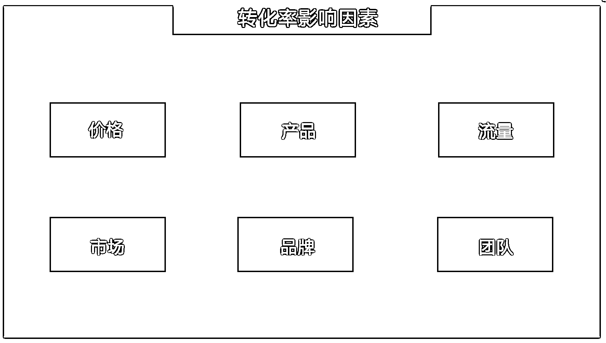

**1、价格。**
这是影响最大的变量。价格低于用户感知价值时转化率会上升，高于价值时就会掉。比如赚钱的课程，价值感在 2500 左右，卖 500 时转化率一定会提升，卖到 10000 时转化率就会下滑。

**2、产品。**
需求强度和产品质量越高，转化率越高。同等价格下，公务员考试、投资理财这类刚需产品天然转化高，而 PPT 制作、日语学习这类兴趣类产品转化就偏低。

**3、流量。**
不同渠道带来的人群支付能力不同，价格敏感度也不同。比如同样的产品，北京用户的购买意愿就明显高于青海、宁夏等西部地区。

**4、外部市场。**
市场有挤出效应，政策环境、宏观事件都会影响转化。疫情冲击了在线教育转化，也打击了线上电商；现在教培政策收紧，市场变化后转化自然下降。

**5、品牌。**
品牌本身就是转化率的体现。做留学，新东方和一家地方机构的转化表现不可能一样。初创公司或个人 IP 前期品牌效应弱，就更要先打口碑。

**6、团队技能的熟练度。**
成熟团队分工更清晰，运营效率更高。老手和新手的转化效果往往天差地别。与其高压逼走老人换新人，不如留住核心，给予合理回报，效果更好。

**误区 4：缺乏体系与数据化的营销思维**

**表现：**

**1、只盯自己的一亩三分地。**
做运营就只写话术打电话，不懂产品、不懂技术、不懂设计、不懂数据，那用户体验必然割裂，信任就很难建立。流量部门只追 KPI 和数量，前期把所有福利都放出来，用户卡在公众号就流失，后续转化断层。社群转化为了完成业绩口径过大、过度承诺，售后和复购压力就会爆炸。

**2、对数据重视偏差，混淆时段数据和时点数据。**
数据有时候挺会骗人。A 团队 1 年 10 人，月业绩 100 万，人均 10 万，转化率 5%；B 团队 3 个月 10 人，月业绩 60 万，人均 6 万，转化率 3.5%。直观看 A 更好，但放在成立时长这个前提下，B 的成长潜力可能更大。很多时候就是因为忽略了隐性前提，只用绝对业绩比较，导致误判。

**原因：**

**1、缺乏整体运行机制。**
公司没有统一的营销指引，部门目标冲突、信息不对称，就无法形成合力。从获客到转化再到复购，本质是一个闭环，必须保证用户在每个环节的体验是顺畅连贯的。没有体系，就必然各自为战。

**2、缺少实践经验和对数据的批判精神。**
凭数字看数据也好，凭直觉看数据也好，本质都偏主观。海量数据里有核心数据，就像产品有北极星指标一样，不同阶段的核心指标会变化。理解不了这一点，就很容易被表面数据带偏。

**方案：**

**1、搭建营销负责人或 IP 自身的营销体系。**
从用户路径出发，合理设计部门协同和各环节重点，诱饵要循序渐进，不要把所有筹码一下子打光。同时要避免各自为战，通过纵向管理、协同办公等方式，确保自己作为用户也能获得良好的体验感。

**2、让数据与业务相互验证。**
多维度看数据，用不同的工具分析，明确关键指标，做横向纵向、同比环比、同行跨行的综合验证。同时要看业务本身的健康度：团队氛围如何、收入是否在增长、团队和用户最常反馈的问题是什么。建立自己的数据评价机制，并杜绝第一时间下主观结论。

篇幅有限，就分享这些。写这篇文章时，7 年的营销经历又重新在脑中过了一遍，希望能给各位同行带来一些借鉴。不同行业有各自的特殊性，若有具体的社群与营销问题，欢迎一起探讨交流。

也非常感谢赚钱提供的平台与信任，未来希望能和更多朋友互相学习，一起做成事。

* * *

评论区：

zeon : 学到了，求链接一下，大佬

阿佰 : 欢迎链接，可以点我头像

逍遥薛少 : 学习了

狂森 : 太强了！正好需要

芷蓝 : 很有收获，感谢

大麦子 : 感谢分享

* * *