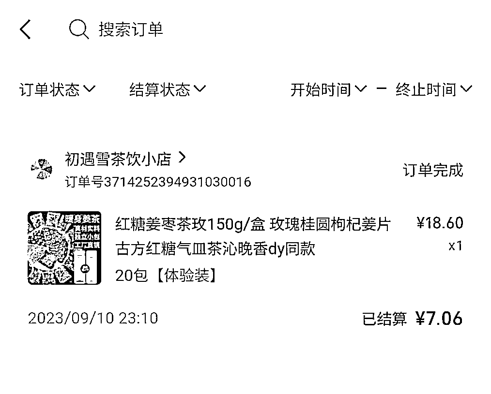
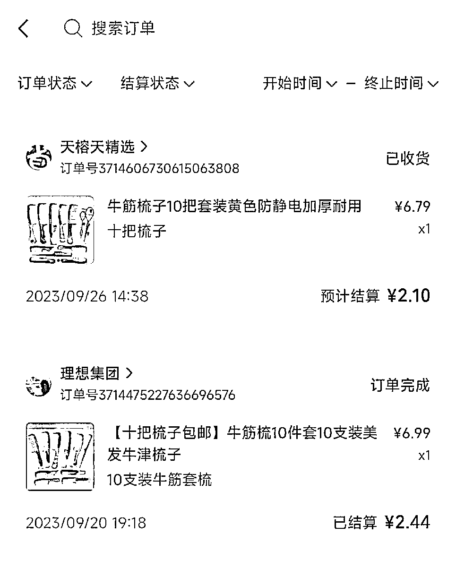
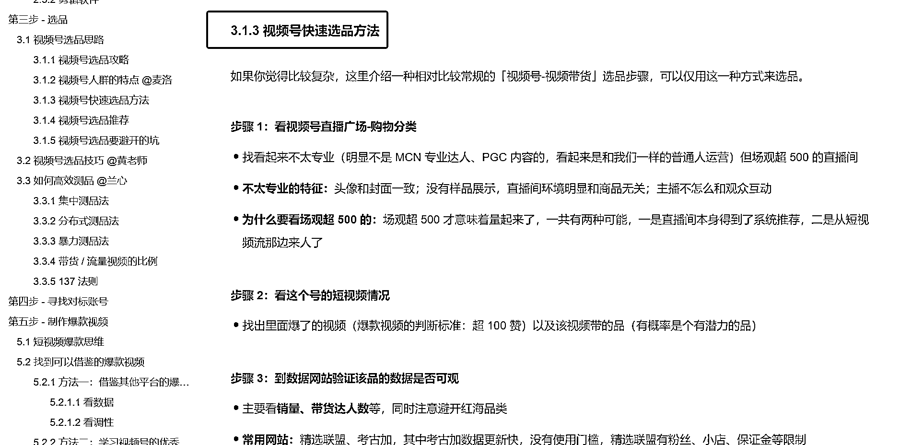
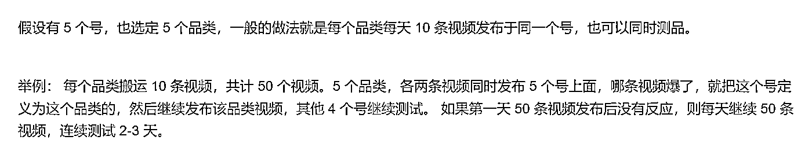

# 视频号从零到第一单，我这个纯小白是怎么打通的
作者：龙哥

## 从零到一的实战复盘

作者： HolyAngles

日期：2023-10-11

**先说下我是谁**

过去十年在北京做游戏开发工程师，现在在家自己做游戏并在海外发行。毕业到离职前，工资就是我唯一的收入，没有任何副业变现经验，所以我一直把自己当成一个彻头彻尾的小白。

* * *

**9 月航海期的战绩**

手上有 4 个账号，靠短视频带货拿下 1 单，靠直播拿下 2 单。

跟头部玩家比，这点成绩不算什么。但它确实达成我出发前给自己定的唯一目标：实现从 0 到 1。

今天复盘的内容，就是围绕 **一个没有任何经验的人，如何在视频号完成第一次成交**，希望能给还在卡在起点的朋友一点参考。

* * *

**短视频带货部分是怎么跑通的：老老实实照着航海手册执行**

**1. 先定人群**

手册里判断视频号用户以中老年为主，建议直接锁定这批人群。我就照做，人群直接锚定中老年。

**2. 选品方法**

手册里给了很多选品思路。
我最终落地的，是视频号快速选品法。

**3. 测品方法**

测品的打法手册里也不少。
我用的集中测品法。

这个打法对视频量有要求，这里我用的是 @奇杰 老师的批量混剪法来冲量，效率非常高，熟练的话一小时能出 10 条，而且基本能过平台的查重。

**要注意的是，素材库一定要够大，素材越丰富，混剪的稀释效果才越明显。**

批量混剪的具体教程在《视频剪辑航海手册》里 https://search01.shengcaiyoushu.com/docx/STTDdDfX0osaamxXIr7cErS3nkf#IDIBda4CFovgFxx3l7lc8Mrcnie

把人群、选品、测品这三步串起来执行，大概率都能实现 0-1，差的只是时间。品测得越多，撞到能卖的概率就越高。

我本人是航海第三周才收到第一单，前两周全在选品测品，试了不少品都没动静，很挫败，也动摇过要不要继续。最后还是坚持下来了。

**核心就一句话：按手册做，并且坚持做下去，结果会来。**

* * *

**直播出单的另外一条路**

上面聊的是视频带货，下面说下我是怎么靠直播补单的。

我本身很社恐，开播对我来说是件挺抗拒的事。之所以硬着头皮上，是被逼的。

四个号之前发了一些测试流量的视频，查重没做好直接被限流了。之后发带货视频几乎没流量，申诉和发 10 条原创也没解开。

直播的流量不吃视频限流这个影响，所以我就转战直播。

**直播的具体做法很简单**

选定商品直接开播，视频已经没用了就不浪费时间了。有样品的体验会更好，没有样品就用商品图代替展示。

选定品后我会想办法先拿到样品，附近商场、美团、网上下单都行。

开播初期我完全不知道怎么聊，后来向教练要了一份直播万能话术，直接照着念。

就这么连着开了几场，每场保持 2 小时以上达到平台的有效直播时长。连续开几天后，平台会逐步给到一点流量。

所以如果你的视频账号被限流了，直播可以作为一个备选的出单通道。

* * *

**我踩过的坑**

为了测试流量发了一些没处理好去重的视频，直接导致账号限流。

* * *

**给还在卡关的朋友几句建议**

1. 按上面的流程一步步走，选品测品贵在坚持，别轻易放弃。
2. 发视频一定要谨慎，提前做好去重，账号一旦限流，恢复起来非常难受。

我表达能力一般，但希望这份真实的踩坑记录，能帮到还在 0-1 路上的你。

* * *

评论区：

渔火 : 同一个小组的，见证了你的成长[强]

HolyAngles : [拥抱]

* * *