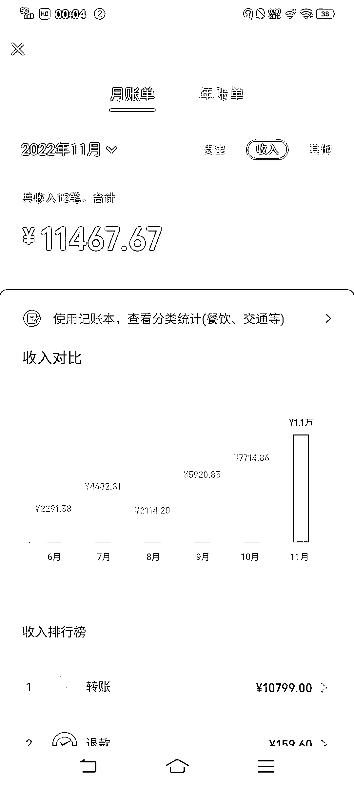
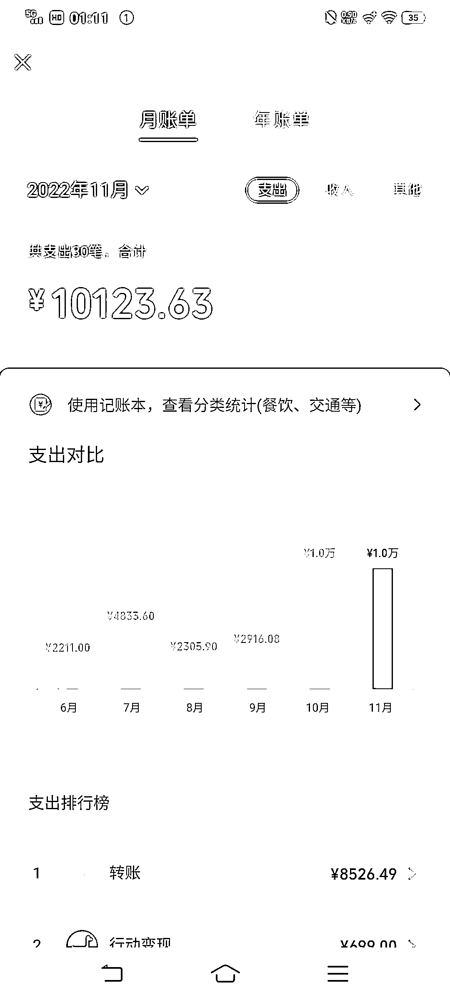

# 用公众号副业把买课钱赚回来，是怎么做到的

## 副业做公众号，我是怎么靠知识付费把学费赚回来的

作者： 二丫吖

日期：2023-10-12

去年四月，我还在给中 V 写稿，一个稿子 200 块。

那段时间我两头跑，一边做自己的公众号，一边给人家投稿赚点零花。

我做事有个习惯，先付费买课，把别人踩过的坑和总结好的方法先学一遍，这样效率更高，弯路更少。

买课要花钱，所以我一边养号，一边接投稿。

投稿的好处很明显，一来能回点血，抵消买课的支出，二来中 V 底下有几十万粉丝，投稿能给我带来曝光和导流。

到了五月，公众号转成日更后，我手里活多了，就没再投了。

其实后来合作关系更近了，本可以继续投，源源不断地拉新。

但当时号里的内容基本都是老稿和问答拼凑，写一篇投稿起码要两小时，我一拖再拖，畏难情绪上来就搁置了。现在涨粉主要靠付费投放，我请了个专门找车的小助理，全权交给她，我只负责对账。

也就是说涨粉这块我已经外包了，自己不碰。

这么做是不对的，引流不能断。

去年十一月，是我做号的第八个月，那个月没接一单广告，公众号收入直接破万。

今天拆开讲三件事：

**一、到底赚了多少**

**二、钱是怎么来的**

**三、花出去的钱都去哪了**

做公众号两年，我很少细算进出，一是没精力，二是觉得数额不大，算太细太累。

之前每个月也就几千块。去年十一月第一次单月破万，我觉得算一次有纪念意义，就把账单扒出来了。

### 一、到底赚了多少？

1、卖出去一个年度咨询；
2、跟两位大 V 合作了两场直播，有分成；
3、当月付费咨询做促销，首单六折，一共卖了 4.5 单，其中一单超时了客户自己补差价；
4、给别人带货做分销，拿提成。

以上这些钱都在我做自媒体的那个微信上，光这部分就 1.1 万了。

还有一部分在生活微信里，因为一开始买课用的就是这个号，绑定也是它。比如知识星球的收入和文章赞赏。

加在一起，这个月自媒体的总收入是：**15000+。**

算到十一月，我做自媒体的累计收入大概在 6 万左右。

### 二、钱是怎么赚的？

跟我同期起步的号主，基本都靠广告变现，或者自己做社群、做课。这条路能走，但有短板。

广告最致命的是伤粉，频繁接广告粉丝会跑。刚起步时必须靠广告活下来，这是最直接最快的现金流，也能让你摸清广告市场的玩法。

正是在这段尝试里，我认识了很多大学生号主，了解到他们的引流方法和做号逻辑。后来我就把自己的内容和他们的渠道结合，把获客成本降下来，摸索出了一条适合自己的路。

引流是要花钱的，前几个月我靠广告勉强收支平衡。

自媒体和别的行业一样，粉丝少阅读低就没话语权，合作也谈不下来。

所以前期我把钱大量投在买课上。

买课肯定有踩雷的时候，比如我花 1599 报的写作课，花 1099 报的知乎课，按课程本身价值算，基本算亏了。

**但买课对我来说有三层用处：**

1、认识老师，拿到更多资讯和后续合作机会；
2、把他们的课程、社群运营、小助理配置、群内氛围、内容结构当成竞品来研究；
3、买课的人都有付费意愿，能把他们转化为我的读者，后续变现概率高；
4、最后才是课程内容本身。

所以那两门课内容不匹配我，但我也学到了东西。买课摊薄成本来看并不亏，有些课明码标价上千，实际只卖几百，性价比很高。

总体来看我的认知、行业话语权和收入都在往上走，买课的钱就回来了。

**说白了，买课对我而言是买一个向上链接的入口。**我做销售多年，资源链接的能力帮我拉开了和同期的差距，也是我变现方式多元化的根源。

我现在有主业，要带娃，公众号还要日更，还要持续学习。

在粉丝基数不够的时候，自己做课就是赔本买卖。那不做课是不是只能靠广告？

**不是，还能做分销。**

我卖的是我自己报过的课：

**对我：**不用运营不用上课不用售后，见效快。
**对粉丝：**都是我亲测过的，推荐了不砸口碑，还会感谢我挖到好课。
**对上游老师：**我能带来成交，他们就愿意给我资源倾斜，后续合作更多。

多赢。

赚到的钱我会立刻砸回投放，所以几个月下来公众号涨到两万多。粉丝越多，话语权越高，向上链接的筹码越多，能合作的博主越多，身价越高，变现渠道越宽。

进入良性循环。

等到这时候再做自己的课，内容和销量都会更好。很多人问我为什么不早做自己的课，其实不是不想，是时候未到。

分销，现在是我自媒体收入的重要支柱。

### 三、花了多少钱？钱花在哪了？

主要花在三块：

1、三个小助理，一个排版、一个找车、一个剪辑直播切片，每月工资 1800 元；
2、上车投放，就是花钱在别的博主那里投广告，给自己引流；
3、持续买课，每月必买，吸收不同博主的思路，链接不同的人。

**基本上是月月收支打平，赚的不少，花得也不少。**

那个月媒体微信流水有点高，因为之前这个号被封过一次，我怕再来，怕梅开二度，就转了 6000 到生活号。**所以当月实际净支出大概只有 4000 多。**

**钱进进出出，最后留下了什么？**

1、认知变了，对自媒体的生意逻辑看得更透；
2、用起来的一批优秀合作伙伴；
3、一个 3 万多粉丝的公众号，和 5000+人的私域微信；
4、一个能自己运转起来的小生意，启动成本除去时间精力，几乎可以忽略。

你看，自媒体这门生意，比开实体店要轻得多，不用囤货不用租铺，也没有股市那样的大起大落。时间自由，有情绪价值，能增长见识，天花板很高。

能看到这篇文章的你，已经一只脚迈进来了。要不要继续走下去，就看你的目标和行动了。

【延伸阅读】

1）[如何写出一篇对读者“有用”的文章？](https://t.zsxq.com/1190iS6eF)

2）[新手小白做公众号的第一步：写](https://t.zsxq.com/11lFui6Ph)

3）[如何从书中提炼观点，让你的文章更有深度](https://t.zsxq.com/11jkbp0BE)

4）[内容更新频率，日更≠能做成一个账号](https://t.zsxq.com/135Hvhqii)

* * *

评论区：

周彦充 : 小助理的内容感兴趣，期待分享下[呲牙][呲牙][呲牙]

清源 : 对投入产出的分析非常到位，学习了

Allan : 有收获！赞！

* * *