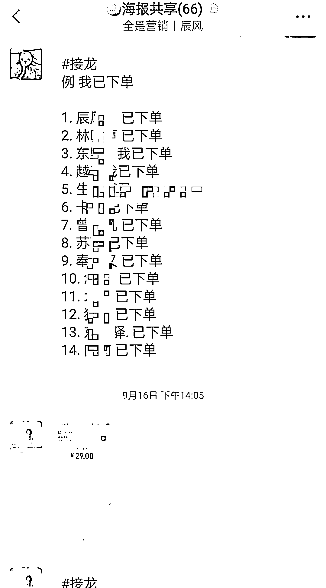
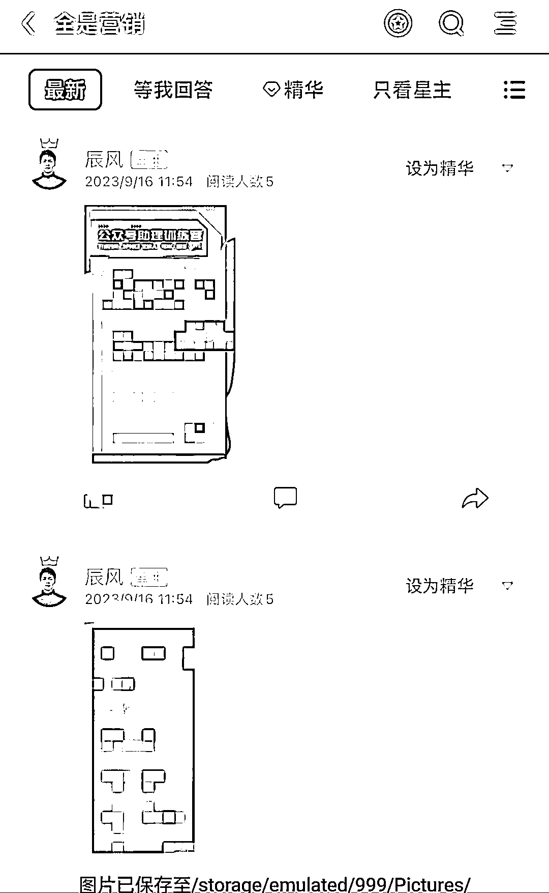
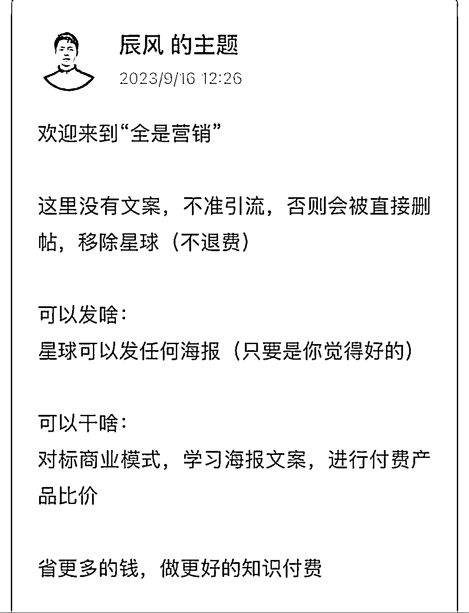
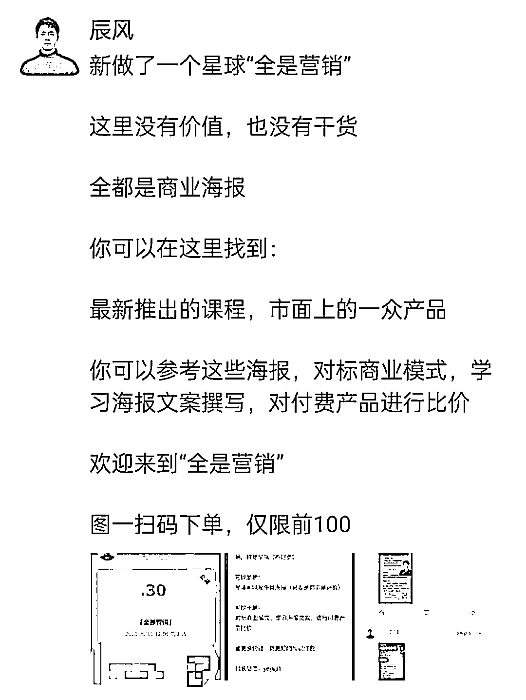
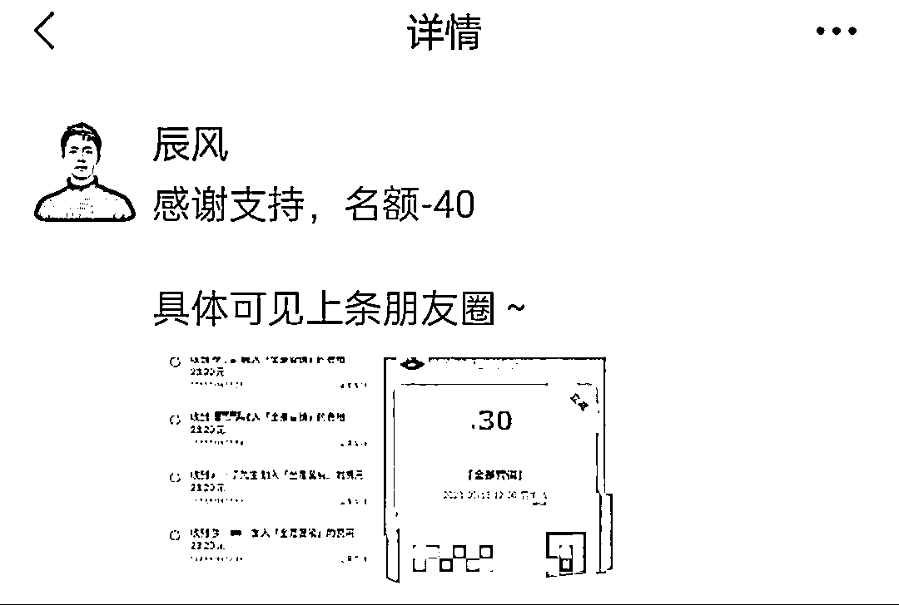

# 通过“全是营销星球，一天转化 50+客户，变现 2000+”的群发售复盘

单日成交50多人、变现2000多，这个不起眼的知识星球是怎么做到的？今天我把整场群发售的完整复盘分享给你。

先说说背景。我的主业是电商，具体做摄影行业的信息流投流。因为每天都要和竞品死磕，看他们的海报、商业模式、套餐设计、视频案例，久而久之我对各种商业案例特别敏感，也养成了刷朋友圈观察同行营销动作的习惯。

熟悉我的老朋友都知道，我之前做过公众号，积累了一大批公众号号主；后来自己做私域，又结识了很多创业、网赚圈的朋友，以及大量做付费产品的野生流量。这些人，正是我做知识付费天然的第一批种子用户。

这一次发售的星球叫“全是营销”。为什么取这个名字？因为星球里收集的全部都是配合营销场景打造的案例，课程海报也好、各类引流海报也好，清一色都是营销素材。

在做任何付费产品前，我都坚持一个共识：发售能不能成，主要看两点。第一，朋友圈营销要做完整，并且要反复晒成交单；第二，社群里的转化和逼单必须跟上。具体玩法不外乎群接龙、晒打款截图、安插水军、请已付费的老学员带头造势——本质上都是利用羊群效应，让潜在用户觉得“这么多人都买了，我也不能落后”，成交效率自然翻倍。

一、先定位，再打靶

没有想清楚卖给谁之前，我不会轻易做产品。这个星球的目标受众很清晰：想通过知识付费做副业变现的自媒体创业者。

那他们的痛点是什么？我梳理下来无非三个：

第一，设计功底弱，海报做不出高级感；

第二，文案能力不足，写不出吸引人的海报文案；

第三，圈子太窄，看不到同行正在做什么商业模式、卖什么付费产品。

“全是营销”能解决的，恰好也是这三点：看会别人的海报，提升自己的审美和设计能力；拆解别人的文案，优化自己的表达；对标大量商业案例，找到属于自己的商业模式和发展路径。

二、发售前的预热：1元群养了3个月

因为之前积累过不少社群和星球发售的经验，这一次流程我反而刻意做得很简单。在正式发售前，我花了不少精力做用户调研。

怎么调研？发朋友圈。那段时间我连续围绕海报输出三类内容：第一类是美学认知，聊海报的设计理念；第二类直指痛点，点破很多人做付费产品最大的两个卡点——做不出好海报、写不出好文案；第三类是试探需求，问有没有人想参与海报分享。通过互动情况，我基本摸清了谁的意愿最强。

紧接着，我建了一个门槛极低的“海报共享群”，只收1块钱。这个定价说白了就是调研成本，如果你对这个主题不感兴趣，也不至于亏什么。此后整整两三个月，我都在群里持续更新海报素材，用价值养着用户信任。直到铺垫得差不多了，我才正式启动星球发售。

三、发售三板斧：低价、返款、晒单

星球的官方价格我定在59元，这也是该产品的最低价。同时，我给之前买过我社群的用户发了一张20元优惠券。为什么有优惠？因为人家已经付费支持过我一次，如果没有一点专属福利，他们的付费意愿反而会降低。千万记住：想方设法给用户好处，你的收益才能翻倍。

正式开售后，我立刻在社群里做接龙。规则很简单：只要在群里晒出加入星球的截图或付款证明，我马上返款，相当于再降一档价格。这是一种很高效的逼单方式。当群内不断滚动出一条条成交动态，很多原本观望的人会被现场气氛带动，跟着加入。

与此同时，我的朋友圈也开始滚动直播：晒群里的接龙进展、晒用户的真实反馈、晒一张又一张的下单截图。价值感就是这样被“秀”出来的。我还在自己名下的其他社群同步推广，继续制造晒单氛围，让更多用户参与进来，成为“成交证据”的一部分。

四、看上去亏钱，其实赢在后面

可能有人会觉得，59元的低价格加上优惠券和返款，能赚多少？但我的目的本来就不是靠这一次暴赚。

我更想要的是跑通一个小型发售的完整闭环，让它成为我亲手操盘的一个商业案例，也变成一次完整的群发售复盘。从0到1，把每一个环节都验证一遍。所以价格可以尽可能低，交付必须尽可能超预期。低价的意义在于：把列表里那些沉默用户和群里的潜在客户都吸引进来，让他们亲身感受一次被我成交的完整过程。只要第一次留下了信任和惊喜，后面我再推出别的付费产品，甚至是一对一私教，都会顺手很多。

最终的结果也确实超出了预期。一天涨了50多个付费用户，变现2000多，对这个体量的产品而言，已经算是一场不错的胜利。

五、比赚钱更大的收获

这次发售给我带来的最大改变，不是那笔成交额，而是我终于可以大胆地输出自己的IP认知，勇敢地卖出自己的产品。同时，我也在一场真实的操盘中打磨了自己的执行能力，个人背书和行业势能都往上抬了一截。

如果后续你想做得更猛，还可以叠加一些玩法：比如设置涨价倒计时，利用稀缺感逼单；比如开通分佣机制或星球分享奖励，把用户变成你的推销员。这些动作都能进一步刺激下单。

以上就是我在“全是营销”星球这次裂变发售中，总结出来的完整流程和实战技巧。希望其中某句话能给你带来启发，也欢迎你来和我交流你的感受。

感谢你看到这里。

以上。

