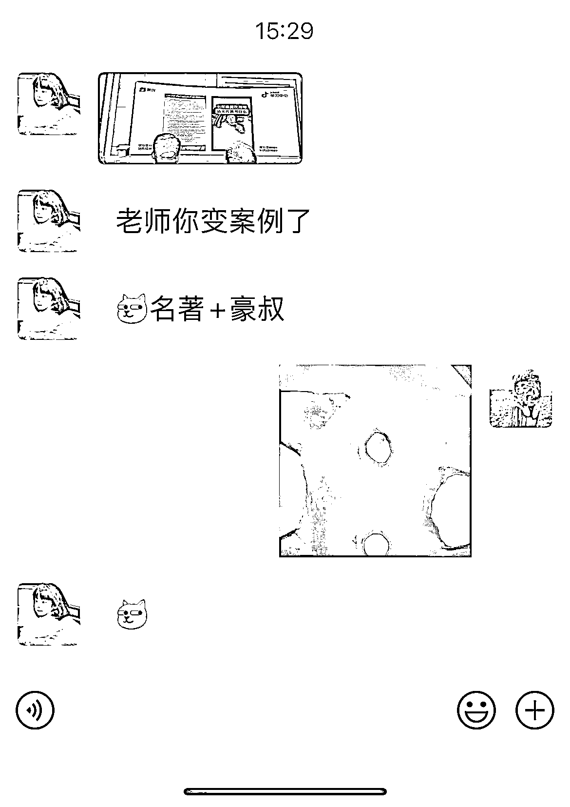
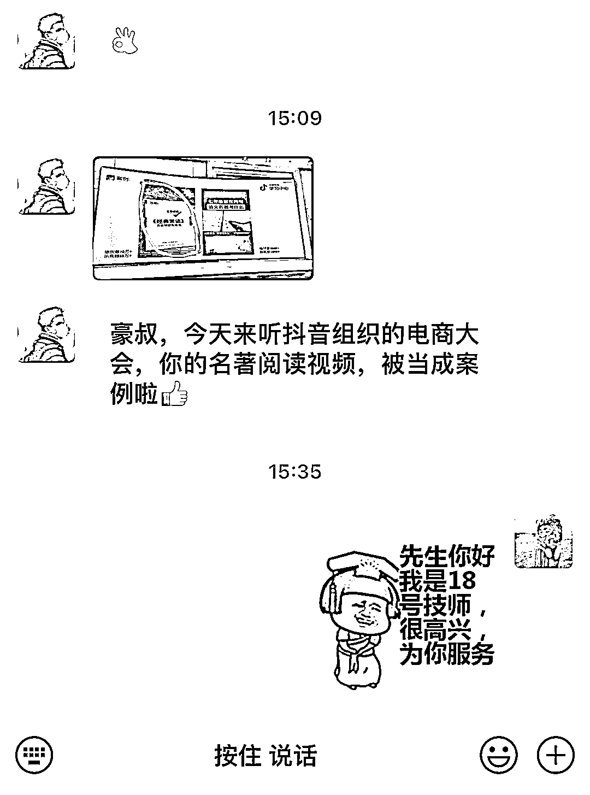
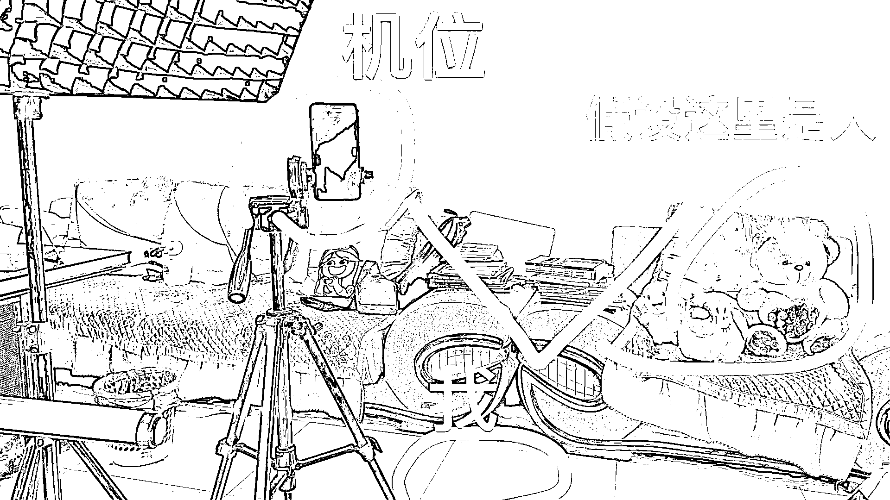

# 抖音短视频带货未来趋势和玩法：口播 3.0 时代
作者：龙哥

你有没有发现，现在刷抖音，那种端端正正坐着、一本正经讲道理的口播视频，越来越看不进去了？用户的心态早就变了。今天聊的是“口播3.0”——一种让观众越刷越上瘾的短视频带货玩法。

为什么大家都想做一个口播账号？很简单，对于上班族、自由职业者，或者自己有点小生意的人来说，这个形式在时间投入和产出上非常划算。白天上班，晚上拍几条，不用复杂的团队和拍摄设备，就能持续输出内容。

但很多人在起步时都卡在同一个问题：一个人对着镜头，脑子一片空白，准备好的话像念稿子，干巴巴的，毫无感染力。这其实是还没进入状态。我刚开始也这样，后来向做得好的头部朋友请教，他说：“录100条口播视频，问题就解决了；100条不行，就录1000条。”我照做，录得越多，果然越自然。

到2.0时代，我也算做出了点成绩，多次登上带货榜单，视频还被抖音官方当作案例，在线下电商大会分享过。可是，做得久了，我也碰到了天花板，感觉再怎么努力，流量都很难往上突破。

于是假期里苦想了好几天，到处请教，终于想通了一个新方向：抖音口播3.0。

回想前几年，做口播简直“有嘴就行”。敢露脸、敢说话，往那一坐，坚持发，就能成大V。但现在？显然不行了。不只是比去年难，甚至比前年都要难上几倍。流量越来越金贵，自然流量不好拿，付费流量越来越贵。可换个角度看，这也刚好印证了二八定律——难倒了一大批三心二意的人，能留下来的，才能真正吃到肉。所以，现在恰恰是打造短视频IP的最好时机。

2.0时代的口播，本质是说教：摆出专家姿态，输出观念，说服你认同，说服你下单。而现在，用户的耐心已经被这种形式消耗殆尽，完播率下滑，5秒跳出率飙升。

那么3.0玩法怎么玩？核心只有一个：别再来正襟危坐说教那一套。口播还是口播，但给视频“化个妆”——改形式，加元素，让它轻快起来。比如我原来固定坐在工作室里，对着固定背景拍；现在我可以去公园边散步边聊，或者坐在行驶的车里，对着后座镜头分享。做教辅带货的，可以改成亲子一问一答，家长问，孩子答，一下子就有代入感了。你看，思路一打开，玩法可以很多。

3.0视频最大的魅力，就是让人刷起来不累，没有那种“听专家上课”的压迫感。

要做到这一点，重点在于——氛围感。用户晚上洗完澡，躺在床上，点开抖音，不是为了上课，是为了放松。所以不管你在视频里扮演什么角色，都得把氛围感拉满，让人感到轻松、亲切，他才愿意继续往下看。

怎么提升氛围感？两个办法。

一、如果条件允许，找人聊天。一个人对着镜头，很难有氛围。旁边有人跟你互动、搭话，画面就活了。亲子互动型、夫妻互动型、师生问答型，都是这个逻辑。就像你去吃饭，总爱挑人多热闹的馆子。刷视频也一样，剧情为什么容易火？因为一群人热热闹闹，更像在“演”，而不像在“教”。现在已经有越来越多的家庭，放弃工作室的精致布景，拍起了这种有生活气的带货视频。

二、你是一个人？那就假装有人在聊。很多个人创作者没有搭档，我也是从一个人开始的。下面分享几个实用技巧。

第一个，呼吸拍摄法。多准备几个机位，正面、侧面随机切换，降低视觉疲劳。在讲重点的时候，把脸部画面放大，加上合适的音效，视频就有了“呼吸感”，不再是一块平板，而是跟着情绪起伏，像在跟观众面对面交流。

第二个，三角拍摄法。这是新手“镜头尴尬症”的救星。机器一架，旁边摆几个玩偶，假装旁边有人。看镜头久了，看看旁边的“人”，眼神就自然了。有了互动对象，就不会再有人盯着屏幕念稿子、瞟提词器了。

第三个，背台词。提前把内容背下来，拍摄时眼睛就能聚焦在镜头上，眼神坚定，像主持人一样。如果你还能结合三角拍摄法，一会看镜头，一会看旁边，眼神交替聚焦，那效果直接起飞，专业主持人都未必比得过你。

第四个，手持拍摄法。可以说是个人创作者的“压轴大招”，大道至简。只要面前架着镜头，不管是谁举着，都容易紧张。那不如自己拿起来拍。

为什么这个方法效果最好？因为抖音的slogan是“记录美好生活”。记录，才是最接近真实的方式。摆拍和剧情，永远比不上真实的记录有力量。走到哪里，用镜头捕捉你看到的东西，整理成有看头的短视频，再放进值得分享的场景里输出——这是每个自媒体人都该养成的习惯。时间久了，你会发现其中的底层逻辑，复用在哪一场内容上都跑得通。

关于口播IP 3.0，今天先聊到这儿。后面我会陆续分享更多细节。如果这篇文章对你有用，记得用你发财的小手点个赞，给我一点继续分享的动力。

我是猎音狮，专注教辅赛道短视频带货。我们下期见。

