# 零预算撬动达人分销，两个人跑出月销20万的实操复盘

## 没有投放费也能玩转达人，2人组月入20万的达人运营实战拆解

作者： 范又荆

日期：2023-10-11

想在抖音上卖一款没什么名气的货，又不想自己上播，也不想自己剪带货视频，还有路可以走吗？

答案是有的。让达人来推。关键是前期没钱、产品没知名度时，怎么让达人愿意白嫖带货？等有了销量后又怎么把势能放大？

下面就用我自己的实战经验，一步步讲清楚我是龙哥，希望能给你启发。

先说下我们当时的基本盘：

1、产供销打通，给皮爷咖啡 peet's coffee 供货，有品牌背书加持
2、带过销售团队，会点电商运营，抖音对我来说是全新赛道
3、用户对产品认知几乎为零，必须靠内容建立心智，所以走兴趣电商
4、身边团队已有人用达人分销跑出成绩

# 一、两个人死磕两个月，量变到质变月销20万

**1. 先把人找对，再把量做起来**

开工前我们内部先对齐了定位。从产品现状、长期价值和天花板来讨论。产品依托皮爷咖啡背书，价格带也对得上消费者。有的人觉得归到咖啡伴侣品类天花板低，但产品本身能直接吃、能配咖啡、还能当甜点装饰，触达面其实更宽。

问题是用户根本不知道有蜂窝糖/卡美罗这个品，大部分人是通过皮爷咖啡才认识我们。咖啡人群的价值也不低。

最后我们把品类锚定在咖啡伴侣，想把“喝咖啡就加蜂窝糖”这件事植入心智，于是目标瞄准饮品类博主。

**2. 各种渠道找人，越杂越全**

a、抖店后台-精选联盟-达人广场

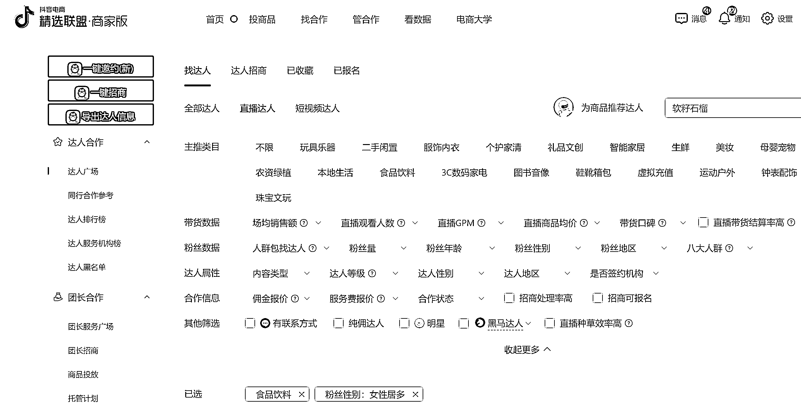

b、抖音App刷同类短视频，关注饮品博主后系统会推荐相似达人

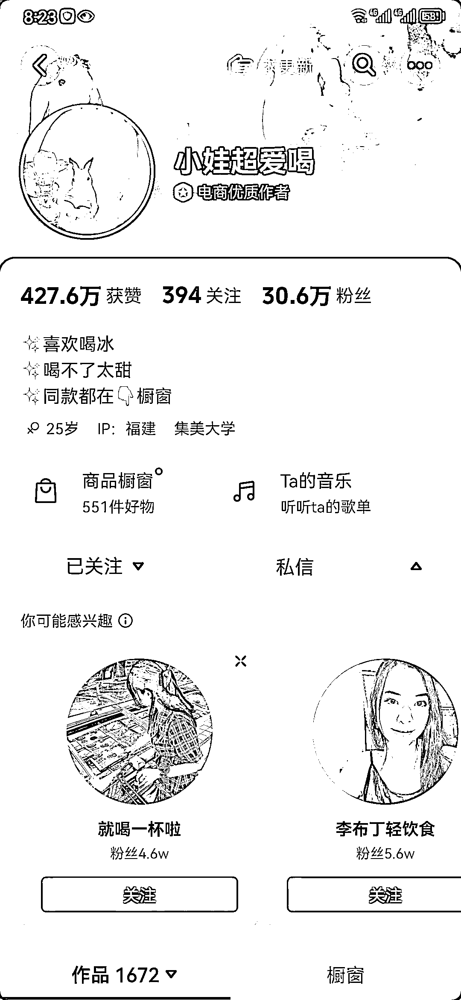

c、去竞品商品链接下看达人秀，甚至是评论区挂车的达人。精选联盟后台搜竞品名就能看到竞品TOP200合作达人表，精准度很高。

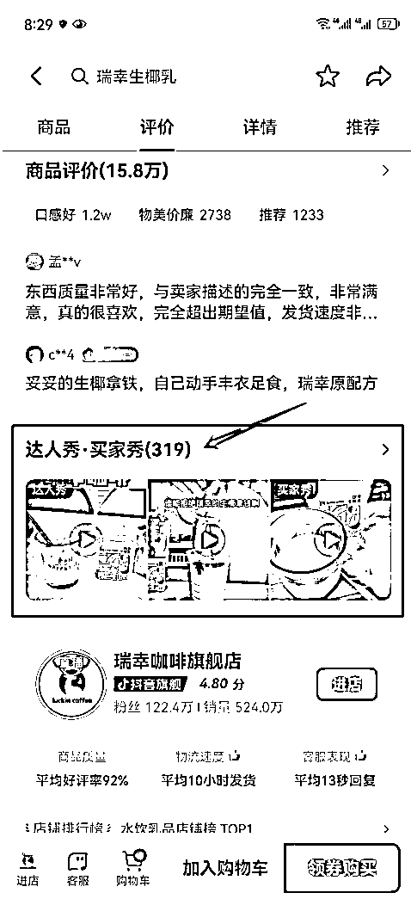

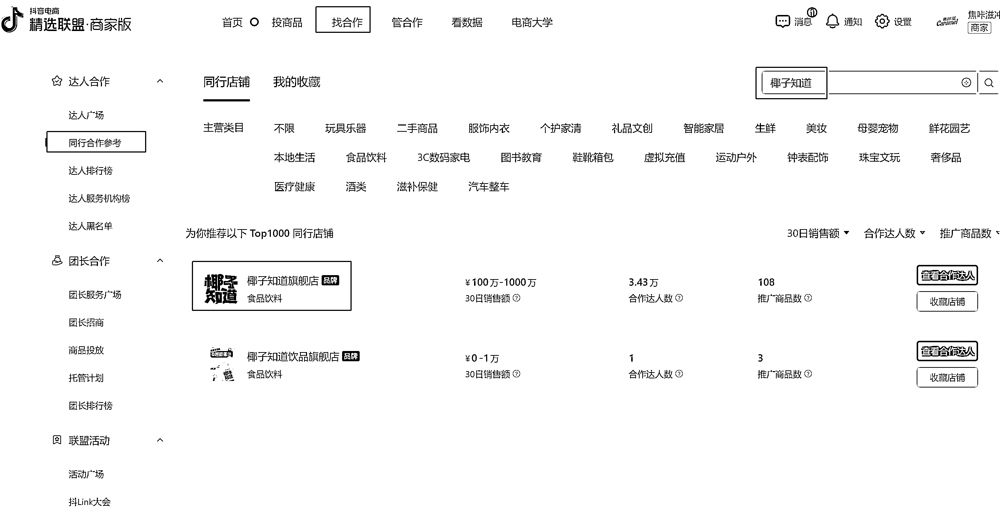

d、摸规律找人。饮品博主昵称常带“喝什么”“超爱喝”“来一杯”等词，直接搜关键词就能筛出一批潜在对象

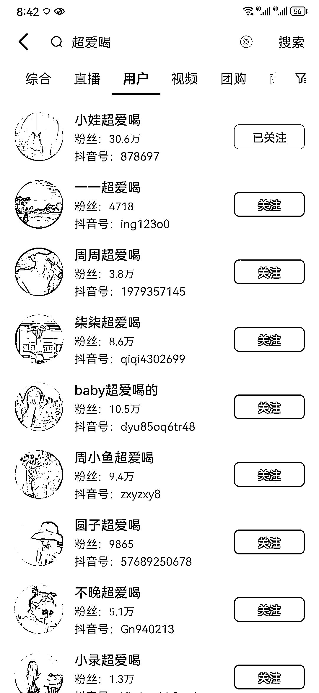

e、看话题。做饮品、做咖啡的达人会在作品里挂类似话题，如“咖啡”“自制饮品”，从话题切入也能批量找人

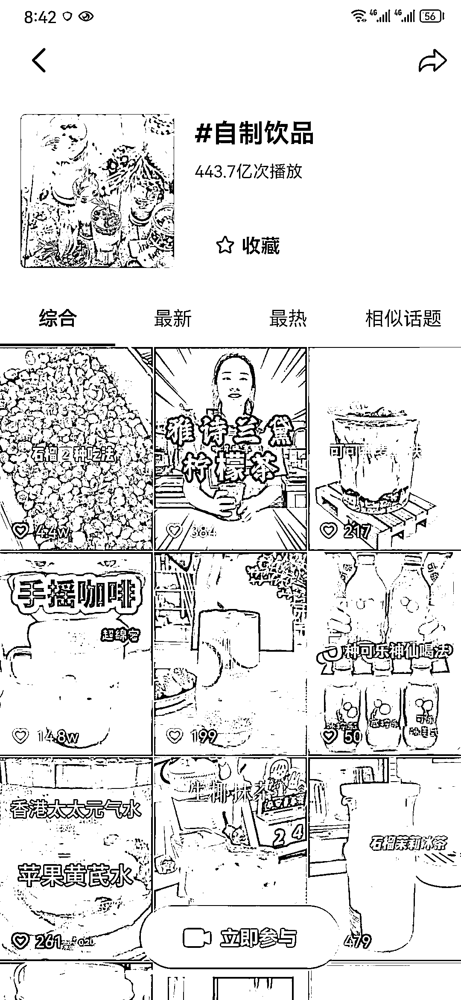

f、数据平台辅助。蝉妈妈、飞瓜等都能按品牌、商品、关键词查达人，但要付费。淘宝上找人代查更便宜。

**3. 怎么拿到联系方式**

a、达人广场点进主页就能看到联系方式

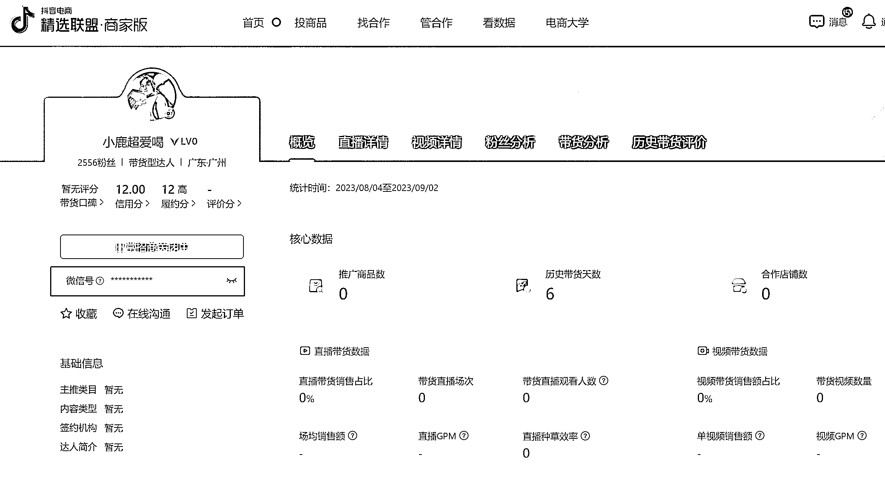

b、抖音App达人主页简介里，部分达人会留🛰️/🐧

c、抖音私信。没互关时只能发一条，务必精简：突出产品/品牌优势+合作意图+联系方式。模板示例：TOP咖啡伴侣，皮爷咖啡独家供应商，与宝内容很搭，期待合作，V我：***

即便你不是Top榜产品也没关系。达人一般不会去核实你是否上榜，至少我们做了半年没人问过。真正计较的也往往不留联系方式，也不是我们的目标分销对象。

d、点在线沟通把商品链接直接发过去，更直观

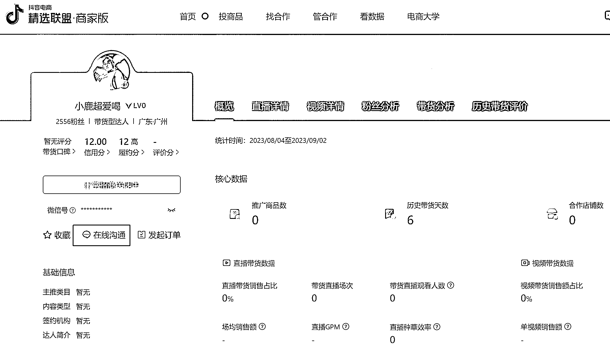

小结：
① 抖音私信上限600条，我们平均每天私信300+个
② 同一个达人，私信+达人广场+🛰️三路并进
③ 利用碎片时间持续找人，执行拉满

**2. 用产品优势说服达人，并把细节打穿**

**1、提高🛰️通过率的细节**

a、头像：从真人换成品牌LOGO，信任感更强
b、昵称：品牌名+商务+小名，如 焦咔滋品牌商务 小于
c、朋友圈：提前铺产品、品牌、公司、达人合作内容，人设更立体
d、加友话术：与私信同理，简短亮点+拉近话术。可提到“之前私信过”“很喜欢宝的拍摄风格”。例如：TOP咖啡伴侣，peet‘s coffee独家供应商，期待合作，前2天私信过。英文混搭、贴合国外品牌，也能增加好奇心。找到共同爱好点切入，通过率会提升。

**2、临门一脚：把卖点讲成达人的好处**

a、价格优势：咖啡店一杯38，家里用蜂窝糖自己做只要几块钱，咖啡爱好者会算这笔账
b、操作简单+出片：做饮品的，一条视频就能把蜂窝糖放到咖啡里，出片效果好，我会同步几张达人实拍图

**常见异议怎么破**

a、“产品不适合我”。直接甩同类型已出单的达人截图，证明同类内容能卖。也有达人真的觉得不搭，这时要帮他搭建场景：比如做糕点的达人，可以在制作时加一杯咖啡的镜头，质感更上档次，也多一份收益。

b、“没预算、没投流不带货”。退一步，先不挂车，让他挂橱窗露出即可，甚至先只做视频露出。先寄样让他免费试吃，建立信任，下次更容易挂车。投流政策我们给的是24小时出10单就补投100元。

c、“没时间”。看他更新频率就能判断。直接约定交片时间，减少他心理负担。

**3、🛰️不删就有机会**

🛰️里躺着没回的达人，每天换着花样敲。删了就没价值，不删就有希望。很多达人不是不感兴趣，是忙忘了。坚持发，总有被唤醒的那天。

小结：
① 先做出1-2个标杆达人，后续沟通有背书
② 细节里有钱
③ 用已出单数据刺激达人跟进

**3. 把经验固化成SOP，提升效率**

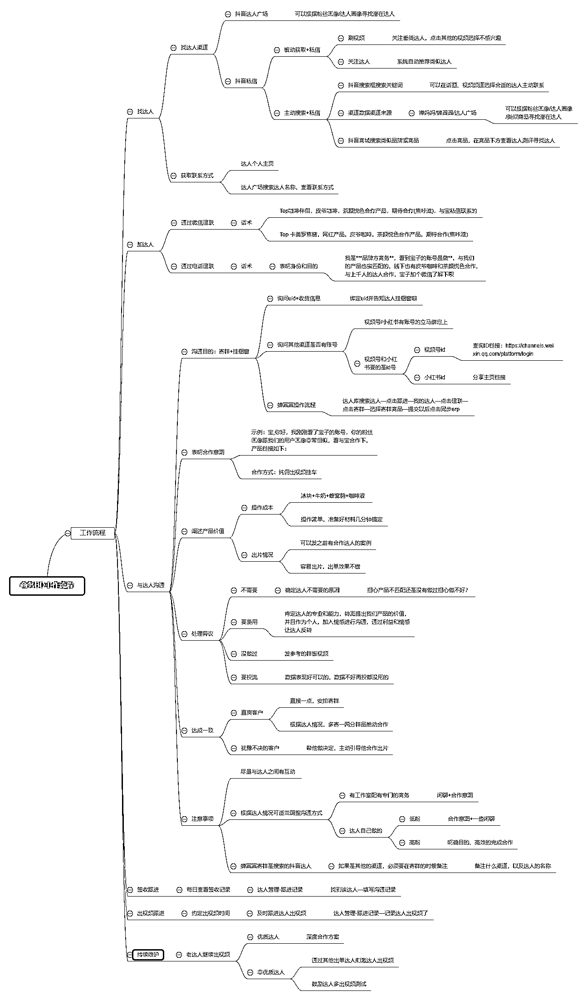

### 形成达人沟通案例库

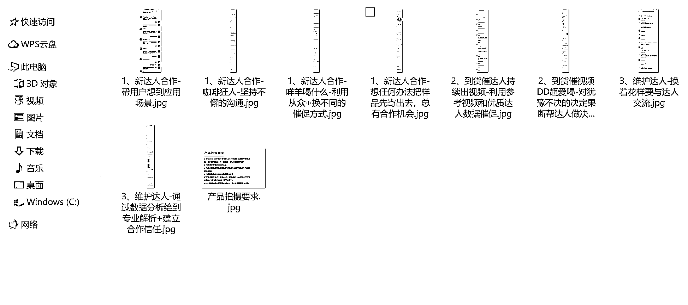

### 整理成实操手册

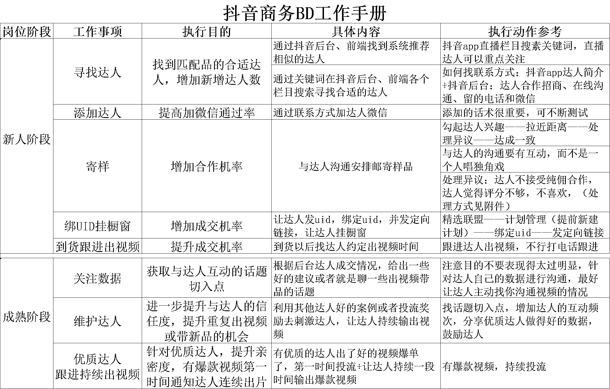

小结：
① 这是知识沉淀，新人上手快
② 管理时能清楚每个节点该做什么，纠正工作习惯

**4. 复盘：成功要找外因**

2人第一个月12万，第二个月20万。主要是平台和产品给力。两个月下来差评极少，咖啡好喝、复购高、还特别容易出片，达人自己也赚钱了。

抖音本质是内容平台，小白品在传统电商很难有这种速度。

# 二、数据好看却掉坑，店铺运营失守导致业绩断崖

**1. 继续找人，但方法要升级**

前两个月数据拉出来：Top10达人贡献了50%-60%业绩，人均出单从1000涨到1500。第三个月人均从900跌到580。

原因：
① 合作达人基数太低，单月出单达人一直卡在100左右，抗风险能力弱
② 业绩过度依赖老达人，新达人没补上来
③ 饮品垂类达人盘子有限，需要破圈

做法：
① 放大寄样范围。按店铺粉丝画像，在达人广场找跨类目相似人群，不同类目自己脑补使用场景。
我们用过蝉圈圈这类系统，能看到竞品合作达人及所属类目，直接参考他们的带货视频

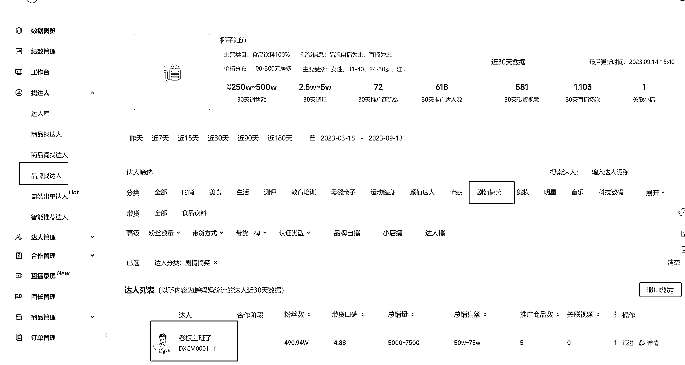

② 用官方和竞品资源找人。参加电商协会的商家对接会，认识了抖音小二，被拉进商家群和达人群，能第一时间拿到政策和选品对接信息。比如图文挂车、明星选品资源等

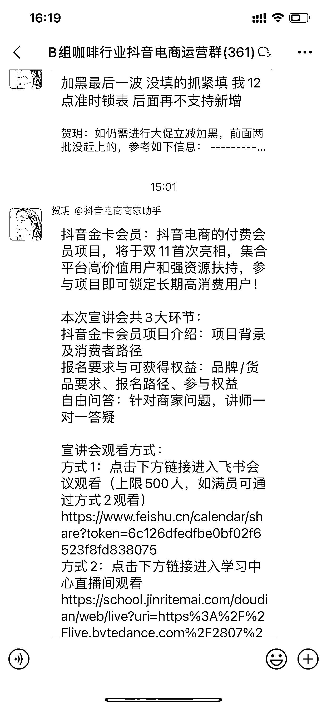

③ 达人/商务互推。跟达人、品牌商务搞好关系，让他们帮忙推荐。也可以资源互换，寄样换推荐

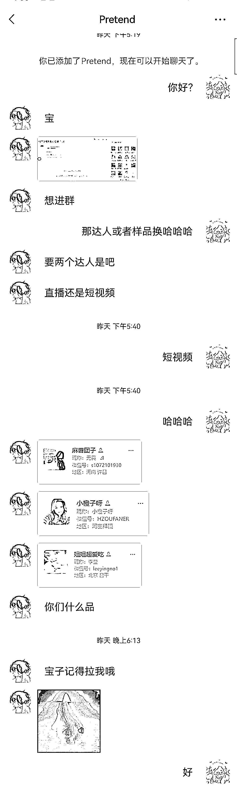

④ 跨品牌组团上头部直播间。自己还没做，但可作为思路：头部5万坑位，两个品牌平摊，或不知名品牌低价陪衬换曝光。头部带过后，中腰部更好谈。

小结：跨类目拓宽盘子，善用官方和其他品牌资源。

**2. 用激励政策推视频**

消费者认知低，需要快速曝光。没有质量就拼数量，没有数量就拼质量。

我们当时出的激励方案是...

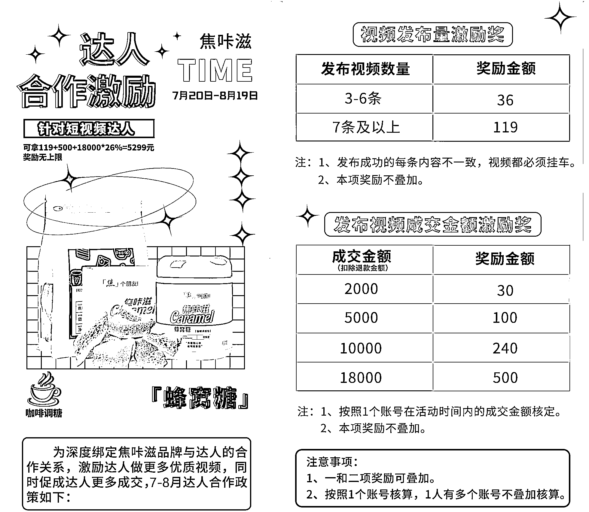

小结：活动方案要按利润和历史出单数据来定。

**3. CRM助力管理**

问题：
a、BD业绩难统计，提成算不清
b、达人越来越多，表格管不过来

方案：上CRM系统，能看每个BD的跟进情况，做过程监控和月度核算，同时系统自带达人、品牌查询功能，适合多平台运营。

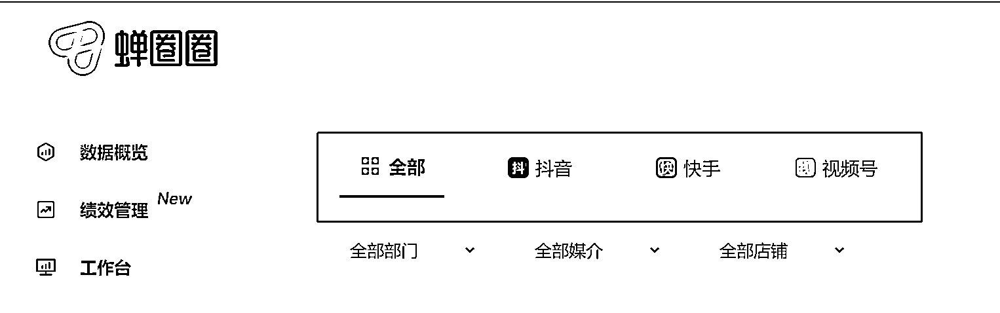

商务超过2人就可以考虑接入，市面上有不少产品，功能差异大，按需选即可。

**4. 商品链接被清退的教训**

前期只顾找达人，被数据漩涡裹挟，每天盯成交。疏于店铺管理，导致售后失控。商务同意退款时消费者选了虚假发货，20单累计导致退品率爆表，平台直接强制下线爆款链接，达人橱窗全废，店铺评分暴跌。

当时有半个月整改期，有人建议建新链接，我心存侥幸想保住老链接，结果还是被下架，后续只能重建链接推达人。

小结：
① 实时监控服务、物流、商品分，及时调整
② 问题出现立刻上B方案，确定就坚决执行

**失败总结：**
1、业绩从20万降到16万再到12万，链接被清退，执行不够果断
2、饮品赛道见顶，未找到第二增长赛道标杆
3、对内闭环太久，没及时跟兄弟单位交流

# 三、找到稳定增长路径：付费+内容深耕

**1. 工具提效**

淘宝上能买到“全自动批量达人邀约”软件，可模拟人工私信达人。1分钟1个，24小时能发上千条。我们实际每天控制在400条左右，避免处罚。用多个子账号轮换，有账号发多了会被禁链。

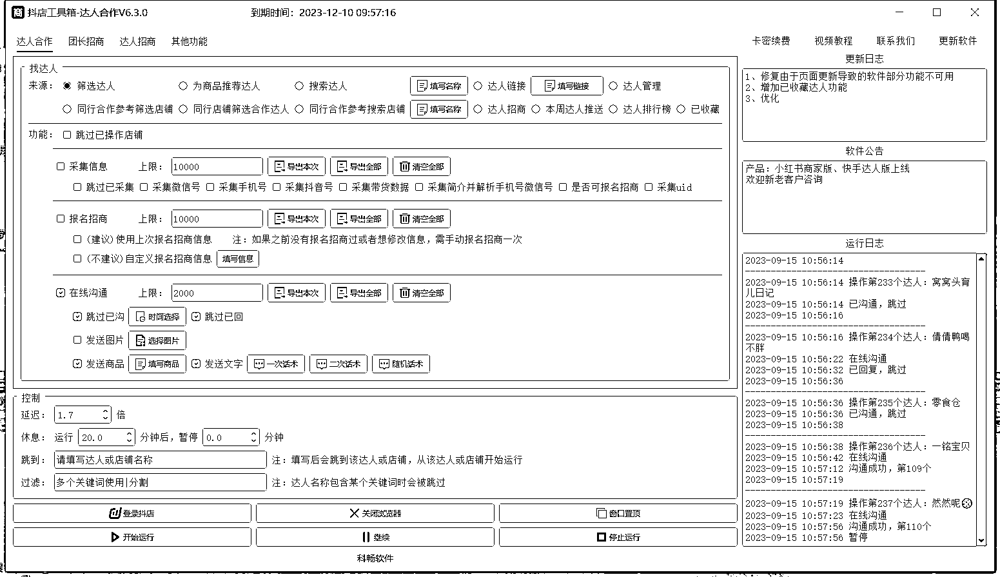

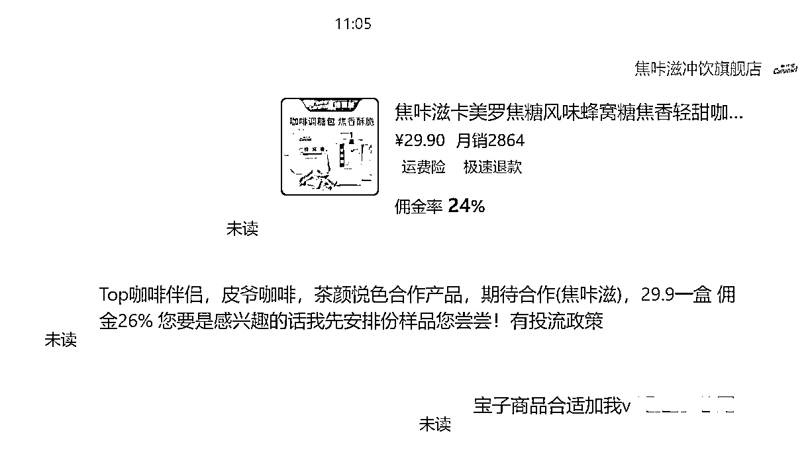

通过达人页在线沟通统一发话术，可参考

**2. 付费玩法：小店随心推+千川**

听其他团队分享后得出结论：有供应链就能用付费做稳定增长，产能可控时可动态调节投放。

**小店随心推**
策略：小额多笔，实时监控ROI，跑飞就停。之前踩过坑，觉得好的达人直接投500，结果效果差。后来按官方建议，100-200起投，同时多笔投放。

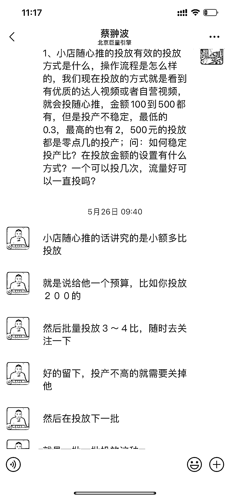

**千川投放**

做千川这件事，我们直接请了专业的投手来负责，具体投放的操作手法这里就不展开了，主要跟大家聊聊实际跑下来比较有效的思路。

我目前把千川用的素材大致归为两类：第一类是自家产出素材去跑，第二类是绑定头部达人直接用他的素材去投。

#### ① 用自家素材投放，核心在于内容生产

我们内部没有自己的拍摄剪辑团队。刚开始验证千川能不能跑通的时候，内容产出主要靠两种做法：

**a、直接从合作达人手里买素材**
先定好素材标准和要求，再从已有合作关系、熟悉产品且拍摄能力过关的达人里筛选，直接按条购买视频。省去沟通成本，上手也快。

**b、文案内部写，拍摄外包**
外面的拍摄团队需要磨合期，对产品理解可能不到位。所以我们的做法是内部先出文案框架，再交给外部团队执行拍剪。这样效率更高，最终成片也更贴合品牌调性。

#### ② 深度绑定达人，用他的账号和素材一起做投放

去找之前合作过、视频质量稳定并且带过成交的优质达人，让达人持续产出视频，然后通过千川绑定达人账号投放他挂车商品的素材。这里成本要算清楚，达人佣金加推广费都是开支，我们一般会通过下调产品佣金的方式来保证投放合作的可行性。

注：千川投放一定要算好投产比，招投手也别盲目相信对方的宣传，能投多少钱能出多少业绩，用结果说话。投手的水平基本都是靠实操的资金喂出来的。

小结：千川的放大逻辑里，素材是第一位。既要保证数量跟得上，也要保证质量能打。现在市面上的素材同质化太严重，很难持续放量。

**（3）对接头部KOL**

资源来源主要靠平台小二给的对接，或者品牌间的互相推荐。最近我们也在接触三只羊的团队。头部资源一般要么预算高，要么合作机制低，一定要先算清账，看看是否真的能盈利。三只羊是有自己的切片团队的，如果算下来要亏，宁可不做。

这里也提醒一下防坑：市面上有些公司自称是某一二线明星的直属团队，可以纯佣合作，品一旦被选中，签约时却要求交6万保证金，而且签约主体也不是明星本人的经纪公司。

小结：
① 目前我们接触了2-3个KOL，因为产品本身消费者认知度偏低，达人也会做对比，直播间同样2分钟讲解，哪个品能带来更高GMV就选哪个，所以不少产品都被拒了，现在主要在等三只羊团队的审核反馈。
② 我们在KOL商务对接上还比较初级，跟同行聊下来才知道，这块非常考验商务的公关能力。很多有意向的达人对接，会直接去达人公司现场沟通，甚至合同里的保价机制、细节条款都要抠得很细。

**（4）总结：抓大放小，用资金杠杆快速放大**

1、当现金流允许时，千川是最直接的放大器。素材消耗速度很快，流量衰减也快，所以内容生产必须快、必须持续。
2、可以适当放权给商务BD，让他们去主动接触KOL，提前把合作机制和预算框架定好，用一部分持续预算让产品保持曝光。

# 写在最后

分享下我从完全小白到现在有点心得且拿到初步结果的心态变化：

1、面对新领域，恐惧是正常的。我是靠成长型心态和好奇心在驱动自己，无论是想赚钱、想扛责任还是想达成成就感，都能成为推动力。想象一下拿到成果的时刻，回头看现在这些困难都不算什么。

2、遇到挫折和自我怀疑是常态。我的解法是先抽离一下，跟朋友聊聊或者安静看场电影，然后回到问题本身，只聚焦当下最关键的3个待解事项去解决。

3、我觉得成功的核心是愿力。成功 = 100%的意愿 + 0%的方法。方法固然重要，但当你有无论如何都要达成的决心时，方法自然会找出来，方法在意愿面前就不值一提了。

* * *

* * *