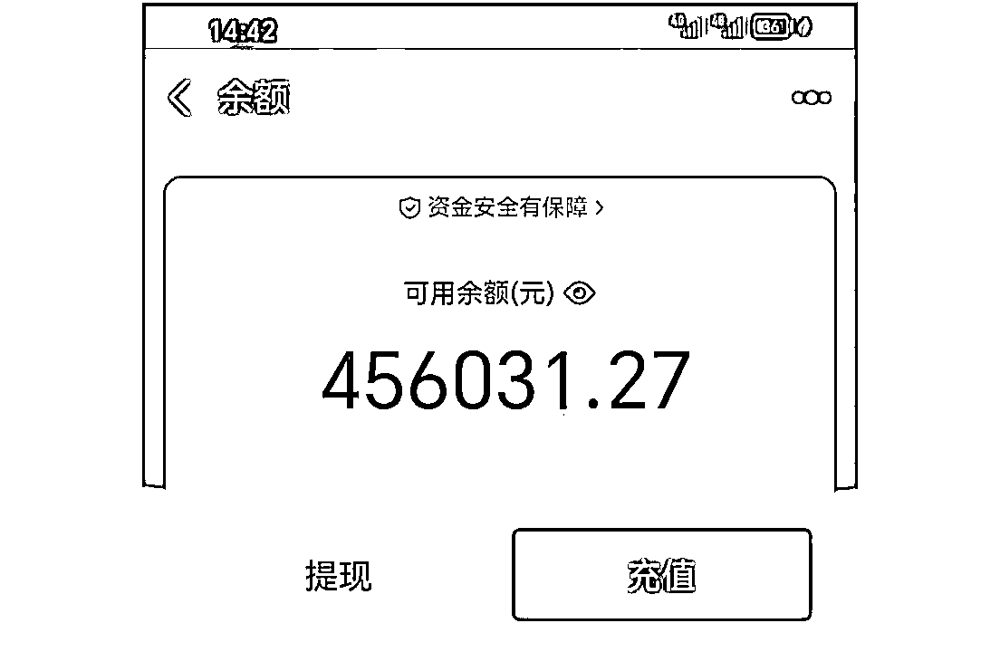

# 从零到年销1500万：一个抖音同城房产号的真实翻身记录，单号月入30万+是如何做到的

## 新手也能玩转抖音同城，房产号一年卖出1500万，单账号创收超30万的实操全景

作者：鑫哥同城
日期：2023-10-07

在当下楼市环境并不友好的大背景下，我是如何靠一个本地房产抖音账号起盘的？起步阶段，前两个月直播间和评论区几乎零线索，整整一年下来却完成了1500万的成交额，单月最高提成冲到12万，单个账号累计变现超过30万。

赚钱的朋友们好，我是龙哥。互联网这边我摸爬滚打了三年，最近这段时间重心都放在短视频本地化变现上，成绩还算可以。今年6月经群里的孙悦伟介绍进入赚钱，在风向标上也聊过几次同城项目的玩法，反响不错。这次第一次用文章的形式把自己做本地账号的经历系统地梳理出来，给正在找方向的伙伴们一些参考，也算给自己一个压力。

我的第一个同城房产号是2021年3月开始启动的。**后面稳定下来后，一个账号每个月能沉淀500多组精准意向客户，最高一个月佣金12万，账号总收益做到三十多万，顺带带动身边的几位小伙伴一起，团队累计佣金过百万元。**这套打法到现在依然有效，而且迁移性很强，放到本地的其他垂类项目里同样能快速产生现金流。

下面我就从头捋一遍：抖音如何批量抓取本地需求、如何把流量转化为看房线索、以及这套方法论如何复制到多个同城账号上的实战过程。有本地资源、想做内容变现的朋友可以重点看看。更详细的复盘拆解我放在了飞书文档里：

* * *

评论区：

龙哥 : 优秀

书豪 : 优秀

禄 : 优秀[强][强][强]

哪吒 : 优秀

* * *