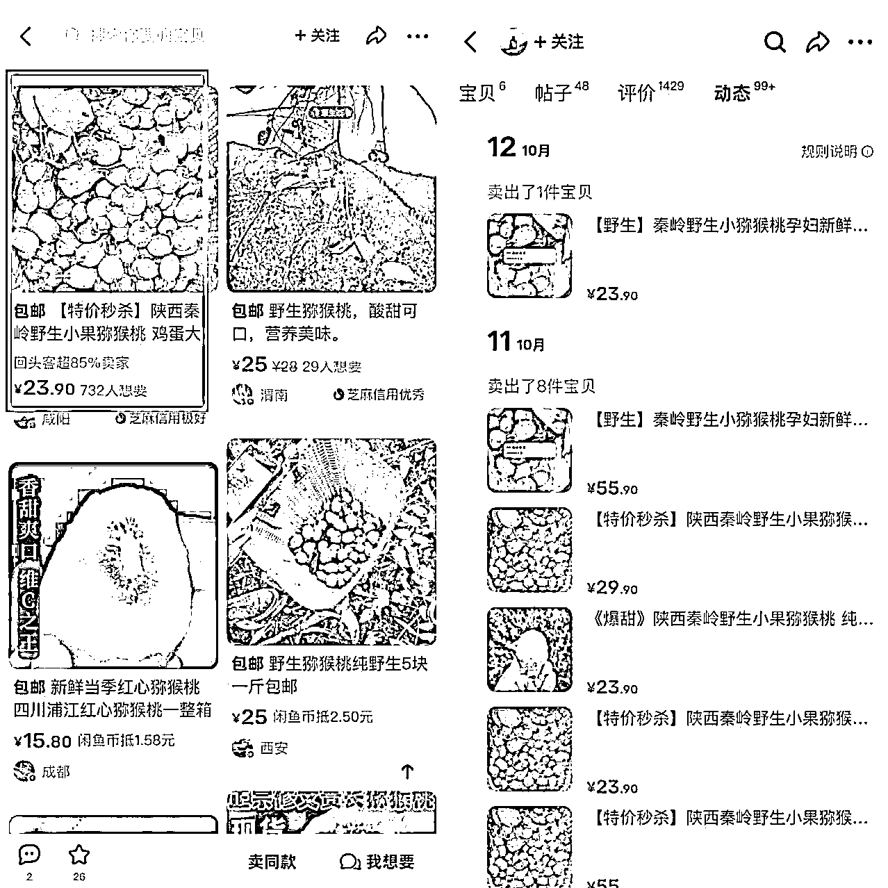
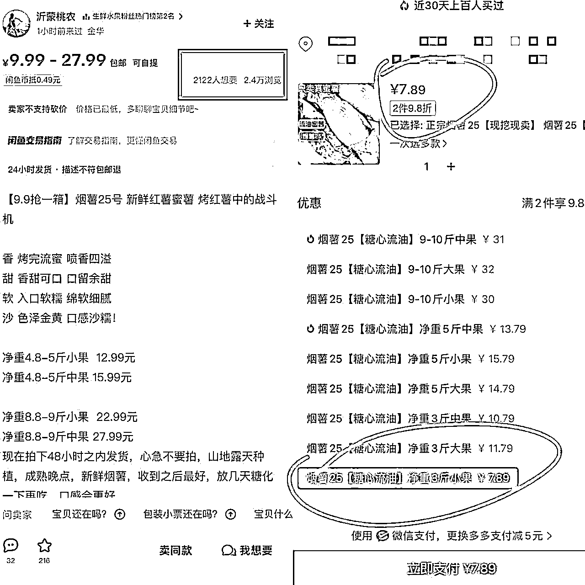
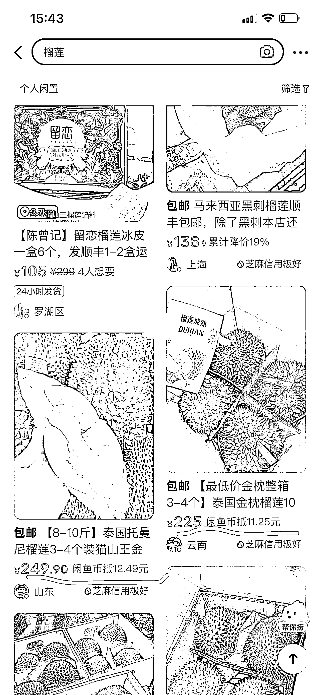
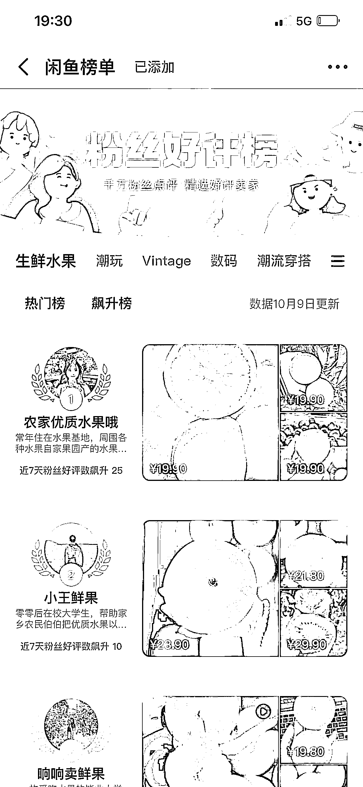
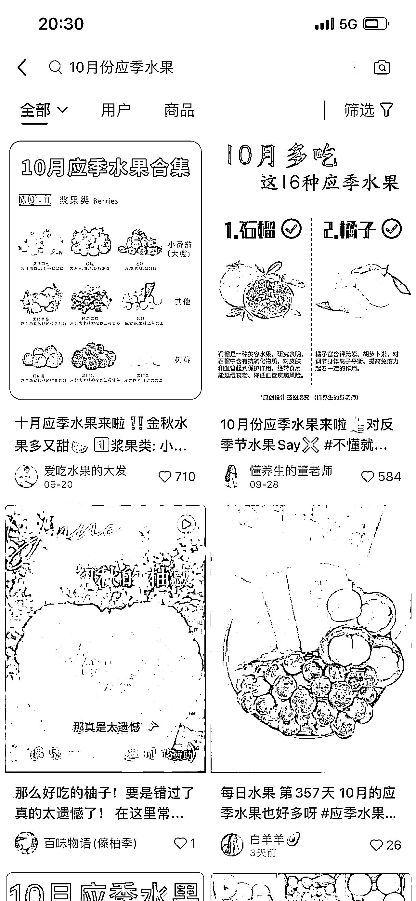
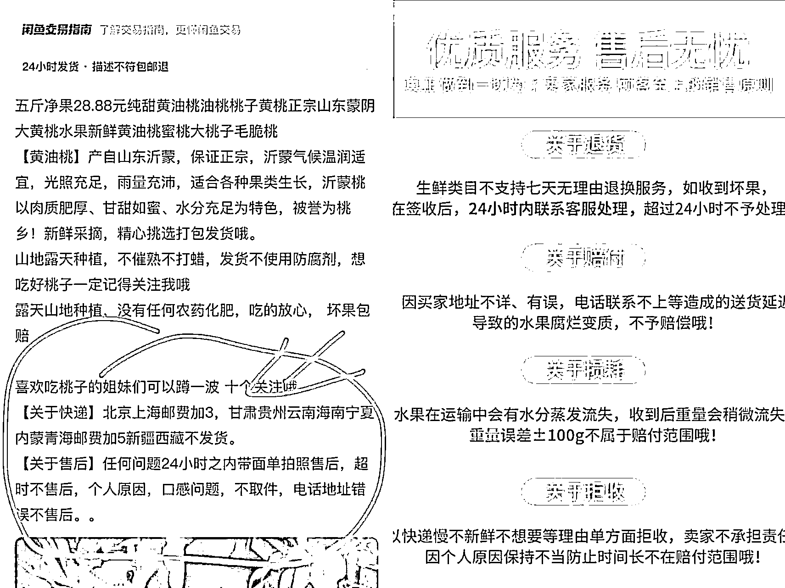
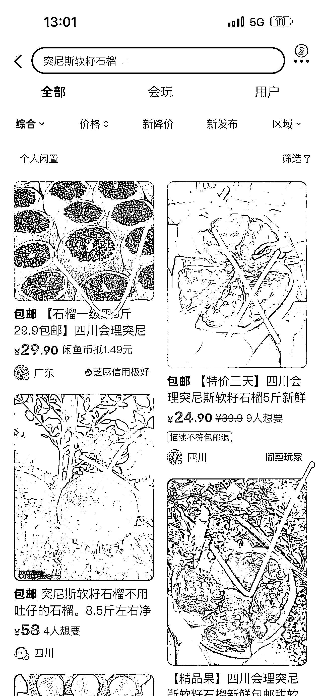
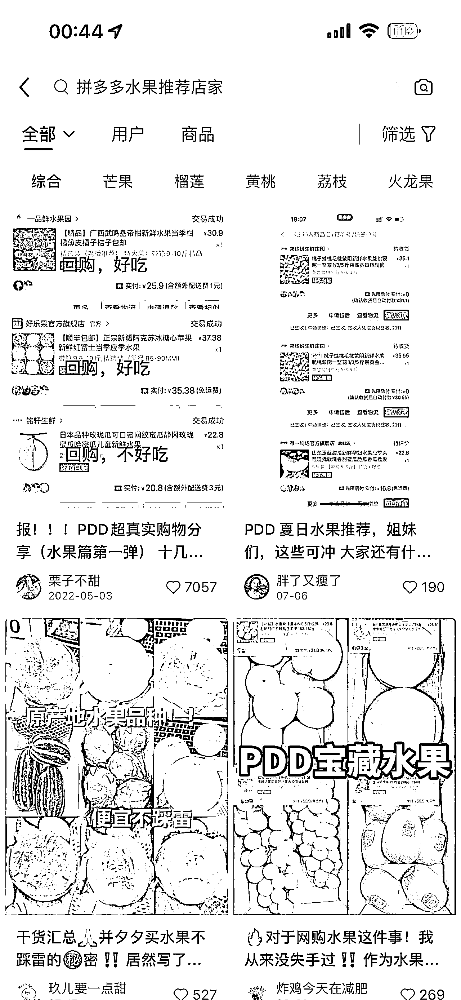

# 闲鱼不出单？别急着放弃，这个品类新手也能快速破零
作者：龙哥

很多刚玩闲鱼的朋友都来跟我诉苦：选品选到头大，上架好几件商品，结果连个咨询都没有，更别提成交了，完全找不到坚持的动力。

今天我就给大家分享一个亲测有效、特别适合新手练手的品类——水果生鲜。只要按方法执行，大概率一周内就能开张。我们内部学员测试时，通常上架一两天就有订单。虽然这类产品利润不算高，赚的是零花钱级别，但用来熟悉平台、建立信心非常合适。等跑通一个号，再复制到多个账号，整体收益也相当可观。

为什么推荐水果？因为它自带应季属性，又是大家日常高频消费的东西，完全不用担心买家问你产品细节时答不上来。当然，生鲜水果免不了有坏果损耗，这个在后文也会告诉大家怎么尽可能规避。

## 货源去哪找？

不用想别的，直接去拼多多。无论是坏果补差价，还是全额仅退款，拼多多在这方面最省心，其他平台售后容易扯皮，处理也慢。

## 第一步：找到值得抄的对标链接

无论做什么玩法，第一步都是找同行。重点要选那些已经在稳定出单的链接，不然没有参考价值。比如人家5斤装猕猴桃卖23.9，每天销量稳定，这个链接就可以拿来研究。同款货源在拼多多一搜一大把。

9.9包邮的定价往往更吸引眼球，转化也更高。虽然20元以上是利润款，但9.9并不代表不赚钱。比如5斤小果烟薯卖9.9，拼多多拿货只要7.89，中间还是有空间的。

所以一定要先去看大多数同行怎么定价，选一个客户最容易接受的价位，别自己拍脑袋乱标。

当然，也不是所有水果都得卖低价。闲鱼上也有走精品路线的，比如榴莲这类高价水果。这时候同样参考同行，不是越便宜越好卖。

### 怎么知道每个月卖什么水果应季？

1. 看闲鱼榜单，能给你选品灵感。

2. 去📕搜“X月应季水果”，全是现成答案。

## 第二步：图文直接抄，但要注意这些坑

文案方面：大胆抄同行，千万别自己瞎编。比如“可以做罐头”“做水果干”这类词，没有相关认证是容易触发违规的。

还有很关键的一点：**文案里一定要做好售后说明**。找对标时优先找那种写清了售后政策的，如果对方没写，你就自己补上，或者九图里放一张售后说明图。不然真出了坏果，你是说不清的。

图片方面：不需要实拍图，越“假”反而越吸引人。最好用那种仓库图、产地实拍图，或者水果看起来特别多汁鲜艳的图片，点击率会高很多。

## 第三步：怎么挑供货商

第一步我们参考了同行的售价，那现在只要拼多多上有比同行更低的价，就可以当供货商。别太纠结货品质量——水果这东西，就算你跑到原产地，也没人敢保证百分百无损。

正确的做法是：多下几单。因为拼多多上很多水果的第一单都是引流底价。多店下单，同时记录售后情况，等到出单量大了，再去找靠谱商家谈长期合作。

关于价格，大家可以随手搜一下，拼多多基本就是全网最低价。

### 怎么找到售后少的店？

咱们不可能每家都买来试。最简单的办法：去📕搜水果种草笔记，看评论区素人真实反馈，一般不太会踩雷。另外，带“百亿补贴”标识的店铺可以优先考虑。

## 第四步：记得开通鱼小铺

鱼小铺的优势在于能设计规格，也方便客户自助下单。之前我建议过店铺有流量就别乱开鱼小铺，但水果生鲜除外——只要你收到邀请，哪怕现在有流量也直接开。

不用担心断流。这类日常消耗品，就算流量掉了也很容易再做起来。每天记得完成“闲鱼鱼币推广”的任务。

另外，一定要开启“24小时发货”和“描述不符包退”的保障。

## 第五步：做数据、人工干预

用自己小号下单，不仅能增加销量数据，还能顺手改产品的定位和价格。后期可以把链接的定位改到水果的原产地，这样看起来更可信，也更容易获得信任。

## 第六步：引导关注店铺

每个链接都要记得引导用户关注你的闲鱼号，争取做到千粉，开通“玩家”身份。如果店铺做得不错，还可以办个营业执照，这样能卖的产品种类会更多，比如茶叶、酒类，利润空间也更大。

这里提醒一下：没有证件只能卖初级农产品。初级农产品指的是种植、畜牧、渔业产品，没经过任何加工，只做自然或风干处理，这些才能上架。带预包装的食品千万别卖，违规。

## 常见疑问解答

**问题一：做垂直品类好，还是杂货好？**

高价水果建议垂直深耕，低价水果可以走杂货多链接策略。

**问题二：一天最多上架多少？**

我的建议是每天不超过5个水果链接，不用贪多。

## 高阶玩法：把客户变成私域资产

光靠卖水果赚的钱可能不算多，但水果是非常好的引流入口。客户收到货后，你可以用“每日抽奖”之类的活动，把他们引导到🛰️。之后再卖什么、做什么项目，这批客户都是你的潜在用户。

整套操作简单易上手，不用太多复杂技巧，想试的朋友尽管去干。

* * *

评论区：

暂无评论

* * *