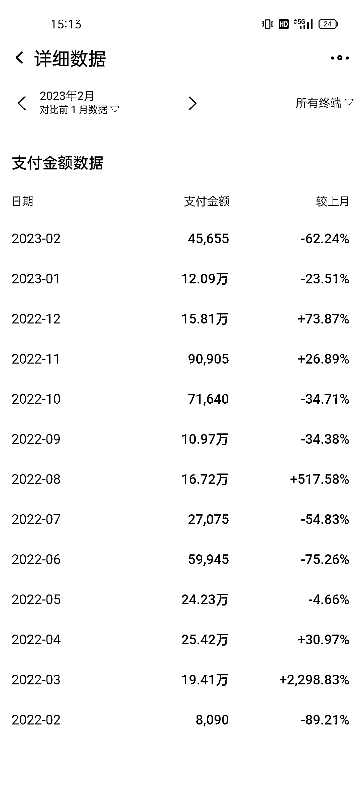
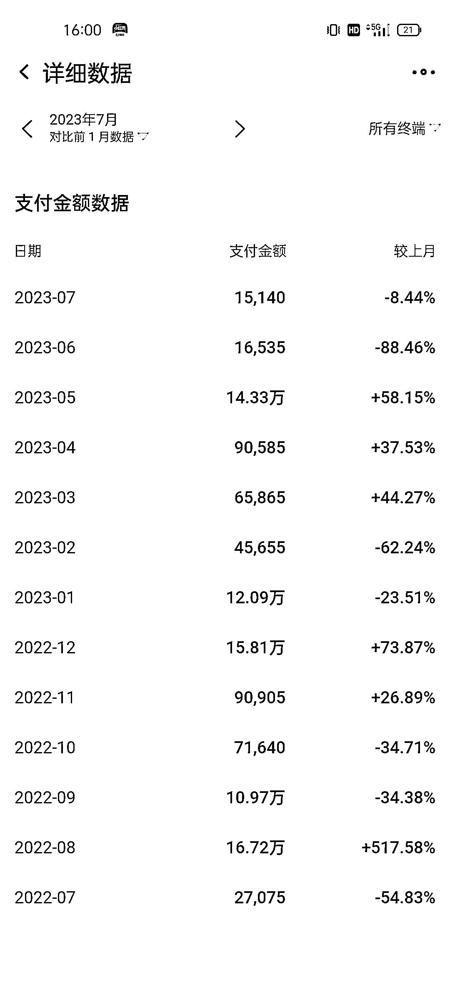
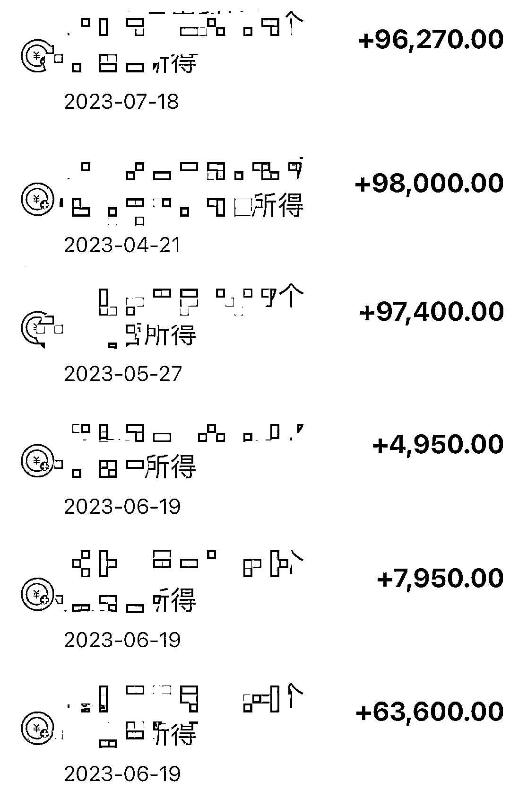
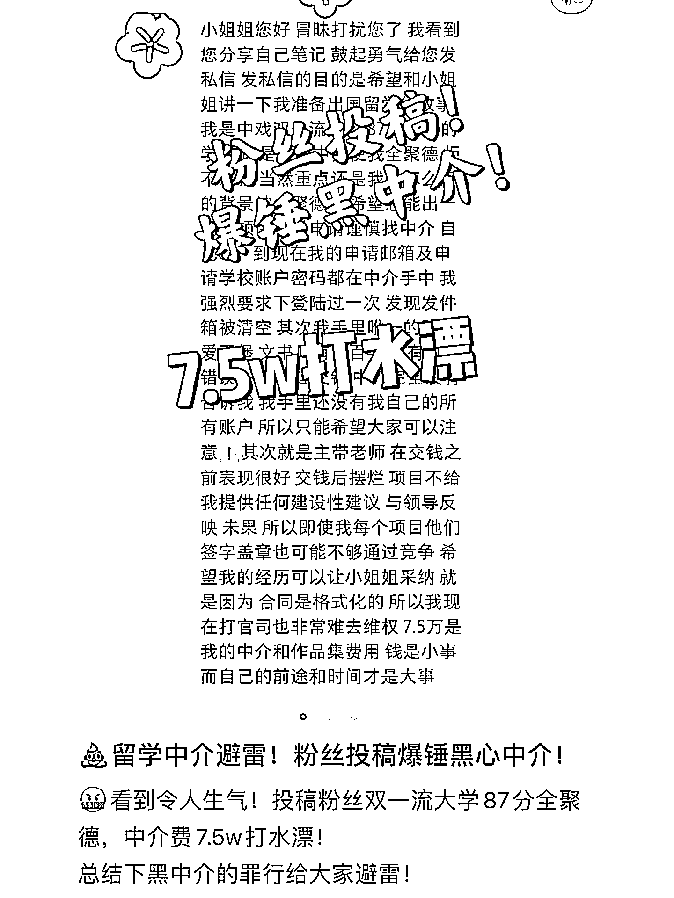

# 小红书教育赛道做到年GMV1600万，小团队如何实现？这里有一份完整心法

大家好，我是珍妮，目前正和赚钱圈的陈铭Ivy一起搭档创业。我们长期扎根教育行业，核心方向是留学服务。2022年，我们协助一家机构完成了1500万的GMV，自己运营的业务也跑出了160万+的GMV。更关键的是，截至今年8月之前，整个团队只聚焦小红书这一个平台，业务也只保留了A、B两条线：A业务配置了3名全职和1名兼职；B业务则是1名兼职、2名外教全职，再加上N名中外临时工，算上我和Ivy，核心团队总共也就9个人。

下面把文章的核心框架列出来，方便你按需查找相应板块：

1. 留学赛道到底有哪些业务类型
2. 怎么找到留学行业的对标账号
3. 矩阵号和IP号分别应该发什么内容
4. 矩阵号内容如何批量规模化生产
5. 后端流量如何高效转化
6. 如何看准人、招对人
7. 小红书平台今年的高频问题与应对方案，比如：
   - 一模一样的图片能不能反复发？
   - 同样的图片和文案，可以重复发吗？
   - 爆款内容一定要选最近的时间吗？
   - 封面被用户看腻了，换封面后曝光依然下滑，怎么办？
   - 账号总被封，每次养起来又没了，如何破局？
   - Midjourney怎样辅助教育领域获客？
   - TikTok又怎么为教育业务引流？
8. 我对留学赛道现在及未来走向的看法

在这里，我要特别感谢Ivy：没有你，我可能还在被社会反复捶打，最后只能回乡镇当老师；没有你，也就没有今天的业务。这些年非常感谢你的点拨、指教与陪伴。

也要感谢靠谱，正因为有你，这篇原本零散的素材才能最终成型，变得有体系；你推荐的营养美学让我整个孕期都状态在线。

感谢叶叶，你是这一切的起点。两年前那次盖洛普优势点拨，引领我们一步步走到今天。

还要感谢赚钱这个大家庭，以及赚钱团队的每一位伙伴，为我们提供了这样优质的学习交流平台。

原文篇幅比较长，大家可以直接点开下面的链接阅读全文。

[`t.zsxq.com/12tvEOFgZ`](https://t.zsxq.com/12tvEOFgZ)[`wfftwwt027.feishu.cn/docx/C5SedRs3LoSnOex9xDFc9Cvgnff?from=from_copylink`](https://wfftwwt027.feishu.cn/docx/C5SedRs3LoSnOex9xDFc9Cvgnff?from=from_copylink)

评论区：

梁靠谱 : 珍妮 ivy 牛逼  
珍妮子 : 感谢谱子！！！❤️❤️❤️  
芷蓝 : 太牛了  
珍妮子 : 感谢芷蓝姐！！！❤️❤️❤️我在玩赚受益很多！！  
哎呀妈 : 好棒哦~  
珍妮子 : 感谢感谢！❤️❤️❤️  
胜遇 : 牛呀牛呀  
阿甘｜豪华车买手 : 太厉害了

