# 亚马逊低量级的 季节-节日性产品玩法
作者：龙哥

这两年我一直在琢磨一个事：怎么用小成本、轻投入，去啃下亚马逊季节性节日这块蛋糕。试了一年多，确实赚到了一些钱，不算多，但最大的收获是把整个玩法的路径给跑通了。今天就把我的真实经历和踩过的坑，一次性分享出来。

开门见山，这个方法不适合把亚马逊当副业的人。

为什么？因为做节日产品需要投入不少心力去研究，不是简单花点时间、动手上架就能出单的。它需要你静下心来做功课，而且有很多延伸操作可以打磨。如果你只是想找个副业赚点零花钱，这个方法可能不太友好。

我真正的目标是什么？

是通过一个个节日，去沉淀买家在特定场景下的偏好和购买习惯，越来越懂他们想要什么。然后把最小可行产品（MVP）跑通，接着复制放大。

启动前需要准备什么？

第一，你要有一个非美国的亚马逊账号。第二，如果做墨西哥、阿联酋、沙特这些站点，得先把当地增值税号注册好，不然没法正常卖货。

接下来，我会从六个维度把这套玩法拆给你看：季节性产品的天花板、它比常规产品的优势、我交过的学费、可以切入的差异化角度、非美国市场的实操路径，以及这些市场的隐藏红利。

# 一、节日产品天然有天花板

## 1. 销售窗口极短

季节性产品的主力售卖周期，通常只有两周到一个月。拿情人节、复活节、母亲节来举例，看它们的搜索流量曲线就一目了然——数值越大，代表流量入口越多。

母亲节：

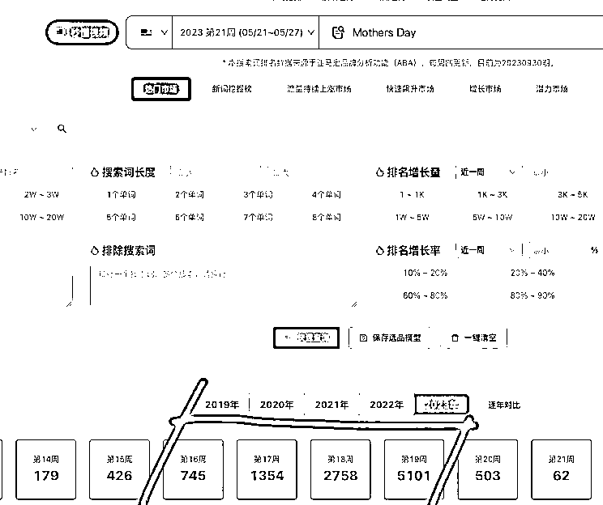

复活节：

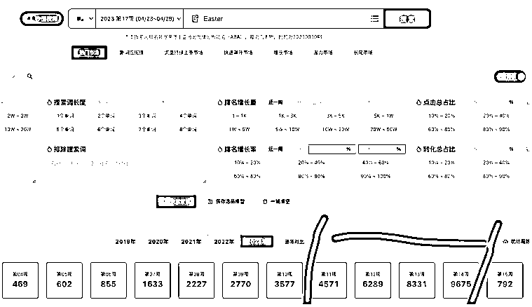

情人节：

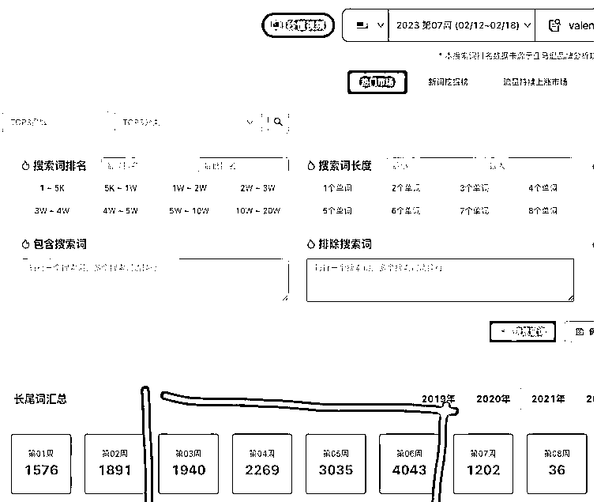

从这三张图能明显看到，情人节的流量爆发期是三兄弟里最长的，上千搜索量的周期能维持好多周；最短的是母亲节，接着是复活节。

消费者买节日礼物的习惯也不一样：情人节很多人会提前好几周就开始挑；母亲节则集中在三周内集中爆发，而且越靠近节日那天搜索量越飙得厉害。

大致算一下，真正的黄金销售期是节日前2到6周。

常规日用品没有明显的淡旺季，一年到头都能卖；可节日品一旦过了这几周，想再等下一波，对不起，请等明年。

## 2. 投入成本和回报比

23年上半年，我试了两个节日：复活节和返校季。

每个节日的采购成本大概两万块左右。复活节赚了一万六，但加拿大和美国两个站点亏了；返校季赚了一万九。两个节日加起来，净赚三万五。

说实话，这钱不算多，但关键是——我花在开发、备货和运营上的时间精力并不夸张，却能换来这些收获。更重要的是，这是一个积累方法和经验的过程，每一轮尝试都在为下一步扩容铺路。

# 二、为什么我偏爱季节性产品？

## 运营层面的优势

### 1. 流量大，推起来不费劲

风口上的猪都能飞。节日期间需求集中爆发，广告稍微一推就能起来，不用像常规品那样费老鼻子劲。

### 2. 一年只竞争一次

你只要跟当年的链接pk就行，不需要一年到头去卷评价数，运营负担天然少了一块。

## 产品开发层面的优势

### 3. 主题突出，人群明确

母亲节、父亲节、返校季、万圣节、圣诞节、复活节、情人节、斋月……每个节日都有非常清晰的场景、人群和热销元素。这时候做差异化定位，方向比常规品好定太多。

### 4. 反馈周期短，迭代快

我做复活节，1月下单，3/4月就能看到结果，最长也就4-5个月拿到市场反馈。小团队一年能打3-4个节日。通过主题鲜明的产品，你能快速验证自己的开发逻辑，不断沉淀对差异化的理解。

### 5. 售后压力小

万一差评多，第二年重新做个新链接就行。当然不是说不用管售后，只是亚马逊的售后相对简单，关键在于前期把关质量、把包装做好，更要紧的是把产品定位做对。

# 三、我踩过的坑，希望你避开

## 开发产品上

### 1. 抄上年爆款，换个站点卖

以为把美帝去年的爆款搬到加拿大、墨西哥就能赢，想着自己本地发货有优势。结果发现，产品还是那个产品，根本没啥优势。

### 2. 不做差异化

做产品的第一铁律：没差异化，同质化就是死路一条。

### 3. 人群定位偏了

没认真做产品分析，也没分清主次人群，把宝押在了一小撮人身上。比如返校季，主要购买者是适龄小学生家长，我却去赌幼儿园小朋友的市场，结果自然凉。

## 运营节奏和时间上的坑

### 4. 不拿样就直接订大货

后来想改都难，太草率了，眼睛大漏看眼——这是性格缺陷，得改。

### 5. 开发时间没排好

导致只能走空运或快船，成本猛涨，销售时间也被压缩，操作弹性所剩无几。更惨的是，如果只剩一两周的销售窗口，竞品早就占住首页，我还在第18页挣扎。这时候急也没用，只能猛砸广告；但如果广告策略不够清晰，竞品遥遥领先，砸进去的钱多半也是薄利。

### 6. 忽略最大流量词

没把流量入口好好梳理一遍，再大的流量也找不到你的产品。这跟第4点一个毛病，都是不够谨慎。

### 7. 滞销就是压一整年

节日品一旦卖不动，就要在仓库存一年，压的全是钱。

# 四、差异化才是活路

要做好季节性产品，最重要的一步就是开发有差异化的产品。这个差异化远不只是产品本身，可以从这些角度切入：

### 1. 价格差异

从成本、包装、头程运费每一环去优化，做出价格优势。

### 2. 渠道差异

站外推广和站内推广都可以做，关键在于你选什么关键词、出什么价。

### 3. 站点差异

不一定要挤美国，加拿大、墨西哥、澳大利亚、中东这些新兴站点都值得看看。

### 4. 推广差异

这些非美国但潜力上升的市场，广告费比美国便宜太多。

### 5. 套装产品

套装是个很有弹性的方向，可以做现货组合，也可以做定制套装，主要是玩供应链管理的差异化。

# 五、我的具体打法

目前我最大的差异化，就是市场选择的差异化。

### 第一步：定位战场

我选的是非美国市场——阿联酋。

### 第二步：锁定跟自己资源匹配的节日类目

把亚马逊后台数据库（ABA）往年同期的热销数据全部拉下来。

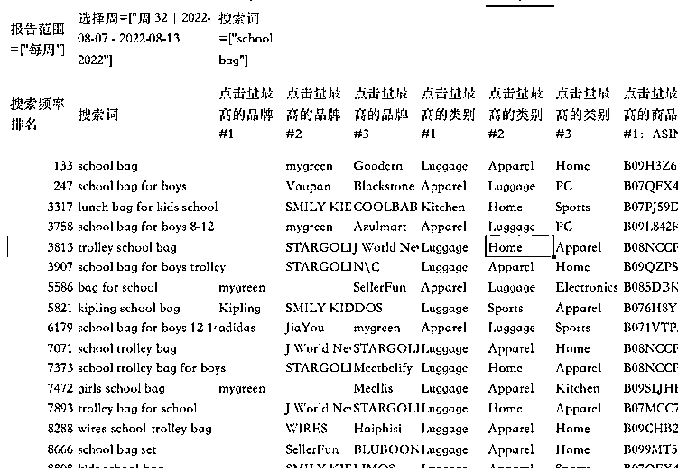

ABA里能看到当期点击最高的三个ASIN，以及整个搜索词库。把这段时间的热销产品、热销类型/系列摸清楚，看看有没有集中的机会。

### 第三步：具体怎么操作？

比如我在阿联酋搜“school bag”：

#### 1. 先看现在首页是什么款式

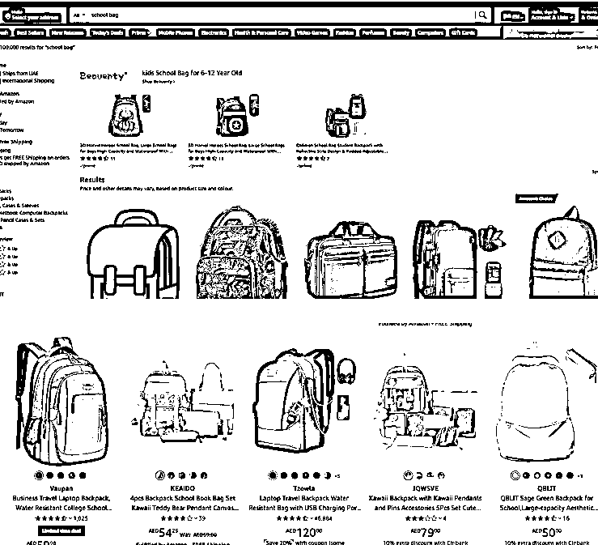

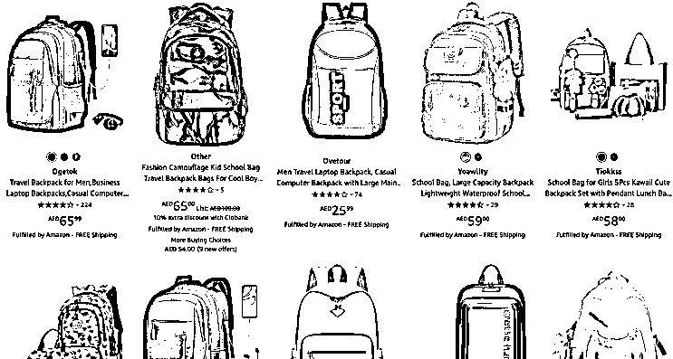

#### 2. 再用ABA榜单，去查往年这个时间点是什么款式

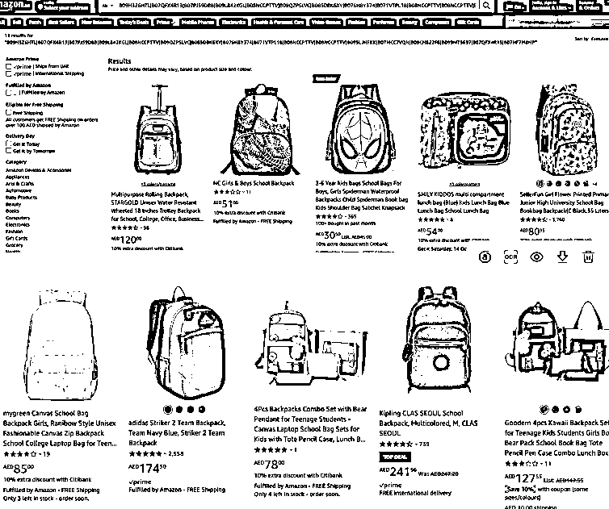

#### 3. 对比近期的类目热销榜，看款式是否集中类似，有没有延续，有没有新变化

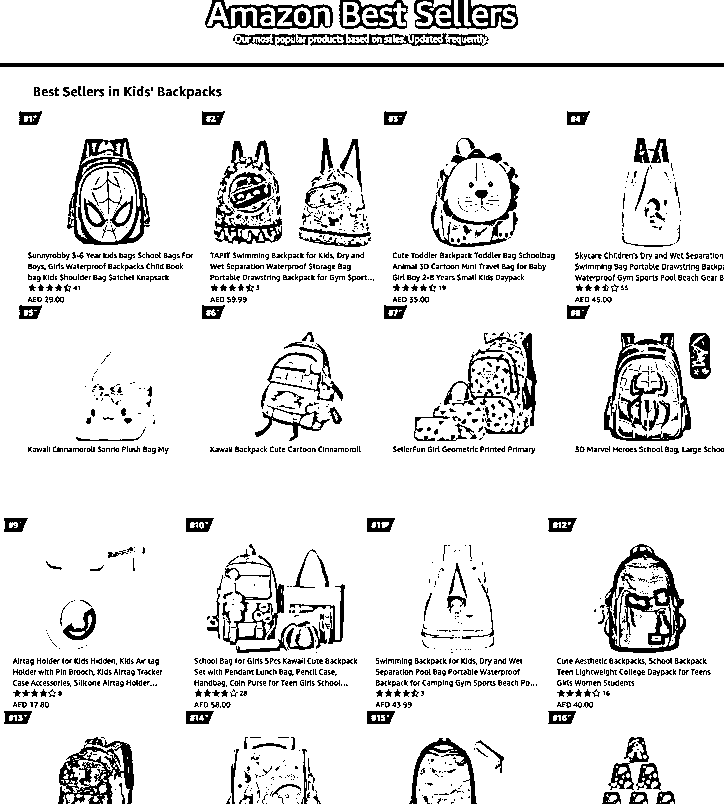

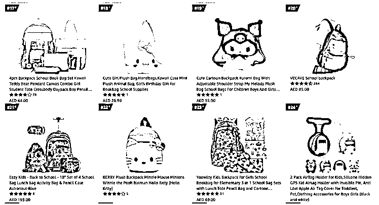

#### 4. 再用关键词去前台搜一遍，看当前排名和热销类目的产品形态是不是一致的，是延续了去年，还是已经有变化

#### 5. 综合这些信息，围绕以下几点来定位产品方向：使用人群（性别、年龄）、产品功能、使用场景、热销元素、采购成本。

这时候不光要定人群，更要从功能、场景、元素里挖掘差异化的购买点：

- 这产品能不能解决某个特定问题？
- 在某个特定场景下被需要？
- 用户会不会为了某个特定图案而掏钱？

#### 6. 用其他类目去验证这些元素有没有被热卖过

举个例子：儿童独角兽书包，同样的独角兽图案能不能用在儿童衣服上？——这是热卖图案的迁移，人群类似。

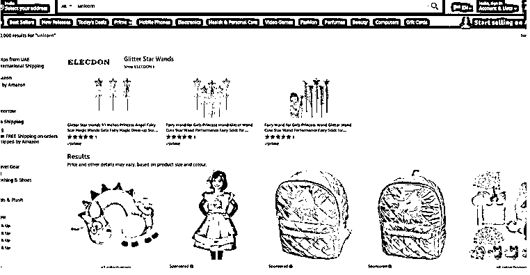

《芭比》电影里的衣服，能不能做成现实里的cosplay？——这是热点的迁移，受众类似。

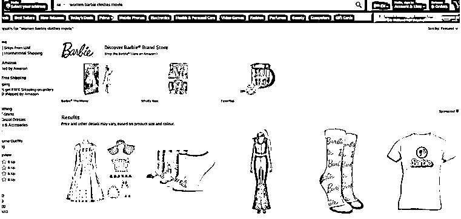

婴儿有小推车，小狗能不能也有小推车？——这是功能的迁移，场景类似。

（婴儿车英文是stroller，不是baby car……）

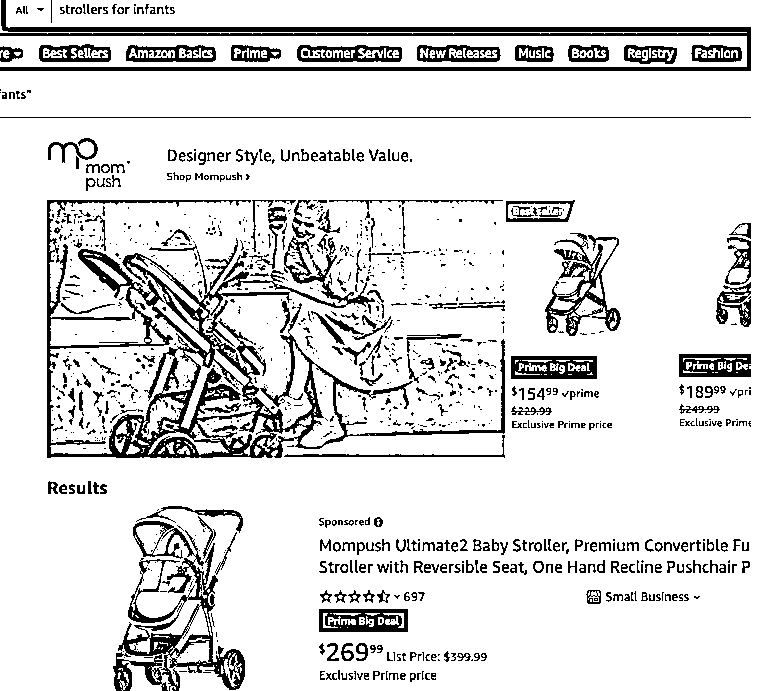

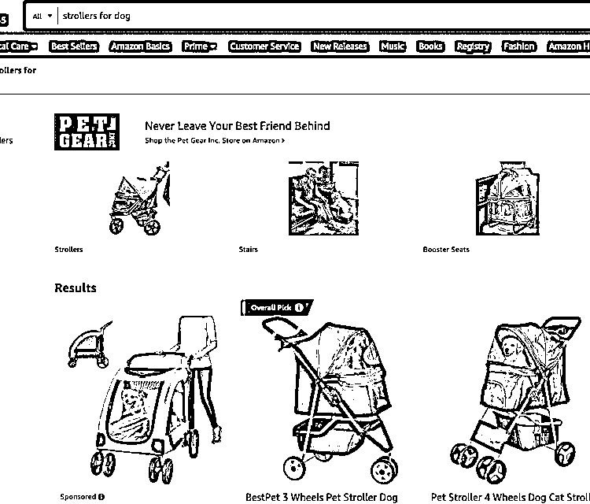

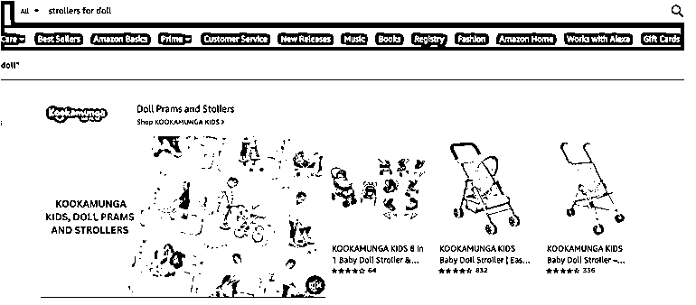

# 六、为什么用非美国市场来练手？

因为它有利润，而且利润很香。

### 1. 竞争低到不可想象

低到什么程度？你用现货，稍微改改做差异化，就能卖起来。有点像美国亚马逊早期的卖方市场，人人有机会。

### 2. 利润特别高

尤其在中东。卖一个，能赚两个的钱。土豪消费力强，对价格不那么敏感。

### 3. 天花板低，但试错成本也低

别老想着挣大钱，验证思路才是第一位的。正因为试错成本低，你完全可以小批量、多频次去测试。

### 4. 尾程运费也便宜

因为各国货币比美元便宜！我同一款产品，美国的尾程运费占售价30%起步，在阿联酋只要17%起步就能搞定。

# 最后说一句

产品，永远是无数个零前面的那个“1”。

从0到1的阶段，拼的是产品数量和你有多努力；想成为有稳定收入的小卖家，拼的是优质产品的数量。

希望我的分享能给你一点点启发。我也希望自己能把这套打法继续复制下去。

加油！

呀哈比比，我是谭lucky。

