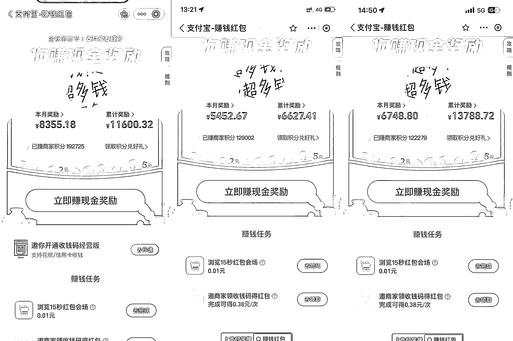
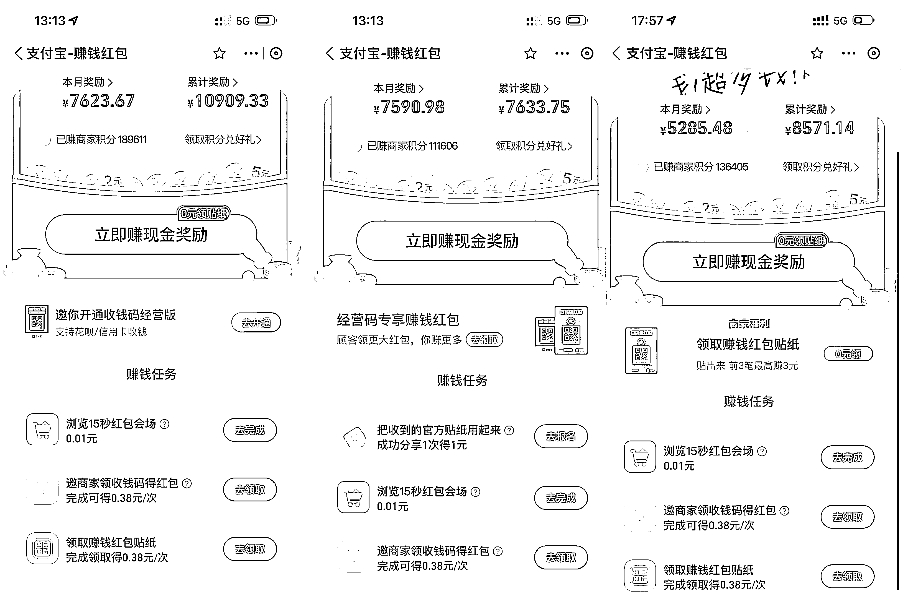
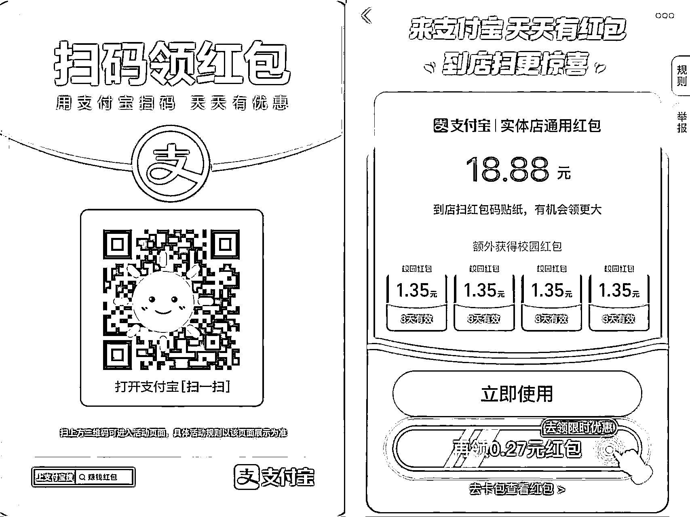
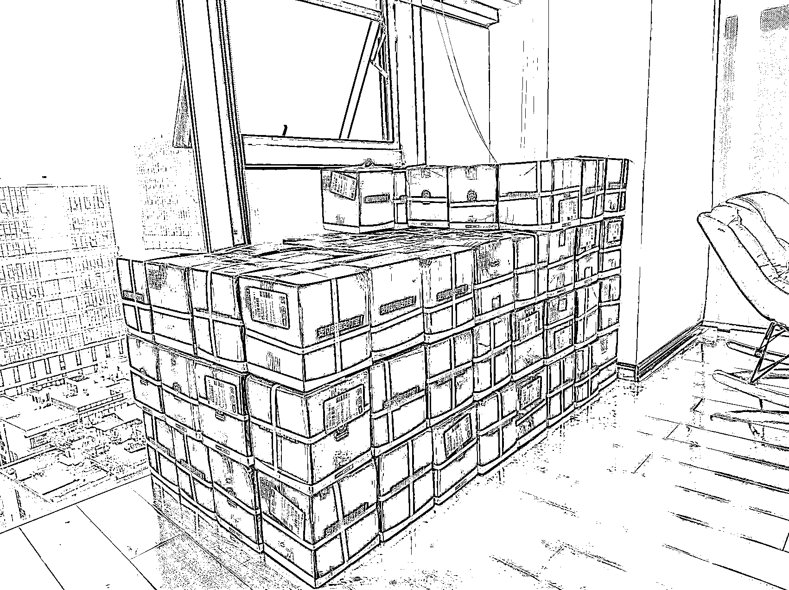

# 支付宝赏金复盘——私域流量如何运营才能实现收益最大化

刚刚结束的国庆假期，正好可以静下心来，把节前那波支付宝赏金活动的实战经验做一次完整复盘。希望这次总结能给大家带来一些不一样的启发。

先介绍一下背景：我们公司在郑州，一直专注私域流量的全链路操盘，包括引流、运营、转化和变现，主营业务是淘客和外卖CPS。

很多人问，为什么我们死磕私域？因为现在各平台的获客成本高得离谱。打个比方：

- **公域流量像自来水**——付钱就有水用，停费就断供，谁出价高谁拿量。
- **私域流量像井水**——打井要花大钱，但井打好了，用水不再付费。以前自来水便宜，大家懒得打井；现在水价飞涨，越来越多人才意识到：这些年交的水费，都够挖好几口井了。

这口井，就是私域。

**私域，就是那些你自己拥有、能反复免费触达的用户。**

但有了私域，是不是就能随便“轰炸”？当然不是。

私域运营的核心，不是触达本身，更不是变着法子营销。**私域不是割韭菜的工具，走进用户是为了服务，服务是为了建立信任。**

### 那私域运营的真正核心是什么？

答案很明确：信任。

私域流量的底层逻辑，其实就是“长期且忠诚的客户关系”。说白了，就是用更低的成本，反复激活同一批流量。通过一次次真情实感的互动，逐步积累熟悉感、好感和信任度。

拿我们的主业来说：

淘客的价值，是帮用户买到更便宜的好货——本来就要买的东西，我们给个优惠；还没想买的，我们推荐高性价比商品激发购买欲。外卖CPS则给用户送免费红包，美团饿了么通用券、叠加券都用上，想尽办法让用户实实在在少花钱。

**别总琢磨能从用户身上拿走什么，先想想自己能为用户带来什么。**

**欲先取之，必先予之。把用户当朋友，你的好，对方一定能感受到。**

**做好了这些，收益自然只是顺带的回报。**

相信到这里，你已经对私域有了基础认知。接下来聊9月22号那波支付宝赚钱红包的放水活动。大家对这种活动应该很熟了，每次一加码，朋友圈、社群里到处都是。

其实背后的逻辑很简单：支付宝为了促消费、拉日活，掏钱补贴市场。用户领到立减红包，推广者赚到赏金。

这个活动常年存在，但只有“加码”时才值得大力推，因为红包变大，赏金变高，所以圈内叫它“放水”。

### 三天左右多赚5W+，我们做对了什么？也踩了哪些坑？

（有个别账号上月忘截图，9月之后当月奖励就不显示了，图里展示的是4.1万的收益部分）

先说这次踩过的坑：

#### 1. 活动没做到第一时间群发

我们其实第一时间就安排了同事群发🛰️、企业🛰️、朋友圈、👸号、自营社群，但这些都算不上强触达。

事后发现，这种让用户立刻拿到好处的活动，根本不像想象中那么伤粉。你连给用户送钱都不敢触达，那让用户花钱时还敢打扰吗？

互联网的传播速度极快，没多久朋友圈就铺天盖地了。第一波极其关键——很多用户第一天领到大红包后，就不会再换渠道领了。我们没果断第一时间群发，错过的收益不可估量。

（悄悄告诉用企业🛰️的朋友：当天已经群发过外卖消息的，可以把企业类型改成“教育”，能多群发一次，以备不时之需。）

#### 2. 流量没有分组承接

活动结束后我们对数据做了分析：大概每发出去1000份红包、带来2000元左右收益，就会被风控，之后赏金明显下降。

如果目标是赚10万，那就要把流量拆成50份，用50个支付宝账号去承接，基本上是这么一个比例。

而我们当时准备的账号量严重不足，导致一大波在路上的红包被风控降佣。本来一单能拿两块多的，最后变成六七毛，这笔损失占比很大。

触达的方式有口令、扫码、中间页自动跳转等。特别提一下中间页跳转：用短链实现🛰️直接跳转支付宝领红包，用户不用复制口令、不用保存图片再扫码，路径顺滑得多，能明显降低流失。

**重点：以后一定要备足支付宝账号，做好分组触达，跳转页要支持自动切换账号。分流、分流、再分流！**

#### 3. 部分新主体的日活没打够

结果就是朋友圈没有曝光权限。新粉本身的信任基础比较弱，我们只群发了老粉，朋友圈这种软触达又没做，这部分用户就白白流失了。

基建是私域的地基，日活更是必须的底座。一定要专人负责这块，自己人手不够就找代做日活的团队，不仅主体稳，朋友圈也能全放出去。

千万别小看外卖粉的朋友圈运营。我们每天稳定发三条朋友圈，能贡献外卖总产出的15%。

**反思：不犯错就不会成长，机会永远留给有准备的人。**

**结论：必须把运营手册沉淀下来，支付宝每年都会有2-3次放水。**

### 整体复盘，核心就这几点：

#### （1）未雨绸缪  
提前把企业日活养好，提前获取支付宝营销计划。

#### （2）兵贵神速  
第一波群发一定要快，朋友圈建议7:30左右发，去吃第一波流量；外卖群发安排在10:20左右。

#### （3）事半功倍  
朋友圈和群发都要做好分组发码。支付宝赏金大概1000份/2000元收益后会降权，必须提前打标签，在短链后台紧盯数据，到量就切换user_id，把流量均匀分配。

#### （4）文案与素材决定点击率  
细节必须做到极致。文案里注意关键词屏蔽，用繁体字规避风险。另外，就算触达了用户，如果点击率上不去，收益照样受影响。

比如文案和配图，要让用户一眼看懂这是什么活动、点进去能拿到什么。目标明确，结果明确，而不是只说“扫码有红包”。

下面是我们当时用的参考图：

**总结一句话：养好主体+做好基建分组+消息获取及时+文案素材优化+提前规避风险+最大化触达=拿到结果**

最后放一张我们部分账号积分兑换支付宝湿巾的图，还有很多在路上，不得不说，支付宝送钱又送礼品，确实大气。

（不管哪个行业，能用互联网思维实现多方共赢的玩法会越来越多。早点培养互联网思维，学会用互联网视角看问题，非常有必要。）

### 关于私域的经验与建议

还没做私域的朋友，真心建议你尽快开始。商业模式的尽头大概率就是私域，绝大多数行业结合私域运营，都能事半功倍，而且会越做越轻松。

就算眼下没有合适模式，也希望这篇复盘能给你提供一些不同角度的思考。

已经在做私域的小伙伴，务必重视多重变现——做了能提前回本，不做的话回本周期会拉得很长，甚至永远回不了本。粗放式红利已经退出历史舞台，精细化运营才是私域最终的形态。

拿我们举例：企V朋友圈精细化发单，每个月能额外多赚总产出的15%左右。具体细节比如发圈时间、文案写法、选品策略等等，篇幅原因这里先不多说，下次专门写一篇各平台多重变现的完整攻略。

**私域流量大有可为！只有长期主义者，才能成为时间的朋友。**

**愿我们在用私域穿越周期的路上，一起成长、一起前行！**

**也欢迎各路朋友来链接交流，一起龙哥盟！**

评论区：

小猪 : 受用了
凡灵逸尘 : 优秀
随心 : 学习了
火花小怪兽 : 学习了
Z~L : 先赞后看，扫码领个红包没想到还有这种玩法
Gigi : 井水的比喻绝了，振哥还是一如既往的6
酷家乐~卫楠楠 : 学习了
贵贵 : 精华内容非常容易实操，方便私域流量的转化工作，写得很详尽

* * *