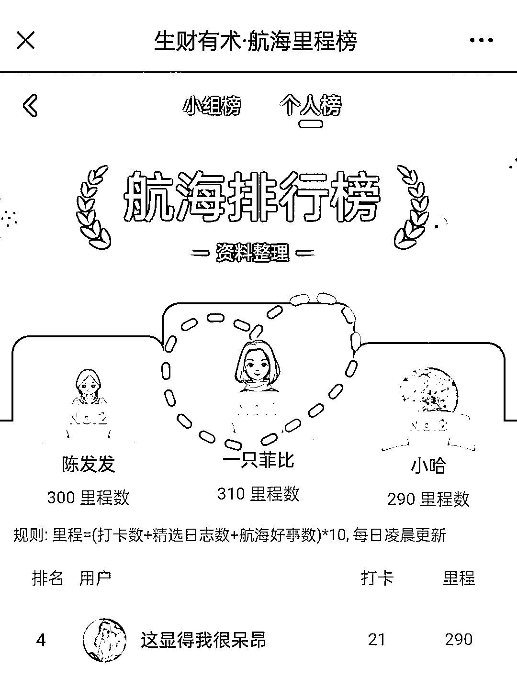
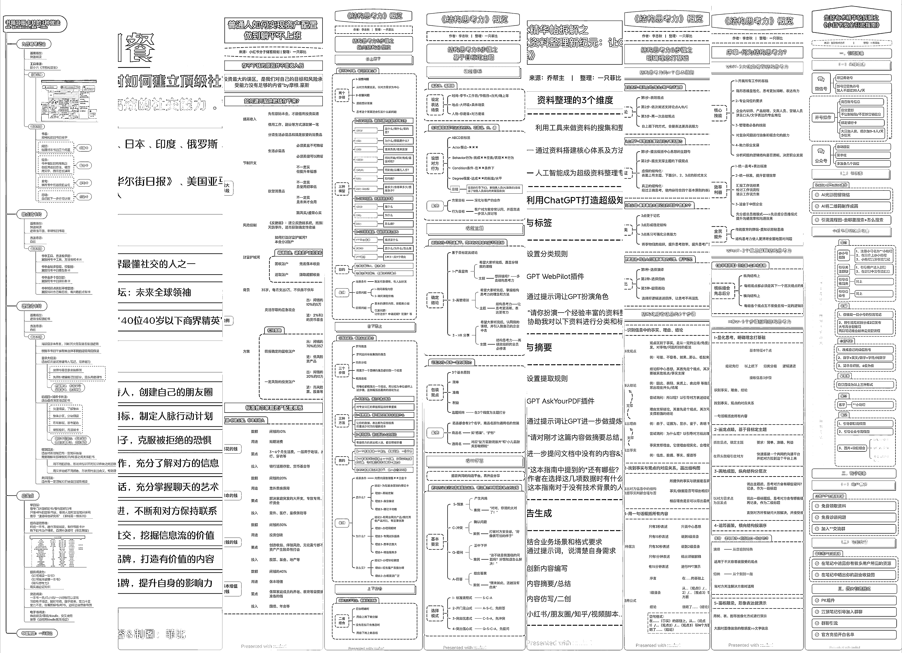
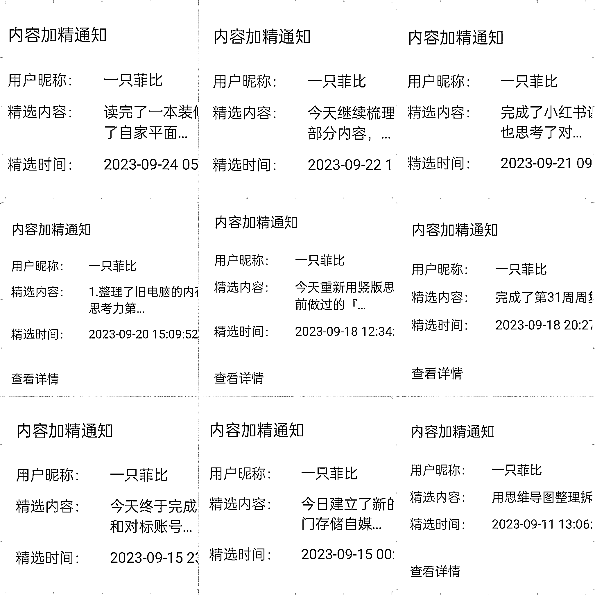

# 别再让资料吃灰了！她用结构化思维，把信息变成随取随用的弹药库
作者：龙哥

你是不是也经历过这种崩溃瞬间——明明记得自己存过一份超重要的资料，翻遍所有文件夹却一无所获；收藏夹躺着几百篇精华干货，真正要用的时候一个都想不起来。资料越囤越多，效率却越来越低。问题出在哪？不在于你存得不够多，而在于你的整理方式，从根本上就缺了“结构”二字。

最近认识了一位极其高效的整理者，她的实战经历很值得拿来聊聊。这位小姐姐是双一流工科出身，拿下了中美双学位硕士，目前在一家世界500强央企当工程师，而且是个痴迷于用结构化思维拆解万物的INFJ。她第一次参加航海实战营，就直接斩获资料整理赛道第一名——9张思维导图、11篇精华帖、1次公开分享，这个成绩单放在谁面前都够亮眼。而这些成果背后，正是她多年摸索沉淀出的一套系统方法论。

她的核心判断非常清醒：整理的最终目的从来不是“占有”信息，而是“随时调动”信息。

**第一，给每条资料一个精准的“坐标”。** 很多人收藏完就丢进收藏夹“躺尸”，等真要用了只能干着急。她的建议是建立一套稳定、一致的分类和命名规则，让每条信息都住进自己的固定“房间”。存放时多花两分钟做好标注，日后查找就能省下两小时。

**第二，用结构化思维给信息“编网”。** 碎片化的知识点本身是散的，只有放进框架里才能彼此连接。她习惯用思维导图拆解主题的主干与分支，把大量零散的内容整合成一张看得见的逻辑网。调用信息时，不靠模糊感觉瞎猜，而是顺着结构脉络一步一步精准定位。

**第三，复盘必须结构化，坚决拒绝形式主义。** 很多人写复盘只是为了完成“仪式感”，长篇大论写完自己都不再看第二眼。她坚持复盘要围绕真实目标展开：有数据支撑、有明确结论、有下一步可执行的动作。这样的复盘才是把宝贵经验内化成个人能力的加速器，而不是自我安慰的流水账。

这套方法论完整版有3000多字，还配有大量直观图解，她已经全部整理到飞书文档里了。如果你也受够了“存了等于没存”的憋屈感，不妨顺着这份资料去推开结构化整理的大门。

一次高质量的整理，胜过十次漫无目的的收藏。与其继续在信息洪流里挣扎，不如学她用结构化思维给自己搭一座清晰有序的私人知识库。信息本身不产生价值，能够随时调用并驱动行动的信息，才真正属于你。