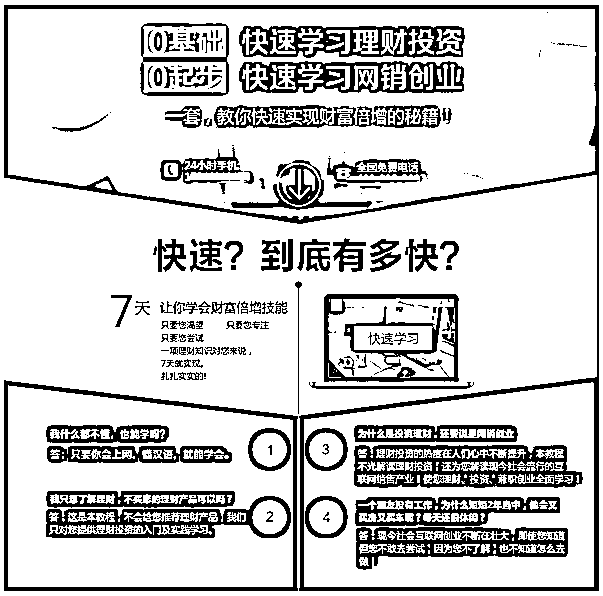
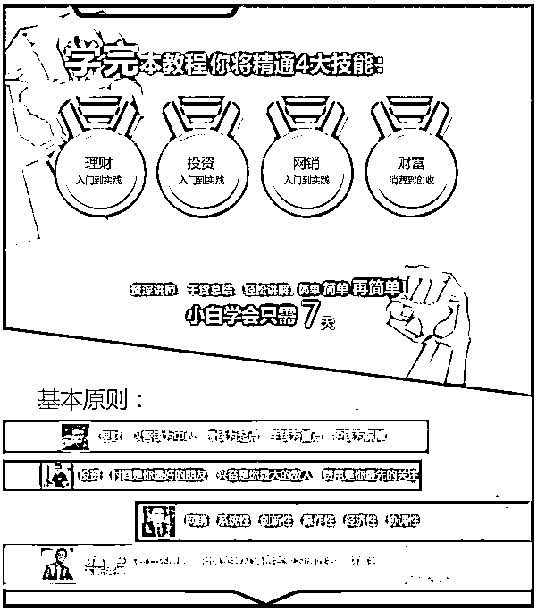
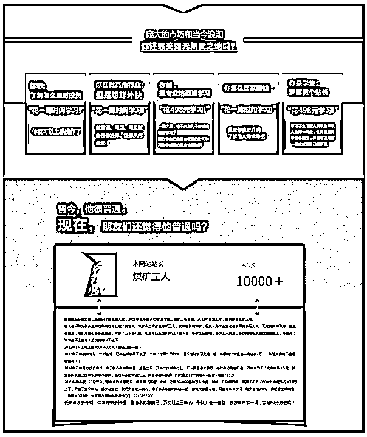
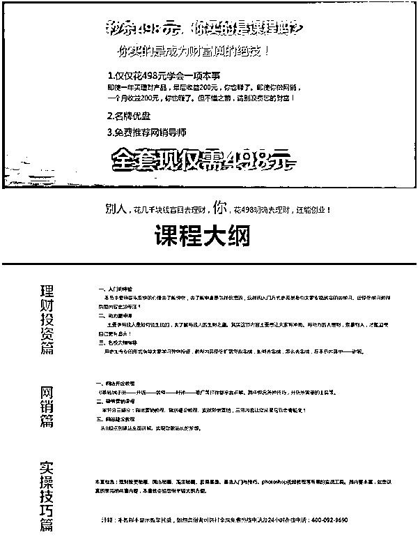
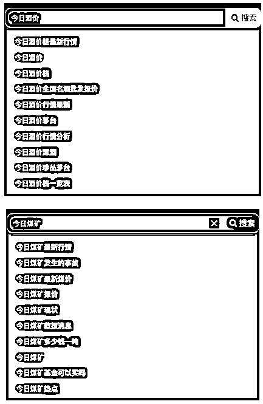
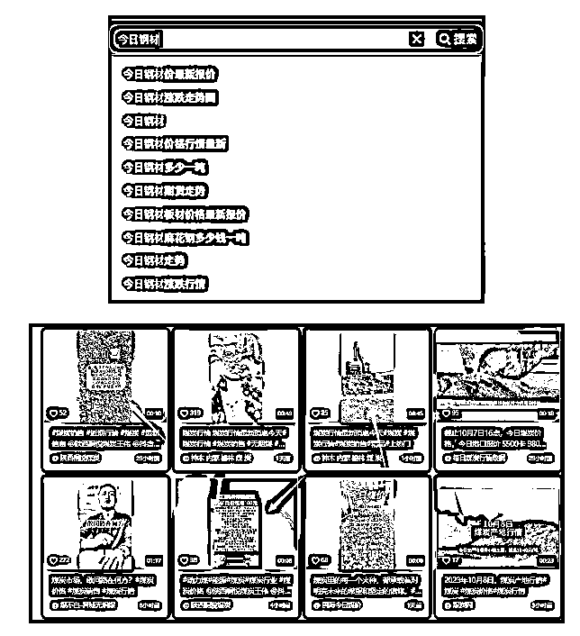
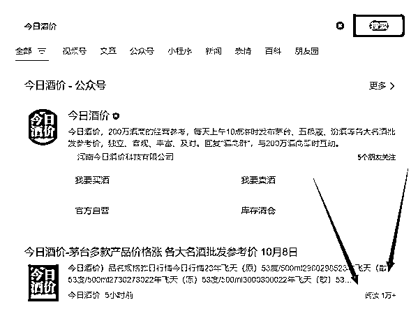
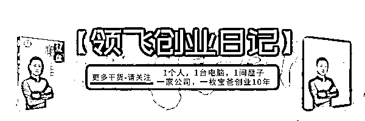

# 从卖资料到做信息差：虚拟资源老兵的被动收入转型笔记

## 卖虚拟资源如何转型发财，实现被动收入

作者： 领飞懂运营

日期：2023-10-08

我是领飞，一个在家带娃做超级个体十年的宝爸。

从入行第一天起，我就对赚无本买卖情有独钟，做中介做撮合。第一桶金就来自这种空手套白狼的玩法，也被最早的带路人带歪了。互联网赚钱有个很强的路径依赖，第一笔钱从哪来，后面你大概率就死磕哪条路。

电商起步很猛，后面就一直研究电商；
CPS CPA 尝到甜头，后面就只琢磨分发；
知识付费赚到钱，后面就只做课程；
无货源电商起家，后面就只玩铺货。

人都是有惯性的。所以选赛道时格局很重要。回头看我挺后悔当年没有去系统学电商运营、没有去吃透平台流量思维，格局被锁死了，只会闷头卖课。仅代表个人复盘，见仁见智。

我最早玩的是百度竞价卖教程。有段时间我几乎是发疯式地开站，一口气上了五十多个独立落地页，全是我自己琢磨出来的冷门方向。像刮腻子教程这种看着很怪的点我都敢上。一个页面建起来成本就三百块，跑顺了每天净赚三千。内容本质就是把淘宝上卖五块的视频、网上搜来的零散资料搬过来重新剪辑、归类、包装，我卖五百。

看到这里，你应该能嗅到其中的逻辑了。

【装修工种技能包】刮腻子、吊顶、电气布线、水暖安装这类蓝领教程，当年就是需求大供给乱的典型。那个环境下百度搜索是唯一的入口，很多人根本不知道淘宝上就有便宜的虚拟教程，也不敢相信便宜的就是劣质的。我的操作其实就是买、搜、整理、拆分、重组。说到卖虚拟资源，我算是吃过很多年老本的老玩家了。

卖虚拟资源说白了，就是把一堆散乱的废柴，整理成别人愿意花钱买走的干柴。整理好了，溢价自然就上去了。

翻回我当年的设计稿，现在看依然觉得顺眼。现在让我再花这种心力去做页面，我是真没那个耐心了。顺手晒几张当年的销售页回味一下。

上面这些图本质上就是一套销售信。卖项目时销售信决定成败。写法其实大同小异，你平时看到的能让你驻足的广告文案，值得系统收藏，日后复用价值巨大。

现在光靠卖资料很难再出单品爆款了。不做成品类型的小程序平台，很难有持续性，而且版权审查越来越严。所以不如把赛道从卖资料，转到卖信息差。

把过去“整合资料”的打法，升级成“整合信息差”的打法。

如下：

举一反三，这类信息差的整合完全没有版权风险。盯住几个权威媒体和头部行业博主的内容，一个👸号就能稳定搬运、加工、输出。

上手门槛很低，特别适合做矩阵，成本也低，跟当年我同时操盘五十个竞价站一个感觉。

做行业信息差有个很管用的引流技巧，就是把价格标得很低。低价一挂出去，同行就会来私聊你。你有没有现货其实无所谓，先说卖掉了，让他加你🛰️说有货第一时间通知。零成本聚人气，人气起来了，后面想怎么变现都行。

再举个更具体的例子：广告设备行业。

线下这个赛道利润高竞争也凶，设备动辄几万到几十万一台，二手需求非常刚性。这就是典型的信息差。

起号手法照旧，先把价格报低，精准吸引广告公司老板。把他们拉进🛰️挨个聊，你就自称是广告二手设备的中介，有需求找你就行。

当你用这招攒下上万个老板资源，真金白银的买卖信息自然就汇聚过来了。接下来继续空手套白狼，你只做信息撮合和背书就行。

比如A老板要出设备，B老板想去验货，信息真假不对，差旅成本就白亏了。这时候你出来做信息担保，收取担保服务费。

类似的二手设备需求遍布所有行业，越是热门的赛道，交易频率越高。千万别去冷门赛道，二手设备信息差同样可以矩阵化操作，目前入局的人不多，值得多行业布点。

写到这儿差不多了。

这些内容是我做虚拟资源的老经验。针对现在还在这个赛道里小打小闹、求生存的人，我的转型建议只有一个：别再死磕卖教程了，去做信息差整合。空白市场很多，做的人少，出头的概率反而高。长期占住几个行业的信息枢纽，被动收入是完全可以做到的。

我把十年创业经验总结成了两本书：《套公式创业运营》一万个项目就是一个；《复盘》唯复制强者，方拥有基本盘。有兴趣的自己去拿。

* * *

评论区：

希声 : [强][强]

富强 : 套公式创业运营

森 : 这文章也是一种引流方式，厉害

小 Q : 整合信息差，优秀

龙哥 : 非常精益的创业思维，如果用在一个有大机会的赛道上，是降维打击。

* * *