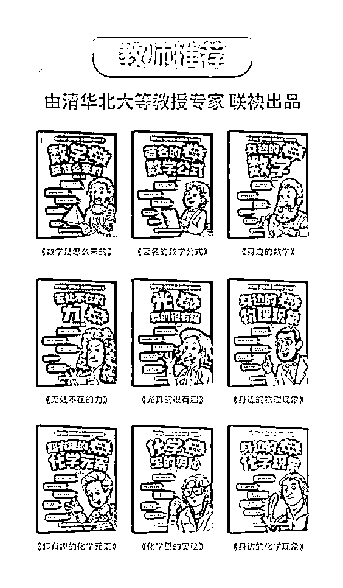
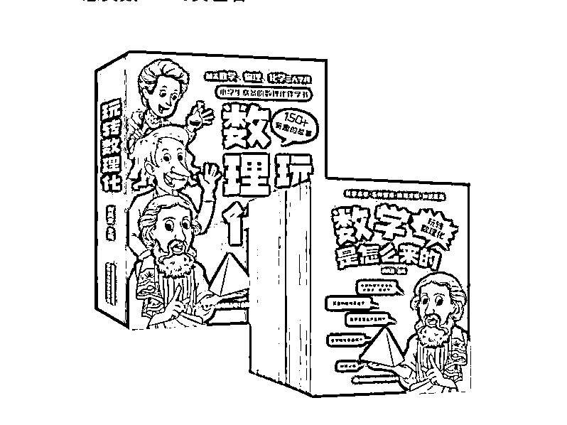

# 公益绘本月销百万套背后：用15元运费撬动宝妈私域裂变
作者：龙哥

原文：[`www.yuque.com/for_lazy/thfiu8/gomamb727okc13ri`](https://www.yuque.com/for_lazy/thfiu8/gomamb727okc13ri)

很多人在问，免费送书怎么还能赚钱？怎么一次活动就能卖出上百万套？今天就把这个【公益图书引流模型】拆开讲清楚。如果你也在做🛰️私域，想低成本吸进精准宝妈粉，这个玩法一定要看到底。

先说结论：这套模式的本质不是卖书，而是用正版童书做诱饵，用运费做筛选，用裂变做获客。

整个链路分四步走：

**1、源头备货**
供货方每月会组织1到2轮公益放量，每轮上架几百个书单SKU，每位参与者在同一轮只能认领1套。书源统一由供应链调配。

**2、分发与裂变**
达人、团长对接供应链后，把书单推给自己的私域用户。用户看中哪一套，就完成一次社交流量行为，比如转朋友圈、拉群、邀请好友助力。一次转发，就带进一批新宝妈。

**3、只收运费**
书本本身是公益免费，均为全新正版儿童绘本，每套3到10本不等。用户只需支付15元包邮费。流程是：朋友圈打卡换取领书名额 -> 在书单里挑序号 -> 在快团团小程序下单付运费。

**4、双向变现**
供应链会给推广方返一点佣金，虽然单量不高，但真正价值在于裂变来的宝妈粉。可以用来带后续的亲子课、早教、辅食、母婴产品等高客单业务。

常见疑问我也提前解答：

**Q1：白送这么多书，供应链不亏吗？**
亏不亏看规模。起步阶段量小，基本是贴钱跑量。做到单期几百万本级别后，印刷、仓储、物流、运营的边际成本会被拉到极致。更关键的是，这个项目能反哺集团内部的仓储物流印刷等板块。算总账，公益图书亏100万，但帮集团降本增效200万，这笔生意就很值。

**Q2：书的质量靠谱吗？有版权吗？会是旧书吗？**
全部为全新正版，印刷品控过关。合作是长期生意，供应链不可能用次品砸自己的招牌。最近一期活动就有148个可选套装，我抽一套出来感受下，9本成套：

**Q3：领取流程复杂吗？**
不复杂，三步搞定：
① 发一条领书朋友圈获得资格
② 在活动书单里自选一套喜欢的编号
③ 在群内小程序找到对应编号支付15元运费
每月两次机会，人均限领一套，全国包邮。

**Q4：量这么大，物流怎么扛住？**
自建体系。郑州、武汉、天津等十多个省份都有自有仓，4万坪仓储规模，100多万套图书储备。自动化打包线+就近发货，四通一达邮政均可。活动结束后10天内发出，发出后5天左右到手。物流进度可在【河马天天团】小程序自查。

**Q5：合作方是谁？靠谱吗？**
供应链是【三只河马】，深耕公益图书领域20年，图书资源和履约能力是行业头部。

讲完怎么卖书，下面说重点：怎么把这个活动变成宝妈裂变利器。

我把完整的实操SOP整理成了万字保姆级教程，包含话术、群动线、裂变节点设计、转化闭环等，想做🛰️私域引流的可以直接看：

* * *

评论区互动：

彭老师 : 链接打不开呀

AQ : 复制出来之后能打开

三生 : 怎么联系

弈尘 : 怎么成为团长

老严干货 CPS : V 我：19662172

老严干货 CPS : V 我：19662172

弈尘 : 加了

* * *