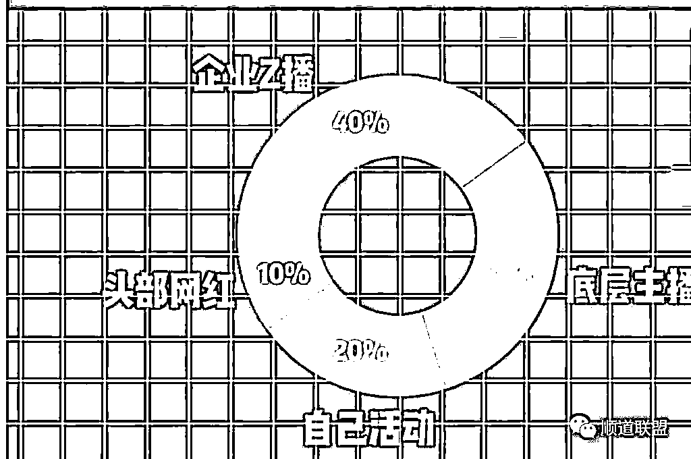
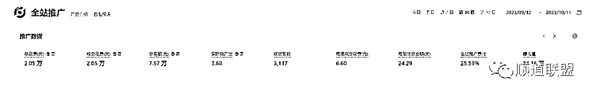

# 拼多多无货源的前世今生

如今电商卖家就两大流派：一边是自建仓库、自持货品的实体型卖家；另一边是两手空空、靠转单赚差价的轻模式玩家。

实体型卖家的画像很典型：有存货、有库房，货从自己手里发出，客服、运营、美工样样都得配齐，卖的商品基本出自自家供应链。这条路的天花板曾经很高。早年要是供应链资源强，或者运营手艺够硬，赶上电商红利期，做出几个爆款就能实现财务自由。义乌那些手握供应链优势的商家，只靠雨季用品、年货季就能吃饱一整年。还有不少厂家光是开模就要砸下几十万，天然形成资金、外观和技术上的护城河。

但缺点也摆在明面上。这几年供应链之间的差距被快速抹平，你刚推红的爆款，别家工厂不出几天就能仿出同款，最后只能拼价格、拼家底。最难受的是库存风险：服装类退货率普遍超过六成，有人年销售额做到3000万，年底一算净利润只有20万甚至倒亏，仓库里还积压着大量退货和过季尾货。还有不少货进回来就再没动过。

轻模式就直白多了：不进货、不压货、不发货，赚的就是供需双方的信息落差。发货让上家代劳，售后也由上家兜底，自己几乎不担风险。利润来源主要是平台间的价差、买家购物习惯的差异、以及同类商品在不同渠道的认知差。这种玩法能批量复制店铺，靠多个店铺同步滚动把总利润做大。代价是单店利润偏薄，价格、图片、物流都没有优势，只能走量取胜。

市面上的轻模式玩家，大体上分成粗暴派和精细派。

粗暴派的第一种，就是趁着新平台扩张期做采集搬家。把其他平台的链接成批搬到自己的店里，赌概率出单。比如从PDD搬运5000个链接，一天也许能出50单；也有人把抖音精选联盟的商品用接近原价甚至更低的价格挂到PDD，出单后再去抖音下单，吃一笔佣金。新平台刚起盘时，需要快速充实商品池和商家数，往往对这种行为睁一只眼闭一只眼。等平台站稳脚跟，规则就来了。现在PDD超过九成的人还在做搬运，单店30天利润普遍只有200到800元。弊端也很真实：采集来的订单经常找不到对应货源，拍单成功率上不去；账面上看着一天挣50，扣掉店铺扣款和跑单损失，实际上可能还倒贴。抖音那边同样有雷，商家前期为了冲销量挂高佣金，等数据养肥了直接把佣金砍到1%，这条渠道立刻就没有利润空间。

粗暴派的第二种，是钻平台漏洞、专挑灰色类目下手，靠S单、动销、退款单、大额单、上下架这些手段快速制造流量。减肥、壮阳、增高、丰胸、医疗器械这些高风险品类，后来又延伸出佛牌、治脱发、茶叶、望远镜、转运符、在线算卦等，利润很高，但官方盯得也紧。这类玩法的本质是跟平台对赌，注定没法长跑。个人永远追不上系统更新规则的速度，这个月还能用的黑操作，下个月可能就被识别；而且系统往往会秋后算账，冻结资金、开出巨额罚款都是常见操作。真能在这条路上吃到肉的，只有极少数资金厚、团队猛的玩家。好比当年天猫店群那波，有人一周开出100家店，4个月净赚2000万。可这种能力不是谁都有的，普通人一味研究漏洞，等于自我消耗。

精细派就不一样了。他们不靠店铺数量硬堆，而是靠选品和后续优化做利润。常见打法有三种：一找冷门小市场，二截同行的单，三做小爆品。冷门小市场指的是有真实需求、定价不透明且竞争小的细分类目，比如大多数人听都没听过的西红柿绑曼夹。截胡同行，就是专门盯着别人跑出销量的商品，用略低的价格或付费推广把订单抢过来。小爆品则是从代发商品里挑出有潜力的款，集中资源打单品，成功率更高，风险也更可控。

多店矩阵的底层心法，其实是稳定为王。市面上不少做这行的人都很焦虑，因为所有招数本质上都在和官方博弈。一夜之间店铺被清空、流量归零的事，我见过太多。曾经有PDD所谓的大佬，几千家店铺全靠快速起店法撑起来，结果一夜之间全被清洗，忙了大半年什么都没剩下。说白了，那种赚钱方式看的是平台脸色和运气。所以我很早就给自己立了规矩：一定要做有沉淀的事。代发模式能沉淀的，就是店铺本身。如果一个玩法注定只能活两个月，迟早被清洗，就算利润再诱人也不碰。因为一旦沾上快钱，心态就彻底坏了，以后每次选择都会扑向速成项目，越陷越深。我遇过一个开了600家店的同行，连SKU是什么都不清楚，也不懂坑产，只会用软件采集。这样的公司沉淀不了团队，沉淀不了店铺，更沉淀不了一颗安静做事的心。

电商的本质，始终是把好产品交到需要的人手里，服务好客户，处理好售后。实体店和代发店在这个点上没有区别，毕竟不可能每个卖家都自建仓库、自己雇人发货。官方为什么打击代发？是因为很多人把市场玩坏了：海量商品堆在一个店铺里，标价随心所欲，客服长期失联，售后无人响应。有些厂家辛辛苦苦优化产品，流量反而比不过无脑铺货的店，这对踏实做货的商家不公平。

其实官方并不排斥代发模式，PDD的小二还曾明确鼓励商家多开店冲业绩，但反对的是无脑铺货。店铺矩阵本身能降低试错成本。拿淘宝和天猫来说：天猫承接高端品牌业务，C店就像天猫的选品试验田。你发现一个小众品类，因为盘子太小天猫看不上，那就先在淘宝店跑跑看，没货就让厂家代发；系统会观察数据，一旦发现这个品类持续上涨，天猫再进来接棒放大。官方真正希望代发商家做的，是补足商品库的空白，而不是挤进红海市场恶性竞争。信息落差也永远不会消失：有人只信京东，有人只在淘宝买东西，有人就是PDD的死忠粉；同款商品的价格也各有不同，有人认便宜，有人认品质，有人看销量，有人信高级感图片，有人只参考评价数量。只要你能找到特定人群需要的产品，把客服、物流、售后和详情页都做到位，代发模式可能是当下最值得做的生意。理由有四：可复制、可积累、启动成本只要一台电脑、办公地点不限。

PDD目前的主流做法，其实是淘上拼。PDD的品类丰富度仍然不如淘宝，官方需要更多店铺来扩充商品库。PDD本身是低价平台，以前做代发的大多从PDD上家拿货，但去年开始，个人店和企业店已经不能使用PDD同行的发货单号，专营店还留了一段时间口子；今年则全面封死。我们前年就转到了淘上拼。很多人不理解：淘宝的价格明明比PDD贵，再加价放到PDD卖，有人买吗？答案藏在流量分配的底层逻辑里。系统不可能把流量全给价格最低或实力最强的卖家。原因有两点：第一，电商流量一直是二八甚至一九分，约20%的头部商家拿走80%流量，剩下80%的中小卖家常分20%。如果系统把所有流量都压给头部，这些人一旦服务滑坡、偷工减料，流失的客户要由平台买单。所以必须有赛马机制，让不达标的下来，让做得好的上去。淘宝当年把直播流量集中给薇娅和李佳琦，后来薇娅反过来挟持了淘宝；快手辛巴在直播间多次公开叫板官方，官方也只能忍着。抖音则学聪明了：很多千万粉网红过段时间就刷不到，百万粉主播的直播间甚至只有几百人。抖音的流量分配方案是4321计划——40%给品牌和商家自播，30%给中腰部达人，20%给活动，只有10%留给头部大主播抢。平台绝不会允许任何人绑架自己。

PDD虽然是低价平台，但高价商品不等于没有曝光，只是拿量的成本更高。代发模式不需要和低价爆款硬碰硬：人家一个品30天能卖数万件，我们只追求单品30天出10单；若店铺里有200个类似SKU，合计就是2000单，每单净赚5元，也有1万元收入。更何况很多细分类目容量太小，大厂家看不上，这恰恰是普通人的机会。电商每年都会诞生大量新需求，代发店铺做的，正是持续承接这些增量。

几年走下来，我越来越确定：人和人学习的差别，首先在心态。心态决定你能吸收多少有效反馈，也决定你能在这条路上走多远。代发行业确实成就了不少人的原始积累，但我认识的所有从业者几乎都有一个共性：浮躁。尤其碰过所谓黑科技的人，更容易误以为这行就是赚快钱，店死了再注册，甚至把店铺数量当成炫耀资本。他们通常只问：几天能起店？一组该开几家店？一个人能管多少店？却很少有人问：店铺能活多久？

这就是短线思维和长线思维的分界线。如果你还没有过任何原始积累，可以先靠短线项目找回信心；但如果你已经拿到结果，我建议及早转向长线。短线玩家往往什么都没有沉淀，长期处在焦虑里，靠运气赢来的钱最后都凭实力输光，还会把某段高收入当成人生的真理，催生出收割韭菜的生意。疫情三年让多少实体店老板把一辈子的积蓄押在未知风险上；抖音餐饮加盟也一样，几十万投进去，听信半年回本的承诺，最后大多一地鸡毛。对代发这种低投入项目，你先要问自己：钱到底从哪里来？答案是先活下来。顺应官方节奏，不要只记得“群”，却忘了“店”。怎样活？回到本质：你给平台和客户提供了好产品吗？优化做到了吗？服务跟上了吗？系统凭什么把流量给你？把这些想明白，就会理解为什么各家平台会陆续出台打击代发的规则。所以盲目铺货、动销、低价引流、大额券这些操作，被清出局只是早晚的事。走长线的人不能再碰短线项目，那会把整个人都拖垮。除非你狠狠摔过跤，焦虑到夜夜难眠，才可能听懂这句话。

这几年实体店倒了一片又一片，疫情、客群、位置、前期投入、人工成本，每一样都在吞利润。所以选项目务必守住三条：第一，投多少、赚多少，算得明白；第二，有没有人已经做成过；第三，能不能带来睡后收入。送外卖这种今天跑单今天赚钱、不跑就没收入的工作，在我看来不算好生意。

再讲两个大坑。第一个是迷信不花钱的自然流量。PDD生态里，连很多有货低价的正规厂家都拿不到自然曝光，代发商家想靠免费订单更是难上加难。因为物流单号受限，现在做所谓免费流的人，大多数还是在淘宝拍单；不管包装成截流还是别的名头，本质都是赌概率。拍淘单常常遇到缺货和虚假轨迹罚款，算下来很多订单不赚反亏。店铺里商品一多，还会招来恶意索赔、外观侵权、商标侵权等纠纷。我们试着做过铺货型店铺，有一回30天赚了800元，转头一起诉讼和解花掉5000元，处理一个恶意索赔又赔400元，等于白忙。

第二个是强付费投放。很多商家根本不会算账，以为保本投产比是2，开到2.5就有利润。实际上还要扣掉退货率、退货包运费和后台店铺扣款，目前拍淘宝单的店铺扣款大约三四个点。很多强付费店铺表面营业额漂亮，一拉净利润却几乎为零。一个代发店保本2，投产比要拉到3.68，30天才能净赚1万元。把账算清楚，比任何技巧都重要。

后面还会有更多内容陆续更新。

一切致富的过程，都是你长期聚焦于一件事情的回报；除此之外赚到的钱，终究会凭实力亏回去。感谢电商路上与你相遇，也庆幸我们都走在这条路上，眼前有星光，耳边有歌声。
