# 两个月把蛋糕店利润做到五倍？拆解这套可复制的增长方法

> 作者：深圳刘宁培｜企业增长与股权设计顾问｜从业5年，年均深度服务企业50家+

大家好，我是刘宁培，龙哥盟的老用户，编号1748，从第二期开始一直续费至今。

今天分享一个刚落地的陪跑案例：如何用两个月时间，把一家上海蛋糕店的月度利润从“1个蛋糕”的体量，提升到“5个蛋糕”的体量。里面涉及的方法论，换到其他品类也同样能用，希望对各位老板有参考价值。

## 一、来找我前的困境

今年3月，我与谢无敌老师签了半年陪跑合约，大约3个月时间就把对方的业绩推到了原来的3倍。有兴趣的伙伴可以去看我之前的复盘👇

老板必读｜如何让公司3个月时间，业绩翻3倍：[`t.zsxq.com/11gnhuyp2`](https://t.zsxq.com/11gnhuyp2)

上海的圈友高夫人，看完谢老师的变化后联系了我。她说的很直白：**店里生意越来越好，自己却越来越累，想能歇下来，最好也能像谢老师那样业绩上去。**

我回复可以。既能让你抽身，也能把利润做上去。

随后走完合同、付款流程，开启了半年8.6万的陪跑服务。

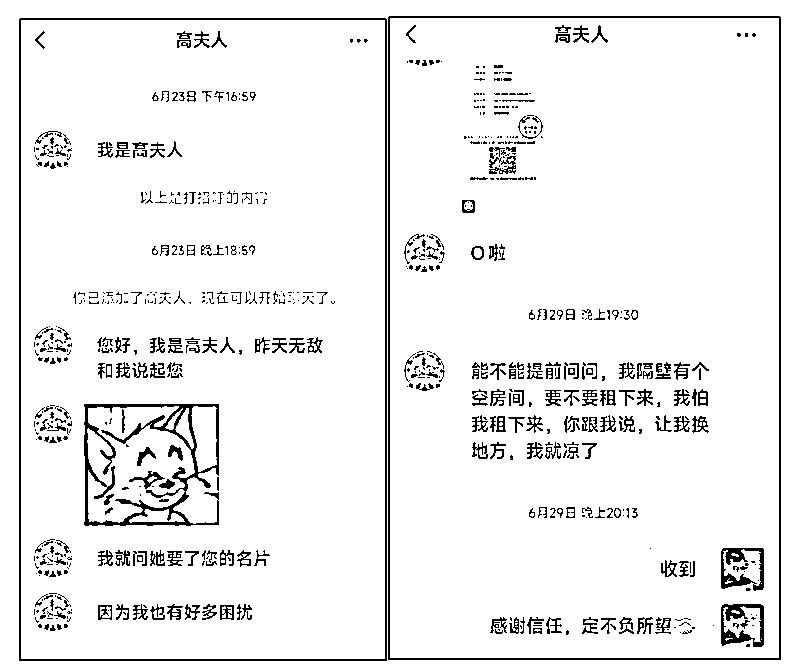

## 二、首次线下交付

7月22日至24日三天，我飞往上海为高夫人进行线下授课和方案落地。

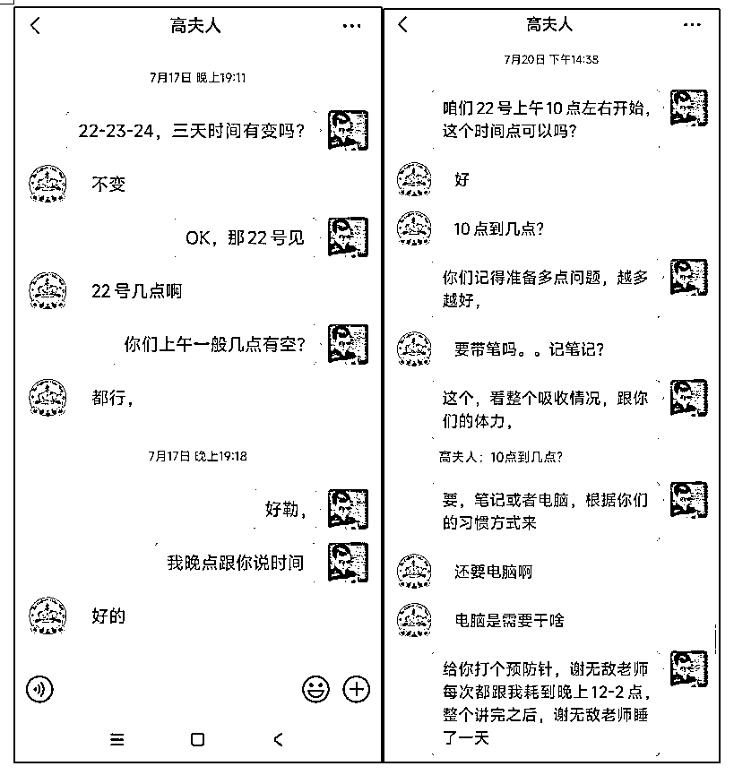

我的交付节奏都是三天线下工作坊。先拆解各业务模块，再结合实际情况定制股权激励和薪酬激励。

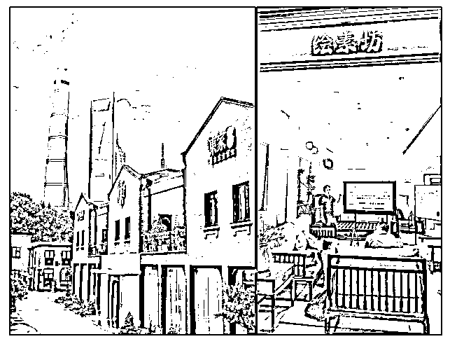

（授课场地在绘素坊的新中式家居空间）

### 运营先看财务

讲到第七个模块——薪酬绩效时，我需要把整店的盈亏平衡点、各部门的盈亏平衡点、乃至每个人的盈亏平衡点全部核算清楚。

**同时要测算完成业绩后的整体利润率，这个指标最能说明一家店的造血能力。**

另外产品财务、渠道财务、客户财务、团队财务都要梳理一遍。

**这些精细数据，是后面做薪酬绩效优化和经营决策优化的唯一依据。**

只有基于可验证的财务分析，才能给出站得住脚的薪酬方案和运营方案。

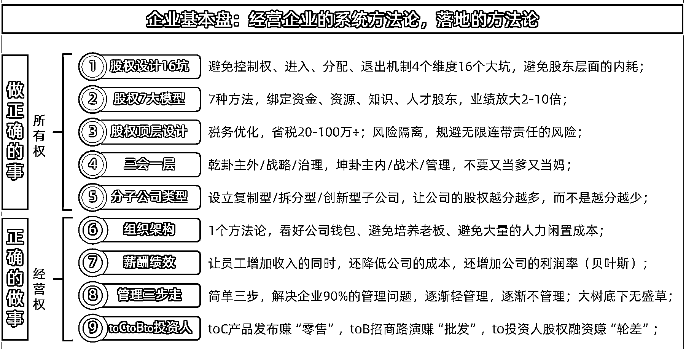

（线下交付现场记录）

算到高夫人蛋糕店的当月利润时，我十分惊讶。直接对她说：你现在这个利润水准，敢花8.6万请我？

**（具体金额不便公开，这里统一称作“1蛋糕”）**

三天课程结束后，我对门店全貌有了清晰判断。能有信心把这家店的月利润从“1蛋糕”提升到“3到5蛋糕”。

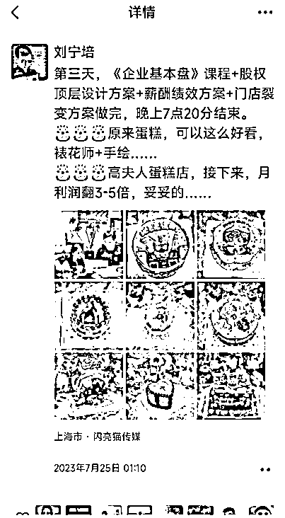

## 三、两个月做了什么，利润直接翻五倍

### 1、产权层面：把店长变成真正的合伙人

老板想自由，第一步就是把店长绑上自己的战车，用股权激励或分红股激励来实现。谢无敌老师就是靠这一步完成抽身的。

课堂上我系统讲解了股权激励的逻辑，高夫人表示认同，愿意按利润表来设计对应的股权/分红方案。

具体做法是：给店长配一定比例的门店股权，让她成为合伙人，一起分润。

**同时设置阶梯业绩目标与分红比例。**

这样店长很清楚，个人投入直接决定收入和门店利润。为了自己的分红，她会更主动地去做业绩。

### 2、管理权层面：让每个人都有奔头

#### （1）薪酬绩效重构

此前店长与员工都是拿固定工资，与业绩好坏无关，本质就是**旱涝保收**。

这种模式下积极性很难起来，主动加班就更不用提了。

因此我依据岗位属性与工作量，重新搭建薪酬结构，引入绩效奖金与提成奖金，让收入与店面业绩、个人表现挂钩。

这里有个关键点：在设计绩效与提成规则时，**一定要确保员工到手收入是递增的**，这样才能产生正向激励。

调整后从纯底薪转为**底薪+绩效+提成**。两位员工底薪各降1000元，但按测算不同业绩对应的提成在2000到4000元区间，综合到手反而更高。

比如郭师傅，原底薪4000元，8月1日新方案公布，8月整月到手超过7000元。

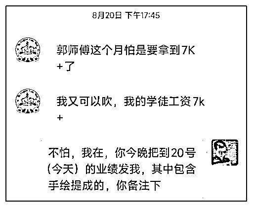

方案成形后，我建议高夫人在店内做一次宣讲并公开发布。她担心自己表达不清，我说可以代讲。她看完方案后觉得逻辑清晰，自己能讲。

宣讲前必须做一件事。

我发现很多企业推行新薪酬后出现员工流失，核心原因是：

一、新规则触动了部分人原有的利益预期；

二、员工没意识到新规则对自己更有利。

所以宣讲时要重点突出新规则的好处，现场解答疑虑，确保员工理解并接受。

#### （2）经营层面：抓住业绩公式

企业主必须熟记一个底层公式——**业绩=流量×转化率×客单价×复购/转介绍。**

市场上所有运营动作，最终都服务于这四个变量。

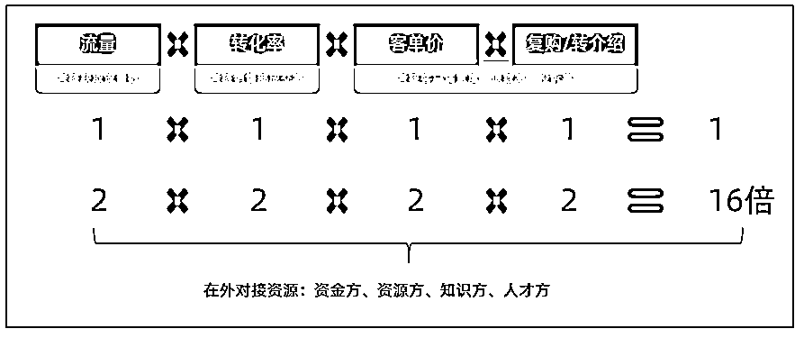

但老板的时间和员工的能力都是稀缺资源，要选一个变量最容易撬动。

三天沟通后拿到高夫人7月份的销售数据，我做了如下调整：

#### （2.1）做大流量

**①增配流量角色**

**现状：**后端蛋糕师、裱花师已培训到位，前端📕引流不足。

**对策：**在谢无敌老师社群内招募一位专职流量同事，同时要求全员在📕做内容种草，带来的客户成交后给予流量提成。

**效果：**流量规模增长超过三倍。

**②调整排班**

**现状：**历史订单数据显示周六日订单峰值最高。

**对策：**把轮休日从周末改为周一、周二。

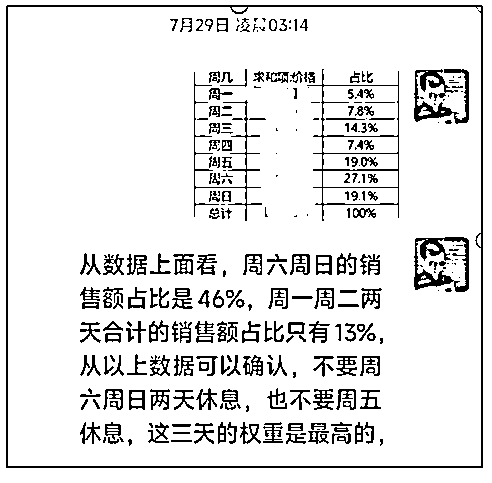

#### （2.2）提高客单价

**③减少4寸蛋糕接单/外包**

**现状：**不管几寸，出品时间成本相近，但财务测算显示4寸、6寸几乎不赚钱。之前甚至因接这些小单，挤掉了更赚钱的大单。

**对策：**
一、寻找可靠的下游外包资源；
二、旺季不接4寸、6寸单，优先做高客单价的订单。

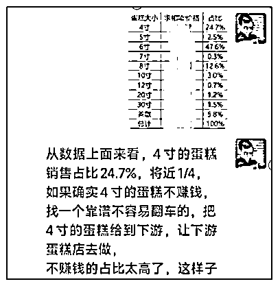

**④新增品类——茶歇**

为提升客单价，我们设计了茶歇服务品类，正式上线在9月。

8月先集中调整前面动作，给团队磨合时间，不宜一次性改动太多。

9月开始在📕发布茶歇相关内容，锁定企业主客户。目标每月获取2-3个茶歇订单，扩充收入结构。

茶歇业务能带来新的现金流来源，提升整体盈利能力。

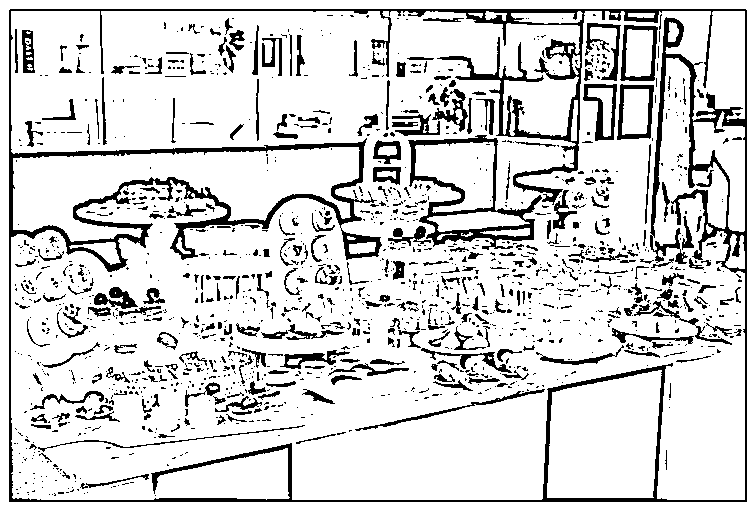

### 3、阶段复盘

这个过程中高夫人真正体会到：时间、精力、资源都有限。

要实现利润倍增，先做投入产出比最高的事。陪跑初期我引导她优先聚焦流量与客单价，这是最快见效的两个杠杆。

等流量与客单价稳定后，下一步目标是把单店月利润推到“6蛋糕”。

（该目标是后续讨论确定的，高夫人其实更激进，想做到“10蛋糕”。我最终定的思路是利润主要靠多店合计，单店做到每月“6蛋糕”的水平即可。）

经过两个月的迭代，月销售额持续上行，固定成本基本持平。费用率下降，利润率随之上扬。

**目前已形成多方受益的局面：**

①员工满意，月度综合收入提升。

②店长满意，距离最高阶梯分红越来越近。

③高夫人满意，过去经常需要团队熬夜出品，现在全员6点准时下班，她本人可不进店，只有客服休假时才去顶班。

④我的服务费也已被N倍回本。

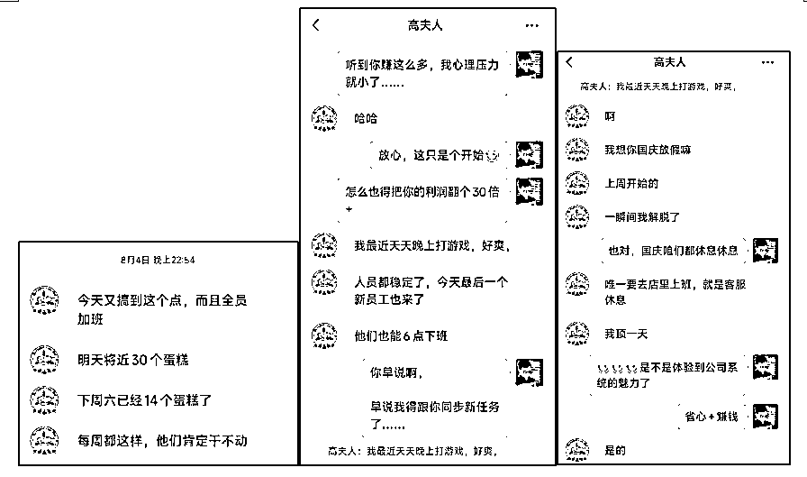

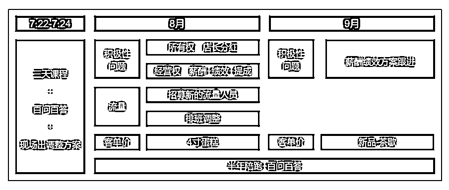

## 四、下一步：把月利润放大到“30蛋糕”

任何门店都有人效与坪效的上限。

商业模式的终局形态是“批发”。这个话题很大，这里不展开，大家自行思考。

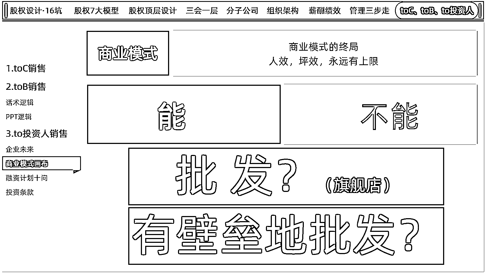

单店盈利模型跑通后，下一步计划是为高夫人复制分店。

无论是加盟还是直营，本质都是把盈利模型复制，放大利润。

等“城市模型”在上海跑通后，再考虑向外扩张。

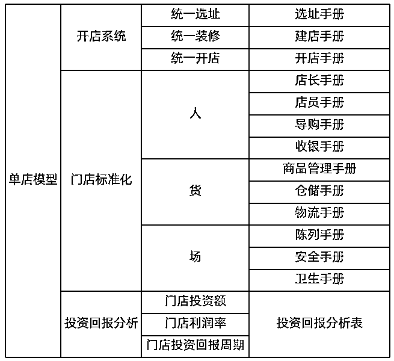

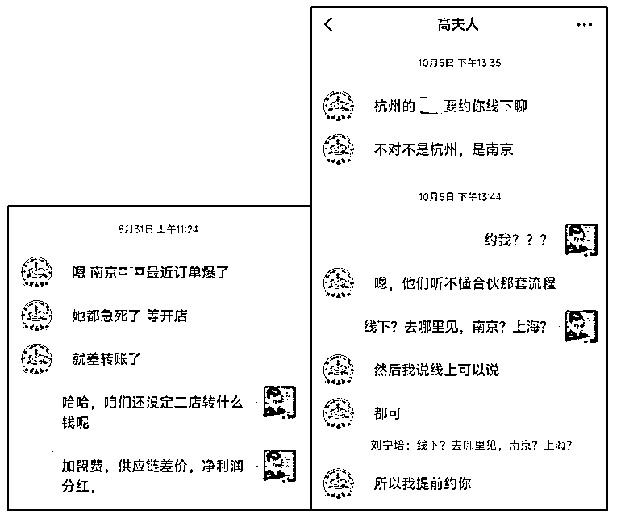

再等我几个月，等第二家分店落地后，我会再来更新进展。

**欢迎交流**

**微信：lnp266，加好友请备注：赚钱圈友。**

**往期干货：**

我在龙哥盟长期聚焦股权设计/股权激励，已发布三篇精华帖：

③企业初创期股权知识，避坑80%+：[`t.zsxq.com/fyNbAuR`](https://t.zsxq.com/fyNbAuR)

④股权顶层设计：[`t.zsxq.com/UBqVvjU`](https://t.zsxq.com/UBqVvjU)、[`t.zsxq.com/27eqV7A`](https://t.zsxq.com/27eqV7A)

⑤股权激励：[`t.zsxq.com/05iMB2Zfu`](https://t.zsxq.com/05iMB2Zfu)

* * *

评论区：

暂无评论

* * *