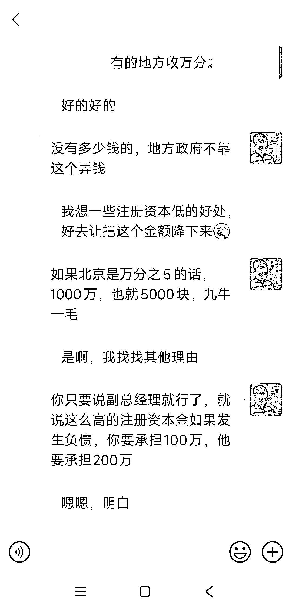

# 注册资本这个数字，写错了可能一辈子都在还债

很多创业者在聊公司设立时都会问我同一个问题：注册资本是不是写得越高越显得有底气，签合同也更吃得开？

也有人半开玩笑地说，我这家公司注册资本三亿，我个人占两成，图个心里踏实。

注册资本到底是写高点好还是写低点好，今天把逻辑彻底捋清楚。

***本文讨论对象均为有限责任公司。**

### 01 注册资本到底在代表什么

公司刚要成立，无论自己跑工商还是找代办，注册资本都是必须填的一栏。

这个数字本质上是全体股东对外的出资承诺的总和，也在一定程度上决定了公司抗风险的能力上限。

10万、100万、2000万、1亿，都是股东们白纸黑字承诺要拿出来的钱。

**只要公司没有进入无负债注销程序，这笔钱在法律上都是要到位兑现的。**

举个极端例子，公司注册资本1亿，后来欠了1亿债，你持股20%，那理论上你就要为这1亿债里对应你的部分，也就是2000万负责。

这就是注册资本里埋着的隐形炸弹，写的时候一时冲动，后期可能要付出代价。

### 02 注册资本多少才算合理

那到底写多少合适？有人想写5万、10万，觉得万一倒闭也不用背太多债。有人想拉高到预计年利润的2-3倍，显得体面。

法律、行政法规另行规定的注册资本如下：

> 如下图：某行业注册资本要 50 亿。

> 

> 

> 

> 除法定的特例外，普通公司该怎么定？

> 

> **我的经验公式：月销售额×3-6倍≈注册资本。**

> 

> **1. 不能定的过高**

> 

> 比如一家知识付费公司，客单价5000元，一个月大概卖60份左右，月流水约40万。

> 

> 按公式算，40万×3=120万，40万×6=240万，区间在120-240万之间，写200万是合理的。

> 

> 2022年我见过一个老板：

> 

> 我：你们注册资本多少？

> 

> 他：2000万。

> 

> 我：客单价高吗？

> 

> 他：最高一万左右。

> 

> 我：月流水大概？

> 

> 他：50万上下。

> 

> 我：那为什么写2000万？

> 

> 他：总觉得数字大点好看，代账公司也说没事。

> 

> 这就是典型的坑。年流水600万上下，年利润撑死300万左右。万一公司负债1亿，按注册资本上限追责，非一人有限公司要兜底2000万。

> 

> 相当于公司7年白干的利润，全拿去填窟窿。

> 

> **2. 也不能定的过低**

> 

> 再看一家客单价20万的公司，一个月能成交15单，月流水300万。

> 

> 月流水×3=900万，月流水×6=1800万，注册资本写1000万左右比较匹配。

> 

> 如果你准备花20万买人家服务，一查对方公司注册资本只有10万，你敢签吗？我不敢。

> 

> 注册资金过小，高净值客户会直接怀疑这是不是空壳，会不会收钱就转移资产申请破产。

> 

> 所以注册资本既不能过高也不能过低，用月销售额×3-6倍这个区间来定，是最稳妥的做法。

> 

> 其他情况还要结合公司类型、业务模式、发展阶段综合判断，后期发展不匹配也可以走变更程序。

### 03 实缴和认缴，差别在哪

很多人还分不清实缴和认缴，甚至会问：我先不实缴，把钱借给公司用，有没有事？

公司注册资本1000万，给我10%股权，认缴的会不会有风险？公司账上一直不分红，风险大吗？

从公司法角度看，两者区别如下：

**法律含义不同**

1. 实缴注册资本：已经实际打到公司账户并登记入账的出资额。
2. 认缴注册资本：股东承诺在未来某个期限内，按照章程约定的方式、金额和时间完成出资的总和。

**出资时间和方式不同**

1. 实缴：设立时就要一次性到位。
2. 认缴：可以分期分批到位。

实缴还是认缴，能在国家企业信用信息公示系统[`www.gsxt.gov.cn/index.html`](https://www.gsxt.gov.cn/index.html)查到，也能在第三方软件上查询。

这是第三方软件查询的某家公司注册资本100万，未实缴。

这是曾经服务过的一家公司，注册资本16000万，实缴16000万。

**看两个场景就明白了**

条件：咨询公司注册资本100万，股东甲70%股东乙30%。

**情况一：认缴**

公司成立时只认缴不实缴，等赚钱了再说。经营不善欠了500万债，有限责任公司以注册资本为限。

甲需要补齐70万出资，乙需要补齐30万出资，才能完成认缴义务。

**情况二：实缴**

成立时甲已打70万，乙已打30万到公司账户，公司账上已有100万用于经营。

同样欠500万债，因为实缴义务已经履行完毕，股东不再需要额外掏钱补窟窿。

债权人只能从公司剩余额度收回，账上所有者权益只剩60万，最终债权人只能拿回60万。

**所以给股东的建议是：**

① 能实缴就早实缴，或者认缴后尽快分期实缴完。实缴资金能马上用于租房、买设备、发工资、进原料，尤其是制造业不能等。

实缴完成后再出问题，股东不用再掏腰包。

② 公司要及时分红。所有者权益=资产-负债。所有者权益里包括实收资本、资本公积、留存收益等。

前面说了实缴后股东不用补债，但公司账上所有者权益不分红就会被用来还债。

比如公司实缴100万，经营后所有者权益滚到400万，产生500万债务，这400万都要用于清偿，不是只还100万注册资本。

③ 关于股权激励。如果你拿到的是虚拟股，可以不管实缴认缴。

如果是工商登记的实股激励，就要看公司是实缴还是认缴。实缴的相对安全，认缴的要仔细看合同条款，避免公司出事后你还要为1000万注册资本的10%也就是100万背债。

### 04 实缴该怎么做才算数

有人会问，我把钱转到对公账户就算实缴了吧？

**不完全算。**

标准流程有5步：

1. 股东必须用自己名下资金直接转账到公司主体对公账户，不能走第三方代转，确保资金来源真实合规；
2. 保存好转账流水和出资凭证，留存备查；
3. 按会计准则计入实收资本科目，保证账务规范；
4. 按税法规定到税务局做实缴纳税登记，缴纳印花税；
5. 到工商局办理注册资本实缴变更登记，确保信息一致。

建议创业前先看同行做法，结合自身业务规划再定注册资本，后期不合适也能变更。

今天的分享就到这里，希望能帮你避开注册资本的常见陷阱。如果你有股权设计、经营管理上的困惑，欢迎交流。

#### 微信：lnp266，添加请备注：赚钱圈友。

#### 往期精选干货：

我在龙哥盟立的生态位，一直是跟股权设计/股权激励相关的，前后写了三篇文章，都拿过精华帖，链接如下：

③企业初创期股权知识，避坑 80%+：[`t.zsxq.com/fyNbAuR`](https://t.zsxq.com/fyNbAuR)

④股权顶层设计：[`t.zsxq.com/UBqVvjU`](https://t.zsxq.com/UBqVvjU)、[`t.zsxq.com/27eqV7A`](https://t.zsxq.com/27eqV7A)

⑤股权激励：[`t.zsxq.com/05iMB2Zfu`](https://t.zsxq.com/05iMB2Zfu)

* * *

评论区：

梁初一 : 沙发一个
深圳刘宁培 : [机智][机智][机智]招商加油
书情小跟班 : 学习了
七小 : 宁培哥 yyds
深圳刘宁培 : 客气客气
深圳刘宁培 : [得意][得意][得意]同步加油

* * *