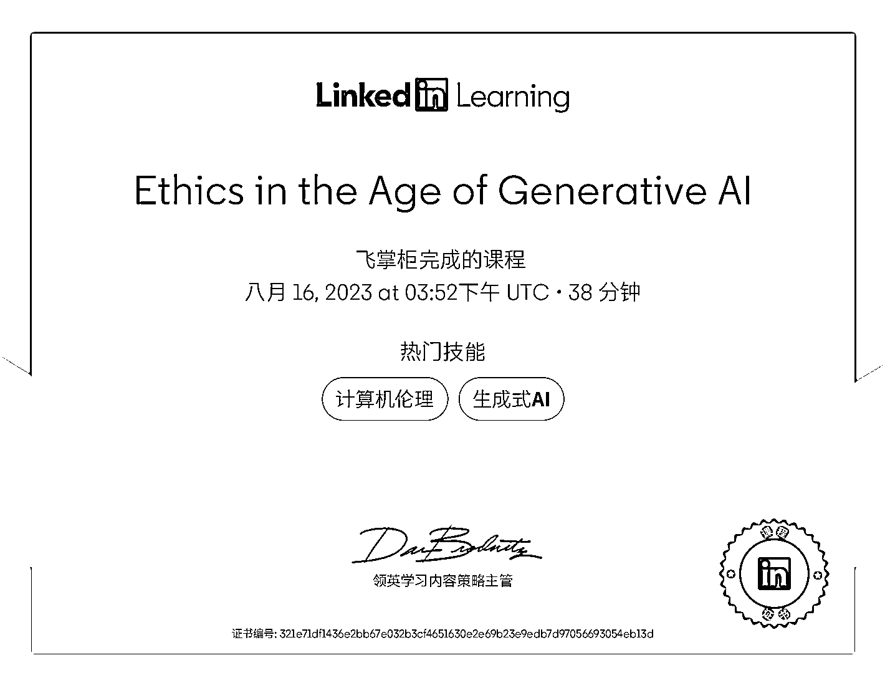
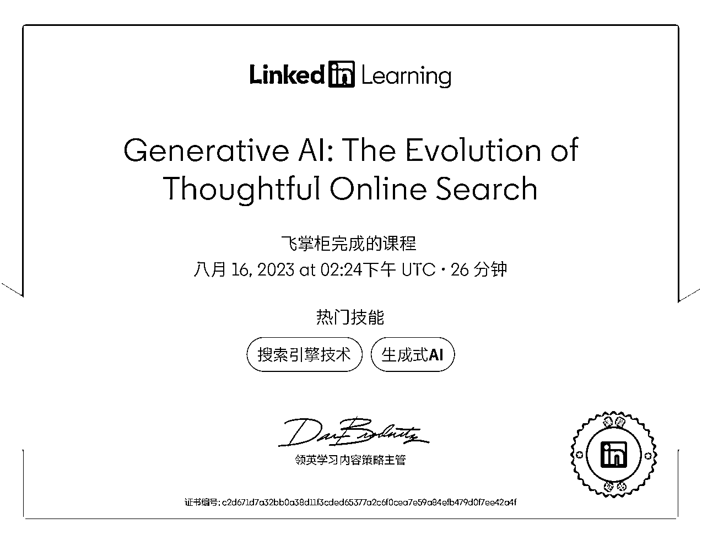
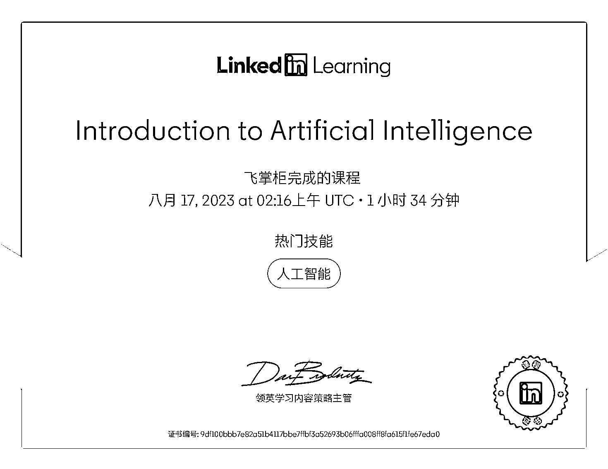
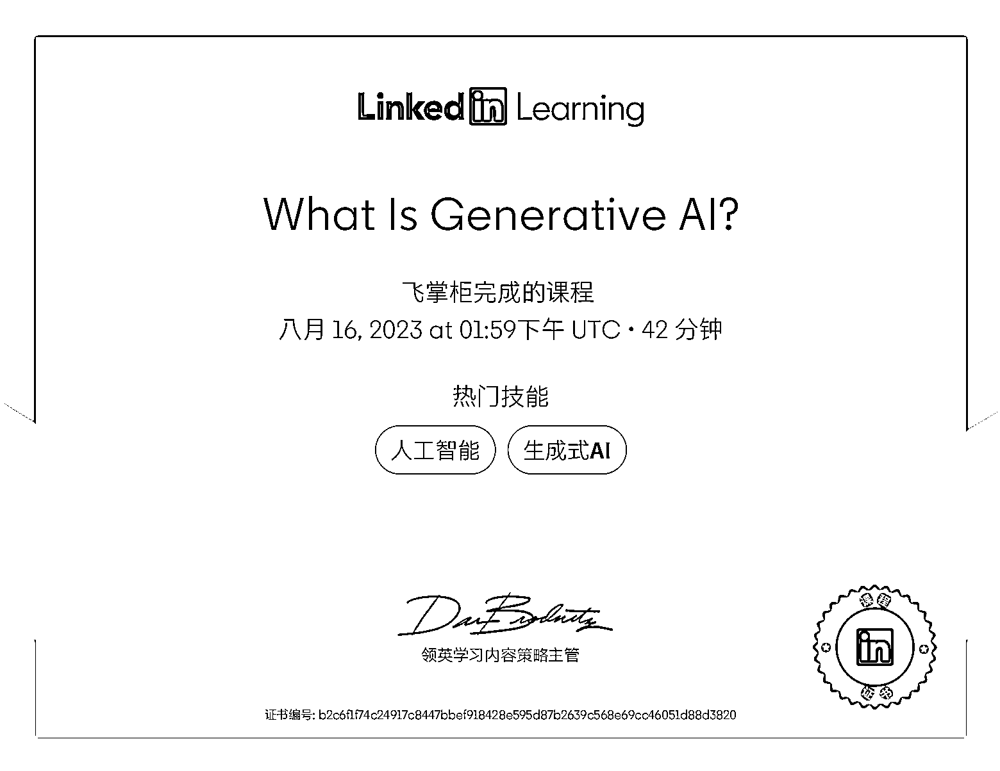

# 2 个半小时搞定微软×领英「生成式人工智能职业证书」实战笔记

## 53 个赞 · 快速拿到微软和领英联合推出的生成式 AI 职业证书的打法分享

作者：飞掌柜  
发布时间：2023-10-17

【一条龙攻略】手把手带你速通微软与领英共推的「生成式人工智能职业证书」！

哈喽，这里是飞掌柜。今天就把我这份拿证心得摊开来讲。整个流程里我主要靠 GPT-3.5 和 Claude 辅助，所以就算没有 4 系列模型的同学也能照着做，门槛很低。

提醒一下，这场考核总共只有三次答题机会。正因为次数有限，我琢磨出了一套约 2.5 小时刷完视频、完成测验并一次性过的节奏。但快不代表水，拿证这件事本身依然有价值，请务必记住下面三条原则：

1、课程视频和章节小测验的内容真的值得细嚼慢咽，认真跟完就能带走不少实用的 AI 知识，考试也就自然水到渠成；

2、我会把 Claude 和 ChatGPT 用来帮忙过小测和正式考题，主要有两个考量：一是省时间，原版学习时长 3 小时 49 分，再加上至少 30 分钟的小测和 1 小时 40 分的结业考，全程下来很可能占掉你一整天；二是想实测一下，用生成式 AI 去解生成式 AI 的考题，命中率到底如何；

3、模型给出的解析默认是中文，我的建议是别直接抄，先通读一遍。翻译、审题、复制粘贴的每一步其实都是在加深理解，必须过一遍脑子。这样才能把效率拉到最高。我亲测全身心投入两个半小时左右，足够把全部内容啃完并顺利过关。

【报考入口】需要🪜，并准备好 Google 邮箱或微软邮箱使用

* * *

评论区互动：

金泽 : 工信部认证的人工智能 AICG 专业级证书可找我咨询[耶]

阿法 : 这张证书能用来抵扣个税吗

飞掌柜 : 大概率是不行的😂

暖安 : 太给力了，感谢分享

飞掌柜 : 不客气啦，建议抓紧时间拿下，现在难度还算友好

飞掌柜 : [强]

波本零 : 想问下这个证书实际有什么用途

飞掌柜 : 点开上方的官方链接，介绍里有详细说明

* * *