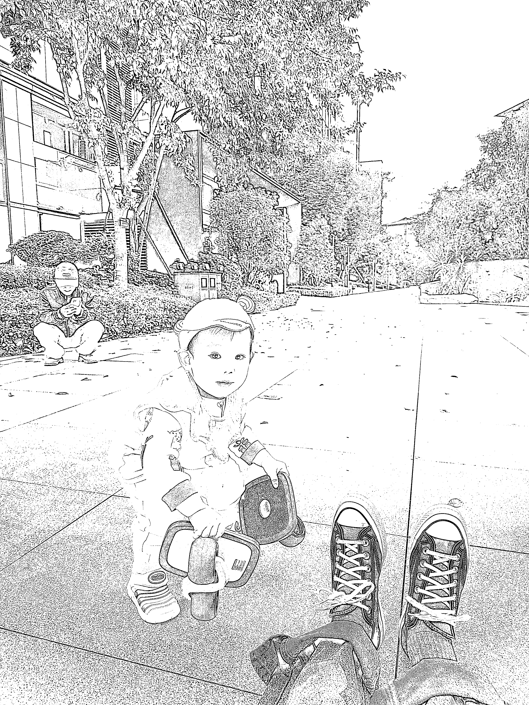

别再埋头傻写了！你的思维没进步，是因为没搞懂这三个台阶

有一种很常见的困惑：天天都在写，写了好几年，依然觉得没什么长进。

问题出在哪？不是写得不够多，而是没有用对方法。

今天这篇，我想从三个角度拆开讲讲：不同写法的差别，不同练法的差别，以及思维跃迁的三个台阶。

先看四类“从念头到落笔”的路径。

第一类，脑子里冒出什么，就原封不动倒出来。这种模式非常顺畅，但也正因为顺畅，它几乎没动用到思考，只是把现成的想法搬上屏幕，对表达熟练度有点帮助，对思维几乎没有锻炼。

第二类，定好主题后，不急着写，先逼自己把问题拆开：有哪些侧面？深层原因是什么？各要素之间怎么连起来？把碎片拼成结构后再动笔。这样写一次，思考就升级一次。坚持一年，你的思维结构会和多数人完全不同。

第三类，定好主题后，先不闷头想，而是去查资料、读文献、找案例，让外部信息进来，再组织输出。每一次这样写，都是在拓宽自己的认知疆域，写出来的东西里会混入原来不知道的东西。

第四类，两件事都做：先进行独立推演，再带着问题出去找答案，最后把内外两条线拧成一股绳。这样既不会闭门造车，也不会丧失自己的判断。

这里特意说明：以上讨论的是“写”对思维的影响，不是文笔提升，也不是作品好坏。

再看两类落笔姿态。

一类是自然流。想到哪个词用哪个词，像讲话一样痛快，一小时能出几千字。可写得太顺，就意味着没有遇到阻力，能力成长自然有限。

另一类是雕刻流。每写一个句子，都要反复打磨：这个动词是否准确？这个比喻是否精彩？换一种说法会不会更有力？慢是慢，一小时可能写不完两百字，但每个字都在训练你对手艺的敏感度。慢，其实是另一种快。

接着是两种练法的差异。

一种练习是纯凭手感，怎么舒服怎么来。这叫重复，不叫练习。因为练是训练，习是学习，只有把学到的东西变成训练动作，才叫练习。不带着方法写的次数再多，也只是在原地转圈。

另一种练习是刻意带着方法。拟标题的时候，就按标题的套路来；设计开篇的时候，就用开头的模板来；安排结构的时候，就对照框架的清单来。每写一步都像在做题，速度和舒适感都下降，但每一次下笔都是对能力的修正，所以成长更扎实。

最后，我来说说让思维功力倍增的三个台阶。

初级台阶，记事层。你写的内容只是对某件事的如实还原：去了哪里、做了什么、花了多少钱。就像有人在出差日记里写：以前住几百块一晚的酒店，现在收入涨了十倍，依然舍不得订头等舱。写完就完了，没有总结，没有提炼。这一层对思维的拉动几乎为零。

中级台阶，提炼层。你先讲一个故事，然后从故事里拎出一个明确的观点。故事是证据，观点是主角。每写一个故事，都得主动问“它说明了什么”，思考浓度立刻上来。比如有人在自驾游路上发现：伴侣的父母如果习惯互相陪伴、互相照看，那么伴侣也会用同样的方式对待自己。于是给出一个关于选对象的判断方法：想知道对方将来会怎么对你，就去观察他/她父母平时如何相处。这就是“故事+观点”的写法。

高级台阶，迁移层。你不满足于就事论事的观点，而是从一件详细的事里，抽取出能指导很多事情的普遍规律。这个层级对脑力的要求最高，也最值钱。比如还是那个演员的例子：一个出身底层、没读过几年书的小伙子，却从早年起就始终相信自己能成为大明星，并且把这种相信落实到每一天的行动里，连看剧本都要随身带本字典查字。很多人说他能吃苦，但吃苦只是他外在的行为，真正支撑他走出来的是“敢信”的能力。如果文章写到这里就结束，那只是中级台阶；但把它上升为“一个人这辈子能得到什么，不会超过他心里真正相信的边界”，就进入了高级台阶。这句话可以用来解释职业选择、亲密关系、财富积累，适用面广得多。

如果你每写一篇，都逼自己从初级台阶往上爬，一两年后思维的深度和锐度，十倍增长不是梦。

今天就聊到这儿，觉得有用的话，记得点个赞。

评论区精选：

读者甲：相信的力量，太燃了。
读者乙：因为相信，所以看见。
读者丙：那个出差住宿的例子，结论到底是啥？等得好急。
读者丁：同问，蹲个答案。
读者戊：人25岁后的消费偏好基本固定。巴菲特照样喝可乐，那个卖矿的老板有了三亿现金，还是只爱吃回锅肉。不是花不起，是觉得没必要。
读者己：消费偏好也是一种惯性。
读者庚：关于“看对方父母就能预测未来”的说法，我不太认可。我父母关系一般，但我自己恋爱时，并没有复刻我爸对我妈的方式。
读者辛：谢谢分享，准备实践。以前总觉得自己写不出东西，其实是少了深度思考。还想请教一下，从“概括观点”到“提炼原则”，有没有可操作的方法？

